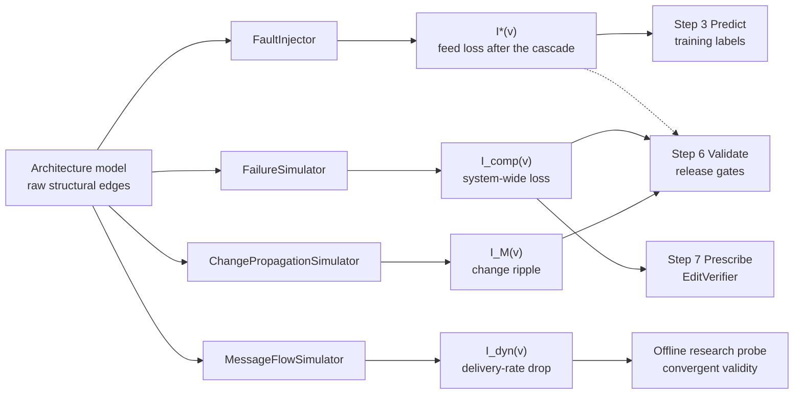
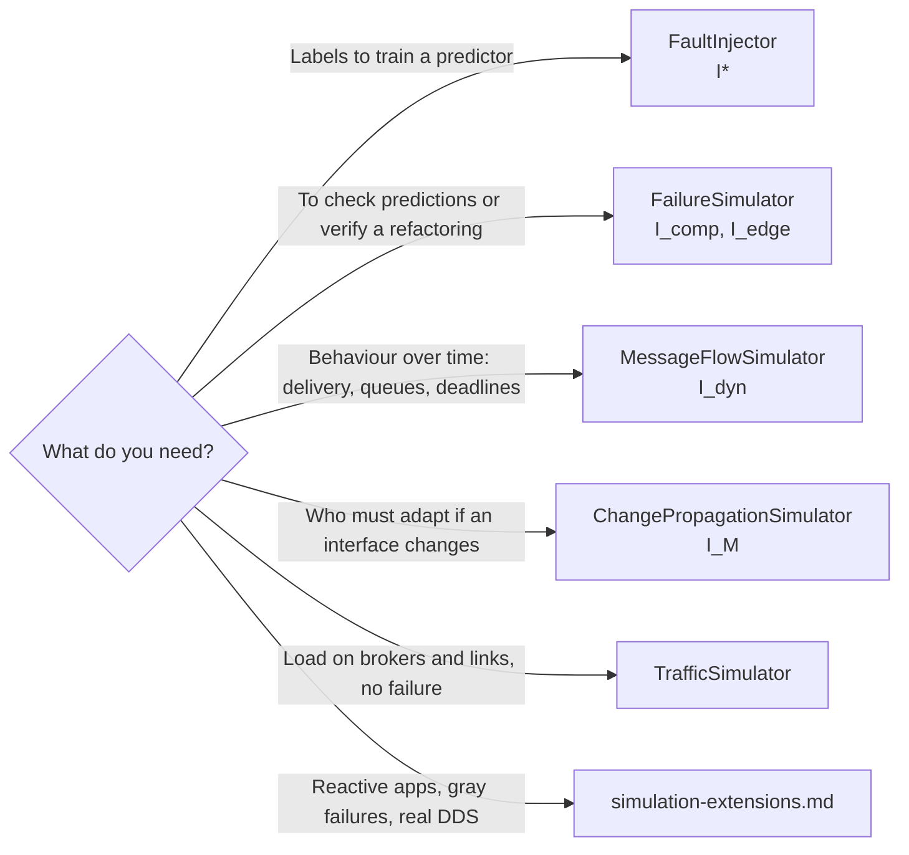
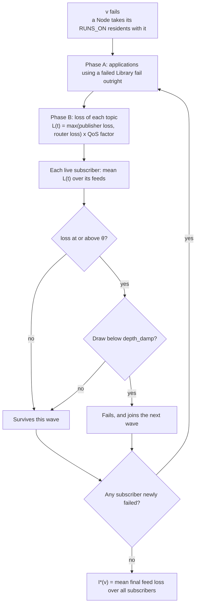
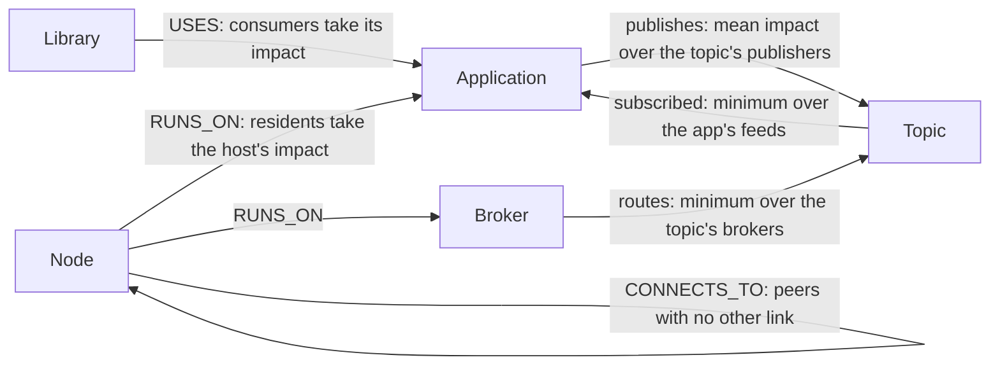
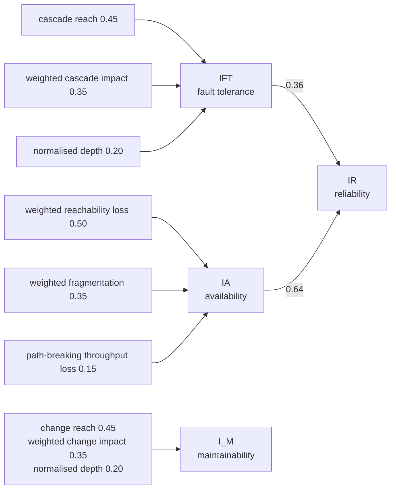
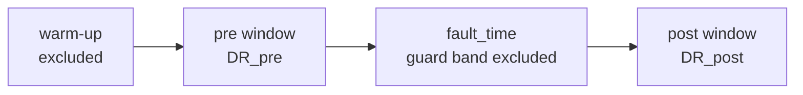
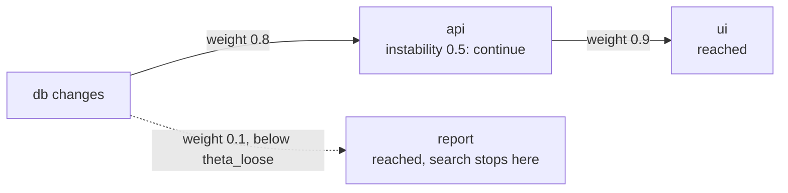
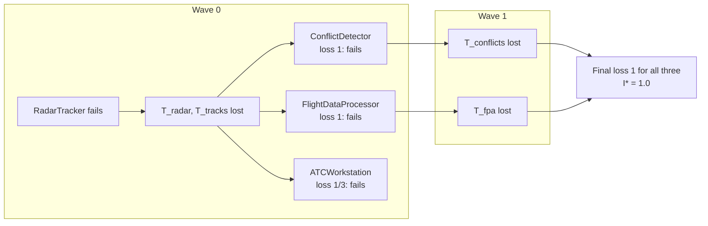

# Step 5: Simulate

**Inject failures into the architecture model and measure what the rest of the system loses.** The measured losses are the ground truth used to train predictors (Step 3), to check them (Step 6) and to verify refactorings (Step 7).

← [Step 4: Diagnose](diagnosis.md) | [README](../README.md) | **Step 5: Simulate** | → [Step 6: Validate](validation.md)

---

## Contents

**Start here:** [1. What this step does](#1-what-the-simulation-step-does) · [2. Which engine?](#2-which-engine-do-i-need) · [3. Rules](#3-rules-that-hold-everywhere)

**Engines:** [4. `FaultInjector`](#4-faultinjector-cascade-labels-i) · [5. `FailureSimulator`](#5-failuresimulator-multi-layer-quality-oracle-i_comp) · [6. `MessageFlowSimulator`](#6-messageflowsimulator-queue-flow-oracle-i_dyn) · [7. `ChangePropagationSimulator`](#7-changepropagationsimulator-maintainability-reference-i_m) · [8. Supporting engines](#8-supporting-engines) · [9. Deployment options](#9-shared-deployment-options)

**Beyond the published labels:** [10. Opt-in extensions](#10-opt-in-extensions-overview), detailed in [simulation-extensions.md](simulation-extensions.md)

**Reference:** [11. Command line and REST](#11-command-line-and-rest-api) · [12. Output files](#12-output-files) · [13. Worked examples](#13-worked-examples) · [14. Research context](#14-research-context) · [15. Limitations](#15-known-limitations)

---

## 1. What the simulation step does

Before a system is deployed there are no crash logs to learn from. SaG therefore fails each component of the declared architecture in turn, propagates the consequences through the model, and records the damage. That damage, a per-component **impact score**, stands in for the missing operational history.

Each engine measures a different kind of damage, and each feeds a different pipeline step:



The dotted arrow is the CLI benchmark in Step 6. I_M runs inside the `FailureSimulator` sweep ([§7](#7-changepropagationsimulator-maintainability-reference-i_m)) and is never a training label.

**The raw-edge rule.** The engines measure on the **raw structural graph** (`PUBLISHES_TO`, `SUBSCRIBES_TO`, `ROUTES`, `RUNS_ON`, `USES`, `CONNECTS_TO`). They never consume the `DEPENDS_ON` edges that Step 2 derives for the predictors, so a label cannot be a restatement of a predictor's input. Two engines need dependency arcs, and build their own:

- `ChangePropagationSimulator` receives edges that `SimulationGraph.get_dependency_edges()` **re-derives from the raw edges**, using the same seven rules as the repositories (`tests/test_simulation_dependency_derivation.py`).
- `FaultInjector` derives arcs on its private copy of the graph from `PUBLISHES_TO`, `SUBSCRIBES_TO` and `USES`, and follows only the application-to-library ones. One caveat: a graph that already contains `DEPENDS_ON` edges is used as given and nothing is derived. The scenario corpus declares none.

---

## 2. Which engine do I need?



| Engine | Question it answers | Output | Cost on `atm_system` / `av_system` (74 / 152 nodes) |
|:---|:---|:---|:---|
| `FaultInjector` | If *v* dies, which subscribers starve? | I\*(v) | 0.08 s / 0.35 s for a 5-seed sweep of Applications, Brokers and Libraries |
| `FailureSimulator` | What is the systemic loss across hosts, brokers, libraries and links? | I_comp(v), I_edge(u,v) | 0.06 s / 0.45 s for an exhaustive sweep |
| `MessageFlowSimulator` | How do delivery, queues and deadlines behave over time when *v* fails? | I_dyn(v), golden signals | 1.5 s / 4.3 s **per failed component** (60 simulated seconds) |
| `ChangePropagationSimulator` | If *v*'s interface changes, what must adapt? | I_M(v) | milliseconds; runs inside the `FailureSimulator` sweep |
| `EventSimulator` | Which paths are live in the healthy system? | baseline flows | milliseconds; primes `FailureSimulator` |
| `TrafficSimulator` | What load does a topic set put on brokers and network? | bandwidth and message rates | closed form; backs the REST traffic endpoint |

Timings are medians of three runs on an idle machine (2026-11). Treat them as orders of magnitude.

**Quick start.** Label a scenario, then probe one failure dynamically. Results land in `output/simulation/` ([§12](#12-output-files)).

```bash
python cli/simulate_graph.py fault-inject --input data/scenarios/atm_system.json --export-json
python cli/simulate_graph.py message-flow --input data/scenarios/atm_system.json --duration 60 --fault-node A0 --export-json
```

---

## 3. Rules that hold everywhere

1. **Oracles are not interchangeable.** I\*, I_comp, I_dyn and I_M measure different things on different scales; only their rank agreement is comparable. `FaultInjector` is the Predict-stage labeller and `FailureSimulator` the Validate-stage oracle. Using one in the other's place is a contract violation (`tests/test_groundtruth_contract.py`). Every result must say which oracle produced it.
2. **Raw edges only** ([§1](#1-what-the-simulation-step-does)). The simulation package also may not import the prediction and quality-scoring classes (`tests/test_independence_guarantee.py`).
3. **Simulation is offline.** Step 3 reads labels from disk and never imports the simulators (`tests/test_predict_simulate_separation.py`). Step 4 (Diagnose) has no simulation access at all.
4. **Defaults are the published engines.** Every [extension](#10-opt-in-extensions-overview) is opt-in. `tests/test_simulation_golden_defaults.py` pins the default I\*, I_dyn, I_comp and I_M outputs bit for bit (I_comp and I_M at `PYTHONHASHSEED=0`), so an extension cannot leak into the published oracles.

---

## 4. `FaultInjector`: cascade labels I\*

Source: [`saag/simulation/fault_injector.py`](../saag/simulation/fault_injector.py). This is the Predict-stage labeller.

**What it answers.** *If component v fails, how much of their input do the subscribers lose once the failure has cascaded?*

**How it works.** The cascade runs in waves, and stops at the first wave in which nothing new fails:



- **Topic loss.** Publisher loss is the rate-weighted share of the topic's publishers that have failed. Router loss is the share of its routing brokers that have failed (½ when one of two brokers dies). A failed topic loses everything. The QoS factor multiplies the loss, which is then clamped to 1; the default `ladder` gives ×1.2 for RELIABLE, ×1.15 for high priority and ×1.05 for medium.
- **Failure rule (`failure_model="step"`, published).** A subscriber whose loss reaches θ (`propagation_threshold`, default 0.2) fails with probability `depth_damp = max(0.25, 1 − 0.15 · wave)`.
  - Wave 0 is therefore deterministic.
  - How far past θ the loss goes never matters. The code writes the probability as `min(1, loss/θ) · depth_damp`, but that branch is only reached when loss ≥ θ, so the first factor is always 1.
  - A surviving subscriber is redrawn on every later wave.

$$I^*(v) = \frac{1}{|\mathcal{S}|}\sum_{s \in \mathcal{S}} \text{loss}(s) \qquad \text{over all subscribers } \mathcal{S}$$

I\* is 0 when nobody loses anything and 1 when every subscriber loses every feed. A subscriber counts its feed loss, not its own failure, so a pure sink, such as an application that only subscribes, always scores 0.

**Options**

| Option | Default | Effect |
|:---|:---|:---|
| `seeds` | `[42]` in code; `RECOMMENDED_SEEDS` (5 seeds) on the CLI | Labels are seed means; `impact_score_std` is the spread |
| `propagation_threshold` | 0.2 | Raise toward 1.0 for "fail only when starved" |
| `qos_factor_mode` | `ladder` | `wt`: scale by the topic weight w(t), which includes durability; `none`: topology only (the label-ablation arm) |
| `failure_model` | `step` | `threshold_cdf`: each subscriber draws a tolerance θ_s ~ U(0.1, 0.5) once per seed and is redrawn only when its loss rises. Averaged over seeds, P(fail) = F_θ(loss) · depth_damp, so the cliff at θ becomes a smooth curve. |
| `network_gating`, `replica_aware` | off | See [§9](#9-shared-deployment-options) |
| `node_types` | `Application, Broker` in code; the CLI adds `Library` | Types left out are listed in `unlabeled_node_ids`, never scored 0. `Topic` and `Node` can be labelled: a failed topic silences its subscribers, and a failed host takes its residents with it. |

**Run it**

```python
from pathlib import Path
from saag.core.graph_io import load_graph
from saag.simulation.fault_injector import FaultInjector, RECOMMENDED_SEEDS

graph = load_graph(Path("data/scenarios/atm_system.json"))
result = FaultInjector(graph, seeds=RECOMMENDED_SEEDS).run(node_types=["Application", "Broker"])
result.save(Path("output/simulation/impact_scores.json"))

top = result.top_k_by_impact[0]
print(top["node_id"], top["impact_score"], result.label_stability["test_retest_spearman"])
```

```bash
python cli/simulate_graph.py fault-inject --input data/scenarios/atm_system.json --seeds 42,123,456,789,2024 --export-json
```

**Output:** `impact_scores.json` ([§12](#12-output-files)). Its `label_stability` block (mean and maximum seed spread, worst pairwise test-retest ρ, worst top-K Jaccard) bounds any correlation computed against these labels. A type whose labels are all 0 is reported in `degenerate_node_types`; `strict_labels=True` turns that into an error.

---

## 5. `FailureSimulator`: multi-layer quality oracle I_comp

Source: [`saag/simulation/failure_simulator.py`](../saag/simulation/failure_simulator.py). This is the Validate-stage oracle; it is never a training label.

**What it answers.** *What does the system as a whole lose when v fails, across hosts, brokers, topics and libraries?*

**How it works.** Each component carries an **impact between 0 and 1** (1 = failed). A queue walks the rules below, each one raising impact on its targets, until nothing rises or the depth limit (10) is reached:



The two minimums express redundancy: a surviving peer broker keeps a topic up, and one healthy feed keeps a subscriber up. A subscriber here is starved only when all its feeds are impaired, unlike `FaultInjector`'s mean feed loss.

Topic impact is also scaled by the topic's weight w(t). Logical rules fire with probability equal to the edge's QoS weight w(e) when one is recorded, and `cascade_probability` otherwise. Physical and network rules use `cascade_probability`. Runs are seeded per component, so a sweep is reproducible.

**The scores.** Four losses are combined with AHP-derived default weights:

$$I_{\text{comp}}(v) = 0.35\,\text{RL} + 0.25\,\text{FR} + 0.25\,\text{TL} + 0.15\,\text{FD}$$

| Term | Meaning |
|:---|:---|
| RL, reachability loss | Share of publisher-to-subscriber paths severed: 1 − paths_after / paths_before |
| FR, fragmentation | 0.70 · Δ connected components + 0.30 · Δ stranded mass |
| TL, throughput loss | Share of QoS-weighted message bandwidth lost |
| FD, flow disruption | Share of healthy `(publisher, topic, subscriber)` flows broken. The baseline flows come from [`EventSimulator`](#8-supporting-engines) (`SimulationService._prime_baseline_flows`). |

The sweep also fills in the quality decomposition the validation gates are written against:



### Edge criticality

Removing one relationship while both endpoints stay up gives

$$I_{\text{edge}}(u,v) = \max\bigl(0,\; I_{\text{comp}}(G \setminus \{(u,v)\}) - I_{\text{comp}}(G)\bigr).$$

Both terms are single measurements with **no cascade**: the question is what this link carries, and cascades belong to the node labels. The sweep measures only a bounded candidate set, the bridges plus the top-q edges by betweenness. The CLI subcommand is `edge-criticality`.

### Options

| Option | Default | Effect |
|:---|:---|:---|
| `qos_weighting` | on | Off: the topology-only oracle arm |
| `failure_mode` | `CRASH` | `DEGRADED`: the target keeps half its capacity and skips the library blast. `PARTITION`: a crash without the physical cascade. `OVERLOAD` is a declared stub with no behaviour of its own; it runs as `CRASH`. |
| `cascade_rule` | `ALL` | Restrict to `PHYSICAL`, `LOGICAL`, `NETWORK` or `LIBRARY` |
| `cascade_probability` | 1.0 | See above; below 1.0 it is what makes Monte Carlo trials differ |
| `library_cascade_probability` | `None` | Falls back to `cascade_probability` |
| `network_gating`, `replica_aware` | off | See [§9](#9-shared-deployment-options) |

### Run it

`SimulationService` loads the graph and offers several ways to run the engine:

| Method | What it runs |
|:---|:---|
| `run_failure_simulation_exhaustive(layer)` | Every component of the layer, one at a time. `system` covers Application, Broker and Node. |
| `run_failure_simulation_pairwise(layer)` | Every pair of components failing together |
| `run_failure_events({name: targets})` | Named joint outages, such as a whole failure domain |
| `run_failure_simulation(target_ids)` | One seeded scenario; the targets fail together |
| `run_failure_simulation_monte_carlo(target_id, n_trials=100)` | Repeated trials; returns mean, spread and 95 % interval |

All of them prime the baseline flows first, so the FD term is live.

```python
import json
from pathlib import Path
from saag.infrastructure.memory_repo import MemoryRepository
from saag.simulation.service import SimulationService

repo = MemoryRepository()
repo.save_graph(json.loads(Path("data/scenarios/atm_system.json").read_text()), clear=True)
results = SimulationService(repo).run_failure_simulation_exhaustive(layer="system")

for r in sorted(results, key=lambda r: -r.impact.composite_impact)[:3]:
    print(r.target_id, r.target_type, round(r.impact.composite_impact, 3),
          round(r.impact.maintainability_impact, 3))
```

---

## 6. `MessageFlowSimulator`: queue-flow oracle I_dyn

Source: [`saag/simulation/message_flow_simulator.py`](../saag/simulation/message_flow_simulator.py). It requires SimPy (extra `sim`).

**What it answers.** *When v fails, how much less traffic gets through, once rates, bounded queues, contention and QoS contracts are taken into account?*

**How it works.** The engine models simulated time. Publishers emit at their topic's declared rate, split evenly among the topic's publishers. Each subscriber has a private bounded queue **per topic**, so one busy topic cannot block another, but all its topics share **one service station** (its CPU), which is where contention arises.


**The impact score.** The fault splits the run into two windows. Each message is assigned to a window by its **creation time**, for demand and for delivery alike. `fault_time` defaults to half the duration; the warm-up and guard band default to 0 s.



$$I_{\text{dyn}}(v) = \text{DR}_{\text{pre}} - \text{DR}_{\text{post}}, \qquad \text{DR} = \frac{\text{delivered}}{\sum_t \text{published}(t)\cdot|\text{sub}(t)|}$$

- The failed component's own receipts, and its share of the fan-out, are left out of both windows.
- A silenced publisher's demand stays in the denominator.
- I_dyn is **not clamped**. Removing a high-rate publisher relieves contention for everyone else, and a negative value is a real measurement.
- **Latency is deliberately left out.** In the same contention-relief situation, latency and deadline misses *fall* after the fault: their changes correlate negatively with I_dyn (ρ = −0.499 and −0.418; [§14](#14-research-context)). A score that added latency to delivery loss would cancel out exactly when a high-rate publisher fails.

The **golden signals** are reported alongside it for triage, for the whole run and for each window: latency (p50/p95/p99, split into queue wait and service), traffic (published and delivered rates, bytes), errors (deadline drops, overflows, unserved demand) and saturation (utilisation, queue depth and occupancy).

**QoS enforcement**, under the default `qos_mode="full"`:

| Policy | What the engine does | DDS meaning, if different |
|:---|:---|:---|
| Reliability RELIABLE | Full queue drops the **oldest** sample (head-drop) | same (KEEP_LAST) |
| Reliability BEST_EFFORT | Full queue drops the **new** sample | KEEP_LAST would replace the oldest |
| `history_depth` | Becomes the queue capacity | same |
| `transport_priority` | Orders service at the station | — |
| `deadline_ms` | A sample whose end-to-end latency exceeds it is **dropped** | DEADLINE is a *period* contract (a new sample at least this often) and drops nothing. Dropping on age is LIFESPAN. |
| durability | Retained samples are replayed to surviving readers after a publisher outage (`recovery` and `full` modes) | — |

`qos_mode` selects which policies apply: `none` neutralises them but keeps the load, `contracts`, `recovery`, `full`, and `legacy` (the pre-QoS engine, uncalibrated). The deadline rule is the engine's largest source of non-structural loss; the [DDS arm](simulation-extensions.md#2-dds-qos-semantics-and-status-metrics) measures the difference.

**Load calibration.** QoS contracts only bind under contention. The engine sizes each subscriber's mean service time from its offered load Λ_s so that it *targets* utilisation ρ = 0.65 (`target_utilization`): E[S_s] = ρ / Λ_s. Below about 0.2 nothing queues; above about 0.85 queues explode into noise.

The realised utilisation is reported per subscriber in `measured_utilization`, and it lands unevenly. On `atm_system` the 60 s run in [§12](#12-output-files) averages 0.37, with A0 at 0.29. Check it before relying on the operating point.

**Timing.** The CLI default is 100 simulated seconds, and the study uses 60 (fault at 30). A sweep needs one run per candidate, which is why I_dyn is an offline probe and I\* the training label.

**Run it**

```python
from pathlib import Path
from saag.core.graph_io import load_graph
from saag.simulation.message_flow_simulator import MessageFlowSimulator

graph = load_graph(Path("data/scenarios/atm_system.json"))
result = MessageFlowSimulator(graph, duration=60.0, fault_node="A0", fault_time=30.0,
                              seed=42, qos_mode="full", target_utilization=0.65).run()
result.save(Path("output/simulation/message_flow_results.json"))

fe = result.fault_event
print(f"I_dyn(A0) = {fe.i_dyn:.4f}  (delivery {fe.delivery_rate_before:.3f} -> {fe.delivery_rate_after:.3f})")
```

```bash
python cli/simulate_graph.py message-flow --input data/scenarios/atm_system.json --duration 60 --fault-node A0 --fault-time 30 --qos-mode full --target-utilization 0.65 --export-json
```

The convergent-validity study across all scenarios is `PYTHONPATH=. python reproduce/convergent_validity.py`.

---

## 7. `ChangePropagationSimulator`: maintainability reference I_M

Source: [`saag/simulation/change_propagation.py`](../saag/simulation/change_propagation.py).

**What it answers.** *If v's interface changes at development time, which components have to adapt?*

**How it works.** If *u* depends on *v*, a change to *v* may force *u* to change, so the change travels **against** the dependency direction, on the transposed graph Gᵀ. Breadth-first search from *v* counts every direct dependent as reached, because it may have to adapt. The search does not continue *through* a dependent when either of these holds:

- **loose coupling:** the dependency weight is below `theta_loose`, default 0.20;
- **stable interface:** the dependent's instability, out-degree / (in-degree + out-degree), is below `theta_stable`, default 0.20.



The simulator returns three sub-metrics, which `ImpactMetrics.maintainability_impact` combines:

$$I_M(v) = 0.45\cdot\text{change reach} + 0.35\cdot\text{weighted change impact} + 0.20\cdot\text{normalised depth}$$

**Where it runs.** `FailureSimulator`'s maintainability post-pass calls it with the dependency edges that `SimulationGraph` re-derives from raw edges, and with their degrees. The result appears as `impact.maintainability_impact` on every sweep result (see the [§5 example](#run-it)).

**Directly**, this reproduces the diagram:

<!-- doc-test: assert -->
```python
from saag.simulation.change_propagation import ChangePropagationSimulator

# (u, v, w): u depends on v with weight w
edges = [("ui", "api", 0.9), ("api", "db", 0.8), ("report", "db", 0.1)]
in_deg, out_deg = {"api": 1, "db": 2}, {"ui": 1, "api": 1, "report": 1}
res = ChangePropagationSimulator().simulate_all(
    ["ui", "api", "db", "report"], edges,
    component_in_degrees=in_deg, component_out_degrees=out_deg)
assert sorted(res["db"].reached_components) == ["api", "report", "ui"]
assert res["api"].reached_components == ["ui"]
```

Pass the degrees. Without them every instability is 0, so every dependent counts as stable and the search stops after one hop.

---

## 8. Supporting engines

**`EventSimulator`** ([`event_simulator.py`](../saag/simulation/event_simulator.py)) is a dependency-free discrete-event loop (`heapq`). It models PUBLISH → ROUTE → DELIVER (→ ACK for RELIABLE) and DROP, with optional Poisson component failures, recoveries and message arrivals. Its job in the pipeline is to record the healthy flows that `FailureSimulator`'s FD term compares against. It can also be run on its own:

```python
import json
from pathlib import Path
from saag.infrastructure.memory_repo import MemoryRepository
from saag.simulation.service import SimulationService

repo = MemoryRepository()
repo.save_graph(json.loads(Path("data/scenarios/atm_system.json").read_text()), clear=True)
ev = SimulationService(repo).run_event_simulation("A0", num_messages=50)
print(ev.metrics.messages_published, ev.metrics.delivery_rate)
```

**`TrafficSimulator`** ([`traffic_simulator.py`](../saag/simulation/traffic_simulator.py)) is a closed-form estimate of message rates and bandwidth per topic and per broker for a chosen topic set. A topic's publish rate is its publisher count × frequency; the delivery rate multiplies that by the subscriber count, and bandwidth by the message size. It produces no impact score. It connects to Neo4j itself (constructor `uri`, `user`, `password`) rather than taking a repository, and backs the REST traffic endpoint (`api/routers/traffic.py`).

---

## 9. Shared deployment options

Two flags change how hosts, replicas and the network are treated. Both are off by default, and the published labels were produced without them. Both are accepted by `SimulationService(...)` and `GraphEvaluator(...)` too, and on the CLI as `--network-gating` and `--replica-aware`.

| Flag | `FaultInjector` | `FailureSimulator` | `MessageFlowSimulator` |
|:---|:---|:---|:---|
| `network_gating` | A feed the live CONNECTS_TO network no longer delivers counts as lost; hosts and `NetworkDevice`s get labels | Flows are routed over the live network (ECMP). Unreachable subscribers starve; congested links scale RL, TL and FD (they measure, they never fail anything) | With `deployment_model="stations"` only: reachability gates delivery |
| `replica_aware` | A host failure kills a resident only if **all** its hosts are down | A hosted component takes its least-impacted host's impact; a joint outage `FailureScenario(target_ids=[…])` kills replicas | When the [runtime engine](simulation-extensions.md#1-runtime-engine) is active: same rule as `FaultInjector` |

- **`network_gating`** needs a modelled network: `NetworkDevice` switches and routers, and `CONNECTS_TO` links with optional `capacity_mbps` ([graph-model.md §5.2](graph-model.md#52-phase-2-structural-topology--degree-augmentation); routing in [`saag/core/network.py`](../saag/core/network.py)). The corpus's sparse host mesh is not a complete network, which is why gating is opt-in. Without gating, a device failure only scores fragmentation, and a warning is logged.
- **`replica_aware`** addresses the default, under which a multi-hosted component dies when *any* of its hosts fails, making a replica a liability. With the flag on, only `Node` labels move. On a corpus without replicas the flag is a no-op (`tests/test_replica_aware.py`). Example, I\* with seeds 42/123/456: atm N0 0.396 → 0.000, av N1 0.947 → 0.032.

---

## 10. Opt-in extensions: overview

The published engines have structural limits: publishers ignore their inputs, so no failure travels more than one hop in `MessageFlowSimulator`; crash-stop is the only fault; QoS semantics are approximate; and nothing is compared with observed behaviour. The extensions address these. Each is off by default, so published numbers do not move.

| Extension | Turn on with | Engine | What changes |
|:---|:---|:---|:---|
| Smooth failure threshold | `failure_model="threshold_cdf"` | `FaultInjector` | P(fail) follows a tolerance distribution instead of a cliff ([§4](#4-faultinjector-cascade-labels-i)) |
| [Reactive behaviour](simulation-extensions.md#reactive-behaviour-behavior_modelreactive) | `behavior_model="reactive"` | `MessageFlowSimulator` | Apps publish only while their inputs are fresh, so failures propagate |
| [Deployment on the data path](simulation-extensions.md#deployment-on-the-data-path-deployment_modelstations) | `deployment_model="stations"` | `MessageFlowSimulator` | Brokers and host CPUs become stations; brokers and hosts are labelled |
| [Fault library](simulation-extensions.md#fault-library) | `faults=[FaultSpec, …]` | `MessageFlowSimulator` | Transient crashes, gray failures, storms, link flaps, hot standby |
| [Paired estimator, bursty workload](simulation-extensions.md#other-runtime-options) | `estimator="paired"`, `workload_model="mmpp"` | `MessageFlowSimulator` | Same-stream baseline; bursts with the declared mean rate |
| [Runtime labels](simulation-extensions.md#runtime-labels-runtime-sweep) | `saag-simulate runtime-sweep` | `MessageFlowSimulator` | Five labels with their order-k references |
| [DDS semantics and statuses](simulation-extensions.md#2-dds-qos-semantics-and-status-metrics) | `qos_semantics="dds"`, `dds_status=True` | `MessageFlowSimulator`, testbed | Period deadlines, KEEP_LAST, QoS matching; DDS status counts |
| [Emulated testbed](simulation-extensions.md#3-emulated-testbed-calibration-and-fidelity) | `saag-simulate testbed …` | — | Runs the scenario on real Cyclone DDS and compares it with the simulator |

---

## 11. Command line and REST API

**Command line.** The entry point is `cli/simulate_graph.py`, installed as `saag-simulate`. The full flag tables, with defaults, are in [cli-pipeline-guide.md, Step 5](cli-pipeline-guide.md#step-5-simulate).

| Subcommand | Engine | Writes |
|:---|:---|:---|
| `fault-inject` (the default) | `FaultInjector` | `impact_scores.json` |
| `edge-criticality` | `FailureSimulator` edge sweep | `edge_criticality.json` |
| `message-flow` | `MessageFlowSimulator` (one failure), including all runtime and DDS flags | `message_flow_results.json` |
| `runtime-sweep` | [Runtime engine](simulation-extensions.md#runtime-labels-runtime-sweep) over all candidates | `runtime_labels.json` |
| `testbed {build,run,calibrate,fidelity}` | [Emulated testbed](simulation-extensions.md#3-emulated-testbed-calibration-and-fidelity) | the testbed directory |
| `combined` | `fault-inject`, then `message-flow` | both |

```bash
python cli/simulate_graph.py edge-criticality --input data/scenarios/atm_system.json --top-q 20 --export-json
python cli/simulate_graph.py combined --input data/scenarios/atm_system.json --seeds 42,123,456 --duration 60 --fault-node A0 --export-json
```

The whole-pipeline CLI `saag` (`cli/run.py`) runs `SimulateGraphUseCase` instead, choosing the service method with `--sim-mode` (default `exhaustive`).

**REST API.** All endpoints are `POST` under `/api/v1/simulation` ([`api/routers/simulation.py`](../api/routers/simulation.py)), run on Neo4j, and take `credentials` in the body. `FaultInjector` and `MessageFlowSimulator` are not exposed.

| Endpoint | Body fields | Runs |
|:---|:---|:---|
| `/event` | `source_app`, `num_messages` (100), `duration` (10.0) | `EventSimulator` |
| `/failure` | `target_ids`, `layer` (`system`), `cascade_probability` (1.0) | `run_failure_simulation` |
| `/exhaustive` | `layer` (`system`), `cascade_probability` (1.0) | `run_failure_simulation_exhaustive` |
| `/report` | `layers` (`app`, `infra`, `system`) | `generate_report` |

`/failure` is seeded, and the API has no seed field. With `cascade_probability` below 1.0 it therefore returns the same single draw on every call, not a sample or an average. For a spread, use the Monte Carlo method, which no endpoint exposes yet.

---

## 12. Output files

### `impact_scores.json` (`fault-inject`)

<!-- schema: impact_scores -->
```json
{
  "schema_version": "2.2",
  "graph_id": "atm_system",
  "topology_fingerprint": "92670795fd37e398",
  "labeler": "FaultInjector",
  "labeler_config": {"failure_model": "step", "propagation_threshold": 0.2, "qos_factor_mode": "ladder",
                     "network_gating": false, "replica_aware": false},
  "seeds_used": [42, 123, 456, 789, 2024],
  "labeled_node_types": ["Application", "Broker"],
  "labeled_dimensions": ["composite", "reliability"],
  "unlabeled_node_ids": ["L0", "L1", "L2"],
  "degenerate_node_types": [],
  "label_stability": {"n_seeds": 5, "mean_std": 0.02014, "max_std": 0.129898,
                      "test_retest_spearman": 0.968807, "topk_jaccard": 0.666667},
  "top_k_by_impact": [{"rank": 1, "node_id": "B4", "node_type": "Broker", "impact_score": 0.7662}],
  "records": {
    "B4": {"node_type": "Broker", "impact_score": 0.7662, "impact_score_std": 0.0014,
           "cascade_depth": 2, "total_orphaned_topics": 21, "total_impacted_subscribers": 22,
           "seed_impact_scores": {"42": 0.7669, "2024": 0.7637}}
  }
}
```

Read labels from `records[*].impact_score`. `unlabeled_node_ids` lists nodes that were never injected; they are unmeasured, not zero.

`labeler_config` states every setting that changes a label, and `topology_fingerprint` hashes the topology the labels were measured on. `cli/train_graph.py` uses them to refuse the wrong file: labels from another topology, or labels that do not reproduce across seeds ([flags](cli-pipeline-guide.md#step-3b-train-gnn)).

### `message_flow_results.json` (`message-flow`)

<!-- schema: message_flow_results -->
```json
{
  "schema_version": "2.0",
  "graph_id": "atm_system",
  "simulation_duration": 60.0,
  "system_delivery_rate": 0.984,
  "qos_mode": "full",
  "target_utilization": 0.65,
  "utilization_mode": "per_subscriber",
  "measured_utilization": {"A0": 0.2917},
  "golden_signals": {
    "latency": {"p50_ms": 3.553, "p95_ms": 26.067, "mean_queue_wait_ms": 0.89},
    "errors": {"deadline_violations": 1559, "queue_overflows": 239},
    "saturation": {"cpu_utilization": 0.3682, "peak_queue_occupancy": 1.0}
  },
  "fault_event": {
    "fault_time": 30.0,
    "faulted_node_id": "A0",
    "delivery_rate_before": 0.9825,
    "delivery_rate_after": 0.7098,
    "i_dyn": 0.272716,
    "latency_p95_before": 19.11,
    "latency_p95_after": 23.62,
    "per_topic_i_dyn": {"T1": 1.0}
  }
}
```

`runtime_config` and `dds_status` appear only when a non-default option is set.

### Other files

| File | Written by | Contents |
|:---|:---|:---|
| `edge_criticality.json` | `edge-criticality` | Run metadata (`top_q`, `n_evaluated`, `n_nonzero`) and `edge_criticality`, one entry per candidate: `source`, `target`, `relationship`, `flow_impact`, `connectivity_impact`, `combined_impact` (= I_edge), `level`, `evaluated` |
| `runtime_labels.json` | `runtime-sweep` | [Runtime labels](simulation-extensions.md#runtime-labels-runtime-sweep) |
| Testbed directory | `testbed` | [Plan, telemetry, profile and fidelity report](simulation-extensions.md#3-emulated-testbed-calibration-and-fidelity) |

---

## 13. Worked examples

### Air traffic management, by hand

<!-- doc-test: assert -->
```python
import networkx as nx
from saag.simulation.fault_injector import FaultInjector

g = nx.DiGraph()
for app in ("RadarTracker", "ConflictDetector", "FlightDataProcessor", "ATCWorkstation"):
    g.add_node(app, type="Application")
g.add_node("ASTERIX_Broker", type="Broker")
for t in ("T_radar", "T_tracks", "T_fpa", "T_conflicts"):
    g.add_node(t, type="Topic")
    g.add_edge("ASTERIX_Broker", t, type="ROUTES")
for u, v, kind in [
    ("RadarTracker", "T_radar", "PUBLISHES_TO"), ("RadarTracker", "T_tracks", "PUBLISHES_TO"),
    ("ConflictDetector", "T_radar", "SUBSCRIBES_TO"), ("ConflictDetector", "T_tracks", "SUBSCRIBES_TO"),
    ("FlightDataProcessor", "T_tracks", "SUBSCRIBES_TO"), ("ATCWorkstation", "T_tracks", "SUBSCRIBES_TO"),
    ("FlightDataProcessor", "T_fpa", "PUBLISHES_TO"), ("ATCWorkstation", "T_fpa", "SUBSCRIBES_TO"),
    ("ConflictDetector", "T_conflicts", "PUBLISHES_TO"), ("ATCWorkstation", "T_conflicts", "SUBSCRIBES_TO"),
]:
    g.add_edge(u, v, type=kind)

records = FaultInjector(g, seeds=[42, 123, 456, 789, 2024]).run().records
scores = {n: round(r.impact_score, 4) for n, r in records.items()}
assert scores == {"RadarTracker": 1.0, "ASTERIX_Broker": 1.0, "ConflictDetector": 0.1111,
                  "FlightDataProcessor": 0.1111, "ATCWorkstation": 0.0}
assert records["RadarTracker"].cascade_waves[0].newly_failed_publishers == [
    "ATCWorkstation", "ConflictDetector", "FlightDataProcessor"]
```

Failing `RadarTracker` takes two waves. All three subscribers fail in the first one, including `ATCWorkstation`, whose loss of 1/3 is already above θ = 0.2. The topics they publish go silent in the second:



| Component | I\* | Cascade depth | Why |
|:---|:---|:---|:---|
| `RadarTracker` | 1.000 | 2 | Sole source of radar and tracks, as drawn above |
| `ASTERIX_Broker` | 1.000 | 1 | Sole router of every topic, so all feeds are lost in wave 0 |
| `ConflictDetector` | 0.111 | 1 | `ATCWorkstation` loses 1 of its 3 feeds: loss 1/3, averaged over the 3 subscribers |
| `FlightDataProcessor` | 0.111 | 1 | Same |
| `ATCWorkstation` | 0.000 | 0 | A pure sink: its failure harms no other subscriber |

### One system, three oracles: `av_system`

These values are computed on the current corpus (152 nodes, 730 edges): I\* with 5 seeds, I_comp exhaustive, and I_dyn from single-seed 60 s runs. Values are means per type.

| Type | Count | I\* | I_comp | I_dyn |
|:---|:---|:---|:---|:---|
| Node (host) | 8 | 0.953 | 0.287 | — (not observable) |
| Library | 20 | 0.947 | — (not swept) | — (not observable) |
| Broker | 4 | 0.960 | 0.104 | — (not observable) |
| Application | 80 | 0.193 | 0.013 | 0.010 |

The oracles rank different strata. I\* puts libraries, brokers and hosts near the top, because each one's failure removes many feeds at once. I_comp emphasises hosts, through fragmentation and stranded capacity. I_dyn only sees components that carry traffic in the published engine; `deployment_model="stations"` makes brokers and hosts observable.

---

## 14. Research context

**Oracle names in the JSS manuscript (§4.3):**

| Engine | Name in the paper | Role in the paper |
|:---|:---|:---|
| `FaultInjector` | Cascade reachability oracle, I\* | Primary target |
| `FailureSimulator` | Multi-metric composite oracle, I_comp; relationship removal oracle, I_edge | Validate and Prescribe |
| `MessageFlowSimulator` | Dynamic queue-flow oracle, I_dyn | Second oracle; research probe |
| `ChangePropagationSimulator` | Change-propagation oracle, I_M | Maintainability reference |

**The order-k reference criterion (§4.4).** Let oracle O propagate a failure in waves, and let T_k(O) be the same computation stopped after wave k. A ranking that equals T_k(O) after a fixed set of simplifications is a **reference** for O, not a predictor: agreeing with O shows it recovers O's rule, not predictive skill. The simplifications are expectation instead of stochastic draws (S1), no QoS severity multipliers (S2), no queueing (S3), uniform rates and normalisers (S4), and counting affected components instead of summing their losses (S5).

The references in the study are:
- for I\*: Analytic I\* (first order), InDeg (the support of the first wave) and Reach (unbounded);
- for I_dyn: the rate-weighted first-order expansion, Eq. 7, where r_t is the declared rate of topic t:

$$\hat I^{\text{rate}}_{\text{dyn},1}(v) = \sum_{t \in \text{pub}(v)} \frac{r_t}{|\text{pub}(t)|}\,|\text{sub}(t)|$$

The simulator's own accounting also leaves v's readership out of the denominator. Because both oracles do most of their damage in the first wave, these low-order truncations capture most of their signal.

**Headline numbers, each with its setup and source:**

| Quantity | Value | Setup | Source |
|:---|:---|:---|:---|
| ρ(I_dyn, I\*) | 0.711 | Five seeds, full Application population, 12 folds | Manuscript §7 (§4.3) |
| ρ(I_dyn, I\*) | 0.627 (Kendall τ 0.493, top-K Jaccard 0.370 vs 0.111 chance) | Single seed, at most 30 candidates per fold | Supplementary, convergent validity; `results/convergent_validity.json` |
| I_dyn labelling cost | 12.7 CPU-hours, 355.6 Wh | Five seeds, whole corpus | Manuscript §7 |
| I\* test-retest | 0.811–1.000 (median 0.982) | Five seeds, 12 folds | Supplementary |
| I\* without QoS scaling vs with | ρ = 0.965 | Application ordering, 12 folds | Manuscript §4 |
| References vs I\* | Analytic I\* 0.808, InDeg 0.764, Reach 0.732; best learner ≤ 0.748; Topo-QoS 0.553 | LOSO, 12 folds | Manuscript §7 |
| Eq. 7 vs I_dyn | 0.830; learned approximation 0.799; rate-fed graph networks ≤ 0.665 | LOSO | Manuscript §7 |
| Latency and deadline change vs I_dyn | ρ = −0.499 and −0.418 | Contention relief | Supplementary |
| RM attribution vs I_comp | 0.566 (Applications), 0.119 (Brokers), 0.244 (Nodes); 0.098 pooled | The reason the study stratifies by type | Supplementary |

**Learners and I_M.** I\* observes runtime reachability, not maintainability. Learners therefore mask the maintainability column of their targets with `dimension_mask` (`[True, True, False]` under `FaultInjector`; the paper writes the two-head form m = [1, 0]). See [prediction.md](prediction.md).

**Quality-model alignment** ([quality-model.md](quality-model.md)):

| ISO/IEC 25010 | Observed as | Engine |
|:---|:---|:---|
| Reliability | Feed-loss cascade (I\*); path reachability loss (RL) | `FaultInjector`, `FailureSimulator` |
| Availability, fault tolerance | Fragmentation and stranded volume (FR), the IA and IFT decompositions | `FailureSimulator` |
| Capacity | QoS-weighted throughput loss (TL) | `FailureSimulator` |
| Time behaviour | Delivery loss under contention (I_dyn) | `MessageFlowSimulator` |
| Maintainability | Upstream change ripple (I_M) | `ChangePropagationSimulator` |

All labels in the framework are simulator-derived. No oracle has been validated against production outages; the [emulated testbed](simulation-extensions.md#3-emulated-testbed-calibration-and-fidelity) is the first comparison with observed behaviour, on emulation.

---

## 15. Known limitations

| | Limitation | Consequence |
|:---|:---|:---|
| **L1** | I\* and the published I_dyn are first-order by construction. `FaultInjector`'s wave 0 is deterministic, and published `MessageFlowSimulator` publishers ignore their inputs. | Low-order references recover most of their signal ([§14](#14-research-context)). The [runtime engine](simulation-extensions.md#1-runtime-engine) is the opt-in alternative. |
| **L2** | I_dyn is one-dimensional: delivery loss only. | Contention relief would cancel a latency term ([§6](#6-messageflowsimulator-queue-flow-oracle-i_dyn)). |
| **L3** | The published engine's deadline is a latency drop, not DDS DEADLINE. | QoS "deadline" effects in I_dyn rest on that rule ([DDS arm](simulation-extensions.md#2-dds-qos-semantics-and-status-metrics)). |
| **L4** | Sweeps inject one failure at a time. | Joint outages need `run_failure_events`, `FailureScenario(target_ids=[…])` or a `faults` list. |
| **L5** | Under the default `--node-types`, `Topic` and `Node` are not injected. Without `deployment_model="stations"`, the published `MessageFlowSimulator` cannot observe brokers or hosts. | Those strata are unmeasured, and must be reported as undefined, never as 0. |
| **L6** | Sinks score I\* = 0. | Terminal consumers look harmless under I\*; `i_flow` charges them their own loss. |
| **L7** | All labels are simulator-derived. | The testbed comparison is on emulation, not production. |

---

## What comes next

- **[Step 3: Predict](prediction.md).** Train rankers on the I\* labels.
- **[Step 6: Validate](validation.md).** Compare predictions with the oracles.
- **[Step 7: Prescribe](prescription.md).** Verify candidate refactorings with `FailureSimulator`.

← [Step 4: Diagnose](diagnosis.md) | → [Step 6: Validate](validation.md)
