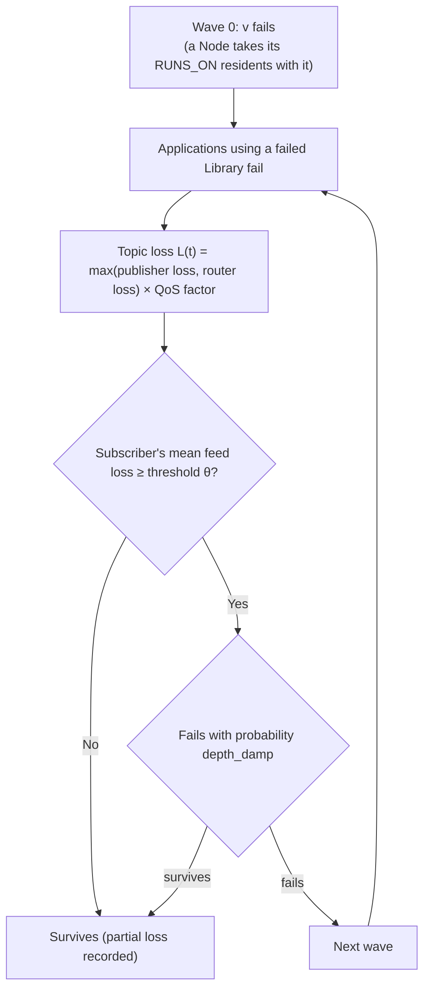
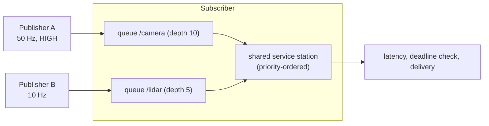

# Step 5: Simulate

**Inject failures into the architecture model and measure what the rest of the system loses.** The measured losses are the ground truth used to train predictors (Step 3), to check them (Step 6) and to verify refactorings (Step 7).

← [Step 4: Diagnose](diagnosis.md) | [README](../README.md) | **Step 5: Simulate** | → [Step 6: Validate](validation.md)

---

## Contents

**Start here**

1. [What the simulation step does](#1-what-the-simulation-step-does)
2. [Which engine do I need?](#2-which-engine-do-i-need)
3. [Rules that hold everywhere](#3-rules-that-hold-everywhere)

**The engines** (published behaviour)

4. [`FaultInjector`: cascade labels I\*](#4-faultinjector-cascade-labels-i)
5. [`FailureSimulator`: multi-layer quality oracle I_comp](#5-failuresimulator-multi-layer-quality-oracle-i_comp)
6. [`MessageFlowSimulator`: queue-flow oracle I_dyn](#6-messageflowsimulator-queue-flow-oracle-i_dyn)
7. [`ChangePropagationSimulator`: maintainability reference I_M](#7-changepropagationsimulator-maintainability-reference-i_m)
8. [Supporting engines](#8-supporting-engines)
9. [Shared deployment options](#9-shared-deployment-options)

**Opt-in extensions** (never part of the published labels)

10. [Overview](#10-opt-in-extensions-overview)
11. [Runtime engine](#11-runtime-engine)
12. [DDS QoS semantics and status metrics](#12-dds-qos-semantics-and-status-metrics)
13. [Emulated testbed, calibration and fidelity](#13-emulated-testbed-calibration-and-fidelity)

**Reference**

14. [Command line](#14-command-line)
15. [Output files](#15-output-files)
16. [Worked examples](#16-worked-examples)

**Research context**

17. [How the JSS study uses the simulators](#17-how-the-jss-study-uses-the-simulators)
18. [Known limitations](#18-known-limitations)

---

## 1. What the simulation step does

Before a system is deployed there are no crash logs to learn from. SaG therefore fails each component of the declared architecture in turn, propagates the consequences through the model, and records the damage. That damage, a per-component **impact score**, stands in for the missing operational history.

```
architecture model ──► fail component v ──► propagate ──► measure loss ──► impact(v)
  (JSON scenario)        (one at a time)      (engine)      (per engine)
```

Each engine measures a different kind of damage, and each feeds a different pipeline step:

| Impact score | Produced by | What it measures | Consumed by |
|:---|:---|:---|:---|
| **I\*(v)** | [`FaultInjector`](#4-faultinjector-cascade-labels-i) | Mean feed loss of all subscribers after the cascade | Step 3 Predict (training labels); the CLI benchmark in Step 6 |
| **I_comp(v)** | [`FailureSimulator`](#5-failuresimulator-multi-layer-quality-oracle-i_comp) | Weighted loss of reachability, connectivity, throughput and flows | Step 6 release gates; Step 7 `EditVerifier` |
| **I_dyn(v)** | [`MessageFlowSimulator`](#6-messageflowsimulator-queue-flow-oracle-i_dyn) | Drop in the message delivery rate in a timed queueing run | Offline research probe (convergent validity) |
| **I_M(v)** | [`ChangePropagationSimulator`](#7-changepropagationsimulator-maintainability-reference-i_m) | How far an interface change ripples upstream | Maintainability reference; never a training label |

**The raw-edge rule.** The engines work on the **raw structural graph** (`PUBLISHES_TO`, `SUBSCRIBES_TO`, `ROUTES`, `RUNS_ON`, `USES`, `CONNECTS_TO`). They never read the `DEPENDS_ON` edges that Step 2 derives for the predictors, so a label cannot be a restatement of a predictor's input (`tests/test_independence_guarantee.py`).
- `ChangePropagationSimulator` does traverse `DEPENDS_ON`. In the pipeline it receives edges that `SimulationGraph.get_dependency_edges()` **re-derives from the raw edges**, using the same seven rules as the repositories (`tests/test_simulation_dependency_derivation.py`). It never receives the analysis graph's edges.

---

## 2. Which engine do I need?

| Your question | Engine | Output | Cost, measured on `atm_system` / `av_system` (74 / 152 nodes) |
|:---|:---|:---|:---|
| If *v* dies, which subscribers starve? | `FaultInjector` | I\*(v) | 0.07 s / 0.26 s for a full 5-seed sweep of all candidates |
| What is the systemic loss across hosts, brokers, libraries and links? | `FailureSimulator` | I_comp(v), I_edge(u,v) | 0.07 s / 0.5 s for an exhaustive sweep |
| How do delivery, queues and deadlines behave over time when *v* fails? | `MessageFlowSimulator` | I_dyn(v), golden signals | 1.7 s / 4.5 s **per failed component** (60 simulated seconds) |
| If *v*'s interface changes, what must adapt? | `ChangePropagationSimulator` | I_M(v) | milliseconds; runs inside the `FailureSimulator` sweep |
| Which paths are live in the healthy system? | `EventSimulator` | baseline flows | milliseconds; primes `FailureSimulator` |
| What load does a topic set put on brokers and network? | `TrafficSimulator` | bandwidth and message rates | closed form; backs the REST traffic endpoint |

Timings are single runs on one CPU core (2026-11).

**Quick start.** Label a scenario, probe one failure dynamically, and run the opt-in runtime sweep:

```bash
python cli/simulate_graph.py fault-inject --input data/scenarios/atm_system.json --export-json
python cli/simulate_graph.py message-flow --input data/scenarios/atm_system.json --duration 60 --fault-node A0 --export-json
python cli/simulate_graph.py runtime-sweep --input data/scenarios/tiny_system.json --seeds 42
```

Results land in `output/simulation/`. See [§15](#15-output-files) for the file formats and [§14](#14-command-line) for every subcommand.

---

## 3. Rules that hold everywhere

1. **Oracles are not interchangeable.** I\*, I_comp, I_dyn and I_M measure different things on different scales; only their rank agreement is comparable. `FaultInjector` is the Predict-stage labeller and `FailureSimulator` the Validate-stage oracle. Using one in the other's place is a contract violation (`tests/test_groundtruth_contract.py`). Every result must say which oracle produced it.
2. **Raw edges only** (§1).
3. **Simulation is offline.** Step 3 reads labels from disk and never imports the simulators (`tests/test_predict_simulate_separation.py`). Step 4 (Diagnose) has no simulation access at all.
4. **Defaults are the published engines.** Every [extension](#10-opt-in-extensions-overview) is opt-in. `tests/test_simulation_golden_defaults.py` pins the default I\*, I_dyn, I_comp and I_M outputs bit for bit (I_comp and I_M at `PYTHONHASHSEED=0`), so an extension cannot leak into the published oracles.

---

## 4. `FaultInjector`: cascade labels I\*

Source: [`saag/simulation/fault_injector.py`](../saag/simulation/fault_injector.py). This is the Predict-stage labeller.

**What it answers.** *If component v fails, how much of their input do the other subscribers lose once the failure has cascaded?*

**How it works.** For each candidate *v*, a cascade runs in waves until nothing new fails:



- **Topic loss.** For topic *t*:
  - **publisher loss** is the rate-weighted share of its publishers that have failed;
  - **router loss** is the share of its routing brokers that have failed (½ when one of two brokers dies);
  - a failed topic loses everything.
  - The QoS factor multiplies the loss and is then clamped to 1. The default `ladder` gives ×1.2 for RELIABLE, ×1.15 for high priority and ×1.05 for medium.
- **Subscriber loss** is the mean topic loss over everything the subscriber reads.
- **Failure rule (`failure_model="step"`, published).** A subscriber whose loss reaches θ (`propagation_threshold`, default 0.2) fails with probability `depth_damp = max(0.25, 1 − 0.15 · wave)`.
  - Wave 0 is therefore deterministic.
  - The code writes the probability as `min(1, loss/θ) · depth_damp`, but that branch is only reached when loss ≥ θ, so the first factor is always 1. How far past the threshold the loss goes never matters.
  - A surviving subscriber is redrawn on every later wave.

$$I^*(v) = \frac{1}{|\mathcal{S}|}\sum_{s \in \mathcal{S}} \text{loss}(s) \qquad \text{over all subscribers } \mathcal{S}$$

I\* is 0 when nobody loses anything and 1 when every subscriber loses every feed. A pure sink, such as an application that only subscribes, always scores 0, because its failure harms no other subscriber.

**Options and variants**

| Option | Default | Effect |
|:---|:---|:---|
| `seeds` | `[42]` in code; `RECOMMENDED_SEEDS` (5 seeds) on the CLI | Labels are seed means; `impact_score_std` is the spread |
| `propagation_threshold` | 0.2 | Raise toward 1.0 for "fail only when starved" |
| `qos_factor_mode` | `ladder` | `wt`: scale by the topic weight w(t), which includes durability; `none`: topology only (the label-ablation arm) |
| `failure_model` | `step` | `threshold_cdf`: each subscriber draws a tolerance θ_s ~ U(0.1, 0.5) once per seed and is redrawn only when its loss rises. Averaged over seeds, P(fail) = F_θ(loss) · depth_damp, so the cliff at θ becomes a smooth curve. Recorded as `labeler_config`. |
| `network_gating`, `replica_aware` | off | See [§9](#9-shared-deployment-options) |
| `node_types` | `Application, Broker` in code; the CLI adds `Library` | Types left out are listed in `unlabeled_node_ids`, never scored 0. `Topic` and `Node` can be labelled: a failed topic silences its subscribers, and a failed host takes its residents with it. |

**Run it**

```python
from pathlib import Path
from saag.core.graph_io import load_graph
from saag.simulation.fault_injector import FaultInjector, RECOMMENDED_SEEDS

graph = load_graph(Path("data/scenarios/atm_system.json"))
result = FaultInjector(graph, seeds=RECOMMENDED_SEEDS).run(node_types=["Application", "Broker"])
result.save(Path("output/simulation/impact_scores.json"))

top = result.top_k_by_impact[0]
print(top["node_id"], top["impact_score"], result.label_stability["test_retest_spearman"])
```

```bash
python cli/simulate_graph.py fault-inject --input data/scenarios/atm_system.json --seeds 42,123,456,789,2024 --export-json
```

**Output:** `impact_scores.json` ([§15](#15-output-files)). It carries a `label_stability` block (mean and maximum seed spread, worst pairwise test-retest ρ, worst top-K Jaccard) that bounds any correlation computed against these labels. A type whose labels are all 0 is reported in `degenerate_node_types`; `strict_labels=True` turns that into an error.

---

## 5. `FailureSimulator`: multi-layer quality oracle I_comp

Source: [`saag/simulation/failure_simulator.py`](../saag/simulation/failure_simulator.py). This is the Validate-stage oracle; it is never a training label.

**What it answers.** *What does the system as a whole lose when v fails, across hosts, brokers, topics and libraries?*

**How it works.** The failure cascades through four layers:

```
Physical     host (Node) fails ──RUNS_ON──► its residents fail
Middleware   broker fails ──ROUTES──► its topics lose routing
Logical      topics without publishers or routing ──► subscribers starve
Software     library fails ──USES──► applications using it fail
```

Four losses are then combined with AHP-derived default weights:

$$I_{\text{comp}}(v) = 0.35\,\text{RL} + 0.25\,\text{FR} + 0.25\,\text{TL} + 0.15\,\text{FD}$$

| Term | Meaning |
|:---|:---|
| RL, reachability loss | Share of publisher-to-subscriber paths severed: 1 − paths_after / paths_before |
| FR, fragmentation | 0.70 · Δ connected components + 0.30 · Δ stranded mass |
| TL, throughput loss | Share of QoS-weighted message bandwidth lost |
| FD, flow disruption | Share of healthy `(publisher, topic, subscriber)` flows broken. The baseline flows come from [`EventSimulator`](#8-supporting-engines) (`SimulationService._prime_baseline_flows`). |

The same run also yields the quality decomposition the validation gates are written against:

| Score | Formula |
|:---|:---|
| Fault tolerance | IFT = 0.45 · cascade reach + 0.35 · weighted cascade impact + 0.20 · normalised depth |
| Availability | IA = 0.50 · weighted reachability loss + 0.35 · weighted fragmentation + 0.15 · path-breaking throughput loss |
| Reliability | IR = 0.36 · IFT + 0.64 · IA |
| Maintainability | I_M, from [§7](#7-changepropagationsimulator-maintainability-reference-i_m) |

**Edge criticality.** Removing a single relationship while both endpoints stay up gives

$$I_{\text{edge}}(u,v) = \bar I_{\text{comp}}(G \setminus \{(u,v)\}) - \bar I_{\text{comp}}(G).$$

The CLI subcommand is `edge-criticality`.

**Options.** `qos_weighting` is on by default. `cascade_probability` and failure modes `CRASH`, `DEGRADED` (half capacity) and `PARTITION` are set through `FailureScenario`. `network_gating` and `replica_aware` are described in [§9](#9-shared-deployment-options).

**Run it.** The service loads the graph, primes the baseline flows and sweeps every component:

```python
import json
from pathlib import Path
from saag.infrastructure.memory_repo import MemoryRepository
from saag.simulation.service import SimulationService

repo = MemoryRepository()
repo.save_graph(json.loads(Path("data/scenarios/atm_system.json").read_text()), clear=True)
results = SimulationService(repo).run_failure_simulation_exhaustive(layer="system")

for r in sorted(results, key=lambda r: -r.impact.composite_impact)[:3]:
    print(r.target_id, r.target_type, round(r.impact.composite_impact, 3),
          round(r.impact.maintainability_impact, 3))
```

---

## 6. `MessageFlowSimulator`: queue-flow oracle I_dyn

Source: [`saag/simulation/message_flow_simulator.py`](../saag/simulation/message_flow_simulator.py). It requires SimPy (extra `sim`).

**What it answers.** *When v fails, how much less traffic gets through, once rates, bounded queues, contention and QoS contracts are taken into account?*

**How it works.** The engine models simulated time:
- each publisher emits at its topic's declared rate, split evenly among the topic's publishers;
- each subscriber has a private bounded queue **per topic**, so one busy topic cannot block another;
- all of a subscriber's topics share **one service station** (its CPU), which is where contention arises.



**QoS enforcement**, under the default `qos_mode="full"`:

| Policy | What the engine does | DDS meaning, if different |
|:---|:---|:---|
| Reliability RELIABLE | Full queue drops the **oldest** sample (head-drop) | same (KEEP_LAST) |
| Reliability BEST_EFFORT | Full queue drops the **new** sample | KEEP_LAST would replace the oldest |
| `history_depth` | Becomes the queue capacity | same |
| `transport_priority` | Orders service at the station | — |
| `deadline_ms` | A sample whose end-to-end latency exceeds it is **dropped** | DEADLINE is a *period* contract (a new sample at least this often) and drops nothing. Dropping on age is LIFESPAN. |
| durability | Retained samples are replayed to surviving readers after a publisher outage (`recovery` and `full` modes) | — |

`qos_mode` selects which policies apply: `none` neutralises them but keeps the load, `contracts`, `recovery`, `full`, and `legacy` (the pre-QoS engine, uncalibrated). The engine's deadline rule is its largest source of non-structural loss. [§12](#12-dds-qos-semantics-and-status-metrics) adds an opt-in arm with DDS semantics and measures the difference.

**Load calibration.** QoS contracts only bind under contention. The engine sizes each subscriber's mean service time from its offered load Λ_s so that it *targets* utilisation ρ = 0.65 (`target_utilization`):

$$E[S_s] = \rho / \Lambda_s$$

Below about 0.2 nothing queues; above about 0.85 queues explode into noise.

The realised utilisation is reported per subscriber in `measured_utilization`, and it lands unevenly. On `atm_system` the 60 s run in [§15](#15-output-files) averages 0.37, with A0 at 0.29. Check it before relying on the operating point.

**The impact score.** The fault is injected at `fault_time`, by default half the duration. With the defaults (no warm-up, no guard band), the windows split there:

$$I_{\text{dyn}}(v) = \text{DR}_{\text{pre}} - \text{DR}_{\text{post}}, \qquad \text{DR} = \frac{\text{delivered}}{\sum_t \text{published}(t)\cdot|\text{sub}(t)|}$$

Two details of the accounting matter:
- The failed component's own receipts, and its share of the fan-out, are left out of both windows.
- A silenced publisher's demand stays in the denominator.

I_dyn is **not clamped**. Removing a high-rate publisher relieves contention for everyone else, and a negative value is a real measurement.

**Why I_dyn ignores latency.** In the same contention-relief situation, latency and deadline misses *fall* after the fault: their changes correlate negatively with I_dyn (ρ = −0.499 and −0.418; [§17](#17-how-the-jss-study-uses-the-simulators)). A score that added latency to delivery loss would cancel out exactly when a high-rate publisher fails, so I_dyn stays one-dimensional.

The **golden signals** are reported alongside it for triage, for the whole run and for each window:
- latency (p50/p95/p99, split into queue wait and service);
- traffic (published and delivered rates, bytes);
- errors (deadline drops, overflows, unserved demand);
- saturation (utilisation, queue depth and occupancy).

**Timing.** The CLI default is 100 simulated seconds, and the study uses 60 (fault at 30). One 60 s run takes 1.7 s on `atm_system` and 4.5 s on `av_system`. A sweep needs one run per candidate, which is why I_dyn is an offline probe and I\* the training label.

**Run it**

```python
from pathlib import Path
from saag.core.graph_io import load_graph
from saag.simulation.message_flow_simulator import MessageFlowSimulator

graph = load_graph(Path("data/scenarios/atm_system.json"))
result = MessageFlowSimulator(graph, duration=60.0, fault_node="A0", fault_time=30.0,
                              seed=42, qos_mode="full", target_utilization=0.65).run()
result.save(Path("output/simulation/message_flow_results.json"))

fe = result.fault_event
print(f"I_dyn(A0) = {fe.i_dyn:.4f}  (delivery {fe.delivery_rate_before:.3f} -> {fe.delivery_rate_after:.3f})")
```

```bash
python cli/simulate_graph.py message-flow --input data/scenarios/atm_system.json --duration 60 --fault-node A0 --fault-time 30 --qos-mode full --target-utilization 0.65 --export-json
```

The convergent-validity study across all scenarios is `PYTHONPATH=. python reproduce/convergent_validity.py`.

---

## 7. `ChangePropagationSimulator`: maintainability reference I_M

Source: [`saag/simulation/change_propagation.py`](../saag/simulation/change_propagation.py).

**What it answers.** *If v's interface changes at development time, which components have to adapt?*

**How it works.** If *u* depends on *v*, a change to *v* may force *u* to change, so the change travels **against** the dependency direction, on the transposed graph Gᵀ. Breadth-first search from *v* counts every direct dependent as reached, because it may have to adapt. The search does not continue *through* a dependent when either of these holds:
- **loose coupling:** the dependency weight is below `theta_loose`, default 0.20;
- **stable interface:** the dependent's instability is below `theta_stable`, default 0.20.

In the example below, `report` depends on `db` only loosely, so a change to `db` reaches `report` but stops there.

The simulator returns the three sub-metrics. `ImpactMetrics.maintainability_impact` combines them:

$$I_M(v) = 0.45\cdot\text{change reach} + 0.35\cdot\text{weighted change impact} + 0.20\cdot\text{normalised depth}$$

**Where it runs.** `FailureSimulator`'s maintainability post-pass calls it with the dependency edges that `SimulationGraph` re-derives from raw edges ([§1](#1-what-the-simulation-step-does)). The result appears as `impact.maintainability_impact` on every `FailureSimulator` result (see the [§5 example](#5-failuresimulator-multi-layer-quality-oracle-i_comp)).

**Directly:**

```python
from saag.simulation.change_propagation import ChangePropagationSimulator

# (u, v, w): u depends on v with weight w
edges = [("ui", "api", 0.9), ("api", "db", 0.8), ("report", "db", 0.1)]
res = ChangePropagationSimulator().simulate_all(["ui", "api", "db", "report"], edges)
for c, r in res.items():
    print(c, r.reached_components, round(r.change_reach, 3), round(r.normalized_change_depth, 3))
```

I_M is never a training label. Learners mask its dimension ([§17](#17-how-the-jss-study-uses-the-simulators)).

---

## 8. Supporting engines

**`EventSimulator`** ([`event_simulator.py`](../saag/simulation/event_simulator.py)) is a dependency-free discrete-event loop (`heapq`):
- it models PUBLISH → ROUTE → DELIVER (→ ACK for RELIABLE) and DROP;
- it supports optional Poisson component failures and recoveries, and Poisson message arrivals.

Its job in the pipeline is to record the healthy `(publisher, topic, subscriber)` flows that `FailureSimulator`'s flow-disruption term compares against. It can also be run on its own:

```python
import json
from pathlib import Path
from saag.infrastructure.memory_repo import MemoryRepository
from saag.simulation.service import SimulationService

repo = MemoryRepository()
repo.save_graph(json.loads(Path("data/scenarios/atm_system.json").read_text()), clear=True)
ev = SimulationService(repo).run_event_simulation("A0", num_messages=50)
print(ev.metrics.messages_published, ev.metrics.delivery_rate)
```

**`TrafficSimulator`** ([`traffic_simulator.py`](../saag/simulation/traffic_simulator.py)) is a closed-form estimate of message rates and bandwidth per topic and per broker for a chosen topic set. A topic's publish rate is its publisher count × frequency; the delivery rate multiplies that by the subscriber count, and bandwidth by the message size. It runs no simulation and produces no impact score. It connects to Neo4j itself (constructor `uri`, `user`, `password`) rather than taking a repository, and backs the REST traffic endpoint (`api/routers/traffic.py`).

---

## 9. Shared deployment options

Two flags change how hosts, replicas and the network are treated. Both are off by default, and the published labels were produced without them.

| Flag | `FaultInjector` | `FailureSimulator` | `MessageFlowSimulator` |
|:---|:---|:---|:---|
| `network_gating` | A feed the live CONNECTS_TO network no longer delivers counts as lost; hosts and `NetworkDevice`s get labels | Flows are routed over the live network (ECMP). Unreachable subscribers starve; congested links scale RL, TL and FD (they measure, they never fail anything) | With `deployment_model="stations"` only: reachability gates delivery |
| `replica_aware` | A host failure kills a resident only if **all** its hosts are down | A hosted component takes its least-impacted host's impact; a joint outage `FailureScenario(target_ids=[…])` kills replicas | When the runtime engine is active ([§11](#11-runtime-engine)): same rule as `FaultInjector` |

- **`network_gating`.** It needs a modelled network: `NetworkDevice` switches and routers, and `CONNECTS_TO` links with optional `capacity_mbps` ([graph-model.md §5.2](graph-model.md#52-phase-2-structural-topology--degree-augmentation); routing in [`saag/core/network.py`](../saag/core/network.py)). The corpus's sparse host mesh is not a complete network, which is why gating is opt-in. Without gating, a device failure only scores fragmentation, and a warning is logged.
- **`replica_aware`.** By default a multi-hosted component dies when *any* of its hosts fails, which makes a replica a liability. With the flag on, only `Node` labels move. On a corpus without replicas the flag is a no-op (`tests/test_replica_aware.py`). Example, I\* with seeds 42/123/456: atm N0 0.396 → 0.000, av N1 0.947 → 0.032.

Both flags are accepted by `SimulationService(...)` and `GraphEvaluator(...)` too, and on the CLI as `--network-gating` and `--replica-aware`.

---

## 10. Opt-in extensions: overview

The published engines have structural limits: publishers ignore their inputs, so no failure travels more than one hop in `MessageFlowSimulator`; crash-stop is the only fault; QoS semantics are approximate; and nothing is compared with observed behaviour. The extensions below address these. Each is off by default, so published numbers do not move ([§3](#3-rules-that-hold-everywhere), rule 4). Any comparison that will be reported should be pre-registered first.

| Extension | Turn on with | Engines | What changes |
|:---|:---|:---|:---|
| Smooth failure threshold | `failure_model="threshold_cdf"` | `FaultInjector` | P(fail) follows a tolerance distribution instead of a cliff ([§4](#4-faultinjector-cascade-labels-i)) |
| Reactive behaviour | `behavior_model="reactive"` | `MessageFlowSimulator` | Apps publish only while their inputs are fresh, so failures propagate |
| Deployment on the data path | `deployment_model="stations"` | `MessageFlowSimulator` | Brokers and host CPUs become stations; brokers and hosts are labelled |
| Fault library | `faults=[FaultSpec, …]` | `MessageFlowSimulator` | Transient crashes, gray failures, storms, link flaps, hot standby |
| Paired estimator | `rng_streams="per_process"`, `estimator="paired"` | `MessageFlowSimulator` | Same-stream no-fault baseline; a fault that touches nothing scores exactly 0 |
| Bursty workload | `workload_model="mmpp"` | `MessageFlowSimulator` | Bursts with the declared mean rate |
| Runtime labels | `saag-simulate runtime-sweep` | `MessageFlowSimulator` | Five labels with their order-k references |
| DDS semantics and statuses | `qos_semantics="dds"`, `dds_status=True` | `MessageFlowSimulator`, testbed | Period deadlines, KEEP_LAST, QoS matching; DDS status counts |
| Emulated testbed | `saag-simulate testbed …` | — | Runs the scenario on real Cyclone DDS and compares it with the simulator |

---

## 11. Runtime engine

Code: [`saag/simulation/runtime/`](../saag/simulation/runtime/). These options switch `MessageFlowSimulator` from the published engine to a runtime model.

### Reactive behaviour (`behavior_model="reactive"`)

Every application publishes only while its inputs are **fresh**. An input stays fresh for max(deadline, 3 periods of its topic) after its last *delivered* sample.

Each application has a trigger policy. It comes from the `trigger` attribute, or by default from `app_type`:

| `app_type` | Policy |
|:---|:---|
| sensor | `periodic` (ignores inputs) |
| processor, controller | `all_of` (every input fresh) |
| gateway, service, monitor, actuator | `any_of` (at least one input fresh) |
| any, via the `trigger` attribute | `k_of_n:K` (degrades in proportion below K fresh inputs) |

Topics nobody publishes, and topics the application itself publishes, are never required inputs.

On the chain `A → t1 → B → t2 → C`, failing the source A now silences C. The published engine gives I_dyn(A) = 0.50 < I_dyn(B) = 1.00, because B keeps publishing. A failure record also lists `stalled_apps`, `time_to_stall_s` and `cascade_hops`.

Queueing jitter can briefly starve a relay even without a fault. Fault-free publication is 0–5.5 % below the published engine's on five scenarios. Only stalls lasting at least one staleness window (and at least 1 s) count.

### Deployment on the data path (`deployment_model="stations"`)

- **Brokers** become service stations on their routes. When a broker fails, its topics move to the lowest-id live broker after a lease of max(1 s, 3 periods).
- **Co-located applications** share their host's CPU (`cpu_cores`, default one core per resident). A failure that adds work, such as a slowdown or babbling, therefore delays neighbours.
- **Host failures** kill residents, respecting `replica_aware`.
- `hot_standby=True` brings `hotstandby` components back after `failover_delay_s`.

### Fault library

Faults are given as `faults=[FaultSpec(target, mode, start_s, duration_s, params)]`. The first fault is the one the record reports.

| Mode | Effect | Parameters |
|:---|:---|:---|
| `crash` | Permanent crash; a host takes its residents | — |
| `transient_crash` | Crash, restart after `duration_s` | `storm_copies` on restart |
| `freeze` | Stops serving and publishing; queues keep filling | `duration_s` |
| `slowdown` | Service time × k (a host's residents, or a broker's station) | `k`, or `k_mu` / `k_sigma` (log-normal) |
| `omission` | Drops each emission with probability p | `p` |
| `babbling` | Publishes at k × its rate | `k` |
| `buffer_leak` | Reader queues shrink by β slots per second | `beta` |
| `redelivery_storm` | Re-sends retained history `copies` times | `copies` |
| `link_flap` | Gilbert-Elliott on link `a\|b` (bad state = cut); needs `deployment_model="stations"` and `network_gating` | `mean_good_s`, `mean_bad_s` |

For a bounded fault the record reports `time_to_recover_s`: the time until delivery regains 95 % of its pre-fault rate. `RuntimeFaultMode` is separate from `FailureSimulator`'s `FailureMode`, so the Validate oracle is unaffected.

```python
from pathlib import Path
from saag.core.graph_io import load_graph
from saag.simulation.message_flow_simulator import MessageFlowSimulator
from saag.simulation.runtime.faults import FaultSpec

graph = load_graph(Path("data/scenarios/atm_system.json"))
result = MessageFlowSimulator(
    graph, duration=40.0, seed=42, behavior_model="reactive", deployment_model="stations",
    rng_streams="per_process", estimator="paired",
    faults=[FaultSpec("N1", "transient_crash", start_s=20.0, duration_s=5.0)],
).run()
fe = result.fault_event
print(fe.i_dyn_paired, fe.time_to_recover_s, len(fe.stalled_apps))
```

### Runtime labels (`runtime-sweep`)

The sweep fails every candidate under the runtime settings: reactive, stations, per-process streams and the paired estimator. Candidates are Applications, plus Brokers and Nodes under stations. It writes `runtime_labels.json`; each label is a mean and spread over seeds:

| Label | Meaning |
|:---|:---|
| `i_delivery` | Paired, volume-weighted delivery loss |
| `i_delivery_consumer` | The same, averaged per subscriber, so a 700 Hz feed does not outweigh a 1 Hz one |
| `i_flow` | Criticality-weighted loss at the sinks. A failed sink loses everything, so terminal consumers are not harmless as they are under I\*. |
| `i_timeliness` | Signed change in the deadline-miss share. Under `qos_semantics="dds"` it is the paired increase in the DDS deadline-miss rate instead. |
| `i_recovery` | Recovery time, for bounded faults only |

Each label ships with its **order-k reference**: the training-free truncation of the simulator's own computation that a learned ranker must beat ([§17](#17-how-the-jss-study-uses-the-simulators)).

| Reference | Truncation |
|:---|:---|
| `ref_delivery_first_order` | Eq. 7, generalised to brokers and hosts |
| `ref_flow_reach` | Full propagation of reach; saturates on dense systems |
| `ref_flow_policy` | Deterministic stall fixpoint under the same trigger policies |

```python
from pathlib import Path
from saag.core.graph_io import load_graph
from saag.simulation.runtime.labels import runtime_labels

out = runtime_labels(load_graph(Path("data/scenarios/tiny_system.json")), seeds=[42],
                     settings={"duration": 20.0})
rec = out["records"]["A9"]
print(rec["i_flow"]["mean"], rec["ref_flow_policy"])
```

> [!WARNING]
> **Exploratory measurements, not results** (2 scenarios, 2 seeds, 30 s runs):
> - ρ(`i_flow`, `ref_flow_policy`) is 0.86 on atm and 0.80 on microservices.
> - ρ(`i_flow`, I\*) is 0.22 and −0.28.
> - ρ(`i_delivery`, first-order reference) is 0.87 and 0.85.
> - No application has `i_flow` = 0, against 5 and 13 with I\* = 0.
>
> A sanity check: with `behavior_model="open_loop"`, paired `i_delivery` matches `ref_delivery_first_order` at ρ = 0.998 on atm.

---

## 12. DDS QoS semantics and status metrics

Code: [`saag/simulation/runtime/dds_status.py`](../saag/simulation/runtime/dds_status.py). These are opt-in arguments to `MessageFlowSimulator`.

### The DDS arm (`qos_semantics="dds"`)

The published engine departs from DDS in three places ([§6](#6-messageflowsimulator-queue-flow-oracle-i_dyn)). `qos_semantics="dds"` follows DDS instead:

| Policy | `engine` (default) | `dds` |
|:---|:---|:---|
| DEADLINE | Drops a sample whose latency exceeds `deadline_ms` | Counts a miss when no new sample arrives within the period; drops nothing |
| KEEP_LAST, BEST_EFFORT | Full queue drops the new sample | Full queue replaces the oldest sample |
| Request-vs-offered matching | Not checked | Incompatible (writer, reader) pairs never communicate: reliability, durability order, deadline period |

The engine's deadline rule is what most of its fault-free loss comes from. These are fault-free 30 s runs, seed 1:

| Scenario | Delivery, `engine` | Delivery, `dds` | DDS reader deadline misses |
|:---|:---|:---|:---|
| atm_system | 0.9811 | 0.9979 | 0 |
| av_system | 0.9403 | 0.9993 | 0 |
| microservices_system | 0.9501 | 0.9914 | 0 |
| financial_trading_system | 0.9909 | 0.9996 | 0 |
| iot_smart_city_system | 0.9840 | 0.9910 | 0 |

The corpus meets every declared deadline period in steady state. The published engine's deadline drops come entirely from treating the deadline as a latency limit, so a QoS "deadline enforcement" effect in I_dyn rests on that interpretation.

### Status metrics (`dds_status=True`; implied by `dds`)

The engine counts the DDS standard communication statuses. Counting is observation only and changes no behaviour. Counts are kept per reader (`reader|<topic>|<component>`) and per writer, in pre- and post-fault windows, in `result.dds_status`. Names follow the DCPS statuses, with the RTI Connext 7.7 metric as an alias:

| Status | RTI alias | Simulator source | Testbed source (Cyclone) |
|:---|:---|:---|:---|
| `requested_deadline_missed` | `dds_data_reader_deadline_missed_total` | Period monitor on reception; pauses once the reader's writers are all gone | `get_requested_deadline_missed_status` |
| `offered_deadline_missed` | `dds_data_writer_deadline_missed_total` | Period monitor on emission while alive | `get_offered_deadline_missed_status` |
| `sample_lost` | `dds_data_reader_sample_lost_total` | Copies dropped on a cut network path | `get_sample_lost_status` |
| `sample_rejected` | `dds_data_reader_sample_rejected_total` | `engine` arm: BEST_EFFORT new sample rejected | `get_sample_rejected_status` |
| `liveliness_alive_count` | — | Matched writers alive (the relays, for a brokered topic) | `…liveliness_changed….alive_count` |
| `liveliness_not_alive_count` | `dds_data_reader_liveliness_not_alive_count` | not simulated (see below) | `…liveliness_changed….not_alive_count` |
| `requested_incompatible_qos` | `dds_data_reader_incompatible_qos_total` | Static request-vs-offered check | `get_requested_incompatible_qos_status` |
| `cache_replaced_dropped_samples`, `cache_samples_peak` | `dds_data_reader_cache_*` | Queue accounting | Agent queue count |

Running against Cyclone corrected the simulator's model twice:
- With AUTOMATIC liveliness, a crashed host's writers are *removed*: `alive_count` drops and `not_alive_count` stays 0. The simulator therefore reports `alive_count`.
- An instance with no live writers stops deadline counting.

```python
from pathlib import Path
from saag.core.graph_io import load_graph
from saag.simulation.message_flow_simulator import MessageFlowSimulator

graph = load_graph(Path("data/scenarios/atm_system.json"))
result = MessageFlowSimulator(graph, duration=30.0, fault_node="A0", seed=1,
                              qos_semantics="dds").run()
print(sum(t.total_dropped_deadline for t in result.topic_stats.values()),
      sorted(result.dds_status["statuses"]))
```

Not modelled: the RTI Prometheus import and export, participant UDP bandwidth, the reliability protocol (heartbeats, NACKs, repairs), and RTI's alert categories.

---

## 13. Emulated testbed, calibration and fidelity

Code: [`saag/testbed/`](../saag/testbed/), [`saag/simulation/calibration.py`](../saag/simulation/calibration.py), [`saag/validation/fidelity.py`](../saag/validation/fidelity.py).

Every oracle above is scored against something the framework computes. The testbed produces *observed* behaviour instead. It runs the scenario as a real pub-sub system, injects the same `FaultSpec`s, and records OpenTelemetry-shaped traces:

| Part | What it does |
|:---|:---|
| Deployment plan | Hosts and residents, each topic's DDS QoS, and each app's trigger policy, staleness windows and service time. The same functions as the reactive model are used, so a gap in fidelity is a gap in timing and transport, not in the behavioural model. |
| Runtime | Stub applications: one publisher thread per output, one worker per app (the shared station), bounded queues, deadline checks. A **broker** is a relay: writers publish to `ingress`, the routing broker republishes to `egress`, and the lowest-id relay with a live heartbeat routes. A **multi-hosted app** runs one instance per host; the lowest-id live instance is active and the others are warm standbys. |
| Transport | Cyclone DDS (extra `testbed`, `cyclonedds==11.0.1`) through a WaitSet poller, never listeners, with AUTOMATIC liveliness. `--mode local` runs everything in-process without Docker. |
| Chaos | Host faults become `docker kill`, `start`, `pause` or `update`. App faults become control files the agents poll. `link_flap` becomes `tc netem`, which cuts all of one endpoint's traffic. `buffer_leak` and `redelivery_storm` are reported as unsupported. |
| Calibration | `TelemetryCalibrator` fits topic rates and service-time distributions on the pre-fault steady state. It infers trigger policies from how emissions respond to input outages, abstaining when the evidence is ambiguous. It never writes `edge_failure_correlation`, which is a cascade probability, not a drop rate. |
| Fidelity | The simulated run is compared with the observed one: steady state against declared tolerances, the fault response (stall-set Jaccard), and DDS statuses. It is a report, never a gate. |

```bash
python cli/simulate_graph.py testbed build --input data/scenarios/tiny_system.json --output output/testbed/tiny --duration 50 --qos-semantics dds
python cli/simulate_graph.py testbed run --output output/testbed/tiny --duration 50 --faults faults.json --mode docker
python cli/simulate_graph.py testbed calibrate --output output/testbed/tiny
python cli/simulate_graph.py testbed fidelity --output output/testbed/tiny --calibrated
```

`--mode docker` builds an image that downloads `python:3.11-slim` and `cyclonedds`. The testbed directory is its own build context, with a copy of `saag/`.

**Validation on `tiny_system`.** This setup has 4 containers, 12 apps and 2 broker relays at 1 Hz, run with declared parameters; each row is a single run, so treat this as a smoke test.

| Run | Topic rate error | Per-reader delivery error | Latency error p50 / p95 | Stall-set Jaccard |
|:---|:---|:---|:---|:---|
| Fault-free, 40 s | 0.000 | 0.000 | 0.14 / 0.11 | — |
| Host N1 `docker kill` at 20 s | 0.000 | 0.059 | 0.40 / 0.14 | 1.0 |
| Broker B0 crash at 20 s (failover to B1) | 0.000 | 0.059 | 0.34 / 0.18 | 1.0 |

Errors are median relative errors. With `qos_semantics="dds"` and a host crash, the DDS statuses of the application entities agree as follows:

| Status | Agreement |
|:---|:---|
| `liveliness_alive_count` | Same 15 readers on both sides; values exact |
| `requested_deadline_missed` | Same 1 reader; 9 vs 7 misses |
| `offered_deadline_missed` | Same 3 writers; ~7 % count error |
| `sample_lost`, `sample_rejected`, `liveliness_not_alive_count` | 0 on both sides |

The relays' own DDS endpoints exist only on the testbed and are excluded, with their count reported.

The first Docker runs exposed defects the in-process tests could not see. All are fixed:
- the IDL type needed its own module;
- multi-hosted apps were placed only on their first host;
- telemetry was lost on `docker kill`;
- Cyclone listeners deadlocked against the GIL;
- `InvalidSample` killed the poller;
- network gating was on by default;
- policy inference was biased at slow rates.

---

## 14. Command line

Entry point: `cli/simulate_graph.py`, installed as `saag-simulate`. The full flag tables, with defaults, are in [cli-pipeline-guide.md, Step 5](cli-pipeline-guide.md#step-5-simulate).

| Subcommand | Engine | Writes |
|:---|:---|:---|
| `fault-inject` | `FaultInjector` | `impact_scores.json` |
| `edge-criticality` | `FailureSimulator` edge sweep | `edge_criticality.json` |
| `message-flow` | `MessageFlowSimulator` (one failure), including all runtime and DDS flags | `message_flow_results.json` |
| `runtime-sweep` | Runtime engine over all candidates | `runtime_labels.json` |
| `testbed {build,run,calibrate,fidelity}` | Emulated testbed | the testbed directory |
| `combined` | `fault-inject`, then `message-flow` | both |

```bash
python cli/simulate_graph.py edge-criticality --input data/scenarios/atm_system.json --top-q 20 --export-json
python cli/simulate_graph.py combined --input data/scenarios/atm_system.json --seeds 42,123,456 --duration 60 --fault-node A0 --export-json
```

---

## 15. Output files

### `impact_scores.json` (`fault-inject`)

<!-- schema: impact_scores -->
```json
{
  "schema_version": "2.1",
  "graph_id": "atm_system",
  "labeler": "FaultInjector",
  "seeds_used": [42, 123, 456, 789, 2024],
  "labeled_node_types": ["Application", "Broker"],
  "labeled_dimensions": ["composite", "reliability"],
  "unlabeled_node_ids": ["L0", "L1", "L2"],
  "degenerate_node_types": [],
  "label_stability": {"n_seeds": 5, "mean_std": 0.02014, "max_std": 0.129898,
                      "test_retest_spearman": 0.968807, "topk_jaccard": 0.666667},
  "top_k_by_impact": [{"rank": 1, "node_id": "B4", "node_type": "Broker", "impact_score": 0.7662}],
  "records": {
    "B4": {"node_type": "Broker", "impact_score": 0.7662, "impact_score_std": 0.0014,
           "cascade_depth": 2, "total_orphaned_topics": 21, "total_impacted_subscribers": 22,
           "seed_impact_scores": {"42": 0.7669, "2024": 0.7637}}
  }
}
```

Read labels from `records[*].impact_score`. `unlabeled_node_ids` lists nodes that were never injected; they are unmeasured, not zero.

### `message_flow_results.json` (`message-flow`)

<!-- schema: message_flow_results -->
```json
{
  "schema_version": "2.0",
  "graph_id": "atm_system",
  "simulation_duration": 60.0,
  "system_delivery_rate": 0.984,
  "qos_mode": "full",
  "target_utilization": 0.65,
  "utilization_mode": "per_subscriber",
  "measured_utilization": {"A0": 0.2917},
  "golden_signals": {
    "latency": {"p50_ms": 3.553, "p95_ms": 26.067, "mean_queue_wait_ms": 0.89},
    "errors": {"deadline_violations": 1559, "queue_overflows": 239},
    "saturation": {"cpu_utilization": 0.3682, "peak_queue_occupancy": 1.0}
  },
  "fault_event": {
    "fault_time": 30.0,
    "faulted_node_id": "A0",
    "delivery_rate_before": 0.9825,
    "delivery_rate_after": 0.7098,
    "i_dyn": 0.272716,
    "latency_p95_before": 19.11,
    "latency_p95_after": 23.62,
    "per_topic_i_dyn": {"T1": 1.0}
  }
}
```

`runtime_config` and `dds_status` appear only when a non-default option is set.

### `runtime_labels.json` (`runtime-sweep`)

<!-- schema: runtime_labels -->
```json
{
  "labeler": "MessageFlowSimulator/runtime",
  "seeds": [42],
  "labeled_dimensions": ["i_delivery", "i_delivery_consumer", "i_flow", "i_timeliness"],
  "references": ["ref_delivery_first_order", "ref_flow_reach", "ref_flow_policy"],
  "records": {
    "A9": {"node_type": "Application",
           "i_flow": {"mean": 0.1732, "std": 0.0, "per_seed": {"42": 0.1732}},
           "ref_flow_policy": 0.1167}
  }
}
```

### Testbed directory

A `testbed` directory contains:
- `deployment.json`, `Dockerfile`, `docker-compose.yml` and `saag/`;
- `telemetry/<host>.jsonl`, OpenTelemetry-shaped `saag.*` events;
- `run.json`, `profile.json` (calibration) and `fidelity.json` (`fidelity_calibrated.json` with `--calibrated`).

---

## 16. Worked examples

### Air traffic management, by hand

<!-- doc-test: assert -->
```python
import networkx as nx
from saag.simulation.fault_injector import FaultInjector

g = nx.DiGraph()
for app in ("RadarTracker", "ConflictDetector", "FlightDataProcessor", "ATCWorkstation"):
    g.add_node(app, type="Application")
g.add_node("ASTERIX_Broker", type="Broker")
for t in ("T_radar", "T_tracks", "T_fpa", "T_conflicts"):
    g.add_node(t, type="Topic")
    g.add_edge("ASTERIX_Broker", t, type="ROUTES")
for u, v, kind in [
    ("RadarTracker", "T_radar", "PUBLISHES_TO"), ("RadarTracker", "T_tracks", "PUBLISHES_TO"),
    ("ConflictDetector", "T_radar", "SUBSCRIBES_TO"), ("ConflictDetector", "T_tracks", "SUBSCRIBES_TO"),
    ("FlightDataProcessor", "T_tracks", "SUBSCRIBES_TO"), ("ATCWorkstation", "T_tracks", "SUBSCRIBES_TO"),
    ("FlightDataProcessor", "T_fpa", "PUBLISHES_TO"), ("ATCWorkstation", "T_fpa", "SUBSCRIBES_TO"),
    ("ConflictDetector", "T_conflicts", "PUBLISHES_TO"), ("ATCWorkstation", "T_conflicts", "SUBSCRIBES_TO"),
]:
    g.add_edge(u, v, type=kind)

records = FaultInjector(g, seeds=[42, 123, 456, 789, 2024]).run().records
scores = {n: round(r.impact_score, 4) for n, r in records.items()}
assert scores == {"RadarTracker": 1.0, "ASTERIX_Broker": 1.0, "ConflictDetector": 0.1111,
                  "FlightDataProcessor": 0.1111, "ATCWorkstation": 0.0}
```

| Component | I\* | Cascade depth | Why |
|:---|:---|:---|:---|
| `RadarTracker` | 1.000 | 2 | Sole source of radar and tracks. Its readers starve; `ConflictDetector` and `FlightDataProcessor` fail in wave 0, and then `ATCWorkstation` loses every feed. |
| `ASTERIX_Broker` | 1.000 | 1 | Sole router of every topic |
| `ConflictDetector` | 0.111 | 1 | `ATCWorkstation` loses 1 of its 3 feeds: loss 1/3, averaged over the 3 subscribers |
| `FlightDataProcessor` | 0.111 | 1 | Same |
| `ATCWorkstation` | 0.000 | 0 | A pure sink: its failure harms no other subscriber |

### One system, three oracles: `av_system`

These values are computed on the current corpus (152 nodes, 730 edges): I\* with 5 seeds, I_comp exhaustive, and I_dyn from single-seed 60 s runs. Values are means per type.

| Type | Count | I\* | I_comp | I_dyn |
|:---|:---|:---|:---|:---|
| Node (host) | 8 | 0.953 | 0.287 | — (not observable) |
| Library | 20 | 0.947 | — (not swept) | — (not observable) |
| Broker | 4 | 0.960 | 0.104 | — (not observable) |
| Application | 80 | 0.193 | 0.013 | 0.010 |

The oracles rank different strata. I\* puts libraries, brokers and hosts near the top, because each one's failure removes many feeds at once. I_comp emphasises hosts, through fragmentation and stranded capacity. I_dyn only sees components that carry traffic in the published engine; `deployment_model="stations"` makes brokers and hosts observable ([§11](#11-runtime-engine)).

---

## 17. How the JSS study uses the simulators

**Oracle names in the manuscript (§4.3):**

| Engine | Name in the paper | Role in the paper |
|:---|:---|:---|
| `FaultInjector` | Cascade reachability oracle, I\* | Primary target |
| `FailureSimulator` | Multi-metric composite oracle, I_comp; relationship removal oracle, I_edge | Validate and Prescribe |
| `MessageFlowSimulator` | Dynamic queue-flow oracle, I_dyn | Second oracle; research probe |
| `ChangePropagationSimulator` | Change-propagation oracle, I_M | Maintainability reference |

**The order-k reference criterion (§4.4).** Let oracle O propagate a failure in waves, and let T_k(O) be the same computation stopped after wave k. A ranking that equals T_k(O) after a fixed set of simplifications is a **reference** for O, not a predictor. Agreeing with O shows it recovers O's rule, not predictive skill. The simplifications are:

- **S1.** Take the expectation instead of stochastic draws.
- **S2.** Drop the QoS severity multipliers.
- **S3.** Drop the queueing mechanics.
- **S4.** Use uniform rates and normalisers.
- **S5.** Count the affected components instead of summing their losses.

The references in the study are:
- for I\*: Analytic I\* (first order), InDeg (the support of the first wave) and Reach (unbounded);
- for I_dyn: the rate-weighted first-order expansion, Eq. 7:

$$\hat I^{\text{rate}}_{\text{dyn},1}(v) = \sum_{t \in \text{pub}(v)} \frac{r_t}{|\text{pub}(t)|}\,|\text{sub}(t)|$$

Here r_t is the declared rate of topic t. The simulator's own accounting also leaves v's readership out of the denominator. Because both oracles do most of their damage in the first wave, these low-order truncations capture most of their signal.

**Headline numbers, each with its setup and source:**

| Quantity | Value | Setup | Source |
|:---|:---|:---|:---|
| ρ(I_dyn, I\*) | 0.711 | Five seeds, full Application population, 12 folds | Manuscript §7 (§4.3) |
| ρ(I_dyn, I\*) | 0.627 (Kendall τ 0.493, top-K Jaccard 0.370 vs 0.111 chance) | Single seed, at most 30 candidates per fold | Supplementary, convergent validity; `results/convergent_validity.json` |
| I_dyn labelling cost | 12.7 CPU-hours, 355.6 Wh | Five seeds, whole corpus | Manuscript §7 |
| I\* test-retest | 0.811–1.000 (median 0.982) | Five seeds, 12 folds | Supplementary |
| I\* without QoS scaling vs with | ρ = 0.965 | Application ordering, 12 folds | Manuscript §4 |
| References vs I\* | Analytic I\* 0.808, InDeg 0.764, Reach 0.732; best learner ≤ 0.748; Topo-QoS 0.553 | LOSO, 12 folds | Manuscript §7 |
| Eq. 7 vs I_dyn | 0.830; learned approximation 0.799; rate-fed graph networks ≤ 0.665 | LOSO | Manuscript §7 |
| Latency and deadline change vs I_dyn | ρ = −0.499 and −0.418 | Contention relief | Supplementary |
| RM attribution vs I_comp | 0.566 (Applications), 0.119 (Brokers), 0.244 (Nodes); 0.098 pooled | The reason the study stratifies by type | Supplementary |

**Learners and I_M.** I\* observes runtime reachability, not maintainability. Learners therefore mask the maintainability column of their targets with `dimension_mask` (`[True, True, False]` under `FaultInjector`; the paper writes the two-head form m = [1, 0]). See [prediction.md](prediction.md).

**Quality-model alignment** ([quality-model.md](quality-model.md)):

| ISO/IEC 25010 | Observed as | Engine |
|:---|:---|:---|
| Reliability | Feed-loss cascade (I\*); path reachability loss (RL) | `FaultInjector`, `FailureSimulator` |
| Availability, fault tolerance | Fragmentation and stranded volume (FR), the IA and IFT decompositions | `FailureSimulator` |
| Capacity | QoS-weighted throughput loss (TL) | `FailureSimulator` |
| Time behaviour | Delivery loss under contention (I_dyn) | `MessageFlowSimulator` |
| Maintainability | Upstream change ripple (I_M) | `ChangePropagationSimulator` |

All labels in the framework are simulator-derived. No oracle has been validated against production outages; [§13](#13-emulated-testbed-calibration-and-fidelity) is the first comparison with observed behaviour, on emulation.

---

## 18. Known limitations

| | Limitation | Consequence |
|:---|:---|:---|
| **L1** | I\* and the published I_dyn are first-order by construction. `FaultInjector`'s wave 0 is deterministic, and published `MessageFlowSimulator` publishers ignore their inputs. | Low-order references recover most of their signal ([§17](#17-how-the-jss-study-uses-the-simulators)). [§11](#11-runtime-engine) is the opt-in alternative. |
| **L2** | I_dyn is one-dimensional: delivery loss only. | Contention relief would cancel a latency term ([§6](#6-messageflowsimulator-queue-flow-oracle-i_dyn)). |
| **L3** | The published engine's deadline is a latency drop, not DDS DEADLINE. | QoS "deadline" effects in I_dyn rest on that rule ([§12](#12-dds-qos-semantics-and-status-metrics)). |
| **L4** | Sweeps inject one failure at a time. | Joint outages need `FailureScenario(target_ids=[…])` or a `faults` list. |
| **L5** | Under the default `--node-types`, `Topic` and `Node` are not injected. Without `deployment_model="stations"`, the published `MessageFlowSimulator` cannot observe brokers or hosts. | Those strata are unmeasured, and must be reported as undefined, never as 0. |
| **L6** | Sinks score I\* = 0. | Terminal consumers look harmless under I\*; `i_flow` charges them their own loss. |
| **L7** | All labels are simulator-derived. | The testbed comparison is on emulation, not production. |

---

## What comes next

- **[Step 3: Predict](prediction.md).** Train rankers on the I\* labels.
- **[Step 6: Validate](validation.md).** Compare predictions with the oracles.
- **[Step 7: Prescribe](prescription.md).** Verify candidate refactorings with `FailureSimulator`.

← [Step 4: Diagnose](diagnosis.md) | → [Step 6: Validate](validation.md)
