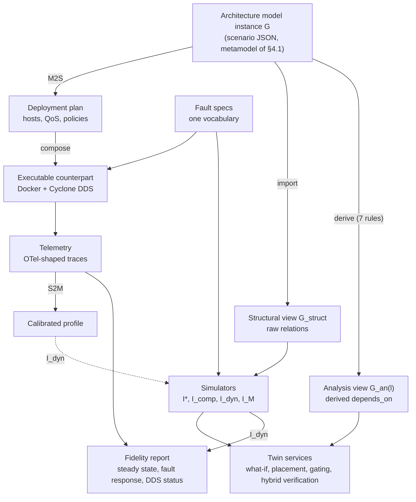
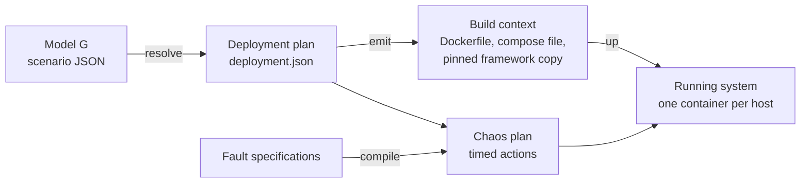

# Engineering an Architectural Digital Twin for Distributed Publish–Subscribe Systems: One Graph Model for Analysis, Simulation, and an Executable Container Testbed

**Authors:**
- Ibrahim Onuralp Yigit\* (Corresponding author. E-mail: `[CORRESPONDING-AUTHOR-EMAIL]`. ORCID: `[0000-0000-0000-0000]`.)
- Feza Buzluca (ORCID: `[0000-0000-0000-0000]`.)

**Affiliation:** `[DEPARTMENT]`, `[INSTITUTION]`, `[STREET ADDRESS]`, `[CITY]`, `[POSTAL CODE]`, `[COUNTRY]`

---

## Abstract

**Context.** Distributed systems built on publish–subscribe middleware such as DDS, ROS 2 or Kafka fail in ways that only show once the assembled system is running. These failures include cascades through shared topics, broker and host outages, and partitions. Engineering teams need a digital counterpart of the *architecture* that can answer what-if questions before deployment and can be checked against the running system afterwards. Such architectural digital twins are still built ad hoc.

**Objective.** We present an engineering method for an architectural digital twin of publish–subscribe systems. A single typed graph model is the source of every twin artefact: the analysis views, four failure simulators, and an executable container-based testbed that stands in for the physical system. Of the four simulators, the discrete-event queue-flow simulator is the one calibrated against and compared with the testbed. The system is built to the level of a batch digital shadow, and every fidelity claim is bounded to middleware, timing and transport behaviour under declared application behaviour.

**Method.** The method has four parts.
1. A graph metamodel separates structural relations from derived dependencies.
2. A model-to-system transformation generates a Docker and Cyclone DDS deployment from the model. A single fault vocabulary drives both the simulators and container-level chaos actions.
3. A system-to-model path turns OpenTelemetry-shaped traces into calibrated simulator parameters.
4. A fidelity-assessment method compares simulated and observed behaviour in steady state, under faults, and in middleware status. It states explicitly which agreements are independent evidence and which hold by construction.

We place each capability on a digital model, shadow and twin maturity ladder and claim only the levels that are built: a digital model, a generated counterpart and a batch digital shadow.

**Results.** Model consistency is enforced by executable invariants: the simulators re-derive all seven dependency rules from raw relations and must match the repository edge set.
- *Calibration.* On a 74-component scenario, topic rates are recovered within 3% median error, application service times within 1%, and inferred trigger policies are never wrong. Unit round trips on a small brokered system also recover broker service times, $k$-of-$n$ trigger policies and, when the workload is bursty, its burstiness. Under declared periodic workload, neither the staleness window nor burstiness can be recovered from telemetry, and we report both as such.
- *Smoke test.* On a four-container system, simulated and observed fault responses agree exactly at the stall-set level. The test also exposes a fidelity gap: DDS peer rediscovery after a partition takes about 6 s, which the simulator does not model.
- *Fidelity study.* In a pre-registered study on eight emulated systems (2,738 counterpart runs, 10,950 simulator runs), the primary comparison is *inconclusive*: the current simulator and the published one cannot be distinguished in how they rank the impact of publisher faults (Hodges–Lehmann $+0.014$, 95% CI $[-0.002, 0.094]$). Both, and a closed-form first-order reference, rank at about the counterpart's own repeatability (median $\rho \approx 0.92$ against a ceiling of 0.93). In hindsight this follows from the design: under declared periodic behaviour, a publisher crash removes only its direct readers' deliveries, which is what the reference computes. Descriptively, the current model reproduces broker and host fault rankings (median $\rho = 0.98$) and stall sets (median Jaccard 0.94), and lowers median latency error from 41% to 25%.

**Conclusion.** An architectural digital twin can be engineered as a family of model transformations around one metamodel, with fidelity treated as a measured, bounded property rather than an assumption. On publisher ranking, the study could not separate simulation from a closed-form formula. The evidence that the counterpart adds lies in infrastructure faults, latency, perturbed-parameter calibration and middleware behaviour the simulator does not model. The remaining step to a live twin—continuous ingestion, topology-drift repair and production actuation—is designed, not implemented.

**Keywords:** Digital twin engineering; Architectural models; Model-driven engineering; Publish–subscribe middleware; DDS; Fault injection; Simulation fidelity; Calibration; Container-based testbed.

---

## 1. Introduction

Publish–subscribe middleware is common in safety- and mission-critical software: air traffic management (ATM), autonomous vehicles, industrial control and financial trading. Examples include the OMG Data Distribution Service (OMG, 2015), ROS 2 (Macenski et al., 2022), Kafka (Kreps et al., 2011) and MQTT (OASIS, 2019). The style decouples producers from consumers in space, time and synchronisation (Eugster et al., 2003). That decoupling is what makes these systems easy to evolve and hard to reason about. A subscriber depends on every publisher of every topic it consumes, but no line of code says so. When a broker, a host or a publisher fails, the damage travels against the direction of data flow, through dependencies that exist only in the assembled system.

These failures are non-local. Unit tests, which see one component in isolation, cannot reveal them. Reproducing them needs the full deployment (hosts, middleware configuration, QoS contracts and placement), and that is precisely the resource a delivery pipeline cannot hold for every change (Humble and Farley, 2010). Teams therefore fall back on partial staging environments and on expert judgement about which components matter. In practice, the most consequential architectural questions are answered without an executable counterpart of the architecture. Which component's failure strands the most subscribers? Does a placement put two replicas in the same failure domain? Will a partition longer than a liveliness lease recover on its own?

The digital-twin idea answers this situation: a virtual counterpart, connected to its physical system, that can be queried, simulated and kept up to date (Grieves and Vickers, 2017; Tao et al., 2019). The software-engineering literature also observes that digital twins are still mostly built ad hoc, without systematic engineering methods (Dalibor et al., 2022; Bordeleau et al., 2020). Most reported twins mirror physical assets such as machines, vehicles and buildings. Far fewer mirror a *software architecture*, and the ones that do rarely say how faithful the twin is, or how the faithfulness was measured.

**Problem.** We address the engineering of an *architectural digital twin* for distributed publish–subscribe systems. Its virtual side is a typed model of components, topics, brokers, hosts and network devices together with the relations between them. Its services are what-if failure analysis, placement verification, change gating and hybrid two-tiered verification before deployment. Building such a twin raises four engineering challenges:
- **One source of truth.** Analysis, simulation and the executable counterpart must describe the same system. Otherwise every disagreement is ambiguous: it could be a defect in the system or a drift between artefacts.
- **A physical counterpart before deployment.** The system the twin mirrors may not exist yet. Something must play the physical role so that the twin can be exercised and checked.
- **A path back from the system.** Pre-deployment models guess runtime parameters such as rates, service times and reactive behaviour. A twin needs a disciplined way to replace those guesses with measurements, and to say which guesses cannot be replaced.
- **Fidelity as a measured property.** A twin is only as useful as the trust its users can place in it (Wright and Davidson, 2020). That trust has to be earned against observed behaviour, and the comparison itself must not be rigged by shared construction.

**Approach.** We report how we engineered such a twin around one graph metamodel, as part of the open-source Software-as-a-Graph (SaG) framework (Yigit and Buzluca, 2026a). Every twin artefact is derived from the same model instance:
- a *structural* view for simulation and a *derived dependency* view for analysis;
- four failure simulators;
- a *generated* container-based testbed, which runs the modelled system as real Cyclone DDS processes (one Docker container per modelled host) under the same faults the simulators inject.

The testbed emits OpenTelemetry-shaped telemetry. A calibrator turns that telemetry back into simulator parameters, and a fidelity report compares simulated with observed behaviour.

**Contributions.**
- **C1: The metamodel as the twin's single source of truth (§4).** The metamodel has two views: a structural one, consumed by simulation, and a derived one, consumed by analysis. Executable invariants check that every consumer re-derives the same dependency semantics.
- **C2: A model-to-system transformation (§5).** It generates a runnable DDS deployment from the model. It emulates brokers on a brokerless middleware and maps model-level QoS to DDS policies. A single fault vocabulary is compiled both into simulator events and into container-level chaos actions. Because the counterpart is generated from the same model, what it can independently confirm is limited to middleware, timing and transport behaviour.
- **C3: A system-to-model calibration path, with an identifiability analysis (§6).** The analysis states which model parameters telemetry can recover and which it cannot.
- **C4: A fidelity-assessment method for architectural twins (§7).** It covers three fidelity dimensions. An explicit independence analysis separates genuine evidence from agreement that holds by construction, and a pre-registered study protocol fixes the analysis before any comparison is computed. Fidelity results therefore speak to timing and transport on an emulated system under declared behaviour, never to real application behaviour. The method is applied to the queue-flow simulator; the other three simulators are not compared with the counterpart. Applied to eight emulated systems, it shows that publisher-ranking fidelity is bounded by the counterpart's noise and matched by a closed-form reference, a tie the confirmatory design made likely. The twin's added detail shows, descriptively, on infrastructure faults, stall sets and latency.

**What we claim.** On the maturity ladder of Kritzinger et al. (2018) (digital model, digital shadow, digital twin), the system we report is a digital model with a generated counterpart and a batch digital shadow. Batch drift detection, incremental EMA re-calibration and behavioural-residual policy feedback are implemented, unit-tested and evaluated on perturbed Docker counterparts (§8.3, §9.2). Both transformations between model and counterpart are automatic, but an engineer closes the loop for each run, and the counterpart is an emulation rather than the deployed system (§4.3). The remaining step to a live twin—continuous streaming ingestion, automated topology-drift repair proposals and production actuation—is specified in §9.2 as designed. We use "twin" for the engineering target and state each capability at the level that is implemented.

**Fit to the theme.** The contributions address the theme section's topics as follows. C1 is a modeling method for digital twins and a mechanism for model consistency. C2 covers digital-twin modeling and simulation; with the change gate (§4.2) and the cost ladder (§8), it also addresses DevOps for twins. C3 combines models and data and makes the remaining uncertainty explicit. C4 is a quality-assurance and fidelity method for twins whose physical side is generated from their own model.

**Relation to prior work by the authors.** The dependency-derivation idea first appeared, in a reduced form, in Yigit and Buzluca (2025). The simulators and their use as ranking oracles for criticality prediction are the subject of a companion manuscript under review (Yigit and Buzluca, 2026b). This paper does not restate those results. It contributes the twin-engineering method around them: the model-to-system and system-to-model transformations, the testbed, the calibration and the fidelity method. None of these appear in the earlier work. A tool paper on the framework's modeling language, quality diagnosis and refactoring is in preparation for this journal. It shares the metamodel description but none of the twin method, and this paper reuses no text or results from it.

**Outline.** §2 reviews digital-twin concepts and related work. §3 states the engineering requirements. §4 presents the twin and its maturity, and §§5–7 present contributions C2–C4. §8 evaluates the twin against four research questions. §9 discusses lessons, the path to a live twin, and threats to validity, and §10 concludes.

---

## 2. Background and Related Work

### 2.1 Digital twins: definitions and maturity

Grieves and Vickers (2017) described the digital twin as a virtual representation of a physical product, linked to it by data and information flows across the life cycle. Their aim was to expose emergent behaviour before it occurs in the field. Industrial surveys have since broadened the term to production systems, processes and services (Tao et al., 2019). Jones et al. (2020) consolidated the literature into thirteen characteristics, among them the physical and virtual entities, their states, the twinning process and its rate, and the *fidelity* of the virtual entity. They identified fidelity as one of the field's open knowledge gaps.

Two distinctions shape how we present our work. The first is due to Kritzinger et al. (2018), who classified twins by how data flows between the physical and virtual objects:
- in a *digital model*, both directions are manual;
- in a *digital shadow*, data flows automatically from the physical to the virtual object only;
- in a *digital twin*, data flows automatically in both directions.

They also observed that work at the full-twin level was scarce. The second distinction is due to Wright and Davidson (2020): a digital twin needs an existing physical counterpart, and a model without one remains a model. Both distinctions matter for a *pre-deployment* twin, whose physical system may not exist yet. We adopt Kritzinger's ladder to state precisely what our system is (§4.3). We answer Wright and Davidson's objection by making the physical counterpart explicit: an emulated system generated from the model. We also bound what that substitution can prove (§7).

ISO 23247-1 gives manufacturing-oriented terms and requirements for digital-twin frameworks, including accuracy, data acquisition and communication (ISO, 2021). Our requirements in §3 are written for software architectures, but they cover analogous concerns.

### 2.2 Model-driven engineering of digital twins

Model-driven engineering raises models to primary development artefacts (Schmidt, 2006), and several works argue that it is the natural basis for engineering twins. Bordeleau et al. (2020) identify three challenges for model-driven twin engineering:
- managing heterogeneous models across disciplines;
- bidirectional synchronisation between twin and system;
- collaborative development across the life cycle.

Eramo et al. (2022) propose a conceptual framework that combines heterogeneous models with their evolving data over a twin's life cycle. Kirchhof et al. (2020) generate a twin's information system from architecture models (MontiArc) and class diagrams, so that the integration between the cyber-physical system and its twin is synthesised rather than hand-written. TwinOps (Hugues et al., 2020) combines model-based engineering, digital twins and DevOps, using AADL and Modelica models with an IoT platform. The mapping study by Dalibor et al. (2022) covers 356 publications and documents both the breadth of twin applications and the scarcity of systematic engineering methods and rigorous evaluations.

Our work shares the model-driven stance, with one difference in emphasis. In Kirchhof et al. (2020), the generated artefact is the twin's *information system*. In our work, the generated artefact is the twin's *physical stand-in*, an executable deployment, so the model must be precise enough to run. The challenge of bidirectional synchronisation (Bordeleau et al., 2020) appears in our design as two concrete transformations, model-to-system (§5) and system-to-model (§6), and we make the coupling between them auditable.

### 2.3 Runtime models and twins of software systems

The models@run.time line of work treats a model as a causally connected self-representation of a running software system, used for adaptation (Blair et al., 2009). An architectural twin is related but has a different purpose. Its primary use is *offline*: what-if analysis and verification before a change reaches the system, not adapting the live system. Its link to the running system is calibration rather than reflection.

Architecture-based dependability and performance models have a long history. These include architecture-based reliability assessment (Goseva-Popstojanova and Trivedi, 2001), the AADL Error Model Annex (Delange and Feiler, 2014), and the Palladio component model for performance prediction (Becker et al., 2009). Static recovery of run-time architectures from robotics configurations (Timperley et al., 2022) addresses model construction. These approaches provide the *model* half of a twin. They usually stop short of a generated executable counterpart, and of measuring how well the model predicts observed behaviour. Closest to our system-to-model path, Mazkatli et al. (2020) incrementally re-calibrate the parametric dependencies of a Palladio model from monitoring data as the code evolves, and Walter et al. (2017) extract architectural performance models from monitoring logs. Both calibrate a model against the running system it describes. Our calibrator serves a pre-deployment model whose counterpart is generated from that same model, so it must also state which parameters the telemetry cannot recover (§6.3). Yigit and Buzluca (2025) introduced the graph-based dependency derivation for publish–subscribe systems that our metamodel extends (§4.1).

### 2.4 Testbeds, emulation and chaos engineering

Container- and namespace-based emulation makes it possible to run realistic distributed systems on one machine. Mininet's "network in a laptop" is a well-known example from networking (Lantz et al., 2010), and Containernet extends it with Docker containers as emulated hosts (Peuster et al., 2016). Chaos engineering injects faults into running systems to build confidence in their resilience (Basiri et al., 2016), and service-level fault injection testing, as in Filibuster (Meiklejohn et al., 2021), systematically explores failed service calls in a test environment. Our testbed combines emulation with fault injection: it generates an emulated deployment from the architecture model, and it injects faults described in the same vocabulary as the simulator's. The goal is not resilience testing of a production system. The goal is an observed reference for the twin's simulators.

### 2.5 Validating simulation models

Validating simulation models is a mature discipline (Sargent, 2013; Kleijnen, 2015). It distinguishes conceptual-model validity, operational validity and data validity, and it warns against comparing a model with a reference that shares its assumptions. Calibrating computer models against observations, with explicit treatment of the remaining parameter uncertainty and of model discrepancy, is likewise established (Kennedy and O'Hagan, 2001). We transfer this discipline to the twin setting in §7. The comparison is made against an emulated system, so we separately list which parts of that system are independent of the simulator and which are not.

---

## 3. Engineering Challenge and Requirements

### 3.1 Setting

The work was motivated by a mission-critical publish–subscribe programme in the ATM domain. Its engineering organisation wrote a requirements baseline for pre-deployment architecture verification: 112 verifiable "shall" statements in six areas:
1. model set-up data generation from configuration-management, source, package and network-topology sources;
2. a scenario generator;
3. a field-records store for telemetry and system data records collected from installed platforms;
4. analytical data preparation;
5. a node–relationship core system model;
6. design verification, analysis and evaluation.

The baseline is programme-specific. Its structure is not: it asks for a model built from engineering artefacts, synthetic scenarios where field data is missing, and a store that brings field telemetry back to the model. That is the shape of a digital twin, even though the baseline never uses the term.

We condensed the baseline into seven requirements for an architectural digital twin, stated independently of the programme (Table 1). Each requirement names the property it protects and the section of this paper that satisfies it, or records that it is not yet satisfied.

**Table 1:** Requirements for an architectural digital twin of a publish–subscribe system, condensed from a 112-requirement industrial baseline. "Status" uses the capability voice of §4.3: *built* means implemented and tested; *partly built* means some parts are implemented; *designed* means specified, not implemented.

| ID | Requirement | Where | Status |
|---|---|---|---|
| R1 | **Single source of truth.** Every twin artefact (analysis view, simulator input, executable counterpart) is derived from one model instance by a defined transformation, never authored separately. | §4.1, §5 | built |
| R2 | **Semantic consistency.** Every consumer that needs dependency semantics computes it with the same rules, and the agreement is checked mechanically. | §8.2 | built |
| R3 | **Substrate separation.** Behavioural oracles (simulators) operate on structural relations only, never on the derived relations that analysis consumes. A simulated outcome then cannot restate an analysis input. | §4.1 | built |
| R4 | **Executable counterpart.** Where the real system is unavailable, the model can be compiled into a running system that exercises the real middleware, under the same faults the simulators inject. | §5 | built |
| R5 | **Calibration from telemetry.** Runtime parameters guessed before deployment can be re-estimated from traces, and the method reports which parameters it cannot estimate. | §6 | built (batch) |
| R6 | **Measured fidelity.** Agreement between twin and counterpart is measured on declared metrics with declared tolerances, and reported as a report, never silently used as a gate. | §7 | built; pre-registered study run |
| R7 | **Drift detection.** Divergence between the modelled and the observed system (topology or parameters) is detected and triggers re-calibration or model repair. | §9.2 | partly built: batch parameter/behavioural drift and EMA re-calibration evaluated on perturbed Docker counterparts (§8.3); topology drift designed |

### 3.2 Why these requirements are hard together

Taken one at a time, each requirement is unremarkable. Taken together, they pull against each other:
- **R1 vs. R3.** R1 asks for one model. R3 forbids the simulators from seeing part of what the model derives. The metamodel must therefore keep two views of the same instance and make the boundary between them enforceable (§4.1).
- **R4 vs. R6.** The executable counterpart is generated from the same model the simulators read. Some agreement between them is therefore guaranteed, and counting it as fidelity evidence would be circular. R6 is only meaningful if the method separates the parts of the counterpart that are independent of the simulators from the parts that are not (§7.2).
- **R5 vs. R6.** Calibrating on the same runs that fidelity is measured on would inflate fidelity. The data used for calibration and the data used for evaluation must be disjoint by protocol (§7.3).
- **R7 depends on R5 and R6.** Drift is a fidelity breach on new data. Detecting it presupposes a calibrated baseline and a fidelity metric with known noise. This is why we built R5 and R6 first and R7 last: its batch detectors and EMA re-calibration are evaluated on perturbed counterparts (§8.3), while topology drift remains designed.

---

## 4. The Architectural Digital Twin

Figure 1 shows the twin as a set of artefacts around one model instance, together with the transformations that connect them. This section defines the model (§4.1), the services the twin offers (§4.2) and its maturity (§4.3). §§5–7 cover the transformations to and from the executable counterpart.



**Figure 1:** Artefacts and transformations of the architectural digital twin. The single model instance drives the executable counterpart (playing the physical role), the analysis and structural views, and the services offered to engineers, including the closed-batch hybrid verification workflow that couples calibration, Tier-1 queue-flow screening and targeted Tier-2 counterpart probing. M2S and S2M are the model-to-system (§5) and system-to-model (§6) transformations. The dashed edge is optional: a simulator run is calibrated only when requested. Calibration and fidelity comparison apply to the discrete-event queue-flow simulator ($I_{\mathrm{dyn}}$). The same fault specifications drive both simulation and the counterpart.

### 4.1 Metamodel: one instance, two views

> **Definition 1 (Architecture model).** An architecture model is a typed, weighted, directed multigraph $\mathcal{G} = (V, E, \tau_V, \tau_E, w_V, w_E)$ with the following parts:
> - *Vertex types* $\tau_V : V \to \{\textsf{Application}, \textsf{Library}, \textsf{Topic}, \textsf{Broker}, \textsf{Node}, \textsf{NetworkDevice}\}$.
> - *Edges* $E = E_s \cup E_d$, with structural relations
>   $$\tau_E(E_s) \subseteq \{\texttt{publishes\_to}, \texttt{subscribes\_to}, \texttt{routes}, \texttt{runs\_on}, \texttt{connects\_to}, \texttt{uses}\}$$
>   and derived relations $\tau_E(E_d) = \{\texttt{depends\_on}\}$.
> - *Weights* $w_V$ and $w_E$ map into $[0.01, 1]$.
>
> Topics carry a QoS contract: reliability, durability, history depth, deadline, transport priority, payload size and rate. Hosts may carry capacities, and `connects_to` edges may carry interface, link capacity and propagation latency. Unlike the other relations, `connects_to` is undirected: it models a cable.

The metamodel keeps two views of each instance:
- The **structural view** $G_{\mathrm{struct}} = (V, E_s)$ holds the relations as declared.
- The **analysis view** $G_{\mathrm{an}}(\ell)$ holds the `depends_on` edges, derived by seven rules and filtered by one of four layer projections $\ell \in \{\text{app}, \text{infra}, \text{mw}, \text{system}\}$.

The rules invert data flow into dependency, and their outcomes are:
1. a subscriber depends on the publishers of its topics, including through library chains;
2. an application depends on the broker routing its topics;
3. a subscriber's host depends on the publisher's host (Rule 1 lifted to hosting nodes);
4. an application's host depends on the routing broker's host (Rule 2 lifted to hosting nodes);
5. an application depends on the libraries it uses;
6. brokers on the same host share fate;
7. when the model declares network devices, a host depends on the devices that separate it from a host it depends on.

Rules 1–2 combine several shared topics by probabilistic union, and Rules 3–4 by a worst-case lift. The rules extend those of Yigit and Buzluca (2025). Their derivation and weighting are documented with the open-source framework (Yigit and Buzluca, 2026a), and we do not repeat them here.

For twin engineering, the important property is not the rules themselves but who may consume which view. *Analysis consumes $G_{\mathrm{an}}$. Simulation consumes $G_{\mathrm{struct}}$ only* (requirement R3). A simulator that read `depends_on` would score components by the very abstraction the analysis services use. Its agreement with those services would then be a tautology, not evidence. Two simulators still need dependency arcs:
- the change-propagation simulator;
- the fault injector, for library chains.

These *re-derive* the arcs from $G_{\mathrm{struct}}$ with their own implementation of the rules. That would open a consistency risk, but executable invariants close it (§8.2).

### 4.2 Twin services

The twin answers four kinds of engineering question. Each is answered on the model and, where needed, graded by a simulator or counterpart other than the one that produced the answer.

- **What-if failure analysis.** Four simulators, all on $G_{\mathrm{struct}}$, measure the damage of failing each component:
  - $I^*$: cascade reachability through publishers, brokers, hosts and libraries;
  - $I_{\mathrm{comp}}$: a multi-layer composite of reachability, fragmentation and throughput loss;
  - $I_{\mathrm{dyn}}$: the drop in delivery rate in a discrete-event queue-flow simulation built on SimPy (Team SimPy, 2023);
  - $I_M$: upstream change ripple.

  Their construction and their use as ranking oracles are reported in Yigit and Buzluca (2026b). Here they are the twin's *behavioural models*. For runtime realism beyond the default oracle, $I_{\mathrm{dyn}}$ provides opt-in arms for queued physical links (per-hop serialization queues from `capacity_mbps` and propagation latency over `connects_to`) and DDS latency-SLA reactive degradation (refreshing input freshness only for deliveries that meet `deadline_ms`, so gray slowdowns and link congestion propagate under non-dropping DDS semantics). Before deployment, when runtime parameters are guesses, uncertainty sweeps sample the parameter space with Latin Hypercube or scrambled Sobol designs, report upper-tail CVaR risk rankings alongside mean impact, and attribute impact variance to individual parameters via Spearman $\rho$ (numeric) and $\eta^2$ (categorical) so engineers know which unknowns warrant staging measurement.
- **Placement verification.** Given a deployment specification (host capacities, failure rates, failure domains, pinning, replica counts and topic deadlines), an exact optimiser proposes placements. Each placement is then re-scored on a held-out, replica-aware failure simulation over every host and failure-domain outage. A reliability gain is claimed only when it clears a measured noise bar. The optimiser's own objective is never used as evidence for the placement it chose.
- **Change gating.** For a candidate change, the twin is rebuilt from the candidate version and compared with the twin of the merge base. The gate blocks only on structural findings the change *introduces*, such as a new single point of failure or a new dependency cycle. Pre-existing debt is not re-reported as a failure. Impact rankings are deliberately kept out of the blocking path: they must flag a large share of components to reach high recall (Yigit and Buzluca, 2026b). They feed a non-blocking note on the change, and targeted simulation of the shortlisted components is the second tier.
- **Hybrid two-tiered runtime verification.** A four-step orchestrator (`saag-simulate hybrid-verify`) chains the twin's transformations into one closed-batch workflow. It (0) builds the counterpart once, runs a fault-free baseline and fits a calibrated profile (§6); (1) screens every candidate on Tier 1, the calibrated $I_{\mathrm{dyn}}$ with DDS semantics, host stations and replica awareness, alongside order-$k$ references; (2) shortlists the top-$K$ risk targets, the largest prediction-versus-Tier-1 disagreements and low-impact negative controls; and (3) probes the shortlist on the counterpart (Tier 2) with crash and gray-failure faults. Its report carries machine-readable parity and independence caveats (§7.2) and an end-of-run operational health summary (§7.1). Like all Tier-2 reports, it is advisory and never blocks a build.

### 4.3 Maturity: what is built and what is designed

Kritzinger et al. (2018) classify twins by whether the data flows between the physical and virtual objects are manual or automatic. We apply their ladder to the twin and add one row that their manufacturing setting does not need: a generated physical stand-in. Table 2 is the authoritative statement of what this paper claims. Throughout, the present tense describes built capabilities only. Designed capabilities are written in the requirements voice and confined to §9.2.

**Table 2:** Maturity of the architectural twin on the ladder of Kritzinger et al. (2018). "Counterpart" is the emulated system of §5 or, for the twin level, a deployed system.

| Level | Model → counterpart | Counterpart → model | Status |
|---|---|---|---|
| Digital model | The model is authored or extracted from engineering artefacts; analysis and simulation run on it. | None. | built |
| Generated counterpart | The model is compiled automatically into a running DDS deployment, with faults compiled into chaos actions (§5). | None. | built |
| Digital shadow (batch) | As above. | Telemetry is calibrated automatically into simulator parameters (rates, app and broker service times, workload burstiness, trigger policies), and fidelity reports are computed automatically (§§6–7), individually or via one closed-batch hybrid verification command (§4.2). Batch drift detection, EMA re-calibration and residual policy feedback are implemented and evaluated on perturbed Docker counterparts (§8.3). Still *invoked per run* by an engineer. | built |
| Digital twin | Accepted decisions (re-placement, configuration change) are pushed to the deployed system. | Continuous streaming ingestion; automated topology-drift graph diffing and model-repair proposals (§9.2). | designed |

Two remarks keep the table honest. First, both transformations are automatic, yet the system is not a twin in Kritzinger's sense. The loop is closed by an engineer for each run, not by the system in operation, and the counterpart is an emulation, not the deployed system. Second, Wright and Davidson's test, that a twin needs a physical counterpart (Wright and Davidson, 2020), is met only by the emulation. We therefore treat everything the counterpart shows as evidence about the twin's fidelity to *middleware, timing and transport behaviour under declared application behaviour*. We do not treat it as evidence about real applications (§7.2).

---

## 5. Model to System: Generating the Executable Counterpart

The twin needs a physical side before the real system exists (R4). We generate one: the model instance is compiled into a deployment in which every modelled host is a Docker container and every modelled application and broker is a process that speaks real DDS. The physical side is therefore whatever the model says it is, which is the source both of its value and of its limits. This section describes the transformation in three stages (Figure 2) and then the trace links that make its output auditable.



**Figure 2:** The model-to-system transformation. Everything an agent needs is resolved once into the plan, so all containers agree on it. The chaos plan is compiled from the same fault specifications the simulators consume.

### 5.1 Stage 1: resolving a deployment plan

The first stage resolves the model into a *deployment plan*: a self-contained document from which every per-host agent reads its configuration, so that no agent re-interprets the model on its own. The plan fixes four groups of facts.
- **Topics.** The plan records each topic's rate, QoS contract, payload size, publishers and routing brokers.
- **Applications.** The plan records each application's inputs and outputs, its hosts and its trigger policy. The trigger policy says when an application emits: on its own period, or only when its inputs are fresh. Policies are taken from the model, or resolved by the same function the simulator's reactive behaviour model uses. With *open-loop* planning, every application emits on schedule, which is the assumption of the published queue-flow simulator. The plan also records a staleness window for each required input and a mean service time. That time is set so that each application station runs at a declared target utilisation, 0.65 by default, of its input load.
- **Brokers.** The plan records the routed topics and service times of each broker.
- **Hosts.** The plan records the residents of each host. An application with several `runs_on` edges gets one instance per host, and a component with none is placed on a default host. Under CPU-bound emulation, the plan also records each container's CPU cap, which is the model's declared core count, or else one core per resident station.

The plan is the only place where model semantics become run-time configuration. It is produced by the same functions that configure the simulator. A disagreement between twin and counterpart therefore points at timing and transport, not at a second, divergent reading of the model.

### 5.2 Stage 2: mapping model concepts to DDS

Some model concepts have no direct DDS counterpart. Three mappings deserve discussion.

**QoS.** Model-level QoS maps onto DDS policies as shown in Table 3. The mapping is kept as plain data, separate from the middleware binding. It can therefore be unit-tested without DDS installed, and it can be reviewed as a modelling decision rather than buried in code.

**Table 3:** Mapping from model-level topic QoS to DDS policies in the generated counterpart.

| Model attribute | DDS policy |
|---|---|
| reliability | `Reliable` (max. blocking 100 ms) / `BestEffort` |
| durability | `Volatile` / `TransientLocal` / `Transient` / `Persistent` |
| history depth | `KeepLast`($d$), with $d=100$ when absent |
| deadline | `Deadline`, only when declared |
| transport priority | `TransportPriority` (low 0 … critical 3) |
| payload size | zero-filled payload of that size (optional) |
| — | `Liveliness` `Automatic`, lease 1 s (plan-wide) |

**Brokers on a brokerless middleware.** DDS is peer-to-peer, but the metamodel has a `Broker` type with `routes` edges, because systems built on Kafka, MQTT or enterprise buses depend on brokers. Dropping brokers would make an entire class of modelled failures unobservable. Each broker is therefore emulated as a relay process. Writers publish into an *ingress* partition, and the routing broker republishes into the *egress* partition that readers use. When several brokers route a topic, the lowest-identifier broker whose heartbeat is still within its lease (1 s) is active. A broker outage thus becomes a real loss of delivery, with real failover, on a middleware that has no brokers of its own. The relays' own DDS endpoints exist only on the counterpart, so they are excluded from status comparisons and counted separately (§7).

**Replicas.** An application with several hosts runs one instance per host. The lowest-identifier live instance is active. The others are warm standbys: they track input freshness but neither serve nor emit, and they take over after a 1 s lease. This is the counterpart of the simulator's replica-aware semantics, in which a host outage moves an application rather than killing it. It is also what makes the twin's placement-verification service (§4.2) testable on the counterpart.

The stub applications behave like the simulator's application model, in real time:
- one publisher thread per output topic;
- a single worker thread serving all inputs, which is the simulator's shared station;
- bounded receive queues with the model's overflow policy;
- deadline checks on end-to-end latency.

Samples are taken by a poller thread blocked on a DDS WaitSet, never by middleware listener callbacks. We learned this the hard way: a Python listener runs on the middleware's receive thread while that thread holds the reader's lock and waits for the interpreter lock, which stalls reception under load. Such details are invisible in the model. Yet they decide whether the counterpart measures the middleware or the emulation harness, which is why we report them.

### 5.3 Stage 3: emitting a build context

The plan is emitted as a build context: a Dockerfile, a compose file with one container per host on a shared bridge network (so DDS discovery works), and a copy of the framework itself. Copying the framework pins the image to the exact code that wrote the plan, so a counterpart cannot silently run a newer emulator than the one the plan was written for. The middleware version is pinned (Cyclone DDS 11.0.1) and changed only deliberately. Containers receive the `NET_ADMIN` capability so that the chaos layer can partition them.

Two emulation options are opt-in at build time:
- **CPU-bound service.** Each stub burns its service time on the CPU instead of sleeping, and each container is capped at its plan CPU count. Co-located applications then really compete for a host, as they do in the simulator's host model. The build refuses to run when the requested utilisation exceeds the machine's cores, so an overloaded emulator is never mistaken for an overloaded system.
- **Payload carrying.** Each topic's declared payload size is put on the wire. Serialisation costs about 12 ns per byte in our setup, about 0.4 ms for 32 KiB.

### 5.4 One fault vocabulary, two back-ends

Faults are specified once, as a list of fault specifications. Each one gives a target, a mode, a start time and a duration; link flaps also carry the parameters of a Gilbert–Elliott schedule. The same list is consumed by the simulators and by the counterpart's chaos compiler (Table 4). For a link flap, both back-ends draw the bad periods from the same seeded schedule.

**Table 4:** Compilation of fault specifications into actions on the counterpart. Application-level faults reach a process inside a container through a control file that the host agent polls every 0.1 s.

| Fault (target, mode) | Counterpart action |
|---|---|
| Host crash | `docker kill` of the host's container |
| Host transient crash | `docker kill`, later `docker start`; residents restart fresh, telemetry is appended |
| Host freeze | `docker pause` / `unpause` |
| Host slowdown | slowdown control file for every resident |
| Application or broker crash, transient crash, freeze, slowdown, omission, babbling | control file read by the agent, reset when the fault ends |
| Link flap | a *partition* during each bad period: blocked containers drop ingress traffic (unicast and multicast) from each other's addresses with `tc`, so DDS discovery and liveliness see the cut |
| Network-device crash (with network gating) | a partition of every host pair that `connects_to` no longer connects |
| Buffer leak, redelivery storm | reported as *unsupported*, never silently skipped |

**Network gating.** Without network gating, a link flap blocks exactly the two hosts at its ends. With gating, the chaos compiler removes cut links and crashed hosts or devices from the `connects_to` graph and blocks every host pair that is no longer connected. This is the same reachability rule the simulator applies, implemented once in a shared module. A model whose topology already separates some hosts is partitioned before traffic starts, so the counterpart cannot be more connected than its model.

Reporting unsupported faults is a small design decision that matters for a twin. Suppose a fault were silently dropped on one back-end. The fidelity report would then compare a faulted simulation with an unfaulted counterpart, and the twin would look either better or worse than it is. In the hybrid two-tiered verification workflow (§4.2), a pre-flight parity check inspects every requested fault probe against the chaos compiler before Tier-2 execution begins: unsupported probes (such as buffer leaks, redelivery storms, or link flaps in in-process mode) are skipped transparently and logged alongside partial-parity caveats (such as station-less application slowdowns and post-partition DDS rediscovery lag).

### 5.5 Trace links

Every artefact of a counterpart run can be traced to the model element that produced it:
- containers are named after modelled hosts;
- DDS topic names are derived from modelled topic identifiers;
- each telemetry event carries the identifier of the modelled component that emitted it and of the modelled topic involved;
- control files are named after the targeted component.

A run directory therefore contains the plan, the build context, the per-host telemetry, the run metadata, the calibrated profile and the fidelity report. Any fidelity finding can be followed back to a model element and forward to the container that exhibited it. This auditability is what the model-driven twin literature asks for when it calls for traceable synchronisation between twin and system (Bordeleau et al., 2020). Here it is a by-product of generating, rather than hand-building, the counterpart.

---

## 6. System to Model: Telemetry and Calibration

A pre-deployment model has to guess the runtime parameters that drive its behavioural simulation:
- how often each topic is really published;
- how long each application takes to serve a message;
- whether an application emits on its own schedule or only when its inputs are fresh.

After deployment, or on the counterpart, these can be measured. The system-to-model transformation turns a trace into a *calibrated profile* that overrides the declared values in the queue-flow simulator (R5). Its design rests on two principles. First, every fitted value records where it came from. Second, the calibrator abstains rather than guesses when the trace does not determine a parameter.

### 6.1 Trace schema

Telemetry is a stream of JSON-lines events shaped like OpenTelemetry log records. Every event has a timestamp on a clock shared by all agents, an event name, and attributes that use OpenTelemetry's messaging conventions where they exist (`service.name`, `messaging.destination.name`, `messaging.message.id`). Seven event kinds carry the operational behaviour:
- *publish*, for an emission;
- *deliver*, for a sample processed within its deadline, with latency and service time;
- *deadline miss*, for a sample that was processed and then dropped as late; it carries its service time too;
- *drop*, for a queue overflow, dead-broker drop or network-partition drop;
- *forward*, for a broker relay forwarding a sample, carrying its measured broker service time without double-counting application deliveries;
- *state*, for a component lifecycle event such as crash, recovery, freeze/thaw, overload or replica takeover;
- *status*, for periodic DDS status counts.

An eighth kind, *health*, records component health-state transitions for the operational health summary (§7.1); calibration and fidelity comparison do not read it.

The queue-flow simulator writes the *same* schema across the shared operational event kinds when asked to record events. This is the single most useful decision in the system-to-model path. Calibration and fidelity comparison are written once and applied to simulated and observed traces alike. A difference between the two can then never be an artefact of two parsers.

### 6.2 The calibrator

The calibrator fits five groups of parameters on the post-warm-up window of a trace: topic rates, application and broker service-time distributions, and per-topic workload burstiness on steady state (robust to mid-run outages), and trigger policies whenever the trace contains discriminating input outages. It also supports incremental exponential-moving-average updates (`update_profile`) for rolling re-calibration against a prior profile, evaluated on perturbed Docker counterparts in §8.3.

**Topic rates.** The fitted rate of a topic is its emissions per active second, counted over all of its publishers. Silence gaps exceeding $\max(5\,\text{s}, 10\cdot\text{median gap})$ are subtracted from the active duration so that a mid-run crash does not bias the healthy publication rate low, while fault-free traces remain unchanged.

**Service-time distributions (applications and brokers).** For each application (from *deliver* and *deadline miss* events) and each routing broker (from *forward* events), the calibrator records the mean and coefficient of variation of measured service times. It reports an exponential family when the CV lies in $[0.7, 1.3]$ and a lognormal family otherwise, and it fits only when at least five samples exist. Service times are taken from delivered samples *and* from samples dropped as late. A late sample was still served, and fitting only the on-time survivors biases the mean low. On the ATM scenario, this bias put one application's mean 45% low before the schema carried service times on deadline misses.

**Workload burstiness.** For each topic with at least 30 active emissions, the calibrator computes the outage-filtered inter-arrival CV and the binned count Fano factor. Topics with $\text{CV} < 0.25$ are classified as periodic; topics exhibiting both $\text{CV} > 1.15$ and Fano factor $> 1.5$ are segmented by 1D two-means clustering over bin rates into burst and calm states to estimate *burst ratio*, *burst fraction* and *mean burst duration* for per-topic Markov-modulated Poisson process (MMPP) replay. Remaining topics are classified as homogeneous Poisson.

**Trigger policies.** An application with inputs emits periodically regardless of its inputs (*periodic*), stops only when all inputs are stale (*any-of*), stops as soon as one input is stale (*all-of*), or degrades proportionally when fewer than $K$ inputs are fresh (*$k$-of-$n$*). The calibrator infers which by splitting time into input freshness states and comparing the application's realised emission rate with its active rate. A state counts as evidence only if it lasted long enough to expect at least three emissions; when partial-outage emission shares fall in the middle band $(0.2, 0.8)$, per-fresh-count shares are checked against candidate $K \in \{2,\dots,N\}$ ramps and reported as `k_of_n:K` only when a unique $K$ fits within tolerance. Otherwise the calibrator abstains. For a single-input application, *all-of* and *any-of* coincide, and the calibrator reports the simpler one.

**What the calibrator refuses to write.** The behavioural profile also has slots used by other simulators. One is a per-edge *failure correlation*, which is a cascade-propagation probability in the multi-layer failure simulator. Another is a starvation tolerance. A measured message-drop rate looks superficially like the former, but it is a different quantity, and no trace event measures the latter. The calibrator writes neither. In a twin, a model slot filled with a plausible but semantically wrong measurement is worse than an empty slot, because it is indistinguishable from a real calibration.

**Calibrated screening.** Calibrated profiles feed both single-fault fidelity comparisons and full-system Tier-1 sweeps, and every label artefact records whether, and from what, it was calibrated, so calibrated and declared sweeps cannot be confused downstream.

### 6.3 Identifiability: what telemetry can and cannot recover

Calibration is only useful if it recovers the right values. We test this in two ways (Table 5). The main experiment simulates the 74-component ATM scenario with *known* parameters under the runtime-label settings, calibrates the resulting trace, and compares the fitted values with the known ones. Rates and service times use 60 s traces; trigger policies use 200 s traces in which every application is down for 15 s in one of eight staggered slots. Parameters that the ATM settings do not exercise (broker service times, $k$-of-$n$ policies and bursty workloads) are checked by unit round trips on small synthetic systems with two to five applications and one seed. These are weaker evidence: they show that an estimator works, not how accurately it works at scale. Both kinds are automated tests in the framework, so they are re-run on every change to the calibrator.

**Table 5:** Parameter recovery: simulate with known parameters, calibrate the trace, compare. (a) The ATM identifiability experiment. (b) Unit round trips on small synthetic systems (one seed).

| Parameter | Recovered? | Evidence |
|---|---|---|
| *(a) ATM scenario* | | |
| Topic rates | yes | median relative error 3% (outage-robust on fault traces) |
| App service mean and CV | yes | median relative error 1%; every application within sampling noise (at most 3.6 standard errors, 30 applications); a uniform distribution is returned as lognormal with its true CV of 0.115 |
| Trigger policy | yes, when observable | 16–17 of the 17 applications with inputs and outputs receive an answer, and every answer is correct, for true staleness windows of 2, 3 or 6 periods (the calibrator assumes 3) |
| Staleness window | no | no estimator; the trace does not determine it |
| Workload burstiness | no, under periodic workload | the declared workload is periodic, so the burst ratio has no effect on the trace and cannot be recovered |
| *(b) Unit round trips* | | |
| Broker service mean and CV | yes | from *forward* events of simulator and testbed relays; exponential, and uniform returned as lognormal |
| `k_of_n:K` trigger policy | yes | $K = 2$ identified for a three-input application from its partial-outage ramp |
| Workload burstiness (MMPP) | yes, when bursty | classified as MMPP; true burst ratio 4.0 recovered within the accepted band 1.5–6.0 and burst fraction 0.1 within 0.02–0.35; no false positives on periodic, Poisson or crashed periodic traces |

The negative rows are a result, not an omission. They tell the twin's users that post-deployment data cannot narrow the plausible range of the staleness window, and that a periodic trace says nothing about how bursty the workload would be under other conditions. Any conclusion sensitive to these parameters must keep carrying its uncertainty after deployment. Applications that never experienced a partial input outage receive no policy, which is correct behaviour rather than a gap.

An identifiability table of this kind is cheap to produce once the simulator and the counterpart share a trace schema, and we recommend it as a standard artefact for calibrated twins. It separates three kinds of parameter:
- parameters that data can pin down;
- parameters that data can pin down only under particular operating conditions (here, trigger policies need an outage and burstiness needs a bursty workload);
- parameters that data cannot pin down at all.

Without such a table, a calibrated twin silently presents all three as equally "calibrated".

The identifiability test uses a simulated trace as ground truth, so it checks the estimators, not the counterpart. Applying the calibrator to counterpart traces, and asking whether calibration improves fidelity, is hypothesis H5 of the fidelity study (§7.3).

---

## 7. Fidelity Assessment

Fidelity, the degree to which the virtual entity reproduces its physical counterpart, is among the least operationalised characteristics of digital twins (Jones et al., 2020). For an architectural twin, the question is concrete: when the same fault hits the twin's simulation and the counterpart, do they show the same damage? This section defines what we compare (§7.1), what such a comparison can and cannot show (§7.2), and how we fix the analysis before seeing results (§7.3).

### 7.1 Three fidelity dimensions

All comparisons are computed from two traces in the shared schema of §6: one simulated, one observed. Each fidelity report records its tolerances. It is a report and never a gate (R6), because a gate on an unvalidated fidelity metric would turn the metric's noise into release decisions.

**Steady state.** Five metrics are computed, each as a per-element error against a declared tolerance (Table 6):
- the publication rate of each topic;
- the delivery rate of each reader–topic pair;
- the p50 and p95 latency of each topic;
- the share of samples that miss their deadline.

The report gives the median error and the share of elements within tolerance.

**Table 6:** Default steady-state tolerances. Relative error for rates and latencies; absolute difference for the deadline-miss share.

| Metric | Tolerance |
|---|---:|
| Topic publication rate | 5% |
| Reader delivery rate | 10% |
| Latency p50 / p95 | 25% / 35% |
| Deadline-miss share | 0.05 |

**Fault response.** For a fault on component $v$, the *observed impact* $I_{\mathrm{obs}}(v)$ follows the definition of the simulator's $I_{\mathrm{dyn}}$: the pre-fault minus the post-fault delivery rate, summed over surviving readers. The faulted component's own receipts are excluded, the value is not clamped, and the simulator's guard band is used. Computing $I_{\mathrm{obs}}$ from a trace with the simulator's definition makes the two directly comparable. On the ATM scenario, $I_{\mathrm{obs}}$ computed from a simulated trace differs from the engine's internal $I_{\mathrm{dyn}}$ by at most 0.0002. At 1 Hz on the smallest scenario the difference is about 0.03, because whole samples are counted. Two comparisons follow:
- rank agreement between simulated and observed impact across faulted components, measured by Spearman's $\rho$ (with top-$K$ Jaccard also computed by the operational fidelity report for triage);
- for each single fault, the Jaccard index between the sets of readers that stall in simulation and in observation (the *stall set*).

**Middleware status.** When the simulator runs with DDS semantics, it maintains the DDS status counters for every application entity:
- liveliness alive and not-alive counts;
- requested and offered deadline misses;
- lost, rejected and cache-replaced samples, and reader peak queue depth.

The report compares, for each counter, the set of entities with non-zero values on each side and the per-entity counts. The broker relays' own endpoints exist only on the counterpart, so they are excluded, and their number is reported.

**Operational health.** An evaluator also classifies every modelled entity at the end of a run as healthy, degraded or lost, and aggregates the result into quality-in-use indices in the sense of ISO/IEC 25019 (ISO/IEC, 2023); this summary is implemented and schema-validated but not evaluated in this paper.

**From fidelity report to feedback.** Two advisory diagnostics connect fidelity back to calibration: `detect_drift` flags metrics, topics and readers whose steady-state error leaves the tolerances of Table 6, and `diagnose_fault_residuals` re-infers trigger policies for applications whose stall sets disagree and proposes, without applying, a profile update. Both are evaluated on perturbed Docker counterparts in §8.3, and neither ever blocks a build (R6).

### 7.2 Independence analysis: what the counterpart can show

The counterpart is generated from the same model, and partly by the same functions, as the simulators' configuration. Some agreement is therefore guaranteed by construction, and reporting it as fidelity would be circular. This is the conceptual-validity trap that the simulation-validation literature warns about (Sargent, 2013). Before any study, we classified every part of the counterpart by whether it is independent of the simulator (Table 7).

**Table 7:** Which parts of the counterpart are independent of the simulator. Only agreement on the independent parts counts as fidelity evidence.

| Counterpart part | Independent? | Consequence |
|---|---|---|
| DDS delivery, discovery and liveliness; OS scheduling; real elapsed time; container kills and network partitions | yes | what fidelity results can speak to |
| Topic rates, mean service times, queue bounds, failover rule, placement | no (same plan) | agreement is not evidence |
| Trigger policies (reactive behaviour) | no (shared function) | agreement between a reactive simulator and a reactive counterpart is circular |
| Late-sample handling | no (agents are told the rule) | a counterpart in the simulator's own late-drop mode is never treated as truth |
| Application logic | no (stubs) | no result covers real application behaviour |

The table bounds every claim the twin can make from its counterpart. *The strongest attainable conclusion concerns timing and transport fidelity on an emulated system under declared behaviour.* No outcome can show that a production system behaves this way. We regard producing this table as a necessary step whenever a twin's physical side is itself generated from the twin's model, a situation that pre-deployment twins cannot avoid. To prevent these boundaries from staying prose-only, the hybrid verification service (§4.2) emits structured, machine-readable `caveats` in every `hybrid_report.json`—automatically flagging reactive policy circularity (unless `--open-loop` is selected), rate-scaled latency distortion when $\kappa < 1$, Cyclone DDS post-partition rediscovery lag, station-less slowdown divergence, in-process transport omission and any skipped unsupported probes.

### 7.3 A pre-registered fidelity study

Fidelity studies have many forks: which scenarios, which faults, which simulator configuration, which metric, which threshold. Each fork is a chance to find agreement after the fact. We therefore wrote the analysis down, including which outcomes it considered possible, before running any comparison, and froze it in the repository on 16 November 2026 (commit `9f84aad9`), before any study number existed (Yigit and Buzluca, 2026a). The simulator arms and the analysis ran on the code tagged `fidelity-study-arms-code` (commit `d4d5ca05` plus the two amendments below), not on later versions of the framework. The only runs made before freezing were pilot runs that measure capacity and noise; none was compared with a simulator. We summarise the protocol here. The complete document lists every exclusion rule, rerun rule and amendment procedure. The operational hybrid verification workflow (`hybrid-verify`, §4.2) is built on the same primitives for practitioner triage and gray-failure probing, and is strictly separate from this frozen confirmatory study: its runs never enter Table 10.

**Population and capacity.** The unit of analysis is the *scenario*. Components, seeds and repetitions are not independent units, and treating them as such would be pseudo-replication. The candidate population has twelve scenarios: eleven generated domains and the ATM scenario. The counterpart runs Python stubs on a single machine. The protocol therefore allowed a scenario whose busiest host exceeds a measured capacity to be rate-scaled by a factor $\kappa \le 1$ (rates multiplied, service times and deadlines divided), with latency results then excluded and $\kappa \ge 0.2$ required for entry. A scenario also enters only if, in a fault-free run, its rate error stays within 5% and its CPU p95 stays within 80% of one core in every container. Both conditions are decided before any fault run. Load ramps on two pilot scenarios outside the population set the capacity at $B_h = 3{,}033$ messages per second for the busiest host, with CPU as the binding limit. Nine of the twelve candidates pass the gate, all at full rate ($\kappa = 1$), so rate scaling was never applied and latency results count for every included scenario. Three are excluded: the autonomous-vehicle scenario saturates one container (CPU gate), the enterprise scenario fails the rate gate because six of its hosts never discover their peers within the run, and the financial-trading scenario would need $\kappa < 0.2$. The enterprise failure is a discovery problem of the single-machine counterpart that we have not diagnosed (§9.3).

**Amendments.** Two amendments were registered during the sweep, both before any simulator arm ran and before any comparison with $I_{\mathrm{obs}}$ was computed. The first corrected a validity check: on one host of the industrial-control scenario, every application is a warm standby that emits nothing while its primary is alive, so a log-recency check rejected 31 of the first 80 runs of a healthy host by chance. The amended check judges such hosts by container liveness. The second withdrew that scenario rather than re-running it from scratch (about 400 runs), a decision about cost taken without knowledge of any outcome. The study therefore has $n = 8$, not the nine that passed the gate. No seed, target, arm, margin, threshold or metric changed.

**Observed conditions.** The confirmatory condition (O-open) makes every application periodic. This removes behaviour as a source of difference between simulator configurations, because the trigger policy is shared (Table 7). The reactive condition is reported descriptively only.

**Arms.** Seven arms are compared against $I_{\mathrm{obs}}$:
- **S0**, the published queue-flow configuration;
- **S1**, S0 with DDS deadline semantics;
- **S2**, the current model: S1 plus host stations, per-process randomness and replica awareness;
- **S3**, S2 calibrated from a separate fault-free run;
- **S4**, S2 with reactive behaviour, scored in the reactive condition only;
- **R**, a closed-form first-order reference with no simulation, ranking a publisher by the declared rate it contributes to each topic times the topic's readership;
- **N**, S2's scores with shuffled targets, as an instrument check.

The data used for calibration never come from evaluated runs (R5 vs. R6, §3).

**Hypotheses.** The primary hypothesis is **H1**: under O-open, S2 ranks publishing applications closer to $I_{\mathrm{obs}}$ than S0 does. It is tested by a one-sided exact Wilcoxon signed-rank test (Wilcoxon, 1945) on per-scenario differences in Spearman $\rho$, at $\alpha = 0.05$. The analysis reports a Hodges–Lehmann effect size with a confidence interval and a TOST equivalence test against a margin $\delta$ derived from a noise pilot. A decision table fixed in advance maps the test results onto four headlines: *better*, *equivalent*, *inconclusive* and *worse*. A secondary, Holm-corrected family asks four questions:
- **H2**: does S0 clear an absolute rank-agreement level of 0.70?
- **H3**: does S2 beat its own first-order reference R?
- **H4**: does S0 beat R?
- **H5**: does calibration reduce per-reader delivery error (S2 vs. S3)?

**Noise ceiling.** No simulator can be expected to agree with the counterpart better than the counterpart agrees with itself. Every per-scenario $\rho$ is therefore reported next to a noise ceiling: the mean leave-one-repetition-out rank agreement of $I_{\mathrm{obs}}$ with itself. In the noise pilot (20 publishing applications, three repetitions) this ceiling was 0.90, with a standard deviation of 0.007. Three publishers had clearly high impact; the other 17 had $I_{\mathrm{obs}}$ between 0.014 and 0.038 but were still ordered consistently across repetitions. The equivalence margin follows from this pilot by a rule fixed before its value was known: $\delta = \max(0.05, \mathrm{SD}) = 0.05$. An earlier pilot run on the same scenario gave a ceiling of only 0.56, with the 17 low-impact publishers reordered in every repetition; its traces were not archived and the difference is unexplained. The protocol therefore does not assume the pilot's ceiling but measures it again on every included scenario. It also records *inconclusive* as a possible outcome in advance, because other scenarios may be noisier than the pilot and a study of nine (in the event, eight) scenarios tolerates only a few losses (§9). An inconclusive result is to be reported as such, and never as evidence that the two configurations are equal. The protocol did not anticipate that the reference R would tie with every simulator arm (§8.4).

**What each result permits.** The protocol pairs each outcome with the claim it licenses. For example, a *better* H1 licenses "the current model matches emulated rankings better under declared behaviour". It does not license "labels are more accurate for real systems". A failed H3 licenses "against this counterpart, simulation adds no ranking value over a closed-form formula". It does not license "simulation never adds value". We regard such a claim table as part of a twin's fidelity specification, not as a statistical nicety. It is what keeps a fidelity number from being quoted in a context it does not cover.

---

## 8. Evaluation

We evaluate the twin against four research questions, one per engineering challenge of §1:
- **RQ1 (consistency).** Do all twin artefacts derived from one model instance agree on its semantics?
- **RQ2 (calibration).** Which runtime parameters can the system-to-model path recover from telemetry?
- **RQ3 (fidelity).** How faithfully do the twin's simulators reproduce the generated counterpart's behaviour, and where do they diverge?
- **RQ4 (cost).** What do the twin's services and its counterpart cost to run, and does that fit a delivery pipeline?

Every number below is tagged with its provenance:
- **[P]**: measured on the open-source prototype, regenerable from a committed artefact;
- **[S]**: from the pre-registered fidelity study (§7.3), run in November 2026.

A number from one source is never presented as evidence for another.

### 8.1 Subjects

We use the committed scenario corpus of the framework (Yigit and Buzluca, 2026a). Every scenario regenerates byte-identically from its generator configuration, which is itself an executable invariant. The subjects are:
- the 74-component ATM scenario (`atm`);
- a five-member ATM scale family from 29 to 444 components, with QoS mix, fan-out shape and criticality proportion held fixed;
- eleven scenarios from other domains, including autonomous vehicles, IoT, financial trading, healthcare and industrial control;
- two small pilot scenarios (`tiny_system`: 4 hosts, 12 applications, 2 brokers; and an integration-hub scenario with 20 publishing applications), which are excluded from the study population.

### 8.2 RQ1: Consistency across twin artefacts

Consistency between artefacts is checked by executable invariants that run in the framework's continuous-integration suite (Table 8). Breaking one fails the build, not merely a review.

**Table 8:** Executable invariants that keep the twin's artefacts consistent [P]. Each is an automated test in the framework's suite; "Checks" counts test cases as collected by pytest (103 in total).

| Req. | Invariant | Checks |
|---|---|---|
| R2 | The simulator's re-derivation of `depends_on` from raw relations yields the same arc set as the repository, rule by rule (Rules 1–7). It ignores failed edges and does not double-count shared topics. | 15 |
| R2 | The in-memory and graph-database repositories agree on derived edges for all rules. | 3 |
| R3 | Simulation code never imports the analysis or prediction packages, and never reads derived edges. | 1 |
| R3 | The labelling simulator and the validation simulator are never substituted for each other within a pipeline stage. | 8 |
| R1 | Every committed scenario regenerates byte-identically from its configuration, and a manifest matches the files on disk. | 21 |
| R4 | Plan, QoS mapping, compose file, chaos compilation (including partitions under network gating) and the in-process counterpart are checked against the simulator. An in-process counterpart run must cascade like the simulator, and its DDS-status semantics must agree with the simulator's. | 34 |
| R4/R6 | Hybrid two-tiered verification and its reports: calibrated Tier-1 sweeps, deterministic shortlisting, pre-flight fault parity and caveat emission, end-to-end in-process runs, and the schema of the operational health summary. | 21 |

**A consistency failure we found.** The invariants are not decorative. For a long time, the simulator's re-derivation implemented only one of the seven rules. The rules it lacked are exactly the ones that give applications, brokers and hosts any dependents. As a result, the change-propagation impact $I_M$ was identically zero for every component the validation scored, and the validation gates that depend on it reported failures that were really unmeasured quantities. The fix was twofold: full re-derivation, guarded by the rule-by-rule parity test, and a rule that an unmeasured gate value is reported as *not measured* rather than coerced to zero. For twin engineering, the lesson is that a single model instance is necessary but not sufficient for R2. Every consumer that re-derives semantics is a place where artefacts can drift apart without any visible error.

**A known, documented divergence.** Not every disagreement has been removed. When a topic is reachable both directly and through a library, the in-memory repository counts it twice in the Rule 1 edge weight, while the graph-database repository does not. The resulting difference affects no pairs on `atm`, 64 pairs on a microservices scenario ($\Delta w \le 0.248$) and 139 on the autonomous-vehicle scenario ($\Delta w \le 0.374$) [P]. Fixing it would move published downstream numbers, so it is documented rather than silently changed. The simulator deliberately matches the graph-database semantics. We report it as an example of the consistency debt that a model-centred twin accumulates and must make visible.

**Answer to RQ1.** All artefacts are derived from one instance, and their agreement on dependency semantics is enforced rule by rule. One historical inconsistency was caught and closed by these checks. One residual divergence in edge weights is measured and documented rather than hidden.

### 8.3 RQ2: Calibration identifiability

Table 5 (§6.3) gives the result [P]:
- on ATM, topic rates are recovered within 3% median error (robust to mid-run outages) and application service-time means and CVs within 1%;
- on ATM, trigger policies are always correct when the trace contains a discriminating outage, and abstained on otherwise;
- on ATM, staleness windows are not identifiable, and burstiness cannot be recovered from the periodic declared workload;
- in unit round trips only, broker service times, `k_of_n:K` policies and MMPP burstiness of a bursty workload are recovered.

On the counterpart itself, the in-process calibration round trip recovers rates, application and broker service means, and identifies trigger policies, under automated tests [P]. Whether calibrating on counterpart telemetry improves simulator fidelity is H5 [S]. It cannot be decided on the unperturbed Study 1 counterpart: the uncalibrated simulator's per-reader delivery error is already 0.000 in seven of eight scenarios (0.018 in the eighth, identical after calibration), so calibration has nothing to reduce (HL $0.000$, Holm n.s.).

**Perturbed-counterpart calibration and batch drift (Docker) [P].** To test calibration and batch drift mechanisms when pre-deployment guesses are actually misspecified, we injected controlled parameter shifts into the Docker + Cyclone DDS counterpart on three topologies—`tiny_system` (4 containers), `atm` (8 containers) and a real-world ROS 2 topology (`realworld_autoware_ros2`, 6 containers)—shifting 40% of topic rates by $+50\% / -35\%$ (alternating) and doubling service times on the busiest host, while keeping the twin's prior model at its declared values (40 s runs, 5 s warm-up, 3 repetitions, calibration from a disjoint trace):
- *Batch calibration (S2 $\to$ S3).* Calibration cuts median per-reader delivery error by 77% on `tiny_system` ($0.277 \to 0.064$), 96% on `atm` ($0.053 \to 0.002$) and 87% on `realworld_autoware_ros2` ($0.284 \to 0.036$), while reducing median p50/p95 latency error by 10–63% across all three topologies (e.g. `realworld_autoware_ros2` p95: $0.620 \to 0.228$).
- *Incremental EMA re-calibration (`update_profile`, $\alpha = 0.5$).* Delivery error converges monotonically across three disjoint rolling windows on every topology (`tiny_system`: $0.161 \to 0.091 \to 0.087$; `atm`: $0.059 \to 0.040 \to 0.029$; `realworld_autoware_ros2`: $0.118 \to 0.062 \to 0.038$).
- *Drift detection and residual policy feedback.* `detect_drift` achieves 1.00 true-positive detection on all shifted runs (shifted-topic recall 1.00 on `tiny_system`, 0.73 on `atm`, 0.80 on `realworld_autoware_ros2`), but also flags unperturbed baselines ($\mathrm{FP} = 1.00$) despite 0.28% baseline delivery error because single-machine p50 latency routinely exceeds the 25% tolerance on $>20\%$ of topics—showing that rate/delivery drift and latency drift need separate thresholds. Under a behavioural shift (one multi-input app switched from declared *periodic* to *all-of*), `diagnose_fault_residuals` correctly infers *all-of* on `tiny_system` (`A11`) and `realworld_autoware_ros2` (`A10`), and *any-of* on `atm` (`A1`).

**Answer to RQ2.** Telemetry recovers the rate and application service parameters that govern queue-flow behaviour on a realistic scenario; broker service times, $k$-of-$n$ policies and bursty workloads are so far recovered only in unit round trips. When pre-deployment parameters are misspecified on Docker + DDS counterparts, both batch calibration and rolling EMA re-calibration cut delivery error by 77–96% and reduce latency error across all tested topologies [P], whereas on unperturbed Study 1 counterparts H5 is undecidable because baseline delivery error is already near zero [S]. Telemetry recovers reactive trigger policies only when outages occur, and it cannot recover staleness windows, or burstiness from a periodic trace. The twin must keep carrying the uncertainty of these parameters after deployment.

### 8.4 RQ3: Fidelity of the simulators to the counterpart

**Smoke test.** We ran `tiny_system` on the Docker counterpart (4 containers, 12 applications, 2 broker relays, 1 Hz) with declared parameters, and simulated the same runs [P]. Each row of Table 9 is a single run, so the results show that the pipeline works end to end. They are not a fidelity estimate.

**Table 9:** Smoke test on `tiny_system` (Docker counterpart, single runs) [P]. Errors are median relative errors between simulated and observed traces (delivery: per reader). The host crash is a `docker kill`; $J$ is the Jaccard index.

| Run | Topic rate | Delivery | Latency p50 / p95 | Stall-set $J$ |
|---|---:|---:|---:|---:|
| Fault-free, 40 s | 0.000 | 0.000 | 0.14 / 0.11 | — |
| Host crash at 20 s | 0.000 | 0.059 | 0.40 / 0.14 | 1.0 |
| Broker crash at 20 s (failover) | 0.000 | 0.059 | 0.34 / 0.18 | 1.0 |

Under both faults, the simulator and the counterpart agree exactly on which readers stall. Topic rates match exactly, which is expected, because they come from the shared plan (Table 7). Delivery agrees within 6%. Latency errors are larger, as expected for a one-machine emulation. The p95 errors stay within their 35% tolerance in every run. The p50 errors stay within their 25% tolerance in the fault-free run but exceed it under both faults. In the host-crash run with DDS semantics, the middleware status counters agree as follows:
- *liveliness alive count*: the same 15 readers on both sides, with exactly equal values;
- *requested deadline missed*: the same single reader, with 9 misses observed against 7 simulated;
- *offered deadline missed*: the same 3 writers, with about 7% count error;
- *lost and rejected samples, liveliness not-alive count*: zero on both sides.

**A fidelity gap the counterpart exposed.** We then ran a two-host chain behind one switch, with network gating, CPU-bound service and payload carrying, and crashed the switch from 10 s to 20 s [P]. Deliveries stopped within 0.2 s of the cut, as in the simulator. They resumed about 6 s *after* the partition was lifted, whereas the simulator reconnects instantly. The cause is middleware behaviour that the model does not represent. During a partition longer than a participant's lease, Cyclone DDS expires the remote participants and has to rediscover them afterwards. In the same run, the burned service time matched the plan: a median of 21.3 ms against an exponential median of 22.5 ms.

This finding is the kind of result the counterpart exists to produce. It falls in the independent row of Table 7: discovery and liveliness belong to the middleware, not to the shared plan. It is invisible to any oracle the framework computes about itself. It also has a direct consequence for the twin's users. Fault-response predictions for partitions longer than a liveliness lease underestimate the outage by the rediscovery time, and we now state this as a known limitation of the behavioural model. A twin that only checked itself against its own simulators could not have found it.

**Pre-registered study.** The study of §7.3 ran on eight scenarios, all at $\kappa = 1$ [S]. All 2,738 counterpart runs (80 fault-free baselines and 2,658 fault runs over 443 targets, three repetitions, two conditions) passed the validity checks on the first attempt, so no target and no scenario was lost. Pre-fault rate error was zero throughout, and the busiest container's CPU p95 stayed between 38% and 62%. The simulator arms ran 10,950 times on the tagged study code (§7.3). The shuffled-label instrument check gave a median $\rho$ of 0.001, inside its $\pm 0.10$ bound, so the confirmatory results are reported. Table 10 gives the decisions and Table 11 the per-scenario agreement.

**Table 10:** Fidelity study results [S]. $n$ is the number of included scenarios; $C_s$ is the noise ceiling; HL is the Hodges–Lehmann median with its 95% CI. Holm-corrected secondary tests are two-sided.

| Quantity | Statistic | Value | Decision |
|---|---|---|---|
| Included scenarios | $n$ (and $\kappa$) | 8 of 12; $\kappa = 1$ for all | one withdrawn (§7.3) |
| Pilot capacity and margin | $B_h$, $\delta$ | 3,033 msg/s; 0.05 | — |
| H1: S2 vs. S0 | HL of $d_s$ [95% CI]; rank-biserial; $p$ superiority; $p$ TOST | $+0.014$ [$-0.002$, $0.094$]; 0.56; 0.098; 0.098¹ | **inconclusive** |
| H2: S0 vs. 0.70 | HL [CI]; raw $p$ | $+0.21$ [$0.06$, $0.26$]; 0.016 | n.s. (Holm) |
| H3: S2 vs. R | HL [CI]; raw $p$ | $+0.002$ [$-0.015$, $0.067$]; 0.84 | n.s. |
| H4: S0 vs. R | HL [CI]; raw $p$ | $-0.014$ [$-0.030$, $0.001$]; 0.078 | n.s. |
| H5: S2 vs. S3 delivery error | HL [CI]; raw $p$ | $0.000$ [$0.000$, $0.0002$]; 0.50 | n.s. |
| Noise ceiling | median $C_s$ (range) | 0.93 (0.66–0.99) | — |
| Instrument check (arm N) | median $\rho_s(\mathrm{N})$ | 0.001 | within $\pm 0.10$ |
| Brokers and hosts (S2) | median $\rho$; median stall-set $J$ | 0.98; 0.94 | descriptive |

¹ The two $p$-values coincide at 25/256. In the upper TOST test, hub_and_spoke is the only scenario beyond $+\delta$ and holds the largest rank. In the superiority test, microservices and logistics_fleet tie exactly in $|d_s|$ (0.020), and the pre-registered exact test (SciPy's) handles that tie conservatively; a tie-aware permutation test gives $p = 0.078$. Neither changes the decision.

**Table 11:** Per-scenario Spearman $\rho$ against $I_{\mathrm{obs}}$ on publishing applications, condition O-open [S]. "Publishers" is the number of ranked applications; $d_s = \rho(\mathrm{S2}) - \rho(\mathrm{S0})$.

| Scenario | Publishers | $C_s$ | S0 | S1 | S2 | S3 | R | $d_s$ |
|---|---:|---:|---:|---:|---:|---:|---:|---:|
| iot_smart_city | 30 | 0.887 | 0.892 | 0.882 | 0.891 | 0.885 | 0.915 | −0.001 |
| healthcare | 30 | 0.984 | 0.952 | 0.977 | 0.969 | 0.972 | 0.974 | +0.017 |
| hub_and_spoke | 30 | 0.658 | 0.576 | 0.618 | 0.753 | 0.710 | 0.614 | +0.177 |
| microservices | 30 | 0.841 | 0.855 | 0.854 | 0.875 | 0.861 | 0.864 | +0.020 |
| telecom_ran | 30 | 0.931 | 0.868 | 0.903 | 0.886 | 0.879 | 0.903 | +0.018 |
| realtime_gaming | 30 | 0.951 | 0.964 | 0.972 | 0.976 | 0.960 | 0.966 | +0.012 |
| logistics_fleet | 30 | 0.926 | 0.962 | 0.962 | 0.942 | 0.937 | 0.947 | −0.020 |
| atm | 21 | 0.994 | 0.988 | 0.995 | 0.997 | 0.997 | 0.987 | +0.009 |
| **Median** | | 0.929 | 0.922 | 0.932 | 0.916 | 0.911 | 0.931 | — |

**H1 is inconclusive.** Six scenarios differ by at most 0.02, well inside $\delta$; logistics_fleet favours S0 by 0.020; hub_and_spoke favours S2 by 0.177. That single scenario is enough to defeat the equivalence test, yet it is also the noisiest observed ranking in the study ($C_s = 0.66$ against 0.84–0.99 elsewhere). With $n = 8$, one scenario decides both tests. By the decision table, the study cannot distinguish the two configurations, and this is not evidence that they are equal.

**The ranking question is saturated.** Every arm, including the published one and the formula R, ranks publishers at about the counterpart's own repeatability: the medians are 0.91–0.93 against a median ceiling of 0.93, and each arm reaches or exceeds $C_s$ in at least four scenarios. ($C_s$ compares one repetition with the mean of the other two, whereas each arm is compared with the mean of all three, so $C_s$ is a conservative ceiling for the arms.) The secondary family follows from this. S2 does not beat its first-order reference (H3: HL $+0.002$), and S0, if anything, falls slightly below it (H4: HL $-0.014$). By the claim table, *against this counterpart, simulation adds no ranking value over the closed-form rate expansion*. S0 clears 0.70 in seven of eight scenarios (H2), but with one loss at $n = 8$ the smallest attainable $p$ is 0.016, above Holm's first threshold of 0.0125. This consequence was stated in the protocol (§9).

**Why the tie was foreseeable (in hindsight).** The protocol did not predict it, but the design made it likely. In the confirmatory condition every application emits on schedule whatever its inputs, so a publisher crash removes only the deliveries to its own direct readers and does not cascade further. Observed impact then reduces to roughly the publisher's rate times its readership, which is exactly how R is built, and those rates come from the plan shared with the simulators (Table 7). What remains for any arm to explain is counterpart noise and small host-station and replica effects. The publisher contrast therefore exercises mainly the *dependent* rows of Table 7. The results that exercise its independent rows (infrastructure faults, stall sets, DDS status and the rediscovery gap above) are descriptive, and we report them as such.

**Where the added model detail does matter.** The descriptive analyses locate the value of the current model outside publisher ranking, where neither S0 nor R can look:
- *Infrastructure faults.* On broker and host crashes, S2 ranks impact with median $\rho = 0.98$ (0.90–0.997) and reproduces the stall set with median Jaccard 0.94. Seven scenarios lie at 0.90–1.00; healthcare is the exception at 0.28. An exploratory look at the healthcare traces locates the disagreement in one application, a hot-standby replicated on two hosts, which the simulator marks as stalled under 46 of 47 faults and the counterpart under none. It is therefore a simulator-side stall-attribution issue for that replica, not a broad disagreement. S0 cannot represent these faults at all.
- *Latency.* Host stations cut the median p50 latency error from 0.41 (S0) to 0.25 (S2), lower in seven of eight scenarios, which brings p50 to the boundary of its 25% tolerance. The p95 errors of S1–S3 stay within their 35% tolerance in every scenario. Delivery error is near zero under every arm.
- *Attribution.* The DDS deadline rule alone (S1 vs. S0) moves rankings by a median of $+0.007$.
- *Middleware status.* On 40 sampled faults, the entities whose counters fire agree closely for liveliness alive count and offered deadline misses (median Jaccard 0.98) and moderately for requested deadline misses (0.71) and replaced cache samples (0.50). Lost, rejected and incompatible-QoS counters are zero on both sides. (`cache_samples_peak` was reported only by the simulator in the study runs, so it is not compared.)
- *Negative control.* Observed impact on sinks is 0.002–0.038, at the level of the lowest-impact publishers.

**The reactive condition (descriptive only).** If the counterpart's applications follow their declared reactive policies, assuming open-loop behaviour (S0) costs little rank agreement against the reactive simulator (S4) in six scenarios, and about 0.06 on iot_smart_city and hub_and_spoke. Because S4 and the counterpart share the trigger-policy function (Table 7), this is the cost of the open-loop assumption, not evidence that reactive modelling is more accurate.

**Answer to RQ3.** On the smoke test, the twin reproduces which components a fault silences and the DDS liveliness status exactly, and its first divergence is slow DDS rediscovery after long partitions. In the pre-registered study, the current and the published simulator cannot be distinguished in how they rank publisher-fault impact on eight emulated systems, and neither beats a closed-form first-order reference: under declared periodic behaviour, the counterpart's own noise, not the simulator, bounds ranking fidelity, a tie that the design made likely. The twin's added fidelity shows instead, descriptively, in broker and host faults, stall sets and latency, which the published configuration and the reference cannot represent. All of this concerns the queue-flow simulator; the other three simulators were not compared with the counterpart.

### 8.5 RQ4: Cost of the twin's services and counterpart

Table 12 summarises costs [P].
- **Analytical services.** Analysis, static checks and the two graph simulators cost milliseconds to about a second up to several hundred components. For the ATM scale family, a complete gate invocation (analysis plus all structural checks) grows roughly in proportion to size, with no cliff: from 0.01 s at 29 components to 1.01 s at 444, mean over five seeds.
- **Queue-flow simulation.** This costs seconds per faulted component and 12.7 CPU-hours for an exhaustive five-seed sweep over the corpus. It therefore suits targeted, second-tier use on shortlisted components rather than every commit.
- **Hybrid two-tiered verification.** Combining one fault-free baseline, a calibrated Tier-1 sweep and Tier-2 verification on a shortlist of size $K + D + C$ (top-$K$ targets, prediction disagreements and negative controls) makes counterpart cost scale with the shortlist rather than with $|V|$. On `tiny_system`, an end-to-end in-process smoke run (baseline calibration, 17 Tier-1 candidates across 2 seeds, and shortlisted `crash` + `omission` probes) finishes in 54.2 s [P]. On the 74-component `atm` scenario in Docker + Cyclone DDS mode (8 containers, 60 s runs, 3 repetitions, 39 Tier-1 candidates across 3 seeds, shortlist of 8 targets: 5 primary + 3 controls), an end-to-end two-probe run (`crash` + `omission` at $p = 0.5$ for 10 s, 33 faulted Docker runs plus baseline) finishes in **107.4 min** ($\approx$48–54 min per fault mode) [P]—a 4–6× reduction over an exhaustive counterpart sweep on `atm`, and 10–15× on 150–444-component topologies. In that measured run, Step 0 achieves 0.000 median rate error and 1.000 exact baseline operational-health agreement across all 66 modelled entities (QiU index error 0.0028); Step 3 achieves Spearman $\rho = 1.000$ on both `crash` (top-$K$ Jaccard 1.0, mean residual $-0.0016$) and `omission` (`i_flow` MAE 0.0008, stall-set $J = 1.0$), while transparently skipping and reporting the five host targets unsupported by `omission` in `caveats`.
- **The counterpart (full-corpus study).** Exhaustive counterpart sweeps remain the most expensive artefact by far. On the eight scenarios of the study, the sweep took 2,738 runs at a median of 72–76 s per run including start-up, about 56 machine-hours, spread over eleven budgeted sessions [S]. The 10,950 simulator runs of the arms took 69 minutes on 16 cores. The counterpart is a validation instrument for the twin, not a per-change service.

**Table 12:** Cost of twin services and counterpart: [P], except the last row [S]. Graph-simulator timings are medians of three runs on an idle machine. Treat them as orders of magnitude.

| Artefact | Workload | Cost |
|---|---|---|
| Gate (analysis + structural checks) | ATM family, 29 / 74 / 148 / 296 / 444 components | 0.01 / 0.05 / 0.13 / 0.53 / 1.01 s |
| Cascade simulator ($I^*$) | 5-seed sweep, `atm` / `av` (74 / 152 components) | 0.08 / 0.35 s |
| Multi-layer simulator ($I_{\mathrm{comp}}$) | exhaustive sweep, `atm` / `av` | 0.06 / 0.45 s |
| Queue-flow simulator ($I_{\mathrm{dyn}}$) | per faulted component, 60 simulated s, `atm` / `av` | 1.5 / 4.3 s |
| Queue-flow simulator ($I_{\mathrm{dyn}}$) | 5 seeds, whole corpus | 12.7 CPU-h (355.6 Wh) |
| Hybrid verification (in-process) | `tiny_system`: Step 0 + 17 Tier-1 × 2 seeds + shortlist × 2 probes | 54.2 s |
| Hybrid verification (Docker + DDS) | `atm`: baseline + 39 Tier-1 × 3 seeds + 8 shortlisted targets × 3 reps × 2 probes (`crash` + `omission`) | 107.4 min (≈48–54 min/probe) |
| Counterpart (Docker + DDS) | one faulted run incl. start-up (noise pilot) | ≈ 71 s |
| Counterpart (Docker + DDS) | full study, both conditions, 8 scenarios, 2,738 runs | ≈ 56 h |

**Answer to RQ4.** The twin's services form a cost ladder:
- graph analysis and graph simulation (sub-second), which fit every change;
- queue-flow simulation (seconds per fault), which screens candidates and feeds shortlists;
- hybrid two-tiered verification (under a minute in-process; tens of minutes in Docker on a shortlist), which fits milestone triage and targeted gray-failure checks;
- exhaustive counterpart sweeps (machine-hours), which fit periodic fidelity assessment of the twin itself.

This ladder is what makes the two-tier use of §4.2 practical.

---

## 9. Discussion

### 9.1 Lessons for engineering architectural digital twins

**L1: Generate the physical stand-in; do not build it by hand.** A pre-deployment twin has no physical system to mirror. Generating a counterpart from the model solves that problem and three others at once:
- it makes the counterpart traceable to model elements (§5.5);
- it keeps the counterpart in step with model evolution;
- it makes the shared parts between twin and counterpart enumerable, so the independence analysis can be written at all (§7.2).

A hand-built testbed would share unknown assumptions with the model. A generated one shares exactly the assumptions in the plan.

**L2: One trace schema for simulation and observation.** Making the simulator emit the counterpart's telemetry schema turned calibration and fidelity into functions written once and applied to both sides. We regard this as the main enabler of the system-to-model path. It is also the cheapest decision in the system to take early and the most expensive to retrofit.

**L3: Fidelity evidence needs an independence analysis.** When the physical side derives from the model, agreement is partly guaranteed. Table 7 took little effort to write and changed what we can claim. For example, exact agreement on topic rates in Table 9 carries no evidential weight at all. The informative results were the ones in independent rows: stall sets, liveliness and partition recovery.

**L4: A calibrator should abstain, and say what it cannot see.** The identifiability table (Table 5) changes how calibrated results should be read. The staleness window remains as uncertain after deployment as before it, and so does burstiness whenever the observed workload is periodic; the twin must say so. The table also keeps evidence from a realistic scenario apart from unit round trips, so that a parameter recovered only on a small synthetic system is not read as calibrated at scale. Refusing to fill model slots with semantically mismatched measurements (§6) follows from the same principle.

**L5: Make consistency debt visible.** A single model instance did not by itself guarantee consistent semantics across consumers (§8.2). What did help were executable parity checks, which turn drift between artefacts into a failing build, and an explicit register of the divergences not yet fixed.

**L6: Match each twin service to a rung of the cost ladder.** The services span about five orders of magnitude in cost, from a 0.01 s gate to a shortlisted Docker verification of about 48–54 minutes per fault mode (107.4 min measured for two probes on `atm`), and an exhaustive counterpart sweep lies another two orders above that (Table 12). Tying each service to the rung it can afford gives a practical pipeline design: graph services on every change, calibrated queue-flow simulation for system-wide screening, hybrid two-tiered verification (§4.2) for shortlisted triage and gray-failure probing, and full counterpart sweeps only for periodic fidelity assessment of the twin itself. Treating the twin as one monolithic "simulate everything" service would put it out of reach of continuous delivery.

### 9.2 From digital shadow to digital twin: what is built and what remains designed

The system reaches the batch-shadow level of Table 2. Three building blocks of the closed loop are implemented in batch mode, unit-tested and evaluated on perturbed Docker counterparts (§8.3): steady-state parameter-drift detection (`detect_drift`, §7.1), incremental exponential-moving-average re-calibration (`update_profile`, §6), and behavioural-residual diagnosis with trigger-policy feedback (`diagnose_fault_residuals` and `apply_residual_feedback`). That evaluation also showed a practical design requirement for live operation: rate/delivery drift and latency drift must be thresholded separately, because single-machine emulation latency can breach a uniform 25% tolerance even when delivery agrees within 0.3%. The remaining capabilities required for a live twin (R7) are stated below in the requirements voice, because they are designed rather than implemented.

**Continuous ingestion.** The twin shall ingest telemetry in the schema of §6 continuously, from the counterpart or from a deployed system. Each record shall be tagged with project, platform and system version, as the industrial baseline's field-records requirements prescribe.

**Three kinds of drift.** Two drift detectors are implemented and evaluated in batch form, and the third remains designed:
- *Parameter drift (implemented and evaluated in batch).* A new steady-state trace is compared with the digital twin using `detect_drift` and the tolerances of §7.1, flagging drifted metrics, topics and subscribers for incremental EMA re-calibration via `update_profile`.
- *Behavioural drift (implemented and evaluated in batch).* After a fault run or incident, `diagnose_fault_residuals` compares observed stall sets and $I_{\mathrm{obs}}$ with the twin's predictions, re-infers mis-specified trigger policies when observable, and proposes profile updates via `apply_residual_feedback`.
- *Topology drift (designed).* Publish and deliver events reveal the observed (application, topic) and (reader, topic) relations. Their difference from the modelled `publishes_to` and `subscribes_to` relations shall produce a graph diff over $G_{\mathrm{struct}}$—flagging unmodelled subscribers, silent publishers or unmodelled hosts as a *model-repair proposal* for an engineer to accept, never an automatic rewrite of the model of record.

**Responses.** Parameter drift on an identifiable parameter triggers incremental re-calibration; behavioural drift logs a fidelity breach, proposes trigger-policy updates where identifiable, and directs drifting components into targeted Step-3 counterpart verification (§4.2) rather than an exhaustive sweep; topology drift shall produce an engineer-reviewed model-repair proposal. Drift on a non-identifiable parameter (Table 5, staleness window) is reported as such and is never "fixed".

**Actuation.** The twin shall push decisions back only through engineers. Examples are an accepted re-placement from the placement service and an accepted configuration change. The twin shall not actuate the system directly. For mission-critical middleware, we consider this the right end state, not a temporary limitation. It makes the target closer to an "engineer-in-the-loop twin" than to an autonomic one.

**Why this order.** Drift detection is a fidelity breach on new data. It therefore needs a calibrated baseline (R5) and a fidelity metric with known noise (R6). Building the shadow first, and measuring its noise ceiling, is a prerequisite for the twin level, not a detour from it.

### 9.3 Threats to validity

**Construct validity.** $I_{\mathrm{obs}}$ adopts the definition of $I_{\mathrm{dyn}}$. Rank agreement therefore measures whether simulation and counterpart agree on *delivery loss*, not on latency or on any other notion of impact. Agreement on other constructs is exploratory. The stall-set Jaccard index ignores *how much* delivery is lost. A fault after which no reader stalls on either side counts as perfect agreement ($J = 1$). Only the queue-flow simulator is compared with the counterpart. The cascade, multi-layer and change-propagation simulators measure other constructs and have no counterpart-based fidelity evidence.

**Internal validity.** The counterpart shares its plan, its trigger-policy function and its late-sample rule with the simulator (Table 7). We confine claims to the independent rows. Single-machine emulation with Python stubs adds scheduling and interpreter effects that a deployed system would not have. We guard against these effects with the capacity gate, CPU logging and WaitSet polling; rate scaling was available but never needed. The capacity of a single machine also limits which systems the counterpart can emulate: in the enterprise scenario, six hosts never discovered their peers (§7.3), and larger systems may need multi-machine emulation.

**External validity.** The counterpart is an emulation with stub applications, so no result covers real application behaviour or production outages. Only Cyclone DDS is exercised. Kafka, MQTT and ROS 2 deployments are modelled by the metamodel but have no counterpart back-end, and broker semantics are emulated by relays. Broker service times, MMPP burstiness and queued link bandwidth are modelled but checked only in unit and round-trip tests, and DDS peer-rediscovery delay ($\approx 6$ s after a partition) and production telemetry remain open external-validity boundaries. Every counterpart in this paper is generated from the model it checks. The most informative next validation is to run an existing, independently written DDS or ROS 2 system under the same fault vocabulary and compare it with the twin built from its model. Most subjects are synthetic, and no measurements from an industrial deployment are reported; the industrial programme contributes only the requirements baseline of §3.

**Conclusion validity.** With eight included scenarios, the exact Wilcoxon test has a floor on attainable $p$. H1 (one-sided) can reach significance with at most two losing scenarios, and only if those losses are the smallest differences. In the secondary family, a test meets Holm's first threshold of 0.0125 only with no losses; this is why H2 fails with seven of eight scenarios above 0.70. Withdrawing one scenario after freezing lowered $n$ from nine to eight; the decision was registered before any comparison and taken for cost, but a reader has only the registration record, not the outcome it would have produced, to judge it by. The H1 result rests on few scenarios, and on one in particular: hub_and_spoke contributes the only large difference and is also the noisiest observed ranking ($C_s = 0.66$). Rank agreement is bounded by the counterpart's own noise. The measured ceilings (median 0.93) are close to the pilot's 0.90, not to the earlier unexplained 0.56, and every arm sits at them, which limits what any rank contrast can resolve on this counterpart. The protocol fixed these statistical consequences in advance; it did not anticipate the tie with R (§8.4).

**What the null ranking result does and does not mean.** The equal ranking of S0, S2 and R arises under the confirmatory condition, in which every application is periodic, so a publisher crash removes only its direct readers' deliveries. Under those conditions, a first-order rate expansion carries the ranking signal almost by construction, so the result says that this counterpart does not exercise the behaviour that separates the simulators on publisher ranking. It does not say that the added model detail is unnecessary: brokers, hosts, latency and gray failures, where the detail matters, are outside H1, and the descriptive results there favour the current model. A confirmatory contrast that exercises the independent rows of the independence analysis would need conditions in which impact depends on middleware behaviour, such as infrastructure faults, partitions longer than a lease or gray failures; we leave such a pre-registered study to future work.

---

## 10. Conclusion

We engineered an architectural digital twin for distributed publish–subscribe systems as a family of transformations around one graph metamodel:
- a structural view for simulation and a derived view for analysis, kept consistent by executable invariants;
- a model-to-system transformation that generates a running Docker and Cyclone DDS counterpart, driven by the same fault vocabulary as the simulators;
- a system-to-model calibration path whose limits are measured;
- a fidelity-assessment method that separates evidence from agreement by construction, paired with a pre-registered study protocol and a single-command hybrid two-tiered verification service that emits machine-readable independence and fault-parity caveats.

The system is a digital model with a generated counterpart and a batch digital shadow, and we have stated it at exactly that level. The results so far support the method:
- the artefacts agree on dependency semantics rule by rule;
- on a 74-component scenario, rates, application service times and trigger policies are recovered, while the staleness window, and burstiness under a periodic workload, are shown not to be recoverable; broker service times, $k$-of-$n$ policies and bursty workloads are so far recovered only in unit round trips;
- on the smoke test, the counterpart reproduced the simulator's stall sets and DDS liveliness exactly;
- the counterpart exposed a real gap, slow DDS rediscovery after long partitions, which the twin could not have found by checking itself against its own simulators.

The pre-registered fidelity study, interpreted under the claim table fixed in advance, adds a sobering result:
- on eight emulated systems, the current and the published simulator cannot be distinguished in how they rank publisher-fault impact, and neither beats a closed-form first-order reference;
- all three rank at about the counterpart's own repeatability; in hindsight the confirmatory condition made this likely, because a publisher crash there removes only its direct readers' deliveries;
- descriptively, the added model detail pays off where the reference cannot reach: broker and host faults, stall sets and latency.

For twin engineering, two lessons follow. The order-$k$ reference must be reported next to every simulator: without it, near-ceiling agreement would have read as simulator fidelity. And a confirmatory fidelity contrast should be placed where the counterpart is independent of the model; ours mostly tested the shared plan. All fidelity evidence here concerns the queue-flow simulator; the other three simulators remain to be compared with the counterpart.

The next step turns the batch shadow into a live twin. It starts with evaluating the batch drift detection and re-calibration that are already implemented, and continues with continuous ingestion and automated topology-drift detection, with engineer-approved model repair and production actuation. The most important open validation is a counterpart that is not generated from the model: an existing DDS or ROS 2 system run under the same fault vocabulary. We have argued that this order is forced: drift detection presupposes calibration and a fidelity metric with known noise. We expect that order to apply to other pre-deployment twins whose physical side must, at first, be generated from the model itself.

---

## Declarations

**Funding:** This work was supported in part by the Scientific and Technological Research Council of Türkiye (TÜBİTAK), grant number `[GRANT-NUMBER]`.

**Competing Interests:** The authors declare that they have no competing financial or non-financial interests that are directly or indirectly related to the work submitted for publication.

**Related Work by the Authors and Overlap Disclosure:** The following works by the same authors are related to this paper.
- *Published.* Yigit and Buzluca (2025) introduced a reduced dependency-derivation method for publish–subscribe systems. This paper restates the extended metamodel in one condensed subsection (§4.1) and cites it.
- *Under review.* A companion manuscript (Yigit and Buzluca, 2026b), under review at the *Journal of Systems and Software*, develops the failure simulators as ranking oracles for learned criticality prediction. This paper uses those simulators as the twin's behavioural models, cites them, and reports none of that manuscript's results.
- *In preparation.* A tool paper for this journal describes the framework's modeling language, quality diagnosis and refactoring. It shares the metamodel description with this paper but none of the twin method, and this paper reuses no text or results from it.
- *Not in any other manuscript.* The model-to-system transformation and generated counterpart, the telemetry calibration and its identifiability analysis, the fidelity-assessment method and independence analysis, the smoke-test and partition results, the maturity analysis and the requirements condensation are reported here for the first time.

We disclose this so the editor can assess the overlap directly.

**Data Availability:** The framework, including the counterpart generator, calibrator, fidelity report and hybrid two-tiered verification orchestrator, is open source (Yigit and Buzluca, 2026a). Three versions are pinned: the fidelity-study protocol, frozen at commit `9f84aad9`; the code on which the study's simulator arms and analysis ran [S], tagged `fidelity-study-arms-code` (commit `d4d5ca05` plus the two amendments); and the release that contains the [P] features described here, including `hybrid-verify`, **[TBD: paper-release tag]**. Later releases do not modify any pre-registered arm or scenario. Scenario topologies, generator configurations, the fidelity-study protocol, the runner and analysis scripts, raw telemetry traces and result artefacts will be archived at `[REPOSITORY-URL]`, persistent identifier **[TBD: mint Zenodo DOI for the fidelity-study archive]**. The counterpart for one scenario is regenerated and run step by step, or end to end via the hybrid workflow, with:

```bash
S="python cli/simulate_graph.py"; OUT=output/testbed/tiny
$S testbed build --input data/scenarios/tiny_system.json \
    --output $OUT --duration 50 --qos-semantics dds
$S testbed run --output $OUT --duration 50 \
    --faults faults.json --mode docker
$S testbed calibrate --output $OUT
$S testbed fidelity --output $OUT --calibrated
$S testbed health --output $OUT --only-unhealthy

# Single-command hybrid two-tiered verification (Step 0 -> Step 3)
$S hybrid-verify --input data/scenarios/tiny_system.json \
    --output output/hybrid/tiny --mode local --duration 20 \
    --warmup 2 --seeds 42,123 --repetitions 1 --top-k 2 \
    --controls 1 --fault-probe crash \
    --fault-probe omission:duration=5,p=0.5 --show-health
```

**Author Contributions:** `[To be completed via the submission interface, per the journal's Submitting Declarations requirements.]`

**Ethics Approval:** Not applicable.

---

## References

- Basiri, A., Behnam, N., de Rooij, R., Hochstein, L., Kosewski, L., Reynolds, J., & Rosenthal, C. (2016). Chaos engineering. *IEEE Software*, 33(3), 35–41. https://doi.org/10.1109/MS.2016.60
- Becker, S., Koziolek, H., & Reussner, R. (2009). The Palladio component model for model-driven performance prediction. *Journal of Systems and Software*, 82(1), 3–22. https://doi.org/10.1016/j.jss.2008.03.066
- Blair, G., Bencomo, N., & France, R. B. (2009). Models@run.time. *IEEE Computer*, 42(10), 22–27. https://doi.org/10.1109/MC.2009.326
- Bordeleau, F., Combemale, B., Eramo, R., van den Brand, M., & Wimmer, M. (2020). Towards Model-Driven Digital Twin Engineering: Current Opportunities and Future Challenges. In *Systems Modelling and Management (ICSMM 2020)*, CCIS 1262 (pp. 43–54). Springer. https://doi.org/10.1007/978-3-030-58167-1_4
- Dalibor, M., Jansen, N., Rumpe, B., Schmalzing, D., Wachtmeister, L., Wimmer, M., & Wortmann, A. (2022). A Cross-Domain Systematic Mapping Study on Software Engineering for Digital Twins. *Journal of Systems and Software*, 193, 111361. https://doi.org/10.1016/j.jss.2022.111361
- Delange, J., & Feiler, P. (2014). Architecture fault modeling with the AADL Error-Model Annex. In *Proc. 40th EUROMICRO Conf. on Software Engineering and Advanced Applications (SEAA)* (pp. 361–368). https://doi.org/10.1109/SEAA.2014.20
- Eramo, R., Bordeleau, F., Combemale, B., van den Brand, M., Wimmer, M., & Wortmann, A. (2022). Conceptualizing Digital Twins. *IEEE Software*, 39(2), 39–46. https://doi.org/10.1109/MS.2021.3130755
- Eugster, P. T., Felber, P. A., Guerraoui, R., & Kermarrec, A.-M. (2003). The many faces of publish/subscribe. *ACM Computing Surveys*, 35(2), 114–131. https://doi.org/10.1145/857076.857078
- Goseva-Popstojanova, K., & Trivedi, K. S. (2001). Architecture-based approach to reliability assessment of software systems. *Performance Evaluation*, 45(2–3), 179–204. https://doi.org/10.1016/S0166-5316(01)00034-7
- Grieves, M., & Vickers, J. (2017). Digital Twin: Mitigating Unpredictable, Undesirable Emergent Behavior in Complex Systems. In F.-J. Kahlen, S. Flumerfelt, & A. Alves (Eds.), *Transdisciplinary Perspectives on Complex Systems: New Findings and Approaches* (pp. 85–113). Springer. https://doi.org/10.1007/978-3-319-38756-7_4
- Hugues, J., Hristozov, A., Hudak, J., & Yankel, J. (2020). TwinOps: DevOps meets model-based engineering and digital twins for the engineering of CPS. In *Proc. 23rd ACM/IEEE Int. Conf. on Model Driven Engineering Languages and Systems: Companion Proceedings (MODELS-C)* (pp. 94:1–94:5). ACM. https://doi.org/10.1145/3417990.3421446
- Humble, J., & Farley, D. (2010). *Continuous Delivery: Reliable Software Releases through Build, Test, and Deployment Automation*. Addison-Wesley.
- ISO. (2021). *ISO 23247-1:2021 Automation systems and integration — Digital twin framework for manufacturing — Part 1: Overview and general principles*. International Organization for Standardization.
- ISO/IEC. (2023). *ISO/IEC 25019:2023 Systems and software engineering — Systems and software Quality Requirements and Evaluation (SQuaRE) — Quality-in-use model*. International Organization for Standardization.
- Jones, D., Snider, C., Nassehi, A., Yon, J., & Hicks, B. (2020). Characterising the Digital Twin: A systematic literature review. *CIRP Journal of Manufacturing Science and Technology*, 29, 36–52. https://doi.org/10.1016/j.cirpj.2020.02.002
- Kennedy, M. C., & O'Hagan, A. (2001). Bayesian calibration of computer models. *Journal of the Royal Statistical Society: Series B (Statistical Methodology)*, 63(3), 425–464. https://doi.org/10.1111/1467-9868.00294
- Kirchhof, J. C., Michael, J., Rumpe, B., Varga, S., & Wortmann, A. (2020). Model-driven Digital Twin Construction: Synthesizing the Integration of Cyber-Physical Systems with Their Information Systems. In *Proc. ACM/IEEE 23rd Int. Conf. on Model Driven Engineering Languages and Systems (MODELS)* (pp. 90–101). ACM. https://doi.org/10.1145/3365438.3410941
- Kleijnen, J. P. C. (2015). *Design and Analysis of Simulation Experiments* (2nd ed.). Springer. https://doi.org/10.1007/978-3-319-18087-8
- Kreps, J., Narkhede, N., & Rao, J. (2011). Kafka: A distributed messaging system for log processing. In *Proc. 6th Int. Workshop on Networking Meets Databases (NetDB)*.
- Kritzinger, W., Karner, M., Traar, G., Henjes, J., & Sihn, W. (2018). Digital Twin in manufacturing: A categorical literature review and classification. *IFAC-PapersOnLine*, 51(11), 1016–1022. https://doi.org/10.1016/j.ifacol.2018.08.474
- Lantz, B., Heller, B., & McKeown, N. (2010). A network in a laptop: rapid prototyping for software-defined networks. In *Proc. ACM SIGCOMM Workshop on Hot Topics in Networks (HotNets 2010)*. ACM. https://doi.org/10.1145/1868447.1868466
- Macenski, S., Foote, T., Gerkey, B., Lalancette, C., & Woodall, W. (2022). Robot Operating System 2: Design, architecture, and uses in the wild. *Science Robotics*, 7(66), eabm6074. https://doi.org/10.1126/scirobotics.abm6074
- Mazkatli, M., Monschein, D., Grohmann, J., & Koziolek, A. (2020). Incremental calibration of architectural performance models with parametric dependencies. In *Proc. IEEE Int. Conf. on Software Architecture (ICSA 2020)*. IEEE. https://doi.org/10.1109/ICSA47634.2020.00011
- Meiklejohn, C. S., Estrada, A., Song, Y., Miller, H., & Padhye, R. (2021). Service-level fault injection testing. In *Proc. ACM Symposium on Cloud Computing (SoCC '21)* (pp. 388–402). ACM. https://doi.org/10.1145/3472883.3487005
- OASIS. (2019). *MQTT Version 5.0*. OASIS Standard, https://docs.oasis-open.org/mqtt/mqtt/v5.0/mqtt-v5.0.html (accessed 9 September 2026).
- Object Management Group (OMG). (2015). *Data Distribution Service (DDS)* (formal/2015-04-10, version 1.4). Object Management Group.
- Peuster, M., Karl, H., & van Rossem, S. (2016). MeDICINE: Rapid prototyping of production-ready network services in multi-PoP environments. In *Proc. IEEE Conf. on Network Function Virtualization and Software Defined Networks (NFV-SDN)* (pp. 148–153). IEEE. https://doi.org/10.1109/NFV-SDN.2016.7919490
- Sargent, R. G. (2013). Verification and validation of simulation models. *Journal of Simulation*, 7(1), 12–24. https://doi.org/10.1057/jos.2012.20
- Schmidt, D. C. (2006). Model-Driven Engineering. *IEEE Computer*, 39(2), 25–31. https://doi.org/10.1109/MC.2006.58
- Tao, F., Zhang, H., Liu, A., & Nee, A. Y. C. (2019). Digital Twin in Industry: State-of-the-Art. *IEEE Transactions on Industrial Informatics*, 15(4), 2405–2415. https://doi.org/10.1109/TII.2018.2873186
- Team SimPy. (2023). *SimPy: Discrete event simulation for Python* [software], Version 4.1.1, https://pypi.org/project/simpy/4.1.1/ (accessed 9 September 2026).
- Timperley, C. S., Dürschmid, T., Schmerl, B., Garlan, D., & Le Goues, C. (2022). ROSDiscover: Statically Detecting Run-Time Architecture Misconfigurations in Robotics Systems. In *2022 IEEE 19th International Conference on Software Architecture (ICSA)* (pp. 112–123). https://doi.org/10.1109/ICSA53651.2022.00019
- Walter, J., Stier, C., Koziolek, H., & Kounev, S. (2017). An expandable extraction framework for architectural performance models. In *Companion Proc. 8th ACM/SPEC Int. Conf. on Performance Engineering (ICPE '17)* (pp. 165–170). ACM. https://doi.org/10.1145/3053600.3053634
- Wilcoxon, F. (1945). Individual comparisons by ranking methods. *Biometrics Bulletin*, 1(6), 80–83. https://doi.org/10.2307/3001968
- Wright, L., & Davidson, S. (2020). How to tell the difference between a model and a digital twin. *Advanced Modeling and Simulation in Engineering Sciences*, 7, 13. https://doi.org/10.1186/s40323-020-00147-4
- Yigit, I. O., & Buzluca, F. (2025). A Graph-Based Dependency Analysis Method for Identifying Critical Components in Distributed Publish–Subscribe Systems. In *Proc. IEEE Int. Conf. on Recent Advances in Systems Science and Engineering (RASSE)* (pp. 1–9). https://doi.org/10.1109/RASSE64831.2025.11315354
- Yigit, I. O., & Buzluca, F. (2026a). *Software-as-a-Graph* [software], protocol freeze commit `9f84aad9`; study code tag `fidelity-study-arms-code`; release **[TBD: paper-release tag]**, GitHub, https://github.com/onuralpyigit/software-as-a-graph/tree/9f84aad92330fd576081daa771ae1ef3258fb928 (accessed 16 November 2026).
- Yigit, I. O., & Buzluca, F. (2026b). Software-as-a-Graph: When Does Graph Learning Improve Cascade-Impact Ranking in Publish–Subscribe Systems? Manuscript under review, *Journal of Systems and Software*.
