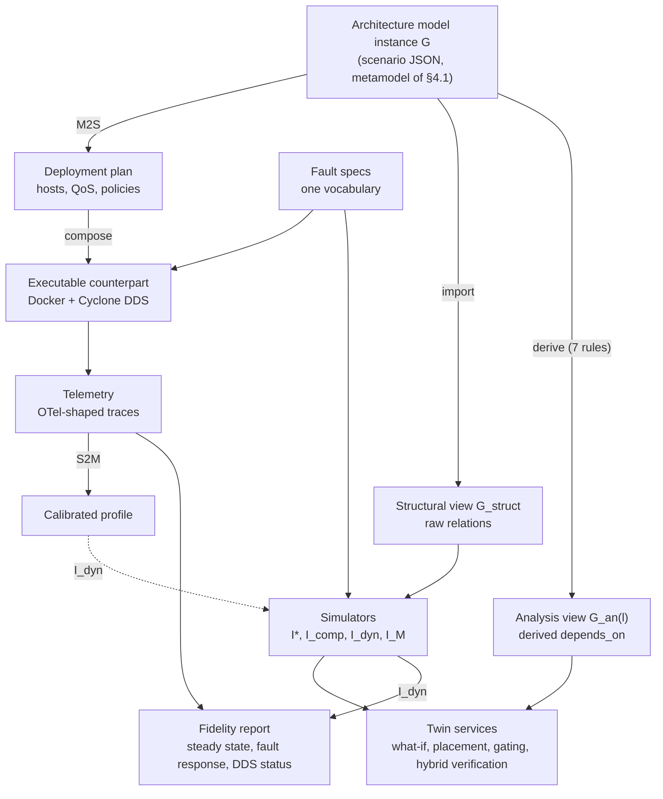
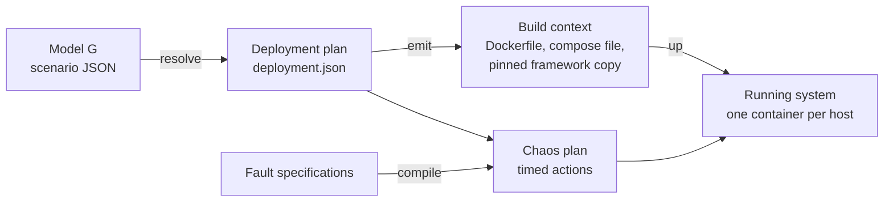

# Engineering an Architectural Digital Twin for Distributed Publish–Subscribe Systems: One Graph Model for Analysis, Simulation, and an Executable Container Testbed

**Authors:**
- Ibrahim Onuralp Yigit\* (Corresponding author. E-mail: `[CORRESPONDING-AUTHOR-EMAIL]`. ORCID: `[0000-0000-0000-0000]`.)
- Feza Buzluca (ORCID: `[0000-0000-0000-0000]`.)

**Affiliation:** `[DEPARTMENT]`, `[INSTITUTION]`, `[STREET ADDRESS]`, `[CITY]`, `[POSTAL CODE]`, `[COUNTRY]`

> *Markdown mirror of the condensed 21-page LaTeX submission ([manuscript.pdf](latex/manuscript.pdf), 2 figures, 6 core tables, 38 references). Detailed QoS/chaos mappings, trace schema thresholds, per-scenario matrices (Tables S1–S8), and CLI reproduction commands are hosted in [SUPPLEMENT.md](SUPPLEMENT.md).*

---

## Abstract

**Context.** Distributed publish–subscribe systems (DDS, ROS 2, Kafka) fail through non-local cascades, broker or host outages, and partitions that appear only in the assembled deployment. Engineering teams need an executable digital counterpart of the *architecture* for pre-deployment what-if analysis and post-deployment checking, yet architectural digital twins are still built ad hoc with rarely measured fidelity.

**Objective.** We present a model-driven method for engineering an architectural digital twin around one typed graph metamodel. A single model instance generates every artefact: derived analysis views, four failure simulators, and an executable Docker + Cyclone DDS testbed acting as the physical counterpart. Of the four simulators, the discrete-event queue-flow simulator ($I_{\mathrm{dyn}}$) is calibrated against and compared with the testbed. The system reaches a *batch digital shadow*, and all fidelity claims are bounded to middleware, timing and transport behaviour under declared application behaviour.

**Method.** The method combines four parts: (1) a metamodel separating structural relations ($G_{\mathrm{struct}}$) from derived dependencies ($G_{\mathrm{an}}$); (2) a model-to-system (M2S) transformation generating a Docker + Cyclone DDS deployment driven by the same fault vocabulary as the simulators; (3) a system-to-model (S2M) calibrator over a shared OpenTelemetry-shaped trace schema with an identifiability analysis; and (4) a fidelity-assessment method separating genuine evidence from agreement by construction, paired with two frozen pre-registered studies.

**Results.** Executable CI invariants (103 checks) enforce rule-by-rule semantic consistency across artefacts. On a 74-component ATM scenario, calibration recovers topic rates within 3%, application service times within 1%, and trigger policies with 100% accuracy when observable, while explicitly reporting non-identifiable parameters (staleness window; burstiness under periodic workload). Under controlled rate and service-time perturbations on three Docker counterparts (including a real-world ROS 2 topology), batch calibration cuts delivery error by 77–96% and latency error by 10–63%, with monotonic rolling EMA convergence. On a four-container smoke test, stall sets ($J = 1.0$) and DDS liveliness agree exactly, while a partition test exposes a $\approx 6$ s Cyclone DDS peer-rediscovery delay absent from the simulator. In frozen pre-registered Study 1 across eight emulated systems (2,738 counterpart runs, 10,950 simulator runs), the primary open-loop publisher-ranking contrast is *inconclusive* (HL $+0.014$, 95% CI $[-0.002, 0.094]$): all arms and a closed-form reference sit at the counterpart's noise ceiling ($\rho \approx 0.92$ vs. $0.93$), a tie foreseeable under open-loop periodic behaviour. Frozen pre-registered Study 2 targeting the independent dimensions across 14 topologies (including five real-world OSS architectures) confirms that the current model significantly lowers steady-state p50 latency error ($n = 13$ at $\kappa = 1$; HL $+0.135$, $p = 0.00061$; median $0.376 \to 0.258$), reproduces broker/host crash rankings (median $\rho = 0.979$, Holm $p = 0.00049$) and stall sets ($J = 1.000$ on all 14/14, Holm $p = 0.00049$), and under parameter misspecification S2M calibration reduces delivery error on every topology (14/14, Holm $p = 0.00049$), while gray-failure omission error vs. a crash reference is not significant ($p = 0.542$).

**Conclusion.** An architectural digital twin can be engineered as model transformations around one metamodel with fidelity treated as a measured, bounded property. Where open-loop publisher ranking ties a closed-form formula, the counterpart's added evidence lies in infrastructure faults, latency, perturbed-parameter calibration and unmodelled middleware behaviour. The remaining step to a live twin—continuous ingestion, topology-drift repair and production actuation—is designed, not implemented.

**Keywords:** Digital twin engineering; Architectural models; Model-driven engineering; Publish–subscribe middleware; DDS; Fault injection; Simulation fidelity; Calibration; Container-based testbed.

---

## 1. Introduction

Publish–subscribe middleware—including OMG DDS (OMG, 2015), ROS 2 (Macenski et al., 2022), Kafka (Kreps et al., 2011) and MQTT (OASIS, 2019)—is widely used in safety- and mission-critical systems such as air traffic management (ATM), autonomous vehicles and industrial control. Decoupling producers from consumers in space, time and synchronisation (Eugster et al., 2003) eases evolution but hides non-local failure modes: when a publisher, broker or host fails, damage propagates against data flow through dependencies that exist only in the assembled deployment. Because delivery pipelines cannot hold full staging environments for every change (Humble and Farley, 2010), architectural questions—which component strands the most subscribers, whether replicas share a failure domain, or whether a long partition recovers cleanly—are routinely answered without an executable counterpart.

Digital twins address this gap by coupling a virtual representation to its physical system (Grieves and Vickers, 2017; Tao et al., 2019), yet digital-twin engineering remains largely ad hoc (Dalibor et al., 2022; Bordeleau et al., 2020), and software-architecture twins rarely measure or bound their fidelity (Wright and Davidson, 2020).

**Problem.** We address the engineering of an *architectural digital twin* for distributed publish–subscribe systems offering what-if failure analysis, placement verification, change gating and hybrid two-tiered verification. Four challenges arise:
1. **One source of truth:** analysis, simulation and the executable counterpart must share semantics so disagreements indicate system defects, not artefact drift.
2. **A pre-deployment physical counterpart:** before the real system exists, an executable stand-in must exercise real middleware under the same faults.
3. **A disciplined path back from telemetry:** guessed pre-deployment parameters must be calibrated from traces while disclosing which parameters telemetry cannot identify.
4. **Measured, non-circular fidelity:** agreement with the counterpart must be quantified without counting shared-construction artefacts as validation.

**Approach and contributions.** We engineered such a twin around one graph metamodel in the open-source Software-as-a-Graph (SaG) framework (Yigit and Buzluca, 2026a), yielding four contributions:
- **C1: Single metamodel with enforced view separation (§4).** One typed graph yields a structural view ($G_{\mathrm{struct}}$, consumed by four failure simulators) and a derived dependency view ($G_{\mathrm{an}}$, consumed by analysis), kept consistent by 103 executable CI invariants.
- **C2: Model-to-system (M2S) transformation (§5).** Compiles the model into a runnable Docker + Cyclone DDS deployment (emulating brokers and replica failover) driven by the same fault vocabulary as the simulators.
- **C3: System-to-model (S2M) calibration and identifiability (§6).** Maps a shared OpenTelemetry-shaped trace schema into calibrated $I_{\mathrm{dyn}}$ parameters while separating recoverable parameters from non-identifiable ones.
- **C4: Bounded, pre-registered fidelity assessment (§7).** Evaluates steady state, fault response and DDS status for $I_{\mathrm{dyn}}$ (the other three simulators are not compared with the counterpart), backed by an explicit independence analysis and two frozen pre-registered studies—Study 1 across eight systems on open-loop publisher ranking, and Study 2 across 14 systems (including five real-world OSS topologies) on independent latency, infrastructure and calibration dimensions.

**Why an emulated middleware counterpart rather than a physical production system?** In safety- and mission-critical domains (e.g. ATM, autonomous vehicles), the target deployment either does not exist yet during architectural design or cannot be subjected to thousands of destructive host-crash and network-partition experiments in production. Crucially, our generated counterpart is *not* a second discrete-event simulator: it executes real OMG Cyclone DDS 11.0.1 processes inside Docker containers over real Linux kernel networking (`tc` packet drops), real OS thread scheduling, real wall-clock time and real `docker kill`/`pause` actions—only the application business logic is stubbed. To prevent circularity from shared model generation, we pair the counterpart with an explicit independence analysis (§7.2), report where the counterpart *falsifies* the simulator (e.g. a $\approx 6$ s post-partition DDS rediscovery delay), and bound every fidelity claim strictly to middleware, timing and transport behaviour under declared application behaviour.

**Maturity claim and relation to prior work.** On the maturity ladder of Kritzinger et al. (2018), the implemented system is a digital model, a generated counterpart and a *batch digital shadow* (§4.3); batch drift detection, EMA re-calibration and residual policy feedback are implemented and evaluated on perturbed Docker counterparts (§8), while continuous ingestion, topology-drift repair and production actuation are designed (§9.2).

A reduced dependency derivation appeared in Yigit and Buzluca (2025), and a companion manuscript under review (Yigit and Buzluca, 2026b) develops the simulators as ranking oracles; a tool paper in preparation covers modeling language and refactoring. None of those works includes the M2S counterpart, S2M calibration, fidelity method, pre-registered studies or maturity analysis reported here (full overlap disclosure in Declarations). Reproducibility details, exhaustive tables and CLI scripts are hosted in the repository's online supplement ([SUPPLEMENT.md](SUPPLEMENT.md); Yigit and Buzluca, 2026a).

**Outline.** §2 reviews related work; §3 states requirements; §§4–7 present C1–C4; §8 evaluates RQ1–RQ4; §9 discusses lessons, the live-twin path and threats; §10 concludes.

---

## 2. Background and Related Work

### 2.1 Digital twins: definitions and maturity

Grieves and Vickers (2017) defined the digital twin as a virtual representation linked to a physical product across its life cycle to expose emergent behaviour before deployment; industrial surveys broadened the concept to processes and services (Tao et al., 2019). Jones et al. (2020) consolidated thirteen twin characteristics and highlighted *fidelity* as a central open gap.

Two distinctions govern our positioning. First, Kritzinger et al. (2018) classify systems by data-flow automation: *digital models* (manual both ways), *digital shadows* (automatic physical-to-virtual only) and *digital twins* (automatic both ways). Second, Wright and Davidson (2020) argue that a twin requires an existing physical counterpart. For a pre-deployment architectural twin—where the production system does not yet exist or cannot safely endure destructive fault injection—we adopt Kritzinger's ladder explicitly (§4.3) and answer Wright and Davidson by generating an *executable real-middleware emulation* (real Cyclone DDS over Linux containers, distinct from discrete-event simulation) while explicitly bounding what that substitution can and cannot prove (§7). ISO 23247-1 defines manufacturing-oriented digital-twin requirements (accuracy, data acquisition, communication) (ISO, 2021); our requirements in §3 address analogous concerns for software architectures.

### 2.2 Model-driven engineering of digital twins

Model-driven engineering treats models as primary artefacts (Schmidt, 2006). Bordeleau et al. (2020) identify heterogeneous model management, bidirectional synchronisation and life-cycle collaboration as core challenges for model-driven twins, while Eramo et al. (2022) conceptualise coupling models with evolving operational data. Kirchhof et al. (2020) synthesise a twin's *information system* from MontiArc and class diagrams; TwinOps (Hugues et al., 2020) combines AADL, Modelica and DevOps for CPS. Dalibor et al. (2022) surveyed 356 publications and documented a scarcity of systematic engineering methods and rigorous evaluations. Unlike Kirchhof et al. (2020), we generate the twin's *physical stand-in* (an executable deployment) from the architecture model, making bidirectional synchronisation concrete via auditable M2S (§5) and S2M (§6) transformations.

### 2.3 Runtime models and architectural analysis

Models@run.time maintains a causally connected self-representation for live adaptation (Blair et al., 2009), whereas our twin targets offline pre-deployment verification with telemetry-based calibration. Classical architecture-based dependability and performance approaches—reliability models (Goseva-Popstojanova and Trivedi, 2001), AADL Error-Model Annex (Delange and Feiler, 2014), Palladio (Becker et al., 2009) and static ROS recovery in ROSDiscover (Timperley et al., 2022)—provide the model side but rarely generate an executable middleware counterpart or quantify fidelity against it. Closest to our S2M path, Mazkatli et al. (2020) incrementally calibrate Palladio parameters from monitoring data and Walter et al. (2017) extract performance models from logs. Because our counterpart is generated from the model itself, our calibrator must additionally establish parameter identifiability (§6.2). Our metamodel extends the graph-based dependency derivation of Yigit and Buzluca (2025).

### 2.4 Emulation, chaos engineering and simulation validation

Container- and namespace-based emulators such as Mininet (Lantz et al., 2010) and Containernet (Peuster et al., 2016) run distributed topologies on one machine. Chaos engineering (Basiri et al., 2016) and service-level fault injection such as Filibuster (Meiklejohn et al., 2021) test resilience in running systems. We combine model-generated emulation with a shared fault vocabulary to create an observed reference for simulators. Finally, simulation-validation theory (Sargent, 2013; Kleijnen, 2015) warns against circular validation against shared assumptions, and computer-model calibration (Kennedy and O'Hagan, 2001) stresses explicit uncertainty and model discrepancy. We transfer both principles to pre-deployment twins via an explicit independence analysis and pre-registered claim table (§7).

---

## 3. Engineering Challenge and Requirements

### 3.1 Setting

This work was motivated by an industrial ATM publish–subscribe programme whose 112-requirement baseline for pre-deployment verification spanned six areas: model generation from engineering artefacts, scenario generation, a field-records telemetry store, analytical preparation, a node–relationship core model, and design verification. Although the baseline never uses the term "digital twin", its closed loop from engineering models to synthetic scenarios and field telemetry defines one. Table 1 condenses that baseline into seven domain-independent requirements (R1–R7).

**Table 1:** Requirements for an architectural digital twin, condensed from a 112-requirement industrial ATM baseline. Status follows §4.3: *built* (implemented and tested), *partly built*, or *designed*.

| ID | Requirement | Where | Status |
|---|---|---|---|
| R1 | **Single source of truth.** Every twin artefact (analysis view, simulator input, counterpart) derives from one model instance via defined transformations. | §4.1, §5 | built |
| R2 | **Semantic consistency.** All consumers of dependency semantics apply identical rules, verified mechanically. | §8.2 | built |
| R3 | **Substrate separation.** Simulators read structural relations only, never derived analysis edges, avoiding tautological scoring. | §4.1 | built |
| R4 | **Executable counterpart.** When the real system is unavailable, the model compiles into a runnable middleware deployment under the same faults. | §5 | built |
| R5 | **Calibration from telemetry.** Pre-deployment parameter guesses are re-estimated from traces, explicitly reporting non-identifiable parameters. | §6 | built (batch) |
| R6 | **Measured fidelity.** Twin-to-counterpart agreement is measured against declared tolerances and reported without gating builds. | §7 | built; studies run |
| R7 | **Drift detection.** Model–system divergence triggers re-calibration or engineer-reviewed model repair. | §9.2 | partly built\* |

*\*Batch parameter/behavioural drift detection, EMA re-calibration and residual feedback are evaluated on perturbed Docker counterparts (§8.3); topology drift is designed.*

### 3.2 Why these requirements are hard together

Taken together, R1–R7 create four architectural tensions:
- **R1 vs. R3:** One model instance must serve both analysis and simulation while enforcing a strict view boundary (§4.1).
- **R4 vs. R6:** Generating the counterpart from the model guarantees partial agreement by construction; R6 is meaningful only with an explicit independence analysis (§7.2).
- **R5 vs. R6:** Calibration and evaluation traces must be strictly disjoint by protocol (§7.3).
- **R7 depends on R5 and R6:** Detecting drift presupposes a calibrated baseline and measured noise; accordingly we built R5–R6 first, evaluated batch drift/EMA next (§8.3), and left topology drift as designed.

---

## 4. The Architectural Digital Twin

Figure 1 summarises the twin's artefacts and transformations around one model instance. Below we define the metamodel (§4.1), services (§4.2) and maturity (§4.3).

**Figure 1:** Artefacts and transformations of the architectural digital twin. The single model instance drives the executable counterpart (playing the physical role), the analysis and structural views, and the engineering services, including closed-batch hybrid verification. Calibration and fidelity comparison apply to $I_{\mathrm{dyn}}$; one fault vocabulary drives both simulation and the counterpart.

### 4.1 Metamodel: one instance, two views

> **Definition 1 (Architecture model).** An architecture model is a typed, weighted, directed multigraph $\mathcal{G} = (V, E, \tau_V, \tau_E, w_V, w_E)$ with weights $w_V, w_E \in [0.01, 1]$, vertex types
> $$\tau_V : V \to \{\textsf{Application}, \textsf{Library}, \textsf{Topic}, \textsf{Broker}, \textsf{Node}, \textsf{NetworkDevice}\},$$
> and edges $E = E_s \cup E_d$ partitioned into derived edges $\tau_E(E_d) = \{\textsc{depends\_on}\}$ and structural relations
> $$\tau_E(E_s) \subseteq \{\textsc{publishes\_to}, \textsc{subscribes\_to}, \textsc{routes}, \textsc{runs\_on}, \textsc{connects\_to}, \textsc{uses}\}.$$
> Topics carry QoS contracts (reliability, durability, history depth, deadline, priority, payload size, rate); hosts carry capacities; undirected `connects_to` edges (modelled as symmetric pairs) carry link capacity and latency.

Each instance exposes two views: the **structural view** $G_{\mathrm{struct}} = (V, E_s)$ and the **analysis view** $G_{\mathrm{an}}(\ell)$, which holds `depends_on` edges derived by seven rules (extending Yigit and Buzluca, 2025) and filtered by layer $\ell \in \{\text{app}, \text{infra}, \text{mw}, \text{system}\}$:
1. a subscriber depends on its topics' publishers (including through library chains);
2. an application depends on the broker routing its topics;
3. a subscriber's host depends on the publisher's host (Rule 1 lifted);
4. an application's host depends on the routing broker's host (Rule 2 lifted);
5. an application depends on the libraries it uses;
6. brokers on the same host share fate;
7. a host depends on network devices separating it from a host it depends on.

Rules 1–2 combine shared topics by probabilistic union and Rules 3–4 by worst-case lift (Yigit and Buzluca, 2026a). Crucially, *analysis consumes $G_{\mathrm{an}}$ while simulation consumes $G_{\mathrm{struct}}$ only* (R3). Simulators that need dependency arcs (change propagation and library-chain fault injection) re-derive them independently from $G_{\mathrm{struct}}$, guarded against drift by CI invariants (§8.2).

### 4.2 Twin services

The twin provides four engineering services, each graded independently of the model that produced the proposal:
- **What-if failure analysis.** Four simulators on $G_{\mathrm{struct}}$ (Yigit and Buzluca, 2026b) serve as behavioural models: cascade reachability ($I^*$), multi-layer composite ($I_{\mathrm{comp}}$), discrete-event SimPy queue-flow delivery loss ($I_{\mathrm{dyn}}$, Team SimPy, 2023) and upstream change ripple ($I_M$). Opt-in $I_{\mathrm{dyn}}$ extensions (queued physical links, latency-SLA degradation and LHS/Sobol uncertainty sweeps) are detailed in the online supplement ([SUPPLEMENT.md](SUPPLEMENT.md)).
- **Placement verification.** An exact optimiser proposes placements under host capacities, failure domains and replica counts; proposals are re-scored on a held-out replica-aware failure simulation and accepted only above a measured noise bar.
- **Change gating.** Rebuilds the twin on candidate changes and blocks only on *newly introduced* structural defects (e.g. new single points of failure or cycles); impact rankings remain advisory rather than blocking (Yigit and Buzluca, 2026b).
- **Hybrid two-tiered verification.** The CLI entry point `saag-simulate hybrid-verify` chains one fault-free baseline and calibration (Step 0), calibrated Tier-1 $I_{\mathrm{dyn}}$ screening with order-$k$ references (Step 1), deterministic shortlisting of top-$K$ targets, disagreements and negative controls (Step 2), and targeted Tier-2 counterpart probing with crash and gray failures (Step 3), emitting machine-readable caveats and an operational health summary.

### 4.3 Maturity: what is built and what is designed

Table 2 adapts Kritzinger et al. (2018) by inserting a *generated counterpart* rung. Present tense throughout describes built capabilities; designed capabilities use requirements voice in §9.2. Even though M2S and S2M are automated, an engineer closes the loop per run and the counterpart is an emulation, satisfying Wright and Davidson (2020) only for *middleware, timing and transport behaviour under declared application behaviour*.

**Table 2:** Maturity of the architectural twin on the ladder of Kritzinger et al. (2018). "Counterpart" is the emulated system (§5) or, at the twin level, a deployed system.

| Level | Model → counterpart | Counterpart → model | Status |
|---|---|---|---|
| Digital model | Model authored/extracted; analysis and simulation run on it. | None. | built |
| Generated counterpart | Model compiled automatically into Docker + DDS deployment and chaos plan (§5). | None. | built |
| Digital shadow (batch) | As above. | Automated trace calibration and fidelity reports (§§6–7) via standalone or `hybrid-verify` runs; batch drift detection, EMA re-calibration and residual feedback evaluated on perturbed Docker counterparts (§8). Invoked per run by an engineer. | built |
| Digital twin | Engineer-approved decisions pushed to deployed system. | Continuous ingestion; topology-drift graph diffing and repair proposals (§9.2). | designed |

---

## 5. Model to System: Generating the Executable Counterpart

To satisfy R4 before the real system exists, the M2S transformation compiles one model instance into a Docker + Cyclone DDS deployment (one container per modelled host) in three stages (Figure 2). Importantly, this counterpart is an *executable middleware emulation*, not a second discrete-event simulator: every message traverses real Cyclone DDS 11.0.1 wire protocols, Linux bridge networking, OS scheduling and kernel-level `tc`/`docker` faults, with only application business logic replaced by timing stubs. Detailed QoS/chaos tables and harness implementation notes (including WaitSet polling to avoid Python GIL stalls, opt-in CPU-bound service burn and payload carrying, and network-gating mechanics) are provided in the online supplement ([SUPPLEMENT.md](SUPPLEMENT.md)).

**Figure 2:** The model-to-system transformation. All runtime semantics are resolved once into `deployment.json`; the chaos plan compiles from the same fault specifications consumed by the simulators.

### 5.1 Three-stage compilation and DDS mappings

- **Stage 1: Deployment plan.** The model is resolved once into a plan (`deployment.json`) fixing topic rates, QoS contracts, broker routes, host residents, replica lists, trigger policies (open-loop or reactive) and mean service times (sized to a declared target utilisation, 0.65 by default). Because the plan is generated by the same functions that configure the simulators, disagreements between twin and counterpart reflect timing and transport rather than divergent model readings.
- **Stage 2: Mapping model concepts to Cyclone DDS.** Model-level QoS attributes (reliability, durability, history depth, deadline, transport priority, payload size, plus a plan-wide 1 s automatic liveliness lease) map cleanly to Cyclone DDS policies as plain unit-testable data ([SUPPLEMENT.md](SUPPLEMENT.md)). Two structural concepts require explicit emulation:
  - **Brokers on peer-to-peer DDS:** Each modelled `Broker` compiles to a relay process bridging an *ingress* partition to an *egress* partition, with lowest-ID active failover under a 1 s heartbeat lease. Relay endpoints are excluded from application DDS-status comparisons.
  - **Replicas:** Multi-hosted applications run one instance per host; the lowest-ID live instance is active while others act as warm standbys taking over after a 1 s lease, mirroring the simulator's replica-aware semantics.

  Each stub application runs one publisher thread per output topic, a single worker thread serving bounded receive queues, and a DDS WaitSet poller thread (preventing Python GIL stalls under middleware callbacks).
- **Stage 3: Pinned build context.** The plan emits a Dockerfile, a Docker Compose file (one container per host on a shared bridge network with `NET_ADMIN`), pinned Cyclone DDS 11.0.1, and a snapshot of the framework code so images cannot drift from their plan.

### 5.2 One fault vocabulary and end-to-end trace links

A single `FaultSpec` list (target, mode, start time, duration, optional seeded Gilbert–Elliott link-flap parameters) drives both the simulators and the counterpart's chaos compiler: host crashes/freezes compile to `docker kill`/`pause`, application/broker faults (crash, freeze, slowdown, omission, babbling) to control files polled every 0.1 s, and link/network-device partitions to `tc` ingress drops using the same `connects_to` reachability module as the simulator ([SUPPLEMENT.md](SUPPLEMENT.md)). Faults the counterpart cannot emulate (e.g. buffer leaks, redelivery storms, or host-level omissions) are reported as *unsupported* and logged in machine-readable `caveats`, never silently skipped.

Every counterpart artefact carries trace links back to $\mathcal{G}$: containers match host IDs, DDS topics match topic IDs, and telemetry records carry modelled component and topic IDs, yielding auditable synchronisation (Bordeleau et al., 2020) as a by-product of generation.

---

## 6. System to Model: Telemetry and Calibration

Pre-deployment models must guess runtime parameters (publication rates, service times, reactive trigger policies). The S2M transformation turns a trace into a *calibrated profile* that overrides declared values in $I_{\mathrm{dyn}}$ (R5), recording provenance for every fitted value and abstaining rather than guessing when telemetry cannot determine a parameter.

### 6.1 Shared trace schema and calibrator

Both $I_{\mathrm{dyn}}$ and the counterpart emit the same OpenTelemetry-shaped JSON-lines schema (shared-clock timestamps, messaging attributes, and seven operational event kinds—*publish*, *deliver*, *deadline miss*, *drop*, *forward*, *state*, *status*—plus an eighth *health* event for operational summaries; full specification in [SUPPLEMENT.md](SUPPLEMENT.md)). Sharing one schema eliminates dual-parser drift.

On the post-warm-up window, the calibrator fits five parameter groups (with exact estimator thresholds in [SUPPLEMENT.md](SUPPLEMENT.md)):
- **Topic rates:** Emissions per active second, subtracting silence gaps from mid-run crashes so fault traces do not bias healthy rates low.
- **Application and broker service times:** Mean and CV from *deliver* and *deadline miss* events (applications) and *forward* events (brokers), fitted as exponential ($\text{CV} \in [0.7, 1.3]$) or lognormal. Including *deadline miss* events is essential: fitting on-time survivors alone biased one ATM application's mean 45% low.
- **Workload burstiness:** Classifies topics with $\ge 30$ emissions as periodic, homogeneous Poisson, or Markov-modulated Poisson process (MMPP) via inter-arrival CV and Fano-factor segmentation.
- **Trigger policies:** Infers *periodic*, *any-of*, *all-of* or `k_of_n:K` from realised emission rates across input-freshness states whenever discriminating outages occur; abstains otherwise.
- **Incremental EMA updates:** `update_profile` blends new steady-state windows against a prior profile for rolling re-calibration (§8).

The calibrator deliberately refuses to populate semantically mismatched slots used by other simulators (such as per-edge failure-correlation probabilities or starvation tolerances), preferring empty slots over plausible-looking miscalibrations.

### 6.2 Identifiability: what telemetry can and cannot recover

We evaluate parameter recovery as automated CI tests (Table 3): simulating the 74-component ATM scenario with known ground truth (60 s fault-free traces for rates/service times; 200 s staggered-outage traces for policies), calibrating, and comparing, supplemented by small synthetic unit round trips (2–5 apps, one seed) for features the ATM settings do not exercise.

**Table 3:** Parameter recovery: simulate with known parameters, calibrate the trace, compare `[P]`. (a) ATM identifiability experiment. (b) Unit round trips on small synthetic systems (one seed).

| Parameter | Recovered? | Evidence |
|---|---|---|
| *(a) ATM scenario (74 components)* | | |
| Topic rates | yes | median relative error 3% (outage-robust on fault traces) |
| App service mean & CV | yes | median relative error 1%; all 30 apps within $\le 3.6$ SE |
| Trigger policy | yes, if observable | 16–17 of 17 apps with inputs/outputs answered, 100% correct across true staleness windows of 2, 3 or 6 periods |
| Staleness window | no | no estimator; not determined by trace |
| Workload burstiness | no, if periodic | periodic declared workload leaves burst ratio unobservable |
| *(b) Unit round trips* | | |
| Broker service mean & CV | yes | from *forward* events of simulator and testbed relays |
| `k_of_n:K` trigger policy | yes | $K = 2$ identified on 3-input app from partial-outage ramp |
| Workload burstiness (MMPP) | yes, if bursty | burst ratio 4.0 recovered in 1.5–6.0; burst fraction 0.1 in 0.02–0.35; zero false positives on periodic/Poisson traces |

The negative rows are a first-class result: post-deployment periodic traces cannot narrow staleness windows or latent burstiness, so twin conclusions sensitive to them must keep carrying that uncertainty. Evaluating calibration on counterpart telemetry is addressed in §8.

---

## 7. Fidelity Assessment

Fidelity is among the least operationalised characteristics of digital twins (Jones et al., 2020). We define three comparison dimensions (§7.1), separate independent evidence from shared construction (§7.2), and freeze our confirmatory analysis in pre-registered protocols (§7.3).

### 7.1 Fidelity dimensions and feedback diagnostics

Every fidelity report compares one simulated trace ($I_{\mathrm{dyn}}$) against one observed trace in the shared schema of §6, never gating builds (R6):
- **Steady state:** Per-element errors against default tolerances (5% topic publication rate, 10% reader delivery rate, 25%/35% p50/p95 latency, 0.05 absolute deadline-miss share; supplement Table S3).
- **Fault response:** Observed impact $I_{\mathrm{obs}}(v)$ mirrors $I_{\mathrm{dyn}}$'s definition (pre-fault minus post-fault delivery rate over surviving readers, matching engine $I_{\mathrm{dyn}}$ within 0.0002 on ATM). We compare impact rankings via Spearman's $\rho$ (with top-$K$ Jaccard also computed in operational triage reports) and per-fault stalled reader sets via Jaccard index $J$.
- **Middleware status:** Compares entities with non-zero DDS counters (liveliness alive/not-alive, offered/requested deadline misses, lost/rejected/cache-replaced samples), excluding broker-relay endpoints.

An operational health evaluator also aggregates per-entity states into ISO/IEC 25019 quality-in-use indices (ISO/IEC, 2023), and two advisory diagnostics—`detect_drift` and `diagnose_fault_residuals`—feed fidelity breaches back to calibration (§8).

### 7.2 Independence analysis: what the counterpart can show

Because the counterpart is generated from the same model as the simulators, reporting shared-construction agreement as fidelity would be circular (Sargent, 2013). Table 4 classifies every counterpart element before any comparison. Why, then, is comparing against a generated counterpart scientifically defensible when a physical production system is absent? Three reasons: (1) *pre-deployment necessity*, since destructive host crashes, broker kills and partitions across 14 topologies ($\approx 3{,}600$ runs) are infeasible on live safety-critical deployments; (2) *genuine runtime independence*, since the counterpart executes real Cyclone DDS, Linux kernel networking and OS scheduling rather than a second simulator; and (3) *empirical falsifiability*, demonstrated by the counterpart contradicting the simulator on post-partition DDS rediscovery ($\approx 6$ s gap), baseline latency tolerances, Study 1's noise-ceiling tie and Study 2's non-significant H2.4. *The strongest attainable conclusion therefore concerns timing, middleware and transport fidelity on an emulated system under declared behaviour—never real production application logic.* To keep these boundaries machine-readable, `hybrid-verify` emits structured `caveats` in every report (flagging reactive circularity, rate-scaled latency distortion, DDS rediscovery lag, and skipped unsupported probes).

**Table 4:** Independence analysis of the generated counterpart. Only agreement on the independent row counts as fidelity evidence.

| Counterpart part | Independent? | Consequence |
|---|---|---|
| DDS delivery, discovery and liveliness; OS scheduling; real elapsed time; container kills and network partitions | yes | what fidelity results can speak to |
| Topic rates, mean service times, queue bounds, failover rule, placement | no (same plan) | agreement is not evidence |
| Trigger policies (reactive behaviour) | no (shared function) | reactive simulator vs. reactive counterpart is circular |
| Late-sample handling | no (configured rule) | engine late-drop mode is never treated as truth |
| Application logic | no (stubs) | no result covers real application behaviour |

### 7.3 Pre-registered fidelity studies

To prevent post-hoc metric or scenario selection, we froze the confirmatory study protocol on 16 November 2026 (commit `9f84aad9`; simulator arms and analysis executed on tag `fidelity-study-arms-code`) before computing any simulator–counterpart comparison ([PREREGISTRATION.md](../fidelity/PREREGISTRATION.md)). Only capacity and noise pilots ran before freezing. Full exclusion, rerun and amendment rules are archived in the repository supplement ([SUPPLEMENT.md](SUPPLEMENT.md)).

**Population, capacity gate and amendments.** The unit of analysis is the *scenario* (avoiding pseudo-replication across components or seeds). Twelve candidate scenarios (eleven generated domains plus ATM) faced a fault-free capacity gate (rate error $\le 5\%$, container CPU p95 $\le 80\%$, rate-scaling factor $\kappa \ge 0.2$ from pilot capacity $B_h = 3{,}033$ msg/s). Nine passed at full rate ($\kappa = 1$), so latency counts on every included scenario; `av` (CPU gate), `enterprise` (peer-discovery/rate gate) and `financial_trading` ($\kappa < 0.2$) were excluded. Two blinded amendments were registered before any simulator arm ran: Amendment 1 judged standby-only hosts (`industrial_scada`'s `N4`) by container liveness instead of log recency; Amendment 2 withdrew `industrial_scada` for compute cost ($\approx 400$ re-runs), yielding $n = 8$.

**Conditions, arms and hypotheses.** The confirmatory condition (**O-open**) makes all applications periodic to avoid trigger-policy circularity (Table 4); **O-react** is descriptive only. Seven arms are compared against $I_{\mathrm{obs}}$ (three repetitions per target): **S0** (published queue-flow engine), **S1** (S0 + DDS deadline semantics), **S2** (current model: S1 + host stations, per-process RNG, replica awareness), **S3** (S2 calibrated from a disjoint fault-free run, respecting R5 vs. R6), **S4** (reactive S2, O-react only), **R** (closed-form first-order rate $\times$ readership formula, no simulation), and **N** (shuffled-label instrument check, must lie within $\pm 0.10$).

Primary hypothesis **H1** tests whether S2 ranks publishing applications closer to $I_{\mathrm{obs}}$ than S0 under O-open (one-sided exact Wilcoxon, Wilcoxon, 1945, $\alpha = 0.05$, Hodges–Lehmann effect size + 95% CI, TOST equivalence against $\delta = 0.05$ fixed from the noise pilot), mapped by a pre-fixed decision table onto *better*, *equivalent*, *inconclusive* or *worse*. A Holm-corrected two-sided secondary family tests **H2** ($\rho(\mathrm{S0}) > 0.70$), **H3** (S2 vs. R), **H4** (S0 vs. R) and **H5** (S2 vs. S3 delivery error). Every per-scenario $\rho$ is paired with the counterpart's leave-one-repetition-out noise ceiling $C_s$ and a formal claim table stating what each outcome licenses.

**Follow-up pre-registered study (Study 2).** Because Study 1's O-open publisher contrast exercised mainly the dependent rows of Table 4 and left $n = 8$ underpowered for Holm, we froze a separate Study 2 protocol on 24 November 2026 (commit `0bbe06af`, leaving Study 1 unmodified; [PREREGISTRATION_V2.md](../fidelity/PREREGISTRATION_V2.md)) across $n = 14$ topologies passing the capacity gate ($\approx 853$ Docker runs): the 8 Study 1 scenarios, `industrial_scada` (restored under Amendment 1), four full-rate real-world OSS topologies (`autoware_ros2`, `edgex`, `homeassistant`, `trainticket`, all $\kappa = 1$) and `cloud_microservices` ($\kappa = 0.74$, excluded from latency per the $\kappa = 1$ rule). Study 2 targets the independent rows directly: primary **H2.1** (steady-state p50 latency error S0 $-$ S2, $n = 13$, one-sided exact Wilcoxon) and Holm-corrected secondary tests **H2.2a/b** (broker/host crash $\rho > 0.85$ and stall-set $J > 0.85$, $n = 14$), **H2.3** (perturbed-counterpart delivery error S2 $-$ S3, $n = 14$) and **H2.4** (gray-failure `omission` $p = 0.5$ impact error on the top-3 highest-fanout publishers vs. an unscaled crash reference, $n = 14$).

---

## 8. Evaluation

We evaluate four research questions—one per challenge of §1: **RQ1** (semantic consistency across artefacts), **RQ2** (parameter calibration and batch drift), **RQ3** (fidelity to the counterpart and divergences) and **RQ4** (service and counterpart cost). Every result carries an explicit provenance tag: **`[P]`** (open-source prototype, regenerable from committed artefacts), **`[S1]`** (frozen pre-registered Study 1, commit `9f84aad9`) or **`[S2]`** (frozen pre-registered Study 2, commit `0bbe06af`). Full per-scenario matrices and test breakdowns are archived in the online supplement ([SUPPLEMENT.md](SUPPLEMENT.md)).

### 8.1 Subjects

Subjects come from the framework's byte-reproducible scenario corpus (Yigit and Buzluca, 2026a): the 74-component `atm` scenario, a five-member ATM scale family (29–444 components), eleven generated domain scenarios (including autonomous vehicles, IoT, healthcare, telecom RAN, microservices and industrial control), two pilot scenarios excluded from the study populations (`tiny_system`: 4 hosts, 12 apps, 2 brokers; and an integration-hub pilot), and five real-world OSS architecture topologies (`autoware_ros2`, `edgex`, `homeassistant`, `trainticket` and `cloud_microservices`) included in Study 2 and the perturbed-counterpart evaluation.

### 8.2 RQ1: Consistency across twin artefacts

Consistency is enforced by **103 automated pytest invariants** in CI `[P]` covering rule-by-rule `depends_on` parity across Rules 1–7 (15 checks), in-memory vs. graph-database repository parity (3), substrate-import isolation (1), oracle-role separation (8), byte-identical scenario regeneration (21), M2S/chaos/in-process parity (34) and `hybrid-verify` contracts (21; full breakdown in supplement Table S4).

These invariants caught a real defect: the simulator's re-derivation originally implemented only 1 of 7 rules, silently zeroing $I_M$ for all scored components; the fix enforced full re-derivation and distinguished *not measured* from zero. Conversely, one residual divergence remains documented as visible consistency debt: when a topic is reachable both directly and via a library, the in-memory repository double-counts its Rule 1 weight while the graph-database repository (and simulator) do not (0 pairs on `atm`, 64 on `microservices` with $\Delta w \le 0.248$, 139 on `av` with $\Delta w \le 0.374$ `[P]`).

**Answer to RQ1.** Automated CI invariants enforce rule-by-rule semantic agreement across all artefacts, caught a major historical bug, and keep residual edge-weight debt measured and visible.

### 8.3 RQ2: Calibration identifiability and perturbed-counterpart recovery

Table 3 (§6.2) shows that on ATM, calibration recovers topic rates within 3% median error, application service means/CVs within 1%, and trigger policies with 100% accuracy when discriminating outages occur, while staleness windows and burstiness under periodic workloads remain non-identifiable; broker service times, `k_of_n:K` policies and bursty MMPP workloads are recovered in unit round trips `[P]`. On the unperturbed Study 1 counterpart, H5 is undecidable because uncalibrated S2 already has 0.000 per-reader delivery error in seven of eight scenarios (0.018 in the eighth, unchanged after calibration; HL $0.000$, Holm n.s.) `[S1]`.

**Perturbed-counterpart calibration and batch drift (Docker) `[P]`.** To test calibration and R7 batch drift when pre-deployment guesses are actually misspecified, we perturbed the Docker + Cyclone DDS counterpart on `tiny_system` (4 containers), `atm` (8 containers) and `realworld_autoware_ros2` (6 containers)—shifting 40% of topic rates by $+50\% / -35\%$ and doubling service times on the busiest host while keeping the twin's prior at declared values (40 s runs, 5 s warm-up, 3 repetitions, calibration from a disjoint trace; supplement Table S6):
- *Batch calibration (S2 → S3):* Cuts median delivery error by 77% on `tiny_system` ($0.277 \to 0.064$), 96% on `atm` ($0.053 \to 0.002$) and 87% on `realworld_autoware_ros2` ($0.284 \to 0.036$), and lowers p50/p95 latency error by 10–63% across all three topologies (e.g. `realworld_autoware_ros2` p95: $0.620 \to 0.228$).
- *Incremental EMA (`update_profile`, $\alpha = 0.5$):* Delivery error converges monotonically across three rolling windows on every topology (`tiny_system`: $0.161 \to 0.091 \to 0.087$; `atm`: $0.059 \to 0.040 \to 0.029$; `realworld_autoware_ros2`: $0.118 \to 0.062 \to 0.038$).
- *Drift detection and residual feedback:* `detect_drift` achieves 1.00 TP (shifted-topic recall 0.73–1.00), but also flags unperturbed baselines ($\text{FP} = 1.00$) despite 0.28% median baseline delivery error (0.28–2.86% across the three topologies) because single-machine p50 latency exceeds 25% on $>20\%$ of topics—showing that rate/delivery and latency drift require separate thresholds. Under a behavioural shift (one app changed from *periodic* to *all-of*), `diagnose_fault_residuals` correctly infers *all-of* on `tiny_system` (`A11`) and `realworld_autoware_ros2` (`A10`), and *any-of* on `atm` (`A1`).

**Answer to RQ2.** Telemetry recovers rates, service times and observable trigger policies; under real parameter misspecification on Docker + DDS counterparts, batch calibration and rolling EMA cut delivery error by 77–96% `[P]` and Study 2 confirmatorily validates delivery-error reduction across all 14 topologies (H2.3: median $0.082 \to 0.018$, HL $+0.096$, Holm $p = 0.00049$) `[S2]`, whereas unperturbed Study 1 H5 has zero baseline error to reduce `[S1]`. Staleness windows and periodic-trace burstiness remain unidentifiable.

### 8.4 RQ3: Fidelity of the simulators to the counterpart

**Smoke test and a real middleware fidelity gap `[P]`.** On `tiny_system` in Docker (4 containers, 1 Hz; supplement Table S5), fault-free, host-crash (`docker kill`) and broker-failover runs agree exactly on stalled readers ($J = 1.0$), exact DDS `liveliness_alive_count` across all 15 readers, and per-reader delivery within 5.9% (p95 latency error 11–18%, within 35% tolerance; p50 14% fault-free, 34–40% under faults). Next, a 10 s switch-crash partition on a two-host chain (with network gating and CPU-bound service matching 21.3 ms vs. 22.5 ms exponential median) stopped deliveries within 0.2 s as simulated, but resumed **$\approx 6$ s after the partition healed** whereas $I_{\mathrm{dyn}}$ reconnects instantaneously: during partitions longer than the 1 s participant lease, Cyclone DDS expires remote participants and must rediscover them. This independent-row finding (Table 4) is invisible to any self-consistent simulator.

**Pre-registered fidelity studies `[S1]` and `[S2]`.** In Study 1 `[S1]`, all 2,738 counterpart runs across $n = 8$ scenarios at $\kappa = 1$ passed validity on the first attempt (0.000 pre-fault rate error; peak CPU p95 38–62%), simulator arms ran 10,950 times, and the instrument check passed ($\rho(\mathrm{N}) = 0.001$). In Study 2 `[S2]`, all 14 topologies (13 at $\kappa = 1$, plus `cloud_microservices` at $\kappa = 0.74$) completed cleanly ($\approx 18.0$ h, $\approx 853$ Docker runs). Table 5 summarises both studies (per-scenario matrices in supplement Tables S7–S8).

**Table 5:** Pre-registered fidelity study results: Study 1 `[S1]` ($n = 8$, $\kappa = 1$, $\delta = 0.05$) and Study 2 `[S2]` ($n = 13$–$14$, independent rows). HL: Hodges–Lehmann median [95% CI]. Holm-corrected secondary tests are two-sided.

| Quantity | Statistic | Value | Decision |
|---|---|---|---|
| *Study 1 `[S1]` (commit `9f84aad9`, $n = 8$, O-open publishers)* | | | |
| H1: S2 vs. S0 (publishers) | HL [CI]; rank-biserial; $p_{\mathrm{sup}}$; $p_{\mathrm{TOST}}$ | $+0.014$ $[-0.002, 0.094]$; 0.56; 0.098; 0.098\* | **inconclusive** |
| H2–H5 (secondary, Holm) | H2 S0 vs. 0.70 ($p = 0.016$); H3 S2 vs. R ($0.84$); H4 S0 vs. R ($0.078$); H5 cal ($0.50$) | all arms & R at ceiling ($\rho \approx 0.91$–$0.93$ vs. $C_s = 0.93$) | all n.s. (Holm) |
| Instrument check (arm N) | median $\rho_s(\mathrm{N})$ | 0.001 | within $\pm 0.10$ |
| *Study 2 `[S2]` (commit `0bbe06af`, $n = 13$–$14$, independent rows)* | | | |
| H2.1: p50 latency S0 $-$ S2 | $n = 13$ ($\kappa = 1$); HL [CI]; 1-sided $p$ | $+0.135$ $[+0.071, +0.225]$; $p = 0.00061$ | **better** |
| H2.2a: Infra $\rho - 0.85$ | $n = 14$; median $\rho$ (range); Holm $p$ | $0.979$ ($0.916$–$1.000$); $p_{\mathrm{H}} = 0.00049$ | **significant** |
| H2.2b: Infra stall $J - 0.85$ | $n = 14$; median $J$; Holm $p$ | $1.000$ (all 14/14); $p_{\mathrm{H}} = 0.00049$ | **significant** |
| H2.3: Perturbed cal S2 $-$ S3 | $n = 14$; HL [CI]; Holm $p$ | $+0.096$ $[+0.034, +0.182]$; $p_{\mathrm{H}} = 0.00049$ | **significant** |
| H2.4: Omission vs. crash ref | $n = 14$; HL [CI]; raw $p$ | $+0.0003$ $[-0.0006, +0.0021]$; $p = 0.542$ | n.s. (Holm) |

*\*Both $p$-values equal 25/256; a tie-aware permutation test gives $p_{\mathrm{sup}} = 0.078$ (same decision).*

**Interpreting Study 1 and Study 2 together.** In Study 1, six scenarios differ by $|d_s| \le 0.02$, `logistics_fleet` favours S0 by 0.020, and noisy `hub_and_spoke` ($C_s = 0.66$) favours S2 by 0.177, leaving H1 inconclusive. Every arm (S0–S3 and closed-form R) sits at the noise ceiling ($\rho \approx 0.91$–$0.93$ vs. $C_s = 0.93$): under O-open, a periodic publisher crash removes only direct-reader deliveries, which R computes directly from the shared plan (dependent rows of Table 4). H2 clears 0.70 in 7/8 scenarios, but at $n = 8$ one loss floors two-sided $p$ at $0.016 > 0.0125$.

Study 2 confirms what Study 1's descriptive analyses suggested once the contrast moves to independent rows across 14 topologies (including five real-world OSS systems): (1) host stations (S2) significantly lower steady-state p50 latency error from median 0.376 (S0) to 0.258 (11/13 wins; p95 $\le 0.30$ on all 13 full-rate scenarios, well inside the 35% tolerance); (2) on broker and host crashes (247 targets total), S2 ranks impact at median $\rho = 0.979$ (`autoware_ros2` $= 1.000$) and achieves exact stall-set agreement ($J = 1.000$) on all 14 scenarios (after fixing Study 1's `healthcare` `A4` prime-second 59 s silence-window artefact on `main`, while Study 1's frozen 0.28 stands); (3) under parameter misspecification, S3 reduces delivery error on all 14/14 scenarios (median $0.082 \to 0.018$, and $0.161$–$0.334 \to 0.003$–$0.047$ on the five OSS topologies); and (4) for top-3 publisher omissions ($p = 0.5$ over 10 s, H2.4), small impact magnitudes leave both S2 and the crash reference with tiny absolute errors ($\approx 0.001$–$0.028$, with the clearest separation on `atm`: $0.0005$ vs. $0.020$) and no significant difference ($p = 0.542$). Study 1's descriptive DDS-status checks (40 faults: `liveliness_alive_count` and `offered_deadline_missed` $J = 0.98$; `requested_deadline_missed` 0.71; `cache_replaced_dropped_samples` 0.50), sink controls ($I_{\mathrm{obs}} \in [0.002, 0.038]$) and O-react sensitivity ($\le 0.06$) are archived in the supplement ([SUPPLEMENT.md](SUPPLEMENT.md)).

**Answer to RQ3.** The counterpart confirms smoke-test stall sets and liveliness and exposes a 6 s DDS post-partition rediscovery gap `[P]`. Study 1 shows open-loop publisher ranking is inconclusive and tied with closed-form R at the noise ceiling `[S1]`. Study 2 confirmatorily establishes that added model detail significantly improves steady-state latency (H2.1), reproduces broker/host crash rankings and exact stall sets (H2.2a/b), and makes S2M calibration effective under parameter misspecification (H2.3), while gray-failure omission error vs. a crash reference is n.s. (H2.4) `[S2]`. All counterpart evidence concerns $I_{\mathrm{dyn}}$ alone.

### 8.5 RQ4: Cost of the twin's services and counterpart

Table 6 shows a five-order-of-magnitude cost ladder matching continuous-delivery stages: sub-second graph gating and graph simulators fit every commit; seconds-per-fault $I_{\mathrm{dyn}}$ fits candidate screening; hybrid two-tiered verification scales with shortlist size rather than $|V|$—finishing in 54.2 s in-process on `tiny_system` and **107.4 min measured** in Docker + DDS on `atm` for two fault probes ($\approx 48$–54 min/probe, a 4–6× speedup over exhaustive sweeps, achieving 1.000 baseline health-state agreement across all 66 entities, Spearman $\rho = 1.000$ across the 5 primary `crash` targets [top-$K$ Jaccard 1.0], and exact rank agreement across the 3 non-host `omission` targets [`i_flow` MAE 0.0008, stall-set $J = 1.0$; primary-only $\rho$ omitted at $n = 2$] while transparently skipping the 5 unsupported host-level omissions in `caveats`); and exhaustive counterpart sweeps ($\approx 18.0$ h for Study 2; $\approx 56$ h for Study 1; 10,950 simulator runs took 69 min on 16 cores) fit periodic twin validation.

**Table 6:** Cost ladder of twin services and counterpart: `[P]` except the last row `[S1]`/`[S2]`. Treat timings as orders of magnitude.

| Artefact | Workload | Cost |
|---|---|---|
| Change gate (analysis + checks) | ATM scale family, 29 / 74 / 148 / 296 / 444 components | 0.01–1.01 s |
| Graph simulators ($I^*, I_{\mathrm{comp}}$) | 5-seed / exhaustive sweep, `atm` (74) / `av` (152) | 0.06–0.45 s |
| Queue-flow simulator ($I_{\mathrm{dyn}}$) | per fault (`atm`/`av`); 5-seed whole corpus | 1.5–4.3 s (12.7 CPU-h) |
| Hybrid verification (in-process) | `tiny_system`: baseline + 17 Tier-1 × 2 seeds + 2 probes | 54.2 s |
| Hybrid verification (Docker + DDS) | `atm`: baseline + 39 Tier-1 × 3 seeds + 8 targets × 3 reps × 2 probes | 107.4 min ($\approx$48–54 min/probe) |
| Counterpart (Docker + DDS) | single run; Study 2 (14 scenarios, $\approx 853$ runs) `[S2]`; Study 1 (8 scenarios, 2,738 runs) `[S1]` | $\approx$71 s; $\approx$18.0 h; $\approx$56 h |

**Answer to RQ4.** Matching each service to its rung on the five-order-of-magnitude cost ladder makes continuous architectural verification practical without running exhaustive container sweeps per change.

---

## 9. Discussion

### 9.1 Lessons for engineering architectural digital twins

- **L1: Generate the physical stand-in; do not build it by hand.** Generating the counterpart from $\mathcal{G}$ ensures traceability (§5.2), co-evolution, and enumerable shared assumptions for Table 4.
- **L2: Share one trace schema across simulation and observation.** Writing calibration and fidelity once for both sides eliminates dual-parser drift; it is cheapest early and costliest to retrofit.
- **L3: Fidelity evidence requires an independence analysis.** Table 4 prevents mistaking shared-plan agreement (e.g. exact topic rates) for validation; the informative findings lie strictly in independent rows (stall sets, liveliness, partition rediscovery, latency).
- **L4: Calibrators must abstain and disclose unidentifiable parameters.** Table 3 keeps realistic-scale evidence separate from unit round trips and prevents presenting unobservable staleness windows or periodic burstiness as calibrated.
- **L5: Make consistency debt visible.** One model instance is not enough; executable CI parity checks catch silent re-derivation bugs while an explicit debt register documents unfixed divergences.
- **L6: Match each service to its rung on the cost ladder.** Sub-second gates per commit, queue-flow screening, $\approx$48–54 min/probe Docker `hybrid-verify` for milestone triage, and machine-hour counterpart sweeps for periodic twin validation keep the twin viable in CI/CD.

### 9.2 From digital shadow to live digital twin (R7)

The twin reaches the batch-shadow level (Table 2), with batch parameter/behavioural drift detection (`detect_drift`, `diagnose_fault_residuals`) and incremental EMA re-calibration (`update_profile`) evaluated on perturbed Docker counterparts (§8). That evaluation showed that rate/delivery drift and latency drift must be thresholded separately because single-machine latency can exceed 25% even when delivery agrees within 0.3% median error (0.3–2.9% across topologies). Three live-twin capabilities remain *designed* (stated in requirements voice):
- **Continuous ingestion:** The twin shall ingest OTel-shaped telemetry continuously, tagged with project, platform and version.
- **Topology drift:** Observed (application, topic) relations differing from $G_{\mathrm{struct}}$ shall produce a graph diff and an engineer-reviewed *model-repair proposal*, never an automatic rewrite.
- **Engineer-in-the-loop actuation:** The twin shall push accepted re-placements or configuration changes only through engineers—never autonomous production actuation, which is inappropriate for mission-critical middleware.

Building calibration (R5) and measured fidelity with known noise (R6) before live drift detection (R7) is forced: drift is a fidelity breach on new data.

### 9.3 Threats to validity

**Construct validity.** $I_{\mathrm{obs}}$ adopts $I_{\mathrm{dyn}}$'s delivery-loss definition rather than latency; stall-set Jaccard ignores partial loss; and only $I_{\mathrm{dyn}}$ (not $I^*$, $I_{\mathrm{comp}}$ or $I_M$) was compared against the counterpart.

**Internal validity.** Shared plan parameters, trigger functions and late-sample rules are bounded by Table 4. Single-machine Python emulation adds scheduling noise, guarded by the capacity gate, CPU logging and WaitSet polling, though large topologies like `enterprise` hit single-machine discovery limits (§7.3).

**External validity.** All counterparts use generated timing stubs over real Cyclone DDS instead of a physical production system; broker semantics are relay-emulated, Kafka/MQTT/ROS 2 back-ends are not built, and real application business logic is untested. While this is an intentional, explicitly bounded pre-deployment trade-off (§7.2), validating against an independently written DDS or ROS 2 application under the same fault vocabulary is the key next external step.

**Conclusion validity.** In Study 1 ($n = 8$ after blinded Amendment 2), exact Wilcoxon floors prevented H2 from clearing Holm ($p = 0.016 > 0.0125$) and allowed noisy `hub_and_spoke` ($C_s = 0.66$) to decide H1; moreover, O-open publisher crashes exercised mainly the dependent rows of Table 4, explaining the tie with closed-form R. Study 2 ($n = 13$–$14$) addressed both limitations directly on independent rows, reaching confirmatory significance on steady-state latency (H2.1), infrastructure crashes and stall sets (H2.2a/b) and perturbed calibration (H2.3), while gray-failure omission error (H2.4) remained non-significant because 10 s $p = 0.5$ omissions on open-loop publishers produce small impact magnitudes where both S2 and the crash reference sit within 0.001–0.028.

---

## 10. Conclusion

We engineered an architectural digital twin for distributed publish–subscribe systems around one typed graph metamodel, deriving separated structural and analysis views guarded by 103 CI invariants (C1), compiling a runnable Docker + Cyclone DDS counterpart under a shared fault vocabulary (C2), calibrating $I_{\mathrm{dyn}}$ over a shared OpenTelemetry-shaped trace schema with explicit identifiability limits (C3), and assessing fidelity through an independence analysis and two frozen pre-registered studies (C4). Claimed strictly at its built level—a digital model, generated counterpart and batch digital shadow—the twin recovers rates, service times and observable trigger policies, cuts delivery error by 77–96% under Docker parameter perturbations with monotonic EMA convergence, matches smoke-test stall sets and DDS liveliness exactly, exposes a $\approx 6$ s Cyclone DDS post-partition rediscovery gap, and fits CI/CD via a five-order-of-magnitude cost ladder (including measured Docker `hybrid-verify` on ATM).

Our two pre-registered studies yield complementary engineering lessons: Study 1 shows that under open-loop periodic behaviour, publisher-impact ranking saturates at the counterpart's noise ceiling and ties a closed-form first-order reference, proving that order-$k$ references must always be reported alongside simulators and confirmatory contrasts must target independent rows. Study 2 then confirms across 14 topologies (including five real-world OSS architectures) that added model detail significantly improves steady-state p50 latency (H2.1, $p = 0.00061$), reproduces broker/host crash rankings (H2.2a, $\rho = 0.979$) and exact stall sets (H2.2b, $J = 1.000$ on all 14/14), and makes S2M calibration effective under parameter misspecification (H2.3, 14/14 improved, Holm $p = 0.00049$). Turning this batch shadow into an engineer-in-the-loop live twin—adding continuous ingestion, topology-drift repair, and validation against an independently built DDS/ROS 2 system—is the natural next step.

---

## Declarations

**Related Work by the Authors and Overlap Disclosure:** (1) *Published:* Yigit and Buzluca (2025) introduced a reduced dependency derivation, condensed and cited in §4.1. (2) *Under review:* A companion manuscript (Yigit and Buzluca, 2026b) (JSS) develops the failure simulators as ranking oracles; this paper cites them as behavioural models and reuses none of its results. (3) *In preparation:* A SoSyM tool paper covers the modeling language, quality diagnosis and refactoring, sharing only the metamodel description and reusing no text or results. (4) *Novel here:* The M2S transformation and generated counterpart, S2M calibration and identifiability analysis, fidelity method and independence analysis, pre-registered studies, perturbed-counterpart drift evaluation, maturity analysis and requirements condensation appear here for the first time.

**Data Availability:** The open-source SaG framework, online reproducibility supplement (`docs/research/edt-sosym/SUPPLEMENT.md` with detailed mapping tables, per-scenario matrices and CLI commands), frozen Study 1 protocol (commit `9f84aad9`, tag `fidelity-study-arms-code`), frozen Study 2 protocol (commit `0bbe06af`, `PREREGISTRATION_V2.md`, `RESULTS_V2.md`), and release **[TBD: paper-release tag]** are available at (Yigit and Buzluca, 2026a). Scenarios, traces and result artefacts will be archived at `[REPOSITORY-URL]`, persistent identifier **[TBD: mint Zenodo DOI for the fidelity-study archive]**.

**Author Contributions:** `[To be completed via the submission interface.]` **Ethics Approval:** Not applicable.

---

## References

- Basiri, A., Behnam, N., de Rooij, R., Hochstein, L., Kosewski, L., Reynolds, J., & Rosenthal, C. (2016). Chaos engineering. *IEEE Software*, 33(3), 35–41. https://doi.org/10.1109/MS.2016.60
- Becker, S., Koziolek, H., & Reussner, R. (2009). The Palladio component model for model-driven performance prediction. *Journal of Systems and Software*, 82(1), 3–22. https://doi.org/10.1016/j.jss.2008.03.066
- Blair, G., Bencomo, N., & France, R. B. (2009). Models@run.time. *IEEE Computer*, 42(10), 22–27. https://doi.org/10.1109/MC.2009.326
- Bordeleau, F., Combemale, B., Eramo, R., van den Brand, M., & Wimmer, M. (2020). Towards Model-Driven Digital Twin Engineering: Current Opportunities and Future Challenges. In *Systems Modelling and Management (ICSMM 2020)*, CCIS 1262 (pp. 43–54). Springer. https://doi.org/10.1007/978-3-030-58167-1_4
- Dalibor, M., Jansen, N., Rumpe, B., Schmalzing, D., Wachtmeister, L., Wimmer, M., & Wortmann, A. (2022). A Cross-Domain Systematic Mapping Study on Software Engineering for Digital Twins. *Journal of Systems and Software*, 193, 111361. https://doi.org/10.1016/j.jss.2022.111361
- Delange, J., & Feiler, P. (2014). Architecture fault modeling with the AADL Error-Model Annex. In *Proc. 40th EUROMICRO Conf. on Software Engineering and Advanced Applications (SEAA)* (pp. 361–368). https://doi.org/10.1109/SEAA.2014.20
- Eramo, R., Bordeleau, F., Combemale, B., van den Brand, M., Wimmer, M., & Wortmann, A. (2022). Conceptualizing Digital Twins. *IEEE Software*, 39(2), 39–46. https://doi.org/10.1109/MS.2021.3130755
- Eugster, P. T., Felber, P. A., Guerraoui, R., & Kermarrec, A.-M. (2003). The many faces of publish/subscribe. *ACM Computing Surveys*, 35(2), 114–131. https://doi.org/10.1145/857076.857078
- Goseva-Popstojanova, K., & Trivedi, K. S. (2001). Architecture-based approach to reliability assessment of software systems. *Performance Evaluation*, 45(2–3), 179–204. https://doi.org/10.1016/S0166-5316(01)00034-7
- Grieves, M., & Vickers, J. (2017). Digital Twin: Mitigating Unpredictable, Undesirable Emergent Behavior in Complex Systems. In F.-J. Kahlen, S. Flumerfelt, & A. Alves (Eds.), *Transdisciplinary Perspectives on Complex Systems: New Findings and Approaches* (pp. 85–113). Springer. https://doi.org/10.1007/978-3-319-38756-7_4
- Hugues, J., Hristozov, A., Hudak, J., & Yankel, J. (2020). TwinOps: DevOps meets model-based engineering and digital twins for the engineering of CPS. In *Proc. 23rd ACM/IEEE Int. Conf. on Model Driven Engineering Languages and Systems: Companion Proceedings (MODELS-C)* (pp. 94:1–94:5). ACM. https://doi.org/10.1145/3417990.3421446
- Humble, J., & Farley, D. (2010). *Continuous Delivery: Reliable Software Releases through Build, Test, and Deployment Automation*. Addison-Wesley.
- ISO. (2021). *ISO 23247-1:2021 Automation systems and integration — Digital twin framework for manufacturing — Part 1: Overview and general principles*. International Organization for Standardization.
- ISO/IEC. (2023). *ISO/IEC 25019:2023 Systems and software engineering — Systems and software Quality Requirements and Evaluation (SQuaRE) — Quality-in-use model*. International Organization for Standardization.
- Jones, D., Snider, C., Nassehi, A., Yon, J., & Hicks, B. (2020). Characterising the Digital Twin: A systematic literature review. *CIRP Journal of Manufacturing Science and Technology*, 29, 36–52. https://doi.org/10.1016/j.cirpj.2020.02.002
- Kennedy, M. C., & O'Hagan, A. (2001). Bayesian calibration of computer models. *Journal of the Royal Statistical Society: Series B (Statistical Methodology)*, 63(3), 425–464. https://doi.org/10.1111/1467-9868.00294
- Kirchhof, J. C., Michael, J., Rumpe, B., Varga, S., & Wortmann, A. (2020). Model-driven Digital Twin Construction: Synthesizing the Integration of Cyber-Physical Systems with Their Information Systems. In *Proc. ACM/IEEE 23rd Int. Conf. on Model Driven Engineering Languages and Systems (MODELS)* (pp. 90–101). ACM. https://doi.org/10.1145/3365438.3410941
- Kleijnen, J. P. C. (2015). *Design and Analysis of Simulation Experiments* (2nd ed.). Springer. https://doi.org/10.1007/978-3-319-18087-8
- Kreps, J., Narkhede, N., & Rao, J. (2011). Kafka: A distributed messaging system for log processing. In *Proc. 6th Int. Workshop on Networking Meets Databases (NetDB)*.
- Kritzinger, W., Karner, M., Traar, G., Henjes, J., & Sihn, W. (2018). Digital Twin in manufacturing: A categorical literature review and classification. *IFAC-PapersOnLine*, 51(11), 1016–1022. https://doi.org/10.1016/j.ifacol.2018.08.474
- Lantz, B., Heller, B., & McKeown, N. (2010). A network in a laptop: rapid prototyping for software-defined networks. In *Proc. ACM SIGCOMM Workshop on Hot Topics in Networks (HotNets 2010)*. ACM. https://doi.org/10.1145/1868447.1868466
- Macenski, S., Foote, T., Gerkey, B., Lalancette, C., & Woodall, W. (2022). Robot Operating System 2: Design, architecture, and uses in the wild. *Science Robotics*, 7(66), eabm6074. https://doi.org/10.1126/scirobotics.abm6074
- Mazkatli, M., Monschein, D., Grohmann, J., & Koziolek, A. (2020). Incremental calibration of architectural performance models with parametric dependencies. In *Proc. IEEE Int. Conf. on Software Architecture (ICSA 2020)*. IEEE. https://doi.org/10.1109/ICSA47634.2020.00011
- Meiklejohn, C. S., Estrada, A., Song, Y., Miller, H., & Padhye, R. (2021). Service-level fault injection testing. In *Proc. ACM Symposium on Cloud Computing (SoCC '21)* (pp. 388–402). ACM. https://doi.org/10.1145/3472883.3487005
- OASIS. (2019). *MQTT Version 5.0*. OASIS Standard, https://docs.oasis-open.org/mqtt/mqtt/v5.0/mqtt-v5.0.html (accessed 9 September 2026).
- Object Management Group (OMG). (2015). *Data Distribution Service (DDS)* (formal/2015-04-10, version 1.4). Object Management Group.
- Peuster, M., Karl, H., & van Rossem, S. (2016). MeDICINE: Rapid prototyping of production-ready network services in multi-PoP environments. In *Proc. IEEE Conf. on Network Function Virtualization and Software Defined Networks (NFV-SDN)* (pp. 148–153). IEEE. https://doi.org/10.1109/NFV-SDN.2016.7919490
- Sargent, R. G. (2013). Verification and validation of simulation models. *Journal of Simulation*, 7(1), 12–24. https://doi.org/10.1057/jos.2012.20
- Schmidt, D. C. (2006). Model-Driven Engineering. *IEEE Computer*, 39(2), 25–31. https://doi.org/10.1109/MC.2006.58
- Tao, F., Zhang, H., Liu, A., & Nee, A. Y. C. (2019). Digital Twin in Industry: State-of-the-Art. *IEEE Transactions on Industrial Informatics*, 15(4), 2405–2415. https://doi.org/10.1109/TII.2018.2873186
- Team SimPy. (2023). *SimPy: Discrete event simulation for Python* [software], Version 4.1.1, https://pypi.org/project/simpy/4.1.1/ (accessed 9 September 2026).
- Timperley, C. S., Dürschmid, T., Schmerl, B., Garlan, D., & Le Goues, C. (2022). ROSDiscover: Statically Detecting Run-Time Architecture Misconfigurations in Robotics Systems. In *2022 IEEE 19th International Conference on Software Architecture (ICSA)* (pp. 112–123). https://doi.org/10.1109/ICSA53651.2022.00019
- Walter, J., Stier, C., Koziolek, H., & Kounev, S. (2017). An expandable extraction framework for architectural performance models. In *Companion Proc. 8th ACM/SPEC Int. Conf. on Performance Engineering (ICPE '17)* (pp. 165–170). ACM. https://doi.org/10.1145/3053600.3053634
- Wilcoxon, F. (1945). Individual comparisons by ranking methods. *Biometrics Bulletin*, 1(6), 80–83. https://doi.org/10.2307/3001968
- Wright, L., & Davidson, S. (2020). How to tell the difference between a model and a digital twin. *Advanced Modeling and Simulation in Engineering Sciences*, 7, 13. https://doi.org/10.1186/s40323-020-00147-4
- Yigit, I. O., & Buzluca, F. (2025). A Graph-Based Dependency Analysis Method for Identifying Critical Components in Distributed Publish–Subscribe Systems. In *Proc. IEEE Int. Conf. on Recent Advances in Systems Science and Engineering (RASSE)* (pp. 1–9). https://doi.org/10.1109/RASSE64831.2025.11315354
- Yigit, I. O., & Buzluca, F. (2026a). *Software-as-a-Graph* [software], Study 1 protocol freeze commit `9f84aad9` (study code tag `fidelity-study-arms-code`); Study 2 protocol freeze commit `0bbe06af`; release **[TBD: paper-release tag]**, GitHub, https://github.com/onuralpyigit/software-as-a-graph/tree/9f84aad92330fd576081daa771ae1ef3258fb928 (accessed 28 November 2026).
- Yigit, I. O., & Buzluca, F. (2026b). Software-as-a-Graph: When Does Graph Learning Improve Cascade-Impact Ranking in Publish–Subscribe Systems? Manuscript under review, *Journal of Systems and Software*.
