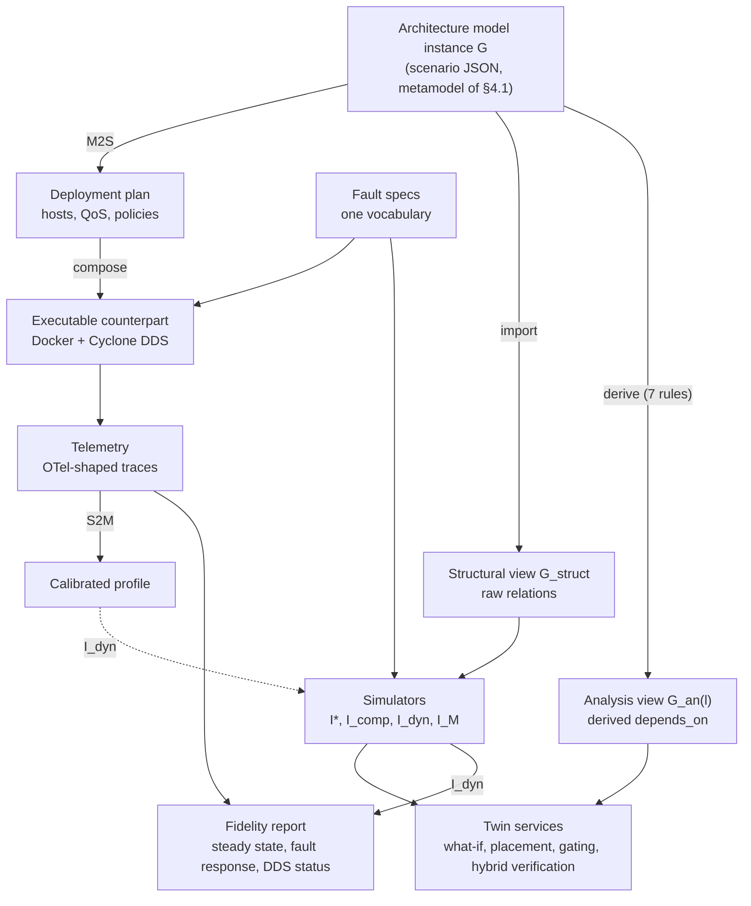
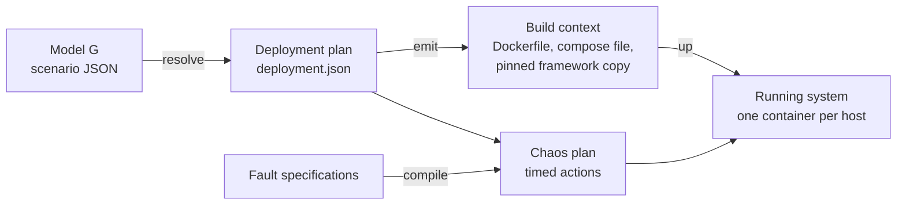

# Paper Overview: Engineering an Architectural Digital Twin for Distributed Publish–Subscribe Systems

- **Working Title:** *Engineering an Architectural Digital Twin for Distributed Publish–Subscribe Systems: One Graph Model for Analysis, Simulation, and an Executable Container Testbed*
- **Authors:** Ibrahim Onuralp Yigit, Feza Buzluca
- **Target Venue:** *Software and Systems Modeling (SoSyM)* — Rolling Theme Section on *Engineering of Digital Twins* (EDTConf journal-first track; manuscript type: **Theme Section Paper**)
- **Manuscript Files:** 10 sections + Declarations, 21 pages ([manuscript.pdf](latex/manuscript.pdf) | [manuscript.tex](latex/manuscript.tex) | [SUPPLEMENT.md](SUPPLEMENT.md) | [cover_letter.md](cover_letter.md) | [RESULTS.md](../fidelity/RESULTS.md) | [RESULTS_V2.md](../fidelity/RESULTS_V2.md))
- **Status (2026-11-28):** Condensed 21-page draft complete. All three evidence tracks are complete: prototype (`[P]`, including Docker perturbed calibration/drift & Docker `hybrid-verify` on `atm`), frozen Study 1 (`[S1]`, `9f84aad9`, $n = 8$, 2,738 runs, $\approx$56 h), and frozen Study 2 (`[S2]`, `0bbe06af`, $n = 14$ including 5 real-world OSS topologies, $\approx 853$ runs, $\approx 18.0$ h: **H2.1 Better**, **H2.2a/b & H2.3 Holm-significant**). Only submission metadata placeholders remain.

---

## 1. Abstract

*Aligned with [latex/sections/abstract.tex](latex/sections/abstract.tex).*

**Context.** Distributed publish–subscribe systems (DDS, ROS 2, Kafka) fail through non-local cascades, broker or host outages, and partitions that appear only in the assembled deployment. Engineering teams need an executable digital counterpart of the *architecture* for pre-deployment what-if analysis and post-deployment checking, yet architectural digital twins are still built ad hoc with rarely measured fidelity.

**Objective.** We present a model-driven method for engineering an architectural digital twin around one typed graph metamodel. A single model instance generates every artefact: derived analysis views, four failure simulators, and an executable Docker + Cyclone DDS testbed acting as the physical counterpart. Of the four simulators, the discrete-event queue-flow simulator ($I_{\mathrm{dyn}}$) is calibrated against and compared with the testbed. The system reaches a *batch digital shadow*, and all fidelity claims are bounded to middleware, timing and transport behaviour under declared application behaviour.

**Method.** The method combines four parts: (1) a metamodel separating structural relations ($G_{\mathrm{struct}}$) from derived dependencies ($G_{\mathrm{an}}$); (2) a model-to-system (M2S) transformation generating a Docker + Cyclone DDS deployment driven by the same fault vocabulary as the simulators; (3) a system-to-model (S2M) calibrator over a shared OpenTelemetry-shaped trace schema with an identifiability analysis; and (4) a fidelity-assessment method separating genuine evidence from agreement by construction, paired with two frozen pre-registered studies.

**Results.** Executable CI invariants (103 checks) enforce rule-by-rule semantic consistency across artefacts. On a 74-component ATM scenario, calibration recovers topic rates within 3%, application service times within 1%, and trigger policies with 100% accuracy when observable, while explicitly reporting non-identifiable parameters (staleness window; burstiness under periodic workload). Under controlled rate and service-time perturbations on three Docker counterparts (including a real-world ROS 2 topology), batch calibration cuts delivery error by 77–96% and latency error by 10–63%, with monotonic rolling EMA convergence. On a four-container smoke test, stall sets ($J = 1.0$) and DDS liveliness agree exactly, while a partition test exposes a $\approx 6$ s Cyclone DDS peer-rediscovery delay absent from the simulator. In frozen pre-registered Study 1 across eight emulated systems (2,738 counterpart runs, 10,950 simulator runs), the primary open-loop publisher-ranking contrast is *inconclusive* (HL $+0.014$, 95% CI $[-0.002, 0.094]$): all arms and a closed-form reference sit at the counterpart's noise ceiling ($\rho \approx 0.92$ vs. $0.93$), a tie foreseeable under open-loop periodic behaviour. Frozen pre-registered Study 2 targeting the independent dimensions across 14 topologies (including five real-world OSS architectures) confirms that the current model significantly lowers steady-state p50 latency error ($n = 13$ at $\kappa = 1$; HL $+0.135$, $p = 0.00061$; median $0.376 \to 0.258$), reproduces broker/host crash rankings (median $\rho = 0.979$, Holm $p = 0.00049$) and stall sets ($J = 1.000$ on all 14/14, Holm $p = 0.00049$), and under parameter misspecification S2M calibration reduces delivery error on every topology (14/14, Holm $p = 0.00049$), while gray-failure omission error vs. a crash reference is not significant ($p = 0.542$).

**Conclusion.** An architectural digital twin can be engineered as model transformations around one metamodel with fidelity treated as a measured, bounded property. Where open-loop publisher ranking ties a closed-form formula, the counterpart's added evidence lies in infrastructure faults, latency, perturbed-parameter calibration and unmodelled middleware behaviour. The remaining step to a live twin—continuous ingestion, topology-drift repair and production actuation—is designed, not implemented.

---

## 2. Core Contributions, Maturity Positioning & Lessons

### Four Contributions (C1–C4)
- **C1 — Single Source of Truth with Substrate Separation (§4, §8.2):** One typed graph metamodel produces both a structural view ($G_{\mathrm{struct}}$, consumed by simulators) and a derived analysis view ($G_{\mathrm{an}}(\ell)$, 7 `depends_on` rules). Executable invariants in CI enforce rule-by-rule semantic consistency and forbid simulators from reading derived edges (preventing tautological evaluation).
- **C2 — Model-to-System Transformation & Unified Fault Vocabulary (§5):** Compiles the model once into a self-contained `deployment.json` plan and a pinned Docker + Cyclone DDS (11.0.1) build context (one container per host). Emulates brokers via ingress/egress relay partitions, replicas via 1 s lease failover, and maps model-level QoS to DDS policies. One `FaultSpec` list compiles into both simulator events and chaos actions (`docker kill`/`pause`, `tc` partitions with shared network-gating reachability, control files); unsupported faults are reported, never silently skipped.
- **C3 — System-to-Model Calibration & Identifiability Analysis (§6):** Both simulator ($I_{\mathrm{dyn}}$) and counterpart emit the same OpenTelemetry-shaped JSON-lines trace schema. The calibrator fits topic rates and service-time distributions on fault-free steady state (recording deadline misses to avoid a 45% survivor bias) and infers trigger policies from discriminating outages. Table 3 separates the ATM identifiability experiment from unit round trips, explicitly reports non-identifiable parameters (staleness window; burstiness under periodic workload), and refuses to populate semantically mismatched slots.
- **C4 — Bounded, Pre-Registered Fidelity Assessment (§7):** Evaluates three dimensions (steady state, fault response, DDS status) backed by an **independence analysis** distinguishing genuine evidence (DDS delivery/discovery/liveliness, OS scheduling, real time, container kills/partitions) from agreement guaranteed by construction (shared plan rates, service times, queue bounds, trigger policies, stub logic). Fixes scenarios, arms, hypotheses (Study 1 H1–H5; Study 2 H2.1–H2.4), noise ceilings, and formal claim tables in two frozen pre-registrations before running comparisons.

### Honest Maturity Positioning
- **Built:** Digital model $\to$ Generated counterpart $\to$ Batch digital shadow (both M2S and S2M are automated, but an engineer closes the loop per run and the counterpart is an emulation).
- **Partly built & evaluated in batch (R7, §8.3, §9.2):** Batch parameter and behavioural drift detection, incremental EMA re-calibration, and residual policy feedback are implemented, unit-tested, and evaluated on perturbed Docker counterparts.
- **Designed only (§9.2):** Continuous telemetry ingestion, automated topology-drift graph diffing, engineer-approved model repair; no autonomous production actuation.
- **Claim boundary & defense of the emulated counterpart (§1, §5, §7.2):** Why compare against a generated container testbed instead of a physical production system? (1) **Real-middleware emulation $\neq$ simulation**—the counterpart runs real Cyclone DDS 11.0.1, Linux kernel `tc` drops, OS scheduling, and `docker kill`/`pause` (only application logic is stubbed); (2) **Pre-deployment necessity**—safety-critical systems do not exist yet or cannot endure ~3,600 destructive fault runs; (3) **Non-circular & falsifiable**—Table 4 isolates independent evidence, and the counterpart actively falsified the simulator (6 s DDS rediscovery gap, Study 1 tie with $R$, Study 2 H2.4 n.s.). All fidelity claims apply strictly to *middleware, timing, and transport behaviour under declared application behaviour*.

### Headline Engineering Lessons (L1–L6, §9.1)
1. **Generate the physical stand-in; do not build it by hand** (enables traceability, co-evolution, and enumerable shared assumptions).
2. **Share one trace schema across simulation and observation** (eliminates dual-parser drift; cheapest decision early, costliest to retrofit).
3. **Fidelity evidence requires an independence analysis** (prevents reporting agreement by construction as validation).
4. **Calibrators must abstain and disclose what telemetry cannot identify** (prevents silently presenting unidentifiable guesses as calibrated).
5. **Make consistency debt visible** (executable CI parity checks + explicit register of documented divergences).
6. **Match each twin service to its rung on the cost ladder** (sub-second graph checks per commit $\to$ calibrated queue-flow screening $\to$ hybrid two-tiered verification on shortlists in minutes $\to$ machine-hour exhaustive counterpart sweeps for periodic twin validation).

---

## 3. Paper Structure

| § | Section & File | Subsections, Figures & Tables | Key Content & Status |
|---|---|---|---|
| **1** | **Introduction** ([sec1_introduction.tex](latex/sections/sec1_introduction.tex)) | Problem, Approach, Contributions (C1–C4), What we claim, Fit to theme, Relation to prior work, Outline | Non-local pub–sub failures; 4 engineering challenges; C1–C4; maturity honesty; overlap disclosure with RASSE 2025, JSS (under review), and SoSyM tool paper (in prep). **Complete.** |
| **2** | **Background and Related Work** ([sec2_background.tex](latex/sections/sec2_background.tex)) | §2.1 DT definitions & maturity; §2.2 Model-driven DT engineering; §2.3 Runtime models & architectural analysis; §2.4 Emulation, chaos engineering & simulation validation | Kritzinger ladder, Wright & Davidson's physical-counterpart test, ISO 23247-1; Bordeleau, Eramo, Kirchhof, TwinOps, Dalibor; models@run.time, AADL, Palladio, ROSDiscover, Mazkatli, Walter; Mininet, Containernet, chaos engineering, Filibuster, Sargent, Kleijnen, Kennedy & O'Hagan. **Complete.** |
| **3** | **Engineering Challenge and Requirements** ([sec3_requirements.tex](latex/sections/sec3_requirements.tex)) | §3.1 Setting; §3.2 Why these requirements are hard together • *Table 1:* Requirements R1–R7 | 112-requirement industrial ATM baseline condensed into 7 requirements (R1–R7); architectural tensions (R1 vs. R3, R4 vs. R6, R5 vs. R6, R7 depending on R5 & R6). **Complete.** |
| **4** | **The Architectural Digital Twin** ([sec4_twin.tex](latex/sections/sec4_twin.tex)) | §4.1 Metamodel: one instance, two views; §4.2 Twin services; §4.3 Maturity • *Fig. 1:* Twin artefacts & transformations • *Table 2:* Maturity ladder | Formal graph metamodel ($G_{\mathrm{struct}}$ vs. $G_{\mathrm{an}}(\ell)$, 7 rules); 4 services (what-if via $I^*, I_{\mathrm{comp}}, I_{\mathrm{dyn}}, I_M$; placement verification; non-blocking-ranking change gate; hybrid two-tiered verification via `hybrid-verify`); maturity table. **Complete.** |
| **5** | **Model to System: Generating the Executable Counterpart** ([sec5_model_to_system.tex](latex/sections/sec5_model_to_system.tex)) | §5.1 Three-stage compilation & DDS mappings; §5.2 One fault vocabulary & trace links • *Fig. 2:* M2S pipeline *(QoS & chaos tables in [SUPPLEMENT.md](SUPPLEMENT.md))* | `deployment.json` resolution; broker relays, replica standbys, WaitSet poller; pinned Docker + Cyclone DDS context; shared `FaultSpec` + explicit unsupported-fault reporting; end-to-end trace links. **Complete.** |
| **6** | **System to Model: Telemetry and Calibration** ([sec6_system_to_model.tex](latex/sections/sec6_system_to_model.tex)) | §6.1 Shared trace schema & calibrator; §6.2 Identifiability • *Table 3:* Parameter recovery, (a) ATM and (b) unit round trips | Shared OpenTelemetry-shaped JSONL schema (details in `SUPPLEMENT.md`); topic rates, app/broker service times (with deadline misses), MMPP burstiness, trigger policy inference, abstention rules; ATM identifiability test. **Complete.** |
| **7** | **Fidelity Assessment** ([sec7_fidelity.tex](latex/sections/sec7_fidelity.tex)) | §7.1 Fidelity dimensions & diagnostics; §7.2 Independence analysis; §7.3 Pre-registered fidelity studies • *Table 4:* Independence analysis *(tolerances & protocol details in [SUPPLEMENT.md](SUPPLEMENT.md))* | Steady-state, fault-response ($I_{\mathrm{obs}}$, $\rho$, stall-set $J$), DDS status, operational health & drift diagnostics; independence classification & emulated-counterpart defense; frozen Study 1 (`9f84aad9`, $n = 8$, $B_h = 3{,}033$ msg/s, $\kappa = 1$) & Study 2 (`0bbe06af`, $n = 14$, $\approx 853$ runs). **Complete.** |
| **8** | **Evaluation** ([sec8_evaluation.tex](latex/sections/sec8_evaluation.tex)) | §8.1 Subjects; §8.2 RQ1 Consistency; §8.3 RQ2 Calibration & Drift; §8.4 RQ3 Fidelity; §8.5 RQ4 Cost • *Table 5:* Study 1 & Study 2 summary; *Table 6:* Cost ladder *(103-check, smoke-test, drift & per-scenario tables in [SUPPLEMENT.md](SUPPLEMENT.md))* | Provenance tags (`[P]`, `[S1]`, `[S2]`); 103 CI invariants, historical $I_M$ bug, Rule 1 debt; ATM identifiability + perturbed Docker calibration/EMA; smoke test, 6 s DDS rediscovery gap, Study 1 & Study 2 results; 5-order-of-magnitude cost ladder with measured Docker `hybrid-verify`. **Complete.** |
| **9** | **Discussion** ([sec9_discussion.tex](latex/sections/sec9_discussion.tex)) | §9.1 Lessons (L1–L6); §9.2 From digital shadow to live digital twin (R7); §9.3 Threats to validity | Six engineering lessons; batch drift findings (separate rate vs. latency thresholds) + requirements-voice live-twin design (continuous ingestion, topology drift, engineer-in-the-loop actuation); construct, internal, external, and Study 1 + Study 2 conclusion validity. **Complete.** |
| **10** | **Conclusion** ([sec10_conclusion.tex](latex/sections/sec10_conclusion.tex)) | Summary of method, complementary Study 1 + Study 2 lessons, and next step | Recap of C1–C4, batch-shadow claim, empirical findings, complementary lessons from Study 1 (order-$k$ references, independent contrasts) and Study 2 (confirmatory latency, infra crash/stall, perturbed calibration), and next steps toward a live twin. **Complete.** |
| **—** | **Declarations** ([declarations.tex](latex/sections/declarations.tex)) | Funding, Competing Interests, Overlap Disclosure, Data Availability, Author Contributions, Ethics | Explicit disclosure of RASSE 2025, JSS (under review), and SoSyM tool paper (in prep); reproducible CLI commands. **Metadata placeholders pending** (grant number, affiliations/ORCIDs, release tag, Zenodo DOI). |

---

## 4. Figures & Tables Overview

The manuscript contains **2 architecture/pipeline figures** (rendered in TikZ in `manuscript.pdf`, previewed below via Mermaid) and **6 core tables** in the main text, with **8 detailed reproducibility tables** (Tables S1–S8) hosted in [SUPPLEMENT.md](SUPPLEMENT.md).

### Figure 1 (§4) — Twin Artefacts and Transformations

*Caption:* Artefacts and transformations of the architectural digital twin. The single model instance drives the executable counterpart (playing the physical role), the analysis and structural views, and the services offered to engineers, including the closed-batch hybrid verification workflow that couples calibration, Tier-1 queue-flow screening and targeted Tier-2 counterpart probing. M2S and S2M are the model-to-system (§5) and system-to-model (§6) transformations. The dashed edge is optional: a simulator run is calibrated only when requested. Calibration and fidelity comparison apply to the discrete-event queue-flow simulator ($I_{\mathrm{dyn}}$). The same fault specifications drive both simulation and the counterpart.

### Figure 2 (§5) — Model-to-System (M2S) Transformation Pipeline

*Caption:* The model-to-system transformation. Everything an agent needs is resolved once into the plan, so all containers agree on it. The chaos plan is compiled from the same fault specifications the simulators consume.

### Index of Tables (6 Core Main Tables + 8 Supplement Tables)

| Location | Tables |
|---|---|
| **Main Paper (Tables 1–6)** | **Table 1** (§3): Requirements R1–R7 • **Table 2** (§4): Kritzinger maturity ladder • **Table 3** (§6): Calibration parameter recovery (ATM + unit round trips) • **Table 4** (§7): Independence analysis • **Table 5** (§8.4): Pre-registered Study 1 `[S1]` & Study 2 `[S2]` decisions • **Table 6** (§8.5): 5-order-of-magnitude cost ladder `[P]`/`[S1]`/`[S2]` |
| **Online Supplement ([SUPPLEMENT.md](SUPPLEMENT.md), Tables S1–S8)** | **S1:** Topic QoS $\to$ DDS mapping • **S2:** FaultSpec $\to$ chaos actions • **S3:** Steady-state tolerances • **S4:** 103 executable CI invariants • **S5:** `tiny_system` Docker smoke test • **S6:** Perturbed-counterpart calibration & R7 drift (Docker) • **S7:** Study 1 per-scenario $\rho$ matrix (+ descriptive summary) • **S8:** Study 2 14-scenario matrix |

---

## 5. Experiments & Evaluation Design

Every empirical number in §8 carries an explicit provenance tag: **`[P]`** (measured on the open-source prototype, regenerable from committed artefacts), **`[S1]`** (frozen pre-registered Study 1, commit `9f84aad9`), or **`[S2]`** (frozen pre-registered Study 2, commit `0bbe06af`).

### Subjects (§8.1)
- **`atm`:** 74-component Air Traffic Management scenario.
- **ATM scale family:** 5 topologies from 29 to 444 components (QoS mix, fan-out shape, and criticality proportion held fixed).
- **Multi-domain corpus:** 11 generated scenarios across autonomous vehicles, IoT, financial trading, healthcare, microservices, telecom RAN, real-time gaming, logistics, hub-and-spoke, enterprise, and industrial control.
- **Real-world OSS topologies (5):** `autoware_ros2`, `edgex`, `homeassistant`, `trainticket`, and `cloud_microservices` (included in Study 2 and the perturbed-counterpart evaluation).
- **Pilots (excluded from study populations):** `tiny_system` (4 hosts, 12 apps, 2 brokers) and an integration-hub pilot (20 publishers) used for capacity/noise calibration and smoke testing.

### Four Experimental Tracks (RQ1–RQ4)

| RQ | Question | Experimental Setup |
|---|---|---|
| **RQ1** (Consistency) | Do all twin artefacts derived from one model instance agree on its semantics? | 103 automated pytest invariants in CI (Supplement Table S4) testing rule-by-rule `depends_on` parity (Rules 1–7), in-memory vs. graph-DB parity, substrate-import guard, scenario byte-identity, M2S/chaos parity, and `hybrid-verify` contracts `[P]`. |
| **RQ2** (Calibration) | Which runtime parameters can S2M calibration recover from telemetry? | **(a) ATM identifiability `[P]`:** Simulate 74-component `atm` with known ground truth (60 s fault-free traces for rates/service times; 200 s staggered-outage traces for trigger policies), calibrate, compare. **(b) Unit round trips `[P]`:** Small synthetic brokered systems (2–5 apps, 1 seed) for broker service times, `k_of_n:K`, and MMPP burstiness. **(c) Perturbed Docker & R7 drift `[P]`:** $+50\%/-35\%$ topic rate shifts and $2\times$ busiest-host service time on `tiny_system`, `atm`, `realworld_autoware_ros2`. **(d) Confirmatory calibration:** Study 1 H5 (unperturbed, $n = 8$) `[S1]` and Study 2 H2.3 (perturbed, $n = 14$) `[S2]`. |
| **RQ3** (Fidelity) | How faithfully do simulators reproduce the counterpart, and where do they diverge? | **(a) Smoke test `[P]`:** `tiny_system` in Docker (4 containers, 1 Hz) under fault-free, host crash (`docker kill`), and broker failover runs. **(b) Partition test `[P]`:** 2-host chain behind a switch with network gating, CPU-bound work, and a 10 s switch crash. **(c) Pre-registered Study 1 `[S1]`:** Frozen protocol (`9f84aad9`), $n = 8$ at $\kappa = 1$, 2,738 counterpart runs, 10,950 simulator runs across 7 arms. **(d) Pre-registered Study 2 `[S2]`:** Frozen protocol (`0bbe06af`), $n = 14$ (13 at $\kappa = 1$, including 5 real-world OSS topologies), $\approx 853$ runs targeting independent rows (H2.1–H2.4). |
| **RQ4** (Cost) | What do twin services and the counterpart cost, and does that fit CI/CD? | Measured wall-clock / CPU timings across the ATM scale family (29–444 components), full-corpus $I_{\mathrm{dyn}}$ sweep, in-process (`tiny_system`, 54.2 s) and measured Docker `hybrid-verify` (`atm`, 107.4 min) `[P]`, and the full Study 2 ($\approx 18.0$ h) `[S2]` & Study 1 ($\approx 56$ h) `[S1]` sweeps. |

### Pre-Registered Study Arms & Hypotheses (`[S1]` & `[S2]`, §7.3)
- **Study 1 (`[S1]`, `9f84aad9`, $n = 8$):** `O-open` (confirmatory periodic) and `O-react` (descriptive); 7 arms (`S0`, `S1`, `S2`, `S3`, `S4`, closed-form `R`, shuffled `N`); primary **H1** (`S2` vs. `S0` publishers, exact Wilcoxon + HL + TOST $\delta = 0.05$); secondary Holm family **H2** (`S0` vs. 0.70), **H3** (`S2` vs. `R`), **H4** (`S0` vs. `R`), **H5** (`S2` vs. `S3` unperturbed delivery error); leave-one-repetition-out noise ceiling $C_s$ and formal claim table.
- **Study 2 (`[S2]`, `0bbe06af`, $n = 13$–$14$, independent rows):** Primary **H2.1** (steady-state p50 latency error `S0 − S2`, $n = 13$ at $\kappa = 1$, one-sided exact Wilcoxon); secondary Holm family **H2.2a/b** (broker/host crash $\rho > 0.85$ and stall-set $J > 0.85$, $n = 14$), **H2.3** (perturbed-counterpart calibration `S2 − S3`, $n = 14$), and **H2.4** (gray-failure `omission` $p = 0.5$ error on top-3 publishers vs. unscaled crash reference, $n = 14$).

---

## 6. Key Results Summary

### RQ1 — Consistency & Visible Consistency Debt (`[P]`)
- **103/103 automated invariants pass in CI** (15 rule-by-rule parity, 3 repo parity, 1 substrate guard, 8 oracle-role separation, 21 scenario byte-identity, 34 M2S/chaos/in-process parity, 21 `hybrid-verify` contract checks).
- **Historical bug caught:** Simulator re-derivation originally implemented only 1 of 7 rules, causing $I_M = 0$ silently for all scored components; now fixed and guarded by CI.
- **Documented consistency debt:** In-memory vs. graph-DB Rule 1 edge-weight double-counting via libraries affects 0 pairs on `atm`, 64 pairs on `microservices` ($\Delta w \le 0.248$), and 139 pairs on `av` ($\Delta w \le 0.374$); measured and documented rather than silently altering published baselines.

### RQ2 — Calibration Parameter Recovery (`[P]` / `[S1]` / `[S2]`)

| Parameter | Scope | Recovered? | Key Result |
|---|---|---|---|
| Topic rates | ATM (74 comp.) `[P]` | Yes | Median relative error $\le 3\%$ (outage-robust on fault traces) |
| App service mean & CV | ATM (74 comp.) `[P]` | Yes | Median relative error $\le 1\%$ (all 30 apps $\le 3.6$ SE; avoids 45% survivor bias by logging deadline misses) |
| Trigger policy | ATM (74 comp.) `[P]` | Yes, if observable | 100% accurate on 16–17 of 17 observable apps across true staleness windows of 2, 3, or 6 periods; abstains otherwise |
| Staleness window / Burstiness (periodic) | ATM (74 comp.) `[P]` | **No** | Explicitly reported as non-identifiable from periodic telemetry |
| Broker service times, `k_of_n:K`, MMPP burstiness | Unit round trips `[P]` | Yes | Recovered on small synthetic systems ($K = 2$ on 3-input ramp; burst ratio 4.0 in 1.5–6.0; zero false positives) |
| Perturbed-counterpart calibration & EMA (Docker) | `tiny_system`, `atm`, `realworld_autoware_ros2` `[P]` | **Yes** | Delivery error cut **77–96%** (`S2 → S3`), p50/p95 latency error cut **10–63%**, monotonic 3-window EMA convergence; `detect_drift` TP 1.00 (topic recall 0.73–1.00; baseline latency FP despite 0.28% median baseline delivery error shows rate vs. latency drift need separate thresholds) |
| Calibration impact on delivery error (Study 1 H5) | Unperturbed study ($n = 8$) `[S1]` | **Undecidable** | Uncalibrated delivery error already `0.000` in 7/8 scenarios (`0.018` in `iot_smart_city`, unchanged after calibration); HL $0.000$, Holm n.s. |
| Perturbed calibration delivery error (Study 2 H2.3) | 14 topologies incl. 5 OSS `[S2]` | **Significant** | **14/14 improved**; median delivery error `0.082 → 0.018`; HL $+0.096$ $[+0.034, +0.182]$; Holm $p = 0.00049$ |

### RQ3 — Smoke Test, Middleware Gap & Pre-Registered Fidelity Studies (`[P]` / `[S1]` / `[S2]`)

**Smoke test (`tiny_system`, Docker, `[P]`):**
- Exact stall-set agreement ($J = 1.0$) on both host crash (`docker kill`) and broker failover; exact DDS `liveliness_alive_count` across all 15 readers; per-reader delivery error $\le 5.9\%$; p95 latency error 11%–18% (within 35% tolerance); p50 latency error 14% fault-free, 34%–40% under faults.
- **Real fidelity gap exposed:** A 10 s switch-crash partition stops deliveries within 0.2 s (matching the simulator) but resumes **$\approx$6 s after the partition heals** due to Cyclone DDS participant lease expiry and peer rediscovery, whereas $I_{\mathrm{dyn}}$ reconnects instantaneously.

**Pre-registered fidelity studies (Study 1 `[S1]`: $n = 8$, 2,738 counterpart runs, 10,950 simulator runs; Study 2 `[S2]`: $n = 14$, $\approx 853$ runs, $\approx 18.0$ h):**
All 2,738 counterpart runs passed validity checks on the first attempt (0.000 pre-fault rate error; peak container CPU p95 38%–62%). Instrument check (arm `N`): median $\rho = 0.001$ (inside $\pm 0.10$).

| Contrast / Metric | Result | Decision / Interpretation |
|---|---|---|
| **H1:** `S2` vs. `S0` (publishers, `O-open`) | HL $+0.014$ $[-0.002, +0.094]$; rank-biserial 0.56 (6/8 favour `S2`); superiority $p = 0.098$ (tie-aware permutation $p = 0.078$); TOST ($\delta = 0.05$) $p = 0.098$ | **Inconclusive** (neither superiority nor equivalence; `hub_and_spoke` at $+0.177$ with noisy $C_s = 0.658$ defeats TOST at $n = 8$) |
| **H2–H5:** Secondary family (Holm) | H2 (`S0` vs. 0.70): HL $+0.21$, raw $p = 0.016$; H3 (`S2` vs. `R`): HL $+0.002$, $p = 0.84$; H4 (`S0` vs. `R`): HL $-0.014$, $p = 0.078$; H5: HL $0.000$, $p = 0.50$ | **All n.s. under Holm** (`S0` beats 0.70 in 7/8 scenarios, but $p = 0.016 > 0.0125$ at $n = 8$) |
| **Noise ceiling saturation** | Median $C_s = 0.929$ (range 0.658–0.994); arm medians: `S0` 0.922, `S1` 0.932, `S2` 0.916, `S3` 0.911, `R` 0.931 | **Tied at ceiling:** Under `O-open`, a publisher crash removes only direct-reader deliveries, which `R` computes directly from the shared plan |
| **Infrastructure faults (descriptive, `S2`)** | Broker & host crashes: median $\rho = 0.98$ (0.90–0.997); stall-set median $J = 0.94$ (7 scenarios 0.90–1.00; `healthcare` 0.28 from one hot-standby replica) | **Where `S2` adds value** (`S0` and `R` cannot model broker/host faults) |
| **Steady-state latency (descriptive)** | Median p50 error cut `0.41 (S0) → 0.25 (S2)` (lower in 7/8 scenarios); p95 within 35% tolerance for `S1–S3` in all 8 scenarios | Host stations measurably improve latency fidelity |
| **DDS status & controls (Study 1 descriptive)** | 40 sampled faults: `liveliness_alive_count` $J = 0.98$, `offered_deadline_missed` $J = 0.98$, `requested_deadline_missed` $J = 0.71$, `cache_replaced_dropped_samples` $J = 0.50$; sinks $I_{\mathrm{obs}} \in [0.002, 0.038]$ | Independent middleware signals agree closely |
| **Study 2 — H2.1:** p50 latency `S0 − S2` ($n = 13$, $\kappa = 1$) `[S2]` | HL $+0.135$ $[+0.071, +0.225]$; rank-biserial 0.934; 1-sided $p = 0.00061$; median `0.376 → 0.258` (p95 $\le 0.30$ everywhere) | **Better** (confirmatory) |
| **Study 2 — H2.2a/b:** Infra crashes & stall sets ($n = 14$) `[S2]` | Median $\rho = 0.979$ (`0.916–1.000`, `autoware_ros2 = 1.000`); **$J = 1.000$ on all 14/14 scenarios**; Holm $p = 0.00049$ | **Significant** (confirmatory) |
| **Study 2 — H2.3:** Perturbed calibration `S2 − S3` ($n = 14$) `[S2]` | **14/14 improved**; median delivery error `0.082 → 0.018`; HL $+0.096$ $[+0.034, +0.182]$; Holm $p = 0.00049$ | **Significant** (confirmatory) |
| **Study 2 — H2.4:** Gray `omission` ($p = 0.5$) vs. crash ref `[S2]` | HL $+0.0003$ $[-0.0006, +0.0021]$; $p = 0.542$ (both errors tiny, $\approx 0.001\text{--}0.028$) | **Not significant** |

### RQ4 — Five-Order-of-Magnitude Cost Ladder (`[P]` / `[S1]` / `[S2]`)

| Rung / Artefact | Workload | Cost | CI/CD Role |
|---|---|---|---|
| Change gate (analysis + checks) `[P]` | ATM family (29–444 components) | **0.01–1.01 s** | Every commit |
| Graph simulators ($I^*$, $I_{\mathrm{comp}}$) `[P]` | `atm` (74) / `av` (152) sweeps | **0.06–0.45 s** | Every commit |
| Queue-flow simulator ($I_{\mathrm{dyn}}$) `[P]` | Per fault (`atm`/`av`); whole-corpus 5-seed | **1.5–4.3 s/fault** (12.7 CPU-h corpus) | Candidate screening |
| Hybrid verification (`hybrid-verify`) `[P]` | `tiny_system` (in-process) / `atm` (Docker shortlist: 8 targets $\times$ 3 reps $\times$ 2 probes) | **54.2 s** / **107.4 min** (measured; $\approx$48–54 min/probe; 4–6$\times$ vs. exhaustive) | Milestone triage & gray-failure probing |
| Counterpart full sweeps `[S2]` / `[S1]` | Study 2 (14 scenarios, $\approx 853$ runs); Study 1 (8 scenarios, 2,738 runs, 72–76 s/run) | **$\approx 18.0$ h** / **$\approx 56$ h** (10,950 sim runs: 69 min on 16 cores) | Periodic twin validation |

---

## 7. Fit to SoSyM EDTConf Theme Section & Companion-Paper Overlap

### Theme Section Fit

| Theme Section Topic | Coverage in Paper |
|---|---|
| Modeling concepts, languages, methods, and tools for DTs | §4 single graph metamodel with structural/analysis views |
| DT modeling and simulation | §4 behavioural simulators ($I^*, I_{\mathrm{comp}}, I_{\mathrm{dyn}}, I_M$); §5 M2S counterpart |
| Quality assurance and evaluation of DTs | §7 fidelity method & pre-registration; §8 RQ1 executable invariants |
| Uncertainty and fidelity in DTs | §6 identifiability analysis; §7 independence analysis, noise ceiling & claim table |
| Combining models and data | §6 shared OTel trace schema & telemetry-to-model calibration |
| Model consistency, management, and evolution | §4.1 substrate separation; §8.2 CI parity checks & consistency-debt register |
| DevOps for DTs | §4.2 change gating; §8.5 cost ladder spanning five orders of magnitude |

### Companion-Paper Overlap Disclosure (§1, Declarations)
- **IEEE RASSE 2025 (published):** Reduced dependency-derivation rules; condensed and cited in §4.1.
- **Journal of Systems and Software (under review):** Develops the failure simulators as ranking oracles for learned criticality prediction; cited as behavioural models with zero results reused.
- **SoSyM Tool Paper (in preparation):** Modeling language, quality diagnosis, and refactoring; shares the metamodel description only, with no shared text, twin engineering method, or results.
- **Novel to this manuscript:** M2S transformation & generated counterpart, S2M calibration & identifiability analysis, fidelity-assessment method & independence analysis, pre-registered study & partition gap, maturity analysis, and requirements condensation.

---

## 8. Open Items for Advisor Review

1. **Complementary Study 1 + Study 2 framing:** Does pairing Study 1's transparent inconclusive open-loop publisher tie with $R$ (dependent rows) alongside Study 2's confirmatory wins on independent rows (latency H2.1, infrastructure crashes/stall sets H2.2a/b, perturbed calibration H2.3) and transparent n.s. H2.4 strike the right tone for SoSyM reviewers?
2. **Maturity claim boundary:** Confirm you are happy claiming **batch digital shadow** (with R7 drift/re-calibration partly built and live-twin actuation strictly designed in §9.2) rather than over-claiming a full digital twin.
3. **Length & structure:** The compiled draft has been condensed to **21 pages** (including 4 pages of references, 2 figures, and 6 core tables; detailed tables and CLI specs are in [SUPPLEMENT.md](SUPPLEMENT.md)). Let me know if any offloaded detail should be brought back into the main text.
4. **Remaining submission metadata placeholders** (in `manuscript.tex` and `declarations.tex`):
   - Author affiliations, street address, corresponding email, and ORCIDs
   - TÜBİTAK grant number (`[GRANT-NUMBER]`)
   - Final `paper-release` git tag and minted Zenodo DOI for the fidelity-study archive
