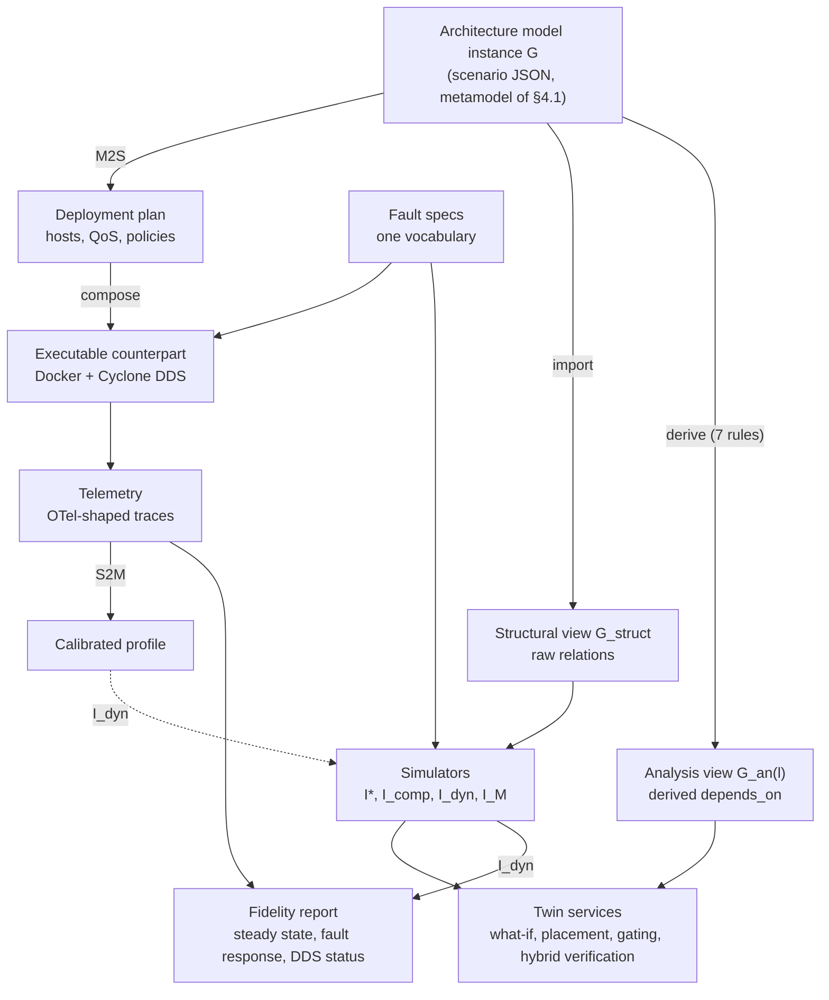
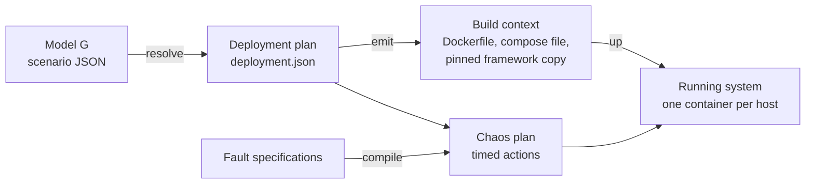

# Paper Overview: Engineering an Architectural Digital Twin for Distributed Publish–Subscribe Systems

- **Working Title:** *Engineering an Architectural Digital Twin for Distributed Publish–Subscribe Systems: One Graph Model for Analysis, Simulation, and an Executable Container Testbed*
- **Authors:** Ibrahim Onuralp Yigit, Feza Buzluca
- **Target Venue:** *Software and Systems Modeling (SoSyM)* — Rolling Theme Section on *Engineering of Digital Twins* (EDTConf journal-first track; manuscript type: **Theme Section Paper**)
- **Manuscript Files:** 10 sections + Declarations, 37 pages ([manuscript.pdf](latex/manuscript.pdf) | [manuscript.tex](latex/manuscript.tex) | [draft.md](draft.md) | [cover_letter.md](cover_letter.md) | [RESULTS.md](../fidelity/RESULTS.md))
- **Status (2026-11-24):** Full draft complete. Both the prototype evaluation (`[P]`, including measured Docker perturbed-counterpart calibration/drift and Docker `hybrid-verify` on `atm`) and the pre-registered fidelity study (`[S]`, frozen at commit `9f84aad9`, Amendments 1–2, code tag `fidelity-study-arms-code`; $n = 8$ scenarios, 2,738 counterpart runs, 10,950 simulator runs, $\approx$56 machine-hours) are complete. Only submission metadata placeholders remain (affiliations, ORCIDs, grant number, release tag, Zenodo DOI).

---

## 1. Abstract

*Aligned with [latex/sections/abstract.tex](latex/sections/abstract.tex).*

**Context.** Distributed systems built on publish–subscribe middleware such as DDS, ROS 2 or Kafka fail in ways that only show once the assembled system is running. These failures include cascades through shared topics, broker and host outages, and partitions. Engineering teams need a digital counterpart of the *architecture* that can answer what-if questions before deployment and can be checked against the running system afterwards. Such architectural digital twins are still built ad hoc.

**Objective.** We present an engineering method for an architectural digital twin of publish–subscribe systems. A single typed graph model is the source of every twin artefact: the analysis views, four failure simulators, and an executable container-based testbed that stands in for the physical system. Of the four simulators, the discrete-event queue-flow simulator ($I_{\mathrm{dyn}}$) is the one calibrated against and compared with the testbed. The system is built to the level of a **batch digital shadow**, and every fidelity claim is bounded to middleware, timing and transport behaviour under declared application behaviour.

**Method.** The method has four parts:
1. A graph metamodel separates structural relations ($G_{\mathrm{struct}}$) from derived dependencies ($G_{\mathrm{an}}$).
2. A model-to-system (M2S) transformation generates a Docker and Cyclone DDS deployment from the model. A single fault vocabulary drives both the simulators and container-level chaos actions.
3. A system-to-model (S2M) path turns OpenTelemetry-shaped traces into calibrated simulator parameters.
4. A fidelity-assessment method compares simulated and observed behaviour in steady state, under faults, and in middleware status. It states explicitly which agreements are independent evidence and which hold by construction.

We place each capability on a digital model, shadow and twin maturity ladder and claim only the levels that are built: a digital model, a generated counterpart and a batch digital shadow.

**Results.** Model consistency is enforced by executable invariants: the simulators re-derive all seven dependency rules from raw relations and must match the repository edge set.
- *Calibration.* On a 74-component scenario, topic rates are recovered within 3% median error, application service times within 1%, and inferred trigger policies are never wrong. Under controlled rate and service-time perturbations on three Docker counterparts (including a real-world ROS 2 topology), batch calibration cuts delivery error by 77–96% and latency error by 10–63%, with monotonic rolling EMA convergence. Unit round trips on a small brokered system also recover broker service times, $k$-of-$n$ trigger policies and, when the workload is bursty, its burstiness. Under declared periodic workload, neither the staleness window nor burstiness can be recovered from telemetry, and we report both as such.
- *Smoke test.* On a four-container system, simulated and observed fault responses agree exactly at the stall-set level. The test also exposes a fidelity gap: DDS peer rediscovery after a partition takes about 6 s, which the simulator does not model.
- *Fidelity study.* In a pre-registered study on eight emulated systems (2,738 counterpart runs, 10,950 simulator runs), the primary comparison is *inconclusive*: the current simulator and the published one cannot be distinguished in how they rank the impact of publisher faults (Hodges–Lehmann $+0.014$, 95% CI $[-0.002, 0.094]$). Both, and a closed-form first-order reference, rank at about the counterpart's own repeatability (median $\rho \approx 0.92$ against a ceiling of 0.93). In hindsight this follows from the design: under declared periodic behaviour, a publisher crash removes only its direct readers' deliveries, which is what the reference computes. Descriptively, the current model reproduces broker and host fault rankings (median $\rho = 0.98$) and stall sets (median Jaccard 0.94), and lowers median latency error from 41% to 25%.

**Conclusion.** An architectural digital twin can be engineered as a family of model transformations around one metamodel, with fidelity treated as a measured, bounded property rather than an assumption. On publisher ranking, the study could not separate simulation from a closed-form formula. The evidence that the counterpart adds lies in infrastructure faults, latency, perturbed-parameter calibration and middleware behaviour the simulator does not model. The remaining step to a live twin—continuous ingestion, topology-drift repair and production actuation—is designed, not implemented.

---

## 2. Core Contributions, Maturity Positioning & Lessons

### Four Contributions (C1–C4)
- **C1 — Single Source of Truth with Substrate Separation (§4, §8.2):** One typed graph metamodel produces both a structural view ($G_{\mathrm{struct}}$, consumed by simulators) and a derived analysis view ($G_{\mathrm{an}}(\ell)$, 7 `depends_on` rules). Executable invariants in CI enforce rule-by-rule semantic consistency and forbid simulators from reading derived edges (preventing tautological evaluation).
- **C2 — Model-to-System Transformation & Unified Fault Vocabulary (§5):** Compiles the model once into a self-contained `deployment.json` plan and a pinned Docker + Cyclone DDS (11.0.1) build context (one container per host). Emulates brokers via ingress/egress relay partitions, replicas via 1 s lease failover, and maps model-level QoS to DDS policies. One `FaultSpec` list compiles into both simulator events and chaos actions (`docker kill`/`pause`, `tc` partitions with shared network-gating reachability, control files); unsupported faults are reported, never silently skipped.
- **C3 — System-to-Model Calibration & Identifiability Analysis (§6):** Both simulator ($I_{\mathrm{dyn}}$) and counterpart emit the same OpenTelemetry-shaped JSON-lines trace schema. The calibrator fits topic rates and service-time distributions on fault-free steady state (recording deadline misses to avoid a 45% survivor bias) and infers trigger policies from discriminating outages. Table 5 separates the ATM identifiability experiment from unit round trips, explicitly reports non-identifiable parameters (staleness window; burstiness under periodic workload), and refuses to populate semantically mismatched slots.
- **C4 — Bounded, Pre-Registered Fidelity Assessment (§7):** Evaluates three dimensions (steady state, fault response, DDS status) backed by an **independence analysis** distinguishing genuine evidence (DDS delivery/discovery/liveliness, OS scheduling, real time, container kills/partitions) from agreement guaranteed by construction (shared plan rates, service times, queue bounds, trigger policies, stub logic). Fixes scenarios, arms, hypotheses (H1–H5), noise ceilings, and a formal claim table in a frozen pre-registration before running comparisons.

### Honest Maturity Positioning
- **Built:** Digital model $\to$ Generated counterpart $\to$ Batch digital shadow (both M2S and S2M are automated, but an engineer closes the loop per run and the counterpart is an emulation).
- **Partly built & evaluated in batch (R7, §8.3, §9.2):** Batch parameter and behavioural drift detection, incremental EMA re-calibration, and residual policy feedback are implemented, unit-tested, and evaluated on perturbed Docker counterparts.
- **Designed only (§9.2):** Continuous telemetry ingestion, automated topology-drift graph diffing, engineer-approved model repair; no autonomous production actuation.
- **Claim boundary:** Every fidelity claim applies strictly to *middleware, timing, and transport behaviour under declared application behaviour*—never to real production application logic.

### Headline Engineering Lessons (L1–L6, §9.1)
1. **Generate the physical stand-in; do not build it by hand** (enables traceability, co-evolution, and enumerable shared assumptions).
2. **Share one trace schema across simulation and observation** (eliminates dual-parser drift; cheapest decision early, costliest to retrofit).
3. **Fidelity evidence requires an independence analysis** (prevents reporting agreement by construction as validation).
4. **Calibrators must abstain and disclose what telemetry cannot identify** (prevents silently presenting unidentifiable guesses as calibrated).
5. **Make consistency debt visible** (executable CI parity checks + explicit register of documented divergences).
6. **Match each twin service to its rung on the cost ladder** (sub-second graph checks per commit $\to$ calibrated queue-flow screening $\to$ hybrid two-tiered verification on shortlists in minutes $\to$ machine-hour exhaustive counterpart sweeps for periodic twin validation).

---

## 3. Paper Structure

| § | Section & File | Subsections, Figures & Tables | Key Content & Status |
|---|---|---|---|
| **1** | **Introduction** ([sec1_introduction.tex](latex/sections/sec1_introduction.tex)) | Problem, Approach, Contributions (C1–C4), What we claim, Fit to theme, Relation to prior work, Outline | Non-local pub–sub failures; 4 engineering challenges; C1–C4; maturity honesty; overlap disclosure with RASSE 2025, JSS (under review), and SoSyM tool paper (in prep). **Complete.** |
| **2** | **Background and Related Work** ([sec2_background.tex](latex/sections/sec2_background.tex)) | §2.1 DT definitions & maturity; §2.2 Model-driven DT engineering; §2.3 Runtime models & software twins; §2.4 Testbeds, emulation & chaos; §2.5 Validating simulation models | Kritzinger ladder, Wright & Davidson's physical-counterpart test, ISO 23247-1; Bordeleau, Eramo, Kirchhof, TwinOps, Dalibor; models@run.time, AADL, Palladio, ROSDiscover; Mininet & chaos engineering; Sargent & Kleijnen validation. **Complete.** |
| **3** | **Engineering Challenge and Requirements** ([sec3_requirements.tex](latex/sections/sec3_requirements.tex)) | §3.1 Setting; §3.2 Why these requirements are hard together • *Table 1:* Requirements R1–R7 | 112-requirement industrial ATM baseline condensed into 7 requirements (R1–R7); architectural tensions (R1 vs. R3, R4 vs. R6, R5 vs. R6, R7 depending on R5 & R6). **Complete.** |
| **4** | **The Architectural Digital Twin** ([sec4_twin.tex](latex/sections/sec4_twin.tex)) | §4.1 Metamodel: one instance, two views; §4.2 Twin services; §4.3 Maturity • *Fig. 1:* Twin artefacts & transformations • *Table 2:* Maturity ladder | Formal graph metamodel ($G_{\mathrm{struct}}$ vs. $G_{\mathrm{an}}(\ell)$, 7 rules); 4 services (what-if via $I^*, I_{\mathrm{comp}}, I_{\mathrm{dyn}}, I_M$; placement verification; non-blocking-ranking change gate; hybrid two-tiered verification via `hybrid-verify`); maturity table. **Complete.** |
| **5** | **Model to System: Generating the Executable Counterpart** ([sec5_model_to_system.tex](latex/sections/sec5_model_to_system.tex)) | §5.1 Stage 1: Deployment plan; §5.2 Stage 2: Mapping to DDS; §5.3 Stage 3: Build context; §5.4 One fault vocabulary, two back-ends; §5.5 Trace links • *Fig. 2:* M2S pipeline • *Table 3:* QoS mapping; *Table 4:* Fault-to-chaos compilation | `deployment.json` resolution; QoS mapping, broker relays, replica standbys, WaitSet poller (avoiding GIL stalls); pinned Docker + Cyclone DDS context with opt-in CPU-bound work & payloads; shared `FaultSpec` + network gating; end-to-end trace links. **Complete.** |
| **6** | **System to Model: Telemetry and Calibration** ([sec6_system_to_model.tex](latex/sections/sec6_system_to_model.tex)) | §6.1 Trace schema; §6.2 The calibrator; §6.3 Identifiability • *Table 5:* Parameter recovery, (a) ATM and (b) unit round trips | Shared OpenTelemetry-shaped JSONL schema (7 operational event kinds + health event); topic rates, app/broker service times, MMPP burstiness, trigger policy inference, abstention rules; automated identifiability test on 74-component ATM scenario. **Complete.** |
| **7** | **Fidelity Assessment** ([sec7_fidelity.tex](latex/sections/sec7_fidelity.tex)) | §7.1 Fidelity dimensions (plus operational health summary); §7.2 Independence analysis; §7.3 Pre-registered fidelity study • *Table 6:* Steady-state tolerances; *Table 7:* Independence analysis | Steady-state, fault-response ($I_{\mathrm{obs}}$, Spearman $\rho$, stall-set Jaccard $J$), DDS status, and operational health summary; independence classification; frozen protocol (`9f84aad9`, code tag `fidelity-study-arms-code`, $n = 8$ after Amendment 2, $B_h = 3{,}033$ msg/s, $\kappa = 1$). **Complete.** |
| **8** | **Evaluation** ([sec8_evaluation.tex](latex/sections/sec8_evaluation.tex)) | §8.1 Subjects; §8.2 RQ1 Consistency; §8.3 RQ2 Calibration; §8.4 RQ3 Fidelity; §8.5 RQ4 Cost • *Table 8:* Executable invariants; *Table 9:* Smoke test; *Table 10:* Study results; *Table 11:* Per-scenario $\rho$; *Table 12:* Cost ladder | Provenance tags (`[P]` vs. `[S]`); CI invariants, historical $I_M$ bug, documented weight divergence; identifiability + H5; `tiny_system` smoke test, 6 s DDS rediscovery gap, study results (H1 inconclusive, ranking saturated at noise ceiling); 5-order-of-magnitude cost ladder. **Complete.** |
| **9** | **Discussion** ([sec9_discussion.tex](latex/sections/sec9_discussion.tex)) | §9.1 Lessons (L1–L6); §9.2 From digital shadow to digital twin (R7); §9.3 Threats to validity | Six engineering lessons; requirements-voice design of continuous ingestion, 3 drift types, and engineer-in-the-loop actuation; construct, internal, external, and conclusion validity (Wilcoxon floors at $n = 8$; tie with $R$ foreseeable in hindsight). **Complete.** |
| **10** | **Conclusion** ([sec10_conclusion.tex](latex/sections/sec10_conclusion.tex)) | Summary of method, results, and next step | Recap of C1–C4, batch-shadow claim, empirical findings, why drift detection must follow calibration and noise measurement, and study lesson (always report the order-$k$ reference next to every simulator). **Complete.** |
| **—** | **Declarations** ([declarations.tex](latex/sections/declarations.tex)) | Funding, Competing Interests, Overlap Disclosure, Data Availability, Author Contributions, Ethics | Explicit disclosure of RASSE 2025, JSS (under review), and SoSyM tool paper (in prep); reproducible CLI commands. **Metadata placeholders pending** (grant number, affiliations/ORCIDs, release tag, Zenodo DOI). |

---

## 4. Figures & Tables Overview

The manuscript contains **2 architecture/pipeline figures** (rendered in TikZ in `manuscript.pdf`, previewed below via Mermaid) and **12 tables** (Tables 1–7 design/specification; Tables 8–12 empirical evaluation).

### Figure 1 (§4) — Twin Artefacts and Transformations

*Caption:* Artefacts and transformations of the architectural digital twin. The single model instance drives the executable counterpart (playing the physical role), the analysis and structural views, and the services offered to engineers, including the closed-batch hybrid verification workflow that couples calibration, Tier-1 queue-flow screening and targeted Tier-2 counterpart probing. M2S and S2M are the model-to-system (§5) and system-to-model (§6) transformations. The dashed edge is optional: a simulator run is calibrated only when requested. Calibration and fidelity comparison apply to the discrete-event queue-flow simulator ($I_{\mathrm{dyn}}$). The same fault specifications drive both simulation and the counterpart.

### Figure 2 (§5) — Model-to-System (M2S) Transformation Pipeline

*Caption:* The model-to-system transformation. Everything an agent needs is resolved once into the plan, so all containers agree on it. The chaos plan is compiled from the same fault specifications the simulators consume.

### Index of Tables (Tables 1–12)

| Group | Tables |
|---|---|
| **Design & Specification (Tables 1–7)** | **Table 1** (§3): Requirements R1–R7 & status • **Table 2** (§4): Kritzinger maturity ladder • **Table 3** (§5): Topic QoS $\to$ DDS policy mapping • **Table 4** (§5): FaultSpec $\to$ chaos action compilation • **Table 5** (§6): Calibration parameter recovery (ATM + unit round trips) • **Table 6** (§7): Steady-state fidelity tolerances • **Table 7** (§7): Independence analysis (independent evidence vs. agreement by construction) |
| **Evaluation & Results (Tables 8–12)** | **Table 8** (§8.2): 103 executable consistency invariants `[P]` • **Table 9** (§8.4): `tiny_system` Docker smoke test `[P]` • **Table 10** (§8.4): Pre-registered fidelity study decisions (`H1–H5`, $C_s$, N, brokers/hosts) `[S]` • **Table 11** (§8.4): Per-scenario Spearman $\rho$ across all 8 scenarios and arms `[S]` • **Table 12** (§8.5): 5-order-of-magnitude cost ladder `[P]`/`[S]` |

---

## 5. Experiments & Evaluation Design

Every empirical number in §8 carries an explicit provenance tag: **`[P]`** (measured on the open-source prototype, regenerable from committed artefacts) or **`[S]`** (from the frozen pre-registered fidelity study run in November 2026).

### Subjects (§8.1)
- **`atm`:** 74-component Air Traffic Management scenario.
- **ATM scale family:** 5 topologies from 29 to 444 components (QoS mix, fan-out shape, and criticality proportion held fixed).
- **Multi-domain corpus:** 11 generated scenarios across autonomous vehicles, IoT, financial trading, healthcare, microservices, telecom RAN, real-time gaming, logistics, hub-and-spoke, enterprise, and industrial control.
- **Pilots (excluded from study population):** `tiny_system` (4 hosts, 12 apps, 2 brokers) and an integration-hub pilot (20 publishers) used for capacity/noise calibration and smoke testing.

### Four Experimental Tracks (RQ1–RQ4)

| RQ | Question | Experimental Setup |
|---|---|---|
| **RQ1** (Consistency) | Do all twin artefacts derived from one model instance agree on its semantics? | 103 automated pytest invariants in CI (Table 8) testing rule-by-rule `depends_on` parity (Rules 1–7), in-memory vs. graph-DB parity, substrate-import guard, scenario byte-identity, M2S/chaos parity, and `hybrid-verify` contracts `[P]`. |
| **RQ2** (Calibration) | Which runtime parameters can S2M calibration recover from telemetry? | **(a) ATM identifiability `[P]`:** Simulate 74-component `atm` with known ground truth (60 s fault-free traces for rates/service times; 200 s traces with 15 s staggered outages for trigger policies), calibrate, compare. **(b) Unit round trips `[P]`:** Small synthetic brokered systems (2–5 apps, 1 seed) for broker service times, `k_of_n:K`, and MMPP burstiness. **(c) Study H5 `[S]`:** Does calibrating on counterpart telemetry reduce delivery error (`S2` vs. `S3`)? |
| **RQ3** (Fidelity) | How faithfully do simulators reproduce the counterpart, and where do they diverge? | **(a) Smoke test `[P]`:** `tiny_system` in Docker (4 containers, 1 Hz) under fault-free, host crash (`docker kill`), and broker failover runs. **(b) Partition test `[P]`:** 2-host chain behind a switch with network gating, CPU-bound work, and a 10 s switch crash. **(c) Pre-registered study `[S]`:** Frozen protocol (`9f84aad9`), capacity gate ($B_h = 3{,}033$ msg/s, CPU p95 $\le 80\%$, rate error $\le 5\%$), 9/12 passed at $\kappa = 1$ (`av`, `enterprise`, `financial_trading` excluded), `industrial_scada` withdrawn by Amendment 2 $\Rightarrow n = 8$ scenarios, 2,738 counterpart runs, 10,950 simulator runs across 7 arms (below). |
| **RQ4** (Cost) | What do twin services and the counterpart cost, and does that fit CI/CD? | Measured wall-clock / CPU timings across the ATM scale family (29–444 components), full-corpus $I_{\mathrm{dyn}}$ sweep, in-process and projected Docker `hybrid-verify` runs `[P]`, and the full 2,738-run counterpart sweep `[S]`. |

### Pre-Registered Study Arms & Hypotheses (`[S]`, §7.3)
- **Observed conditions:** `O-open` (confirmatory: periodic declared behaviour, removing shared trigger-policy circularity) and `O-react` (descriptive only: declared reactive policies).
- **Seven arms compared against observed impact $I_{\mathrm{obs}}$:**
  - `S0`: published queue-flow configuration; `S1`: `S0` + DDS deadline semantics; `S2`: current model (`S1` + host stations, per-process randomness, replica awareness); `S3`: `S2` calibrated from a separate fault-free run; `S4`: `S2` + reactive behaviour (`O-react` only); `R`: closed-form first-order reference (declared rate $\times$ readership, no simulation); `N`: shuffled-target instrument check.
- **Hypotheses & guardrails:** Primary **H1** (`S2` vs. `S0` on publishing applications, `O-open`): one-sided exact Wilcoxon signed-rank test ($\alpha = 0.05$) + Hodges–Lehmann (HL) effect size + TOST equivalence ($\delta = 0.05$, fixed from the noise pilot). Secondary Holm-corrected two-sided family: **H2** (`S0` vs. 0.70), **H3** (`S2` vs. `R`), **H4** (`S0` vs. `R`), **H5** (`S2` vs. `S3` delivery error). Every $\rho$ is paired with the counterpart's leave-one-repetition-out noise ceiling $C_s$ and a pre-registered claim table.

---

## 6. Key Results Summary

### RQ1 — Consistency & Visible Consistency Debt (`[P]`)
- **103/103 automated invariants pass in CI** (15 rule-by-rule parity, 3 repo parity, 1 substrate guard, 8 oracle-role separation, 21 scenario byte-identity, 34 M2S/chaos/in-process parity, 21 `hybrid-verify` contract checks).
- **Historical bug caught:** Simulator re-derivation originally implemented only 1 of 7 rules, causing $I_M = 0$ silently for all scored components; now fixed and guarded by CI.
- **Documented consistency debt:** In-memory vs. graph-DB Rule 1 edge-weight double-counting via libraries affects 0 pairs on `atm`, 64 pairs on `microservices` ($\Delta w \le 0.248$), and 139 pairs on `av` ($\Delta w \le 0.374$); measured and documented rather than silently altering published baselines.

### RQ2 — Calibration Parameter Recovery (`[P]` / `[S]`)

| Parameter | Scope | Recovered? | Key Result |
|---|---|---|---|
| Topic rates | ATM (74 comp.) `[P]` | Yes | Median relative error $\le 3\%$ (outage-robust on fault traces) |
| App service mean & CV | ATM (74 comp.) `[P]` | Yes | Median relative error $\le 1\%$ (all 30 apps $\le 3.6$ SE; avoids 45% survivor bias by logging deadline misses) |
| Trigger policy | ATM (74 comp.) `[P]` | Yes, if observable | 100% accurate on 16–17 of 17 observable apps across true staleness windows of 2, 3, or 6 periods; abstains otherwise |
| Staleness window / Burstiness (periodic) | ATM (74 comp.) `[P]` | **No** | Explicitly reported as non-identifiable from periodic telemetry |
| Broker service times, `k_of_n:K`, MMPP burstiness | Unit round trips `[P]` | Yes | Recovered on small synthetic systems ($K = 2$ on 3-input ramp; burst ratio 4.0 in 1.5–6.0; zero false positives) |
| Perturbed-counterpart calibration & EMA (Docker) | `tiny_system`, `atm`, `realworld_autoware_ros2` `[P]` | **Yes** | Delivery error cut **77–96%** (`S2 → S3`), p50/p95 latency error cut **10–63%**, monotonic 3-window EMA convergence; `detect_drift` TP 1.00 (topic recall 0.73–1.00; baseline latency FP shows rate vs. latency drift need separate thresholds) |
| Calibration impact on delivery error (H5) | Unperturbed study ($n = 8$) `[S]` | **Undecidable** | Uncalibrated delivery error already `0.000` in 7/8 scenarios (`0.018` in `iot_smart_city`, unchanged after calibration); HL $0.000$, Holm n.s. |

### RQ3 — Smoke Test, Middleware Gap & Pre-Registered Fidelity Study (`[P]` / `[S]`)

**Smoke test (`tiny_system`, Docker, `[P]`):**
- Exact stall-set agreement ($J = 1.0$) on both host crash (`docker kill`) and broker failover; exact DDS `liveliness_alive_count` across all 15 readers; per-reader delivery error $\le 5.9\%$; p95 latency error 11%–18% (within 35% tolerance); p50 latency error 14% fault-free, 34%–40% under faults.
- **Real fidelity gap exposed:** A 10 s switch-crash partition stops deliveries within 0.2 s (matching the simulator) but resumes **$\approx$6 s after the partition heals** due to Cyclone DDS participant lease expiry and peer rediscovery, whereas $I_{\mathrm{dyn}}$ reconnects instantaneously.

**Pre-registered fidelity study (`n = 8`, 2,738 counterpart runs, 10,950 simulator runs, `[S]`):**
All 2,738 counterpart runs passed validity checks on the first attempt (0.000 pre-fault rate error; peak container CPU p95 38%–62%). Instrument check (arm `N`): median $\rho = 0.001$ (inside $\pm 0.10$).

| Contrast / Metric | Result | Decision / Interpretation |
|---|---|---|
| **H1:** `S2` vs. `S0` (publishers, `O-open`) | HL $+0.014$ $[-0.002, +0.094]$; rank-biserial 0.56 (6/8 favour `S2`); superiority $p = 0.098$ (tie-aware permutation $p = 0.078$); TOST ($\delta = 0.05$) $p = 0.098$ | **Inconclusive** (neither superiority nor equivalence; `hub_and_spoke` at $+0.177$ with noisy $C_s = 0.658$ defeats TOST at $n = 8$) |
| **H2–H5:** Secondary family (Holm) | H2 (`S0` vs. 0.70): HL $+0.21$, raw $p = 0.016$; H3 (`S2` vs. `R`): HL $+0.002$, $p = 0.84$; H4 (`S0` vs. `R`): HL $-0.014$, $p = 0.078$; H5: HL $0.000$, $p = 0.50$ | **All n.s. under Holm** (`S0` beats 0.70 in 7/8 scenarios, but $p = 0.016 > 0.0125$ at $n = 8$) |
| **Noise ceiling saturation** | Median $C_s = 0.929$ (range 0.658–0.994); arm medians: `S0` 0.922, `S1` 0.932, `S2` 0.916, `S3` 0.911, `R` 0.931 | **Tied at ceiling:** Under `O-open`, a publisher crash removes only direct-reader deliveries, which `R` computes directly from the shared plan |
| **Infrastructure faults (descriptive, `S2`)** | Broker & host crashes: median $\rho = 0.98$ (0.90–0.997); stall-set median $J = 0.94$ (7 scenarios 0.90–1.00; `healthcare` 0.28 from one hot-standby replica) | **Where `S2` adds value** (`S0` and `R` cannot model broker/host faults) |
| **Steady-state latency (descriptive)** | Median p50 error cut `0.41 (S0) → 0.25 (S2)` (lower in 7/8 scenarios); p95 within 35% tolerance for `S1–S3` in all 8 scenarios | Host stations measurably improve latency fidelity |
| **DDS status & controls (descriptive)** | 40 sampled faults: `liveliness_alive_count` $J = 0.98$, `offered_deadline_missed` $J = 0.98$, `requested_deadline_missed` $J = 0.71$, `cache_replaced_dropped_samples` $J = 0.50$; sinks negative control $I_{\mathrm{obs}} \in [0.002, 0.038]$ | Independent middleware signals agree closely |

### RQ4 — Five-Order-of-Magnitude Cost Ladder (`[P]` / `[S]`)

| Rung / Artefact | Workload | Cost | CI/CD Role |
|---|---|---|---|
| Change gate (analysis + checks) `[P]` | ATM family (29–444 components) | **0.01–1.01 s** | Every commit |
| Graph simulators ($I^*$, $I_{\mathrm{comp}}$) `[P]` | `atm` (74) / `av` (152) sweeps | **0.06–0.45 s** | Every commit |
| Queue-flow simulator ($I_{\mathrm{dyn}}$) `[P]` | Per fault (`atm`/`av`); whole-corpus 5-seed | **1.5–4.3 s/fault** (12.7 CPU-h corpus) | Candidate screening |
| Hybrid verification (`hybrid-verify`) `[P]` | `tiny_system` (in-process) / `atm` (Docker shortlist: 8 targets $\times$ 3 reps $\times$ 2 probes) | **54.2 s** / **107.4 min** (measured; $\approx$48–54 min/probe; 4–6$\times$ vs. exhaustive) | Milestone triage & gray-failure probing |
| Counterpart full sweep `[S]` | 8 scenarios, 2,738 runs (72–76 s/run median) | **$\approx$56 machine-hours** (10,950 sim runs: 69 min on 16 cores) | Periodic twin validation |

---

## 7. Fit to SoSyM EDTConf Theme Section & Companion-Paper Overlap

### Theme Section Fit

| Theme Section Topic | Coverage in Paper |
|---|---|
| Modeling concepts, languages, methods, and tools for DTs | §4 single graph metamodel with structural/analysis views |
| DT modeling and simulation | §4 behavioural simulators ($I^*, I_{\mathrm{comp}}, I_{\mathrm{dyn}}, I_M$); §5 M2S counterpart |
| Quality assurance and evaluation of DTs | §7 fidelity method & pre-registration; §8 RQ1 executable invariants |
| Uncertainty and fidelity in DTs | §6 identifiability analysis; §7 independence analysis, noise ceiling & claim table |
| Combining models and data | §6 shared OTel trace schema & telemetry-to-model calibration |
| Model consistency, management, and evolution | §4.1 substrate separation; §8.2 CI parity checks & consistency-debt register |
| DevOps for DTs | §4.2 change gating; §8.5 cost ladder spanning five orders of magnitude |

### Companion-Paper Overlap Disclosure (§1, Declarations)
- **IEEE RASSE 2025 (published):** Reduced dependency-derivation rules; condensed and cited in §4.1.
- **Journal of Systems and Software (under review):** Develops the failure simulators as ranking oracles for learned criticality prediction; cited as behavioural models with zero results reused.
- **SoSyM Tool Paper (in preparation):** Modeling language, quality diagnosis, and refactoring; shares the metamodel description only, with no shared text, twin engineering method, or results.
- **Novel to this manuscript:** M2S transformation & generated counterpart, S2M calibration & identifiability analysis, fidelity-assessment method & independence analysis, pre-registered study & partition gap, maturity analysis, and requirements condensation.

---

## 8. Open Items for Advisor Review

1. **Framing of the inconclusive primary outcome (H1) & tie with $R$:** Does the current framing—reporting H1 transparently as inconclusive, explaining why the open-loop publisher tie with $R$ followed from the design in hindsight, and positioning the counterpart's added value in broker/host faults, latency, and DDS rediscovery—strike the right tone for SoSyM reviewers?
2. **Maturity claim boundary:** Confirm you are happy claiming **batch digital shadow** (with R7 drift/re-calibration partly built and live-twin actuation strictly designed in §9.2) rather than over-claiming a full digital twin.
3. **Length & structure:** The compiled draft is currently **37 pages** (`article` class, 11 pt, 1 in margins; SoSyM imposes no page limit on Theme Section papers). Let me know if any section should be trimmed or moved to an appendix.
4. **Remaining submission metadata placeholders** (in `manuscript.tex` and `declarations.tex`):
   - Author affiliations, street address, corresponding email, and ORCIDs
   - TÜBİTAK grant number (`[GRANT-NUMBER]`)
   - Final `paper-release` git tag and minted Zenodo DOI for the fidelity-study archive
