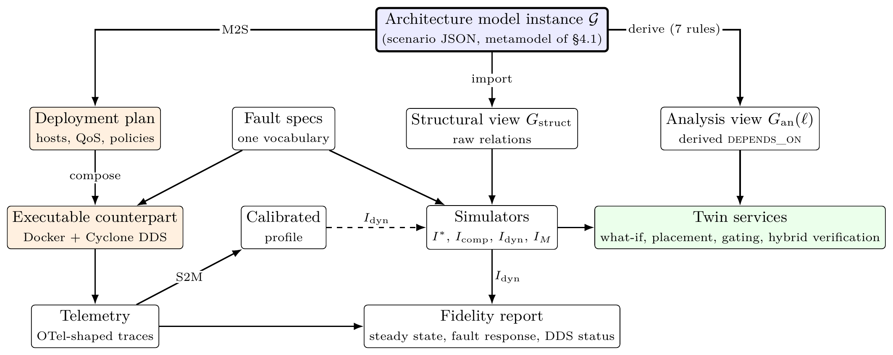
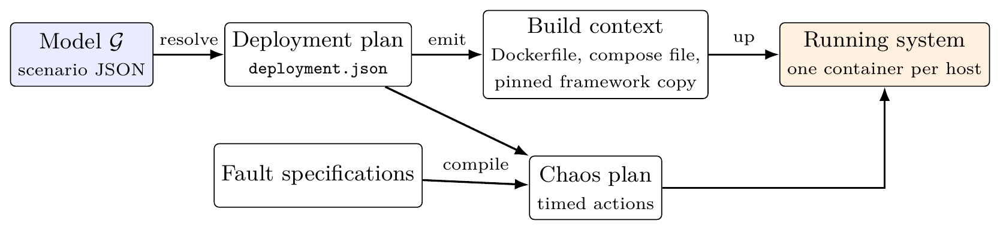

# Engineering an Architectural Digital Twin for Distributed Publish–Subscribe Systems

**Working Title:** *Engineering an Architectural Digital Twin for Distributed Publish–Subscribe Systems: One Graph Model for Analysis, Simulation, and an Executable Container Testbed*  
**Authors:** Ibrahim Onuralp Yigit, Feza Buzluca  
**Target Venue:** *Software and Systems Modeling (SoSyM)* — Rolling Theme Section on *Engineering of Digital Twins* (EDTConf journal-first track; Theme Section Paper)  
**Manuscript & Artefacts:** 21 pages (2 figures, 6 core tables, 38 references) — [manuscript.pdf](latex/manuscript.pdf) | [SUPPLEMENT.md](SUPPLEMENT.md) (Tables S1–S8) | [Study 1 Results](../fidelity/RESULTS.md) | [Study 2 Results](../fidelity/RESULTS_V2.md)

---

## 1. Abstract

**Context.** Distributed publish–subscribe systems (DDS, ROS 2, Kafka) fail through non-local cascades, broker or host outages, and partitions that appear only in the assembled deployment. Engineering teams need an executable digital counterpart of the *architecture* for pre-deployment what-if analysis and post-deployment checking, yet architectural digital twins are still built ad hoc with rarely measured fidelity.

**Objective.** We present a model-driven method for engineering an architectural digital twin around one typed graph metamodel. A single model instance generates every artefact: derived analysis views, four failure simulators, and an executable Docker + Cyclone DDS testbed acting as the physical counterpart. Of the four simulators, the discrete-event queue-flow simulator ($I_{\mathrm{dyn}}$) is calibrated against and compared with the testbed. The system reaches a *batch digital shadow*, and all fidelity claims are bounded to middleware, timing and transport behaviour under declared application behaviour.

**Method.** The method combines four parts: (1) a metamodel separating structural relations ($G_{\mathrm{struct}}$) from derived dependencies ($G_{\mathrm{an}}$); (2) a model-to-system (M2S) transformation generating a Docker + Cyclone DDS deployment driven by the same fault vocabulary as the simulators; (3) a system-to-model (S2M) calibrator over a shared OpenTelemetry-shaped trace schema with an identifiability analysis; and (4) a fidelity-assessment method separating genuine evidence from agreement by construction, paired with two frozen pre-registered studies.

**Results.** Executable CI invariants (103 checks) enforce rule-by-rule semantic consistency across artefacts. On a 74-component ATM scenario, calibration recovers topic rates within 3%, application service times within 1%, and trigger policies with 100% accuracy when observable, while explicitly reporting non-identifiable parameters (staleness window; burstiness under periodic workload). Under controlled rate and service-time perturbations on three Docker counterparts (including a real-world ROS 2 topology), batch calibration cuts delivery error by 77–96% and latency error by 10–63%, with monotonic rolling EMA convergence. On a four-container smoke test, stall sets ($J = 1.0$) and DDS liveliness agree exactly, while a partition test exposes a $\approx 6$ s Cyclone DDS peer-rediscovery delay absent from the simulator. In frozen pre-registered Study 1 across eight emulated systems (2,738 counterpart runs, 10,950 simulator runs), the primary open-loop publisher-ranking contrast is *inconclusive* (HL $+0.014$, 95% CI $[-0.002, 0.094]$): all arms and a closed-form reference sit at the counterpart's noise ceiling ($\rho \approx 0.92$ vs. $0.93$), a tie foreseeable under open-loop periodic behaviour. Frozen pre-registered Study 2 targeting the independent dimensions across 14 topologies (including five real-world OSS architectures) confirms that the current model significantly lowers steady-state p50 latency error ($n = 13$ at $\kappa = 1$; HL $+0.135$, $p = 0.00061$; median $0.376 \to 0.258$), reproduces broker/host crash rankings (median $\rho = 0.979$, Holm $p = 0.00049$) and stall sets ($J = 1.000$ on all 14/14, Holm $p = 0.00049$), and under parameter misspecification S2M calibration reduces delivery error on every topology (14/14, Holm $p = 0.00049$), while gray-failure omission error vs. a crash reference is not significant ($p = 0.542$).

**Conclusion.** An architectural digital twin can be engineered as model transformations around one metamodel with fidelity treated as a measured, bounded property. Where open-loop publisher ranking ties a closed-form formula, the counterpart's added evidence lies in infrastructure faults, latency, perturbed-parameter calibration and unmodelled middleware behaviour. The remaining step to a live twin—continuous ingestion, topology-drift repair and production actuation—is designed, not implemented.

---

## 2. Research Highlights

- **One graph metamodel drives all twin artefacts:** A single typed graph generates separated structural ($G_{\mathrm{struct}}$) and derived analysis ($G_{\mathrm{an}}$) views, four failure simulators, and a runnable Docker + Cyclone DDS counterpart, guarded by 103 automated CI invariants.
- **Honest maturity & claim boundaries:** Positioned transparently on Kritzinger et al.'s ladder as a *digital model*, *generated counterpart*, and *batch digital shadow*, with an explicit independence analysis separating genuine middleware/timing evidence from agreement guaranteed by construction.
- **Identifiable S2M calibration & evaluated batch drift:** Recovers rates ($\le 3\%$), service times ($\le 1\%$, eliminating a 45% survivor bias), and observable trigger policies (100%), while cutting perturbed Docker delivery error by **77–96%** with monotonic 3-window EMA convergence—and explicitly disclosing unidentifiable parameters.
- **Real middleware gap exposed:** A 10 s switch-crash partition reveals a **$\approx 6$ s Cyclone DDS post-partition peer-rediscovery delay** absent from the simulator, demonstrating why an executable middleware counterpart is essential.
- **Two complementary frozen pre-registered studies:** Study 1 ($n = 8$, 2,738 runs) honestly shows open-loop publisher ranking saturates at the noise ceiling alongside a closed-form reference; Study 2 ($n = 14$, including 5 real-world OSS architectures) confirmatorily establishes significant wins on steady-state p50 latency ($p = 0.00061$), broker/host crash rankings ($\rho = 0.979$), exact stall sets ($J = 1.000$ on 14/14), and perturbed calibration (14/14 improved, Holm $p = 0.00049$).
- **CI/CD-ready five-order-of-magnitude cost ladder:** Ranges from sub-second graph gating (`0.01–1.01 s`, per commit) and queue-flow screening (`1.5–4.3 s/fault`) to measured Docker `hybrid-verify` (`107.4 min` for two probes on 8-container `atm`, $\rho = 1.000$ on primary `crash` targets) and periodic full-corpus sweeps (`18.0–56 h`).

### Why an Emulated Middleware Counterpart (Not a Physical Production System—and Not Just Simulation)?
A natural reviewer question is why the twin is validated against a generated container testbed rather than a physical production system. Our defense rests on three pillars (§1, §5, §7.2):
1. **Real-middleware emulation $\neq$ discrete-event simulation:** The counterpart is *not* a second simulator. It runs real OMG Cyclone DDS (11.0.1) processes inside Docker containers over real Linux kernel networking (`tc` packet drops), real OS scheduling, real elapsed time, and real `docker kill`/`pause` actions—only the application business logic is stubbed.
2. **Pre-deployment & destructive-testing necessity:** In safety-critical publish–subscribe domains (ATM, autonomous vehicles), the physical system either does not exist yet during architectural design or cannot safely endure ~3,600 controlled destructive crash and partition runs across 14 topologies.
3. **Non-circularity & empirical falsifiability:** Table 4 explicitly separates independent runtime evidence from shared-plan construction, bounding every claim strictly to *middleware, timing, and transport behaviour under declared application behaviour*. Moreover, the counterpart actively *falsified* the simulator—exposing the $\approx 6$ s DDS post-partition rediscovery delay, baseline latency drift, Study 1's noise-ceiling tie with closed-form $R$, and Study 2's non-significant H2.4—which a circular reference could never do.

---

## 3. Core Contributions, Requirements & Maturity Positioning

- **C1 — Single Metamodel with Enforced View Separation (§4):** One typed graph yields a structural view ($G_{\mathrm{struct}}$, consumed by simulators $I^*, I_{\mathrm{comp}}, I_{\mathrm{dyn}}, I_M$) and a derived dependency view ($G_{\mathrm{an}}$, 7 rules, consumed by analysis), kept consistent by 103 CI invariants.
- **C2 — Model-to-System (M2S) Transformation & Unified Fault Vocabulary (§5):** Compiles the model once into `deployment.json` and a pinned Docker + Cyclone DDS (11.0.1) deployment (emulating brokers via ingress/egress relays and replicas via 1 s lease failover), driven by one `FaultSpec` list that explicitly reports unsupported faults.
- **C3 — System-to-Model (S2M) Calibration & Identifiability Analysis (§6):** Maps a shared OpenTelemetry-shaped JSONL trace schema into calibrated $I_{\mathrm{dyn}}$ profiles (including rolling EMA updates) while separating recoverable parameters from non-identifiable ones.
- **C4 — Bounded, Pre-Registered Fidelity Assessment (§7):** Evaluates steady state, fault response, and DDS status for $I_{\mathrm{dyn}}$ backed by an independence analysis, machine-readable report caveats, and two frozen pre-registered studies (`9f84aad9` and `0bbe06af`).

### Table 1: Requirements Condensed from a 112-Requirement Industrial ATM Baseline (§3)

| ID | Requirement | Where | Status |
|---|---|---|---|
| **R1** | **Single source of truth.** Every twin artefact (analysis view, simulator input, counterpart) derives from one model instance via defined transformations. | §4.1, §5 | built |
| **R2** | **Semantic consistency.** All consumers of dependency semantics apply identical rules, verified mechanically. | §8.2 | built |
| **R3** | **Substrate separation.** Simulators read structural relations only, never derived analysis edges, avoiding tautological scoring. | §4.1 | built |
| **R4** | **Executable counterpart.** When the real system is unavailable, the model compiles into a runnable middleware deployment under the same faults. | §5 | built |
| **R5** | **Calibration from telemetry.** Pre-deployment parameter guesses are re-estimated from traces, explicitly reporting non-identifiable parameters. | §6 | built (batch) |
| **R6** | **Measured fidelity.** Twin-to-counterpart agreement is measured against declared tolerances and reported without gating builds. | §7 | built; studies run |
| **R7** | **Drift detection.** Model–system divergence triggers re-calibration or engineer-reviewed model repair. | §9.2 | partly built\* |

*\*Batch parameter/behavioural drift detection, EMA re-calibration, and residual feedback are evaluated on perturbed Docker counterparts (§8.3); topology drift is designed.*

### Table 2: Maturity of the Architectural Twin on Kritzinger et al.'s Ladder (§4.3)

| Level | Model $\to$ Counterpart | Counterpart $\to$ Model | Status |
|---|---|---|---|
| **Digital model** | Model authored/extracted; analysis and simulation run on it. | None. | built |
| **Generated counterpart** | Model compiled automatically into Docker + DDS deployment and chaos plan (§5). | None. | built |
| **Digital shadow (batch)** | As above. | Automated trace calibration and fidelity reports (§§6–7) via standalone or `hybrid-verify` runs; batch drift detection, EMA re-calibration and residual feedback evaluated on perturbed Docker counterparts (§8.3). Invoked per run by an engineer. | built |
| **Digital twin** | Engineer-approved decisions pushed to deployed system. | Continuous ingestion; topology-drift graph diffing and repair proposals (§9.2). | designed |

---

## 4. Architecture & Pipeline Figures

**Figure 1 (§4):** *Artefacts and transformations of the architectural digital twin. Blue: single model instance. Orange: executable counterpart playing the physical role. Green: engineering services, including closed-batch hybrid verification. Calibration and fidelity comparison apply to $I_{\mathrm{dyn}}$; one fault vocabulary drives both simulation and the counterpart.*

**Figure 2 (§5):** *The model-to-system transformation. All runtime semantics are resolved once into `deployment.json`; the chaos plan compiles from the same fault specifications consumed by the simulators.*

---

## 5. Core Methodological & Evaluation Tables

### Table 3: Calibration Parameter Recovery & Identifiability (`[P]`, §6.2)

| Parameter | Recovered? | Evidence |
|---|---|---|
| *(a) ATM scenario (74 components)* | | |
| Topic rates | Yes | Median relative error 3% (outage-robust on fault traces) |
| App service mean & CV | Yes | Median relative error 1%; all 30 apps within $\le 3.6$ SE |
| Trigger policy | Yes, if observable | 16–17 of 17 apps with inputs/outputs answered, 100% correct across true staleness windows of 2, 3 or 6 periods |
| Staleness window | **No** | No estimator; not determined by trace |
| Workload burstiness | **No, if periodic** | Periodic declared workload leaves burst ratio unobservable |
| *(b) Unit round trips (2–5 apps, 1 seed)* | | |
| Broker service mean & CV | Yes | From `forward` events of simulator and testbed relays |
| `k_of_n:K` trigger policy | Yes | $K = 2$ identified on 3-input app from partial-outage ramp |
| Workload burstiness (MMPP) | Yes, if bursty | Burst ratio 4.0 recovered in 1.5–6.0; burst fraction 0.1 in 0.02–0.35; zero false positives on periodic/Poisson traces |

### Table 4: Independence Analysis of the Generated Counterpart (§7.2)

| Counterpart Part | Independent? | Consequence |
|---|---|---|
| DDS delivery, discovery & liveliness; OS scheduling; real elapsed time; container kills & network partitions | **Yes** | What fidelity results can speak to |
| Topic rates, mean service times, queue bounds, failover rule, placement | No (same plan) | Agreement is not evidence |
| Trigger policies (reactive behaviour) | No (shared function) | Reactive simulator vs. reactive counterpart is circular |
| Late-sample handling | No (configured rule) | Engine late-drop mode is never treated as truth |
| Application logic | No (stubs) | No result covers real application behaviour |

### Table 5: Pre-Registered Fidelity Study Results — Study 1 (`[S1]`) & Study 2 (`[S2]`) (§8.4)

| Quantity | Statistic | Value | Decision |
|---|---|---|---|
| *Study 1 `[S1]` (commit `9f84aad9`, $n = 8$, O-open publishers)* | | | |
| **H1:** S2 vs. S0 (publishers) | HL [95% CI]; rank-biserial; $p_{\mathrm{sup}}$; $p_{\mathrm{TOST}}$ | $+0.014$ $[-0.002, 0.094]$; 0.56; 0.098; 0.098\* | **inconclusive** |
| **H2–H5** (secondary, Holm) | H2 S0 vs. 0.70 ($0.016$); H3 S2 vs. R ($0.84$); H4 S0 vs. R ($0.078$); H5 cal ($0.50$) | All arms & R at ceiling ($\rho \approx 0.91\text{--}0.93$ vs. $C_s = 0.93$) | all n.s. (Holm) |
| Instrument check (arm N) | Median $\rho_s(\mathrm{N})$ | 0.001 | within $\pm 0.10$ |
| *Study 2 `[S2]` (commit `0bbe06af`, $n = 13\text{--}14$, independent rows)* | | | |
| **H2.1:** p50 latency S0 $-$ S2 | $n = 13$ ($\kappa = 1$); HL [CI]; 1-sided $p$ | $+0.135$ $[+0.071, +0.225]$; $p = 0.00061$ | **better** |
| **H2.2a:** Infra $\rho - 0.85$ | $n = 14$; median $\rho$ (range); Holm $p$ | $0.979$ ($0.916\text{--}1.000$); $p_{\mathrm{H}} = 0.00049$ | **significant** |
| **H2.2b:** Infra stall $J - 0.85$ | $n = 14$; median $J$; Holm $p$ | $1.000$ (all 14/14); $p_{\mathrm{H}} = 0.00049$ | **significant** |
| **H2.3:** Perturbed cal S2 $-$ S3 | $n = 14$; HL [CI]; Holm $p$ | $+0.096$ $[+0.034, +0.182]$; $p_{\mathrm{H}} = 0.00049$ | **significant** |
| **H2.4:** Omission vs. crash ref | $n = 14$; HL [CI]; raw $p$ | $+0.0003$ $[-0.0006, +0.0021]$; $p = 0.542$ | n.s. (Holm) |

*\*Both $p$-values equal 25/256; a tie-aware permutation test gives $p_{\mathrm{sup}} = 0.078$ (same decision).*

### Table 6: Five-Order-of-Magnitude Cost Ladder (`[P]` / `[S1]` / `[S2]`, §8.5)

| Artefact | Workload | Cost |
|---|---|---|
| Change gate (analysis + checks) | ATM scale family, 29 / 74 / 148 / 296 / 444 components | 0.01–1.01 s |
| Graph simulators ($I^*, I_{\mathrm{comp}}$) | 5-seed / exhaustive sweep, `atm` (74) / `av` (152) | 0.06–0.45 s |
| Queue-flow simulator ($I_{\mathrm{dyn}}$) | Per fault (`atm`/`av`); 5-seed whole corpus | 1.5–4.3 s (12.7 CPU-h) |
| Hybrid verification (in-process) | `tiny_system`: baseline + 17 Tier-1 $\times$ 2 seeds + 2 probes | 54.2 s |
| Hybrid verification (Docker + DDS) | `atm`: baseline + 39 Tier-1 $\times$ 3 seeds + 8 targets $\times$ 3 reps $\times$ 2 probes | 107.4 min ($\approx 48\text{--}54$ min/probe) |
| Counterpart (Docker + DDS) | Single run; Study 2 (14 scenarios, $\approx 853$ runs) `[S2]`; Study 1 (8 scenarios, 2,738 runs) `[S1]` | $\approx 71$ s; $\approx 18.0$ h; $\approx 56$ h |

---

*Additional reproducibility tables (QoS/chaos mappings, steady-state tolerances, 103 CI invariants, `tiny_system` smoke test, perturbed-counterpart EMA drift table, and full per-scenario matrices for Study 1 and Study 2, Tables S1–S8) and exact CLI commands are hosted in [SUPPLEMENT.md](SUPPLEMENT.md).*
