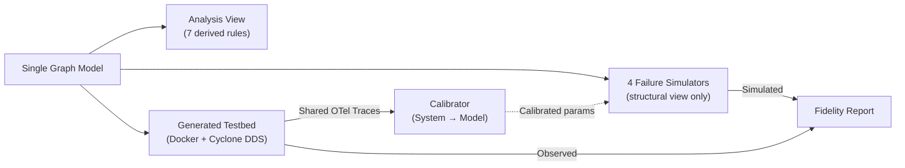

# Engineering an Architectural Digital Twin for Distributed Publish–Subscribe Systems

**Advisor Briefing — SoSyM Theme Section Paper Draft**

- **Authors:** Ibrahim Onuralp Yigit, Feza Buzluca
- **Target Venue:** *Software and Systems Modeling (SoSyM)* — Theme Section on *Engineering of Digital Twins* (EDTConf journal-first track)
- **Current Status:** Complete, condensed 21-page draft ([manuscript.pdf](latex/manuscript.pdf)) + GitHub reproducibility supplement ([SUPPLEMENT.md](SUPPLEMENT.md)); Study 1 (`9f84aad9`, $n = 8$, 2,738 runs, $\approx$56 h: H1 inconclusive) + **Study 2 (`0bbe06af`, $n = 14$ incl. 5 real-world OSS topologies, $\approx 853$ runs, $\approx 18.0$ h: H2.1 Better $p = 0.00061$, H2.2a/b & H2.3 Holm $p = 0.00049$)** + Docker `hybrid-verify` (`atm`, 107.4 min) all complete.

---

## 1. The Problem

- Publish–subscribe systems (**DDS, ROS 2, Kafka, MQTT**) decouple publishers and subscribers.
- Failures—cascades through shared topics, broker/host crashes, network partitions—only appear in the **assembled deployment**, not in unit tests.
- Teams cannot hold a full staging environment for every change, so critical architectural decisions rely on guesswork.
- **Gap in DT literature:** Architectural digital twins for software are still built *ad hoc*, and their **fidelity is rarely measured** or bounded.

---

## 2. Our Core Idea: One Graph Model Drives Everything

Instead of hand-building separate models, simulators, and testbeds that drift apart, **one typed graph model** generates every artefact:

- **Same fault vocabulary** drives both the simulators and container-level chaos (`docker kill`/`pause`, `tc` network partitions).
- **Same OpenTelemetry-shaped trace schema** is emitted by both the queue-flow simulator and the Docker/DDS testbed.

---

## 3. Four Contributions at a Glance

| # | Contribution | Why It Matters |
|---|---|---|
| **C1** | **One metamodel, two views** | Simulators read raw structure ($G_{\mathrm{struct}}$); analysis reads derived dependencies ($G_{\mathrm{an}}$). Prevents circularity; 103 automated test cases enforce consistency. |
| **C2** | **Model → System (M2S)** | Generates a runnable Docker + Cyclone DDS counterpart (including broker relays & replica failover) before the real system exists. |
| **C3** | **System → Model (S2M)** | Calibrates rates, service times, and trigger policies from traces—and explicitly reports what telemetry **cannot** identify. |
| **C4** | **Bounded fidelity method** | Separates genuine evidence from agreement by construction (independence table) and locks the analysis in a pre-registered study. |

---

## 4. Honest Positioning: What We Claim

Reviewers in EDTConf scrutinize *"is this really a digital twin?"* We answer up front using Kritzinger et al.'s maturity ladder:

| Maturity Level | Status in This Paper |
|---|---|
| **Digital model** (analysis & simulation on one model) | **Built** |
| **Generated counterpart** (model compiled to Docker + DDS) | **Built** |
| **Batch digital shadow** (automated calibration, calibrated screening, shortlisted verification & caveat report per run via `hybrid-verify`; batch drift detection, EMA re-calibration & residual policy feedback implemented and evaluated on perturbed Docker counterparts) | **Built** |
| **Live digital twin** (continuous streaming ingestion, automated topology-drift graph diffing & model-repair proposals, engineer-approved actuation) | **Designed only (§9.2)** |

> **Bounded claim & defense (why an emulated counterpart rather than a physical system?):**
> 1. **Real-middleware emulation $\neq$ discrete-event simulation:** The Docker counterpart runs real Cyclone DDS 11.0.1, Linux kernel networking (`tc`), OS scheduling, and `docker kill`/`pause`—only application business logic is stubbed.
> 2. **Pre-deployment necessity:** Safety-critical systems (ATM, AV) either do not exist yet during architecture verification or cannot endure ~3,600 destructive crash/partition runs across 14 topologies.
> 3. **Non-circular & falsifiable:** Table 4 separates independent runtime evidence from shared-plan construction, and the counterpart *falsified* the simulator (exposing the $\approx 6$ s DDS rediscovery gap, Study 1's tie with $R$, and H2.4 n.s.). All claims are strictly bounded to **middleware, timing, and transport behaviour under declared application behaviour**.

---

## 5. Key Results Already Built & Verified (`[P]`)

1. **Consistency (RQ1):**
   - 103 automated test cases keep repositories, simulators, testbed, and the hybrid two-tiered protocol aligned.
   - Caught a real historical bug where 6 of 7 dependency rules were missing in $I_M$; one residual edge-weight divergence is measured and documented.
2. **Calibration Identifiability & Perturbed Docker Recovery (RQ2):**
   - On the 74-component ATM scenario: topic rates recovered within **3%**, service times within **1%** (fixing a 45% survivor bias by logging deadline misses), trigger policies **100% accurate** when an outage occurs.
   - **Perturbed Docker counterparts (`tiny_system`, `atm`, `realworld_autoware_ros2`):** Under $+50\% / -35\%$ rate shifts and $2\times$ busiest-host service times, batch calibration (`S2 → S3`) cuts delivery error by **77%–96%** and latency error by **10%–63%**, with monotonic 3-window EMA convergence.
   - **Negative result:** The staleness window, and burstiness under the periodic declared workload, are **not identifiable** from telemetry. Broker service times, `k_of_n:K` and bursty workloads are recovered only in unit round trips.
3. **Smoke Test & Real Fidelity Gap (RQ3):**
   - On a 4-container testbed (`tiny_system`): exact stall-set agreement ($J = 1.0$) and exact DDS liveliness counts across 15 readers.
   - **Headline finding:** During a 10 s switch crash, Cyclone DDS expires remote participants and takes **~6 s to rediscover peers** after recovery—whereas the simulator reconnects instantly. *(A real gap no self-consistent simulator could find alone.)*

---

## 6. The Two Pre-Registered Fidelity Studies (`[S1]` & `[S2]`, done)

- **Frozen protocol** (16 Nov 2026, commit `9f84aad9`) before any comparison was run.
- **Included scenarios:** 9 of 12 pass the capacity gate ($B_h = 3{,}033$ msg/s, full rate $\kappa = 1$); `industrial_scada` withdrawn for cost (Amendment 2), so $n = 8$.
- **Primary hypothesis (H1):** Does our current queue-flow model (S2) rank fault impact closer to observed DDS delivery loss than the published baseline (S0)?
- **Secondary hypotheses (H2–H5):** Absolute accuracy ($\ge 0.70$), beating a closed-form formula (R), and whether calibration improves delivery error (S3 vs. S2).
- **Scale:** 2,738 Docker + DDS runs, all valid first time ($\approx$72–76 s/run $\to$ **$\approx$56 machine-hours**), plus 10,950 simulator runs (69 min on 16 cores).
- **Results (Study 1 `[S1]`):** H1 **inconclusive** (HL $+0.014$ $[-0.002, +0.094]$, $p = 0.098$ superiority & TOST; tie-aware permutation $p = 0.078$); H2–H5 n.s. under Holm. S0, S2 and the formula R all rank at the noise ceiling (median $\rho$ 0.91–0.93 vs. $C_s = 0.93$)—foreseeable in hindsight because under periodic open-loop behaviour a publisher crash removes only direct-reader deliveries, which R computes directly.
- **Follow-up Study 2 (`[S2]`, `0bbe06af`, $n = 14$ incl. 5 real-world OSS topologies, $\approx 853$ runs, $\approx 18.0$ h, [RESULTS_V2.md](../fidelity/RESULTS_V2.md)):** Targeting the independent rows directly: **H2.1 Better** (p50 latency `0.376 → 0.258`, $n = 13$ at $\kappa = 1$, HL $+0.135$, $p = 0.00061$); **H2.2a Significant** (infra crash median $\rho = 0.979$, Holm $p = 0.00049$); **H2.2b Significant** (**$J = 1.000$ on all 14/14**, Holm $p = 0.00049$); **H2.3 Significant** (perturbed calibration improved on **14/14**, median `0.082 → 0.018`, Holm $p = 0.00049$); H2.4 omission vs. crash ref n.s. ($p = 0.542$).
- **Safe design:** Pre-fixed decision tables map outcomes to *better / equivalent / inconclusive / worse*—every outcome is publishable and paired with the exact claim it permits.

---

## 7. Practicality: A Cost Ladder Spanning About Five Orders of Magnitude (RQ4)

Each twin service matches what an engineering pipeline can afford:

| Tier | Service | Cost | When to Run |
|---|---|---|---|
| **Gate** | Graph analysis & change gate | **0.01–1.01 s** (29–444 components) | Every commit / PR |
| **Tier 1 screening** | Calibrated queue-flow simulation ($I_{\mathrm{dyn}}$) | **1.5–4.3 s** per fault | System-wide screening & shortlisting |
| **Hybrid (Tier 1 + Tier 2 shortlist)** | Hybrid two-tiered verification (`hybrid-verify`) | **54.2 s** local (`tiny_system`) / **107.4 min** measured Docker 2-probe (`atm`, $\approx$48–54 min/probe) | Milestone triage, targeted gray-failure checks |
| **Exhaustive counterpart** | Exhaustive Docker + DDS counterpart sweep | **≈ 71 s/run** (**≈ 18.0 h** Study 2 / **≈ 56 h** Study 1) | Periodic twin fidelity validation |

---

## 8. Fit to SoSyM & Overlap Safety

- **Strong venue fit:** The call explicitly asks for *engineering methods* for digital twins—not just another domain application. Our paper hits 7 call topics (modeling, simulation, QA/fidelity, uncertainty, models+data, consistency, DevOps).
- **Low overlap risk:**
  - **RASSE 2025 (published):** Cited; metamodel condensed in §4.1.
  - **JSS (under review):** Cited for simulators as ranking oracles; **no results reused**.
  - **SoSyM Tool Paper (in prep):** Disclosed; covers language/diagnosis/refactoring, **no overlap** with testbed, calibration, or fidelity.
  - **Verbatim 8-gram overlap:** **< 0.6%** against all companion drafts.

---

## 9. Next Steps & Decisions for Advisor Review

### Action Plan
1. **Advisor review** of the complete draft ([overview.pdf](overview.pdf) / [outline.md](outline.md) / [draft.md](draft.md) / [manuscript.pdf](latex/manuscript.pdf)), supplement ([SUPPLEMENT.md](SUPPLEMENT.md)), and pre-registered results ([RESULTS.md](../fidelity/RESULTS.md) & [RESULTS_V2.md](../fidelity/RESULTS_V2.md)).
2. **Incorporate feedback**, archive raw traces and mint the Zenodo DOI, fill author/grant/release-tag metadata, and submit.

### Open Decisions
1. **Target submission window:**
   - **By 31 Dec 2026** → allows **two** major review rounds before EDTConf 2027.
   - **By 19 Apr 2027** → allows **one** review round only.
2. **Journal indexing check:** Confirm whether ITU's graduation requirement uses Scopus CiteScore (SoSyM = Q1) or JCR/SCImago (SoSyM = Q2) before committing both SoSyM papers.
