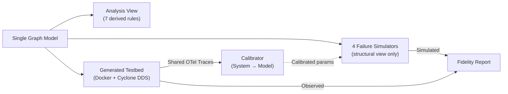

# Engineering an Architectural Digital Twin for Distributed Publish–Subscribe Systems

**Advisor Briefing — SoSyM Theme Section Paper Draft**

- **Authors:** Ibrahim Onuralp Yigit, Feza Buzluca
- **Target Venue:** *Software and Systems Modeling (SoSyM)* — Theme Section on *Engineering of Digital Twins* (EDTConf journal-first track)
- **Current Status:** Complete 30-page draft ([manuscript.pdf](latex/manuscript.pdf)); fidelity study protocol frozen (`9f84aad9`); pre-registered study complete (n = 8, 2,738 runs, ~56 h): H1 inconclusive

---

## 1. The Problem

- Publish–subscribe systems (**DDS, ROS 2, Kafka, MQTT**) decouple publishers and subscribers.
- Failures—cascades through shared topics, broker/host crashes, network partitions—only appear in the **assembled deployment**, not in unit tests.
- Teams cannot hold a full staging environment for every change, so critical architectural decisions rely on guesswork.
- **Gap in DT literature:** Architectural digital twins for software are still built *ad hoc*, and their **fidelity is rarely measured** or bounded.

---

## 2. Our Core Idea: One Graph Model Drives Everything

Instead of hand-building separate models, simulators, and testbeds that drift apart, **one typed graph model** generates every artefact:

- **Same fault vocabulary** drives both the simulators and container-level chaos (`docker kill`/`pause`, `tc` network partitions).
- **Same OpenTelemetry-shaped trace schema** is emitted by both the queue-flow simulator and the Docker/DDS testbed.

---

## 3. Four Contributions at a Glance

| # | Contribution | Why It Matters |
|---|---|---|
| **C1** | **One metamodel, two views** | Simulators read raw structure ($G_{\mathrm{struct}}$); analysis reads derived dependencies ($G_{\mathrm{an}}$). Prevents circularity; 56 CI tests enforce consistency. |
| **C2** | **Model → System (M2S)** | Generates a runnable Docker + Cyclone DDS counterpart (including broker relays & replica failover) before the real system exists. |
| **C3** | **System → Model (S2M)** | Calibrates rates, service times, and trigger policies from traces—and explicitly reports what telemetry **cannot** identify. |
| **C4** | **Bounded fidelity method** | Separates genuine evidence from agreement by construction (independence table) and locks the analysis in a pre-registered study. |

---

## 4. Honest Positioning: What We Claim

Reviewers in EDTConf scrutinize *"is this really a digital twin?"* We answer up front using Kritzinger et al.'s maturity ladder:

| Maturity Level | Status in This Paper |
|---|---|
| **Digital model** (analysis & simulation on one model) | **Built** |
| **Generated counterpart** (model compiled to Docker + DDS) | **Built** |
| **Batch digital shadow** (automated calibration, calibrated screening, shortlisted verification & caveat report per run via `hybrid-verify`) | **Built** |
| **Live digital twin** (continuous ingestion + drift detection → re-calibration / repair) | **Designed only (§9.2)** |

> **Bounded claim:** Because the counterpart uses generated stubs, fidelity results speak strictly to **middleware, timing, and transport behaviour under declared application behaviour**—never to production business logic.

---

## 5. Key Results Already Built & Verified (`[P]`)

1. **Consistency (RQ1):**
   - 56 automated CI invariants keep repositories, simulators, testbed, and the hybrid two-tiered protocol aligned.
   - Caught a real historical bug where 6 of 7 dependency rules were missing in $I_M$; one residual edge-weight divergence is measured and documented.
2. **Calibration Identifiability (RQ2):**
   - On the 74-component ATM scenario: topic rates recovered within **3%**, service times within **1%** (fixing a 45% survivor bias by logging deadline misses), trigger policies **100% accurate** when an outage occurs.
   - **Negative result:** Staleness window and burst ratio are **not identifiable** from telemetry.
3. **Smoke Test & Real Fidelity Gap (RQ3):**
   - On a 4-container testbed (`tiny_system`): exact stall-set agreement ($J = 1.0$) and exact DDS liveliness counts across 15 readers.
   - **Headline finding:** During a 10 s switch crash, Cyclone DDS expires remote participants and takes **~6 s to rediscover peers** after recovery—whereas the simulator reconnects instantly. *(A real gap no self-consistent simulator could find alone.)*

---

## 6. What Remains: The Pre-Registered Fidelity Study (`[S]`)

- **Frozen protocol** (16 Nov 2026, commit `9f84aad9`) before any comparison was run.
- **Included scenarios:** 9 of 12 pass the capacity gate ($B_h = 3{,}033$ msg/s, full rate $\kappa = 1$); `industrial_scada` withdrawn for cost (Amendment 2), so n = 8.
- **Primary hypothesis (H1):** Does our current queue-flow model (S2) rank fault impact closer to observed DDS delivery loss than the published baseline (S0)?
- **Secondary hypotheses (H2–H5):** Absolute accuracy ($\ge 0.70$), beating a closed-form formula (R), and whether calibration improves delivery error (S3 vs. S2).
- **Scale:** 2,738 Docker + DDS runs, all valid first time (~72–76 s/run → **~56 machine-hours**).
- **Results:** H1 **inconclusive** (HL +0.014 [−0.002, 0.094], p = 0.098); H2–H5 n.s. under Holm. S0, S2 and the formula R all rank at the noise ceiling (median ρ 0.91–0.93 vs. C_s 0.93). Where detail matters: broker/host faults ρ 0.98, stall-set J 0.94; p50 latency error 0.41 → 0.25.
- **Safe design:** A pre-fixed decision table maps outcomes to *better / equivalent / inconclusive / worse*—every outcome is publishable and paired with the exact claim it permits.

---

## 7. Practicality: A Five-Order-of-Magnitude Cost Ladder (RQ4)

Each twin service matches what an engineering pipeline can afford:

| Tier | Service | Cost | When to Run |
|---|---|---|---|
| **Tier 1** | Graph analysis & change gate | **0.01–1.01 s** (29–444 components) | Every commit / PR |
| **Tier 2a** | Calibrated queue-flow simulation ($I_{\mathrm{dyn}}$) | **1.5–4.3 s** per fault | System-wide screening & shortlisting |
| **Tier 2b** | Hybrid two-tiered verification (`hybrid-verify` + `testbed health`) | **54.2 s** local (`tiny_system`) / **≈ 40 min** projected Docker shortlist (`atm`) | Milestone triage, targeted gray-failure checks, Tier-2 operational health (ISO/IEC 25019) & criticality rankings |
| **Tier 3** | Exhaustive Docker + DDS counterpart sweep | **≈ 71 s/run** (≈ 56 h full study) | Periodic twin fidelity validation |

---

## 8. Fit to SoSyM & Overlap Safety

- **Strong venue fit:** The call explicitly asks for *engineering methods* for digital twins—not just another domain application. Our paper hits 7 call topics (modeling, simulation, QA/fidelity, uncertainty, models+data, consistency, DevOps).
- **Zero self-plagiarism risk:**
  - **RASSE 2025 (published):** Cited; metamodel condensed in §4.1.
  - **JSS (under review):** Cited for simulators as ranking oracles; **no results reused**.
  - **SoSyM Tool Paper (in prep):** Disclosed; covers language/diagnosis/refactoring, **no overlap** with testbed, calibration, or fidelity.
  - **Verbatim 8-gram overlap:** **< 0.6%** against all companion drafts.

---

## 9. Next Steps & Decisions for Advisor Review

### Action Plan
1. **Advisor feedback** on the current draft ([draft.md](draft.md) / [manuscript.pdf](latex/manuscript.pdf)).
2. ~~Run the fidelity sweep~~ Done (2,738 runs, ~56 h); results in Tables 10–11 and [RESULTS.md](../fidelity/RESULTS.md).
3. **Archive traces & mint Zenodo DOI**, fill author/grant metadata, and submit.

### Open Decisions
1. **Target submission window:**
   - **By 31 Dec 2026** → allows **two** major review rounds before EDTConf 2027.
   - **By 19 Apr 2027** → allows **one** review round only.
2. **Journal indexing check:** Confirm whether ITU's graduation requirement uses Scopus CiteScore (SoSyM = Q1) or JCR/SCImago (SoSyM = Q2) before committing both SoSyM papers.
