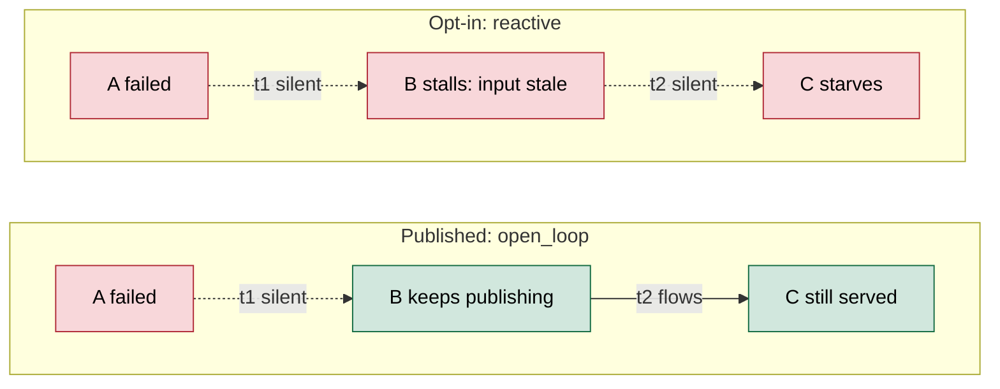
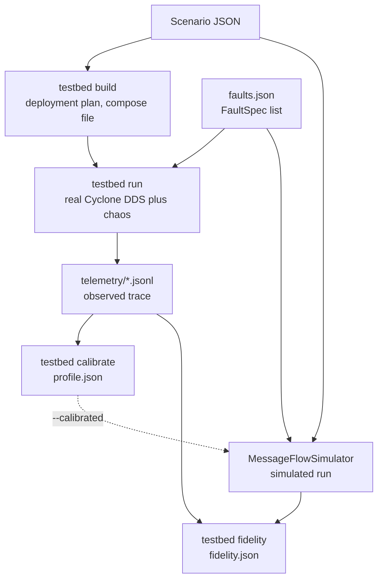

# Step 5: Simulation extensions

**Opt-in engines that go beyond the published labels: failures that propagate at runtime, a wider fault library, DDS-accurate QoS, and a comparison with a real pub-sub system.**

← [Step 5: Simulate](failure-simulation.md) | [README](../README.md) | [CLI flags](cli-pipeline-guide.md#step-5-simulate)

Read [Step 5: Simulate](failure-simulation.md) first. Nothing here changes a published number: every option is off by default, and `tests/test_simulation_golden_defaults.py` pins the defaults bit for bit. Any comparison that will be reported should be pre-registered first.

| Section | Problem it addresses | Status |
|:---|:---|:---|
| [1. Runtime engine](#1-runtime-engine) | Published publishers ignore their inputs, so no failure travels more than one hop; crash-stop is the only fault | Exploratory measurements only |
| [2. DDS QoS semantics and status metrics](#2-dds-qos-semantics-and-status-metrics) | The published QoS rules only approximate DDS | Checked against Cyclone DDS |
| [3. Emulated testbed, calibration and fidelity](#3-emulated-testbed-calibration-and-fidelity) | Nothing is compared with observed behaviour | Smoke-tested on `tiny_system` |

---

## 1. Runtime engine

Code: [`saag/simulation/runtime/`](../saag/simulation/runtime/). These options switch `MessageFlowSimulator` from the published engine to a runtime model.

### Reactive behaviour (`behavior_model="reactive"`)

Every application publishes only while its inputs are **fresh**. An input stays fresh for max(deadline, 3 periods of its topic) after its last *delivered* sample. This is what lets a failure travel through a relay:



On this chain, the published engine gives I_dyn(A) = 0.50 < I_dyn(B) = 1.00, because B keeps publishing. A failure record under the reactive model also lists `stalled_apps`, `time_to_stall_s` and `cascade_hops`.

Each application has a trigger policy. It comes from the `trigger` attribute, or by default from `app_type`:

| `app_type` | Policy |
|:---|:---|
| sensor | `periodic` (ignores inputs) |
| processor, controller | `all_of` (every input fresh) |
| gateway, service, monitor, actuator | `any_of` (at least one input fresh) |
| any, via the `trigger` attribute | `k_of_n:K` (degrades in proportion below K fresh inputs) |

Topics nobody publishes, and topics the application itself publishes, are never required inputs.

Queueing jitter can briefly starve a relay even without a fault. Fault-free publication is 0–5.5 % below the published engine's on five scenarios. Only stalls lasting at least one staleness window (and at least 1 s) count.

### Deployment on the data path (`deployment_model="stations"`)

- **Brokers** become service stations on their routes. When a broker fails, its topics move to the lowest-id live broker after a lease of max(1 s, 3 periods).
- **Co-located applications** share their host's CPU (`cpu_cores`, default one core per resident). A failure that adds work, such as a slowdown or babbling, therefore delays neighbours.
- **Host failures** kill residents, respecting `replica_aware`.
- `hot_standby=True` brings `hotstandby` components back after `failover_delay_s`.

### Fault library

Faults are given as `faults=[FaultSpec(target, mode, start_s, duration_s, params)]`. The first fault is the one the record reports.

| Mode | Effect | Parameters |
|:---|:---|:---|
| `crash` | Permanent crash; a host takes its residents | — |
| `transient_crash` | Crash, restart after `duration_s` | `storm_copies` on restart |
| `freeze` | Stops serving and publishing; queues keep filling | `duration_s` |
| `slowdown` | Service time × k (a host's residents, or a broker's station) | `k`, or `k_mu` / `k_sigma` (log-normal) |
| `omission` | Drops each emission with probability p | `p` |
| `babbling` | Publishes at k × its rate | `k` |
| `buffer_leak` | Reader queues shrink by β slots per second | `beta` |
| `redelivery_storm` | Re-sends retained history `copies` times | `copies` |
| `link_flap` | Gilbert-Elliott on link `a\|b` (bad state = cut); needs `deployment_model="stations"` and `network_gating` | `mean_good_s`, `mean_bad_s` |

For a bounded fault the record reports `time_to_recover_s`: the time until delivery regains 95 % of its pre-fault rate. `RuntimeFaultMode` is separate from `FailureSimulator`'s `FailureMode`, so the Validate oracle is unaffected.

```python
from pathlib import Path
from saag.core.graph_io import load_graph
from saag.simulation.message_flow_simulator import MessageFlowSimulator
from saag.simulation.runtime.faults import FaultSpec

graph = load_graph(Path("data/scenarios/atm_system.json"))
result = MessageFlowSimulator(
    graph, duration=40.0, seed=42, behavior_model="reactive", deployment_model="stations",
    rng_streams="per_process", estimator="paired",
    faults=[FaultSpec("N1", "transient_crash", start_s=20.0, duration_s=5.0)],
).run()
fe = result.fault_event
print(fe.i_dyn_paired, fe.time_to_recover_s, len(fe.stalled_apps))
```

### Other runtime options

| Option | Effect |
|:---|:---|
| `rng_streams="per_process"`, `estimator="paired"` | Same-stream no-fault baseline; a fault that touches nothing scores exactly 0 |
| `workload_model="mmpp"` | Bursts with the declared mean rate |

### Runtime labels (`runtime-sweep`)

The sweep fails every candidate under the runtime settings: reactive, stations, per-process streams and the paired estimator. Candidates are Applications, plus Brokers and Nodes under stations. It writes `runtime_labels.json`; each label is a mean and spread over seeds:

| Label | Meaning |
|:---|:---|
| `i_delivery` | Paired, volume-weighted delivery loss |
| `i_delivery_consumer` | The same, averaged per subscriber, so a 700 Hz feed does not outweigh a 1 Hz one |
| `i_flow` | Criticality-weighted loss at the sinks. A failed sink loses everything, so terminal consumers are not harmless as they are under I\*. |
| `i_timeliness` | Signed change in the deadline-miss share. Under `qos_semantics="dds"` it is the paired increase in the DDS deadline-miss rate instead. |
| `i_recovery` | Recovery time, for bounded faults only |

Each label ships with its **order-k reference**: the training-free truncation of the simulator's own computation that a learned ranker must beat ([research context](failure-simulation.md#14-research-context)).

| Reference | Truncation |
|:---|:---|
| `ref_delivery_first_order` | Eq. 7, generalised to brokers and hosts |
| `ref_flow_reach` | Full propagation of reach; saturates on dense systems |
| `ref_flow_policy` | Deterministic stall fixpoint under the same trigger policies |

```python
from pathlib import Path
from saag.core.graph_io import load_graph
from saag.simulation.runtime.labels import runtime_labels

out = runtime_labels(load_graph(Path("data/scenarios/tiny_system.json")), seeds=[42],
                     settings={"duration": 20.0})
rec = out["records"]["A9"]
print(rec["i_flow"]["mean"], rec["ref_flow_policy"])
```

```bash
python cli/simulate_graph.py runtime-sweep --input data/scenarios/tiny_system.json --seeds 42
```

<!-- schema: runtime_labels -->
```json
{
  "labeler": "MessageFlowSimulator/runtime",
  "seeds": [42],
  "labeled_dimensions": ["i_delivery", "i_delivery_consumer", "i_flow", "i_timeliness"],
  "references": ["ref_delivery_first_order", "ref_flow_reach", "ref_flow_policy"],
  "records": {
    "A9": {"node_type": "Application",
           "i_flow": {"mean": 0.1732, "std": 0.0, "per_seed": {"42": 0.1732}},
           "ref_flow_policy": 0.1167}
  }
}
```

> [!WARNING]
> **Exploratory measurements, not results** (2 scenarios, 2 seeds, 30 s runs):
> - ρ(`i_flow`, `ref_flow_policy`) is 0.86 on atm and 0.80 on microservices.
> - ρ(`i_flow`, I\*) is 0.22 and −0.28.
> - ρ(`i_delivery`, first-order reference) is 0.87 and 0.85.
> - No application has `i_flow` = 0, against 5 and 13 with I\* = 0.
>
> A sanity check: with `behavior_model="open_loop"`, paired `i_delivery` matches `ref_delivery_first_order` at ρ = 0.998 on atm.

---

## 2. DDS QoS semantics and status metrics

Code: [`saag/simulation/runtime/dds_status.py`](../saag/simulation/runtime/dds_status.py). These are opt-in arguments to `MessageFlowSimulator`.

### The DDS arm (`qos_semantics="dds"`)

The published engine departs from DDS in three places ([QoS table](failure-simulation.md#6-messageflowsimulator-queue-flow-oracle-i_dyn)). `qos_semantics="dds"` follows DDS instead:

| Policy | `engine` (default) | `dds` |
|:---|:---|:---|
| DEADLINE | Drops a sample whose latency exceeds `deadline_ms` | Counts a miss when no new sample arrives within the period; drops nothing |
| KEEP_LAST, BEST_EFFORT | Full queue drops the new sample | Full queue replaces the oldest sample |
| Request-vs-offered matching | Not checked | Incompatible (writer, reader) pairs never communicate: reliability, durability order, deadline period |

The engine's deadline rule is what most of its fault-free loss comes from. These are fault-free 30 s runs, seed 1:

| Scenario | Delivery, `engine` | Delivery, `dds` | DDS reader deadline misses |
|:---|:---|:---|:---|
| atm_system | 0.9811 | 0.9979 | 0 |
| av_system | 0.9403 | 0.9993 | 0 |
| microservices_system | 0.9501 | 0.9914 | 0 |
| financial_trading_system | 0.9909 | 0.9996 | 0 |
| iot_smart_city_system | 0.9840 | 0.9910 | 0 |

The corpus meets every declared deadline period in steady state. The published engine's deadline drops come entirely from treating the deadline as a latency limit, so a QoS "deadline enforcement" effect in I_dyn rests on that interpretation.

### Status metrics (`dds_status=True`; implied by `dds`)

The engine counts the DDS standard communication statuses. Counting is observation only and changes no behaviour. Counts are kept per reader (`reader|<topic>|<component>`) and per writer, in pre- and post-fault windows, in `result.dds_status`. Names follow the DCPS statuses, with the RTI Connext 7.7 metric as an alias:

| Status | RTI alias | Simulator source | Testbed source (Cyclone) |
|:---|:---|:---|:---|
| `requested_deadline_missed` | `dds_data_reader_deadline_missed_total` | Period monitor on reception; pauses once the reader's writers are all gone | `get_requested_deadline_missed_status` |
| `offered_deadline_missed` | `dds_data_writer_deadline_missed_total` | Period monitor on emission while alive | `get_offered_deadline_missed_status` |
| `sample_lost` | `dds_data_reader_sample_lost_total` | Copies dropped on a cut network path | `get_sample_lost_status` |
| `sample_rejected` | `dds_data_reader_sample_rejected_total` | `engine` arm: BEST_EFFORT new sample rejected | `get_sample_rejected_status` |
| `liveliness_alive_count` | — | Matched writers alive (the relays, for a brokered topic) | `…liveliness_changed….alive_count` |
| `liveliness_not_alive_count` | `dds_data_reader_liveliness_not_alive_count` | not simulated (see below) | `…liveliness_changed….not_alive_count` |
| `requested_incompatible_qos` | `dds_data_reader_incompatible_qos_total` | Static request-vs-offered check | `get_requested_incompatible_qos_status` |
| `cache_replaced_dropped_samples`, `cache_samples_peak` | `dds_data_reader_cache_*` | Queue accounting | Agent queue count |

Running against Cyclone corrected the simulator's model twice:
- With AUTOMATIC liveliness, a crashed host's writers are *removed*: `alive_count` drops and `not_alive_count` stays 0. The simulator therefore reports `alive_count`.
- An instance with no live writers stops deadline counting.

```python
from pathlib import Path
from saag.core.graph_io import load_graph
from saag.simulation.message_flow_simulator import MessageFlowSimulator

graph = load_graph(Path("data/scenarios/atm_system.json"))
result = MessageFlowSimulator(graph, duration=30.0, fault_node="A0", seed=1,
                              qos_semantics="dds").run()
print(sum(t.total_dropped_deadline for t in result.topic_stats.values()),
      sorted(result.dds_status["statuses"]))
```

Not modelled: the RTI Prometheus import and export, participant UDP bandwidth, the reliability protocol (heartbeats, NACKs, repairs), and RTI's alert categories.

---

## 3. Emulated testbed, calibration and fidelity

Code: [`saag/testbed/`](../saag/testbed/), [`saag/simulation/calibration.py`](../saag/simulation/calibration.py), [`saag/validation/fidelity.py`](../saag/validation/fidelity.py).

Every oracle in Step 5 is scored against something the framework computes. The testbed produces *observed* behaviour instead. It runs the scenario as a real pub-sub system, injects the same `FaultSpec`s, and records OpenTelemetry-shaped traces:



| Part | What it does |
|:---|:---|
| Deployment plan | Hosts and residents, each topic's DDS QoS, and each app's trigger policy, staleness windows and service time. The same functions as the reactive model are used, so a gap in fidelity is a gap in timing and transport, not in the behavioural model. |
| Runtime | Stub applications: one publisher thread per output, one worker per app (the shared station), bounded queues, deadline checks. A **broker** is a relay: writers publish to `ingress`, the routing broker republishes to `egress`, and the lowest-id relay with a live heartbeat routes. A **multi-hosted app** runs one instance per host; the lowest-id live instance is active and the others are warm standbys. |
| Transport | Cyclone DDS (extra `testbed`, `cyclonedds==11.0.1`) through a WaitSet poller, never listeners, with AUTOMATIC liveliness. `--mode local` runs everything in-process without Docker. |
| Chaos | Host faults become `docker kill`, `start`, `pause` or `update`. App faults become control files the agents poll. `link_flap` becomes `tc netem`, which cuts all of one endpoint's traffic. `buffer_leak` and `redelivery_storm` are reported as unsupported. |
| Calibration | `TelemetryCalibrator` fits topic rates and service-time distributions on the pre-fault steady state. It infers trigger policies from how emissions respond to input outages, abstaining when the evidence is ambiguous. It never writes `edge_failure_correlation`, which is a cascade probability, not a drop rate. |
| Fidelity | The simulated run is compared with the observed one: steady state against declared tolerances, the fault response (stall-set Jaccard), and DDS statuses. It is a report, never a gate. |

```bash
python cli/simulate_graph.py testbed build --input data/scenarios/tiny_system.json --output output/testbed/tiny --duration 50 --qos-semantics dds
python cli/simulate_graph.py testbed run --output output/testbed/tiny --duration 50 --faults faults.json --mode docker
python cli/simulate_graph.py testbed calibrate --output output/testbed/tiny
python cli/simulate_graph.py testbed fidelity --output output/testbed/tiny --calibrated
```

`--mode docker` builds an image that downloads `python:3.11-slim` and `cyclonedds`. The testbed directory is its own build context, with a copy of `saag/`.

A testbed directory contains:
- `deployment.json`, `Dockerfile`, `docker-compose.yml` and `saag/`;
- `telemetry/<host>.jsonl`, OpenTelemetry-shaped `saag.*` events;
- `run.json`, `profile.json` (calibration) and `fidelity.json` (`fidelity_calibrated.json` with `--calibrated`).

**Validation on `tiny_system`.** This setup has 4 containers, 12 apps and 2 broker relays at 1 Hz, run with declared parameters; each row is a single run, so treat this as a smoke test.

| Run | Topic rate error | Per-reader delivery error | Latency error p50 / p95 | Stall-set Jaccard |
|:---|:---|:---|:---|:---|
| Fault-free, 40 s | 0.000 | 0.000 | 0.14 / 0.11 | — |
| Host N1 `docker kill` at 20 s | 0.000 | 0.059 | 0.40 / 0.14 | 1.0 |
| Broker B0 crash at 20 s (failover to B1) | 0.000 | 0.059 | 0.34 / 0.18 | 1.0 |

Errors are median relative errors. With `qos_semantics="dds"` and a host crash, the DDS statuses of the application entities agree as follows:

| Status | Agreement |
|:---|:---|
| `liveliness_alive_count` | Same 15 readers on both sides; values exact |
| `requested_deadline_missed` | Same 1 reader; 9 vs 7 misses |
| `offered_deadline_missed` | Same 3 writers; ~7 % count error |
| `sample_lost`, `sample_rejected`, `liveliness_not_alive_count` | 0 on both sides |

The relays' own DDS endpoints exist only on the testbed and are excluded, with their count reported.

---

← [Step 5: Simulate](failure-simulation.md) | → [Step 6: Validate](validation.md)
