# Step 5: Simulate

**Inject failures into the architecture model and measure what the rest of the system loses.** The measured losses are the ground truth used to train predictors (Step 3), to check them (Step 6) and to verify refactorings (Step 7).

← [Step 4: Diagnose](diagnosis.md) | [README](../README.md) | **Step 5: Simulate** | → [Step 6: Validate](validation.md)

---

## Contents

1. [What the simulation step does](#1-what-the-simulation-step-does) · [2. Which engine do I need?](#2-which-engine-do-i-need) · [3. Rules that hold everywhere](#3-rules-that-hold-everywhere)
2. Engines: [4. FaultInjector](#4-faultinjector-cascade-labels-i) · [5. FailureSimulator](#5-failuresimulator-multi-layer-quality-oracle-i_comp) · [6. MessageFlowSimulator](#6-messageflowsimulator-queue-flow-oracle-i_dyn) · [7. ChangePropagationSimulator](#7-changepropagationsimulator-maintainability-reference-i_m) · [8. Supporting engines](#8-supporting-engines) · [9. Shared deployment options](#9-shared-deployment-options)
3. Tier 1 & Tier 2 extensions: [10. Runtime engine](#10-runtime-engine) · [11. DDS QoS semantics & status metrics](#11-dds-qos-semantics-and-status-metrics) · [12. Emulated testbed, calibration & fidelity](#12-emulated-testbed-calibration-and-fidelity) · [13. Hybrid two-tiered runtime verification](#13-hybrid-two-tiered-runtime-verification) · [14. Operational health & Tier-2 criticality](#14-operational-health-status-and-tier-2-operational-criticality)
4. Reference: [15. Command line and REST API](#15-command-line-and-rest-api) · [16. Output files](#16-output-files) · [17. Worked examples](#17-worked-examples) · [18. Research context](#18-research-context) · [19. Known limitations](#19-known-limitations)
---

## 1. What the simulation step does

Before a system is deployed there are no crash logs to learn from. SaG therefore fails each component of the declared architecture in turn, propagates the consequences through the model, and records the damage. That damage, a per-component **impact score**, stands in for the missing operational history.

Each engine measures a different kind of damage, and each feeds a different pipeline step:

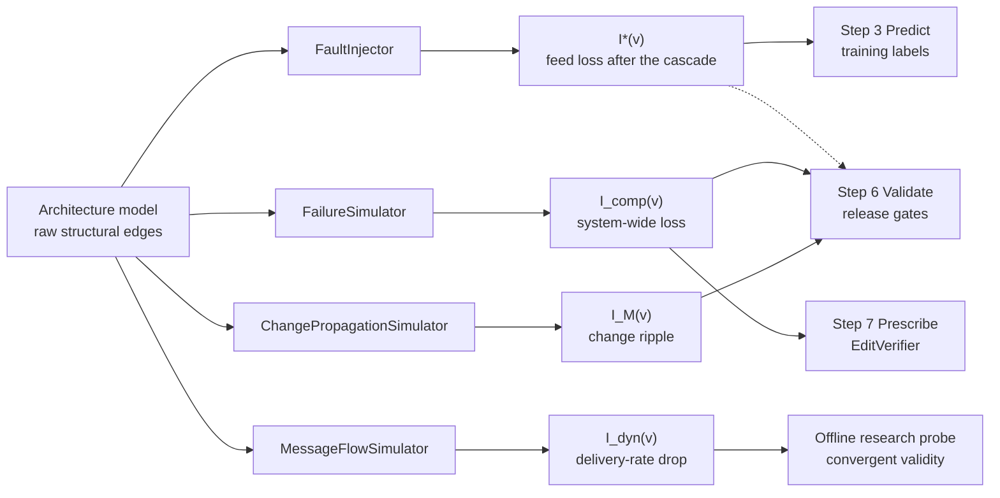

The dotted arrow is the CLI benchmark in Step 6. I_M runs inside the `FailureSimulator` sweep ([§7](#7-changepropagationsimulator-maintainability-reference-i_m)) and is never a training label.

**The raw-edge rule.** The engines measure on the **raw structural graph** (`PUBLISHES_TO`, `SUBSCRIBES_TO`, `ROUTES`, `RUNS_ON`, `USES`, `CONNECTS_TO`). They never consume the `DEPENDS_ON` edges that Step 2 derives for the predictors, so a label cannot be a restatement of a predictor's input. Two engines need dependency arcs, and build their own:

- `ChangePropagationSimulator` receives edges that `SimulationGraph.get_dependency_edges()` **re-derives from the raw edges**, using the same seven rules as the repositories (`tests/test_simulation_dependency_derivation.py`).
- `FaultInjector` derives arcs on its private copy of the graph from `PUBLISHES_TO`, `SUBSCRIBES_TO` and `USES`, and follows only the application-to-library ones. One caveat: a graph that already contains `DEPENDS_ON` edges is used as given and nothing is derived. The scenario corpus declares none.

---

## 2. Which engine do I need?

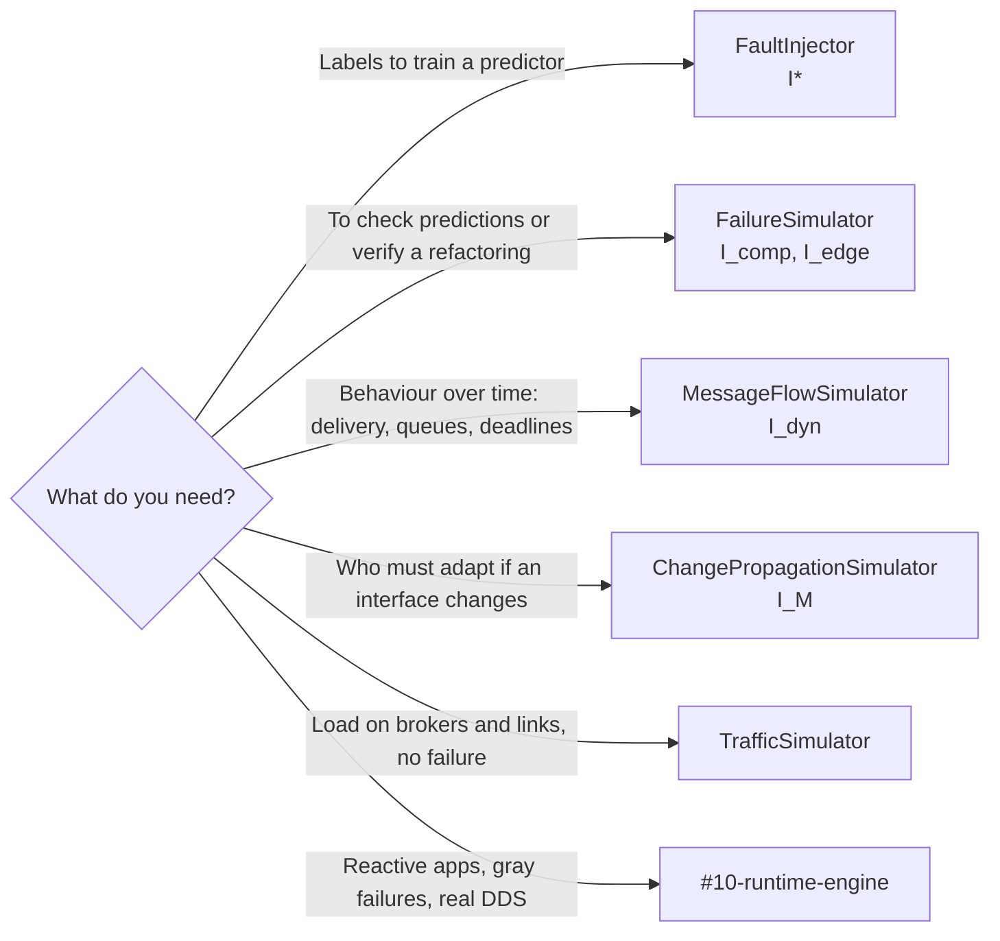

| Engine | Question it answers | Output | Cost on `atm_system` / `av_system` (74 / 152 nodes) |
|:---|:---|:---|:---|
| `FaultInjector` | If *v* dies, which subscribers starve? | I\*(v) | 0.08 s / 0.35 s for a 5-seed sweep of Applications, Brokers and Libraries |
| `FailureSimulator` | What is the systemic loss across hosts, brokers, libraries and links? | I_comp(v), I_edge(u,v) | 0.06 s / 0.45 s for an exhaustive sweep |
| `MessageFlowSimulator` | How do delivery, queues and deadlines behave over time when *v* fails? | I_dyn(v), golden signals | 1.5 s / 4.3 s **per failed component** (60 simulated seconds) |
| `ChangePropagationSimulator` | If *v*'s interface changes, what must adapt? | I_M(v) | milliseconds; runs inside the `FailureSimulator` sweep |
| `EventSimulator` | Which paths are live in the healthy system? | baseline flows | milliseconds; primes `FailureSimulator` |
| `TrafficSimulator` | What load does a topic set put on brokers and network? | bandwidth and message rates | closed form; backs the REST traffic endpoint |

Timings are medians of three runs on an idle machine (2026-11). Treat them as orders of magnitude.

**Quick start.** Label a scenario, then probe one failure dynamically. Results land in `output/simulation/` ([§12](#16-output-files)).

```bash
python cli/simulate_graph.py fault-inject --input data/scenarios/atm_system.json --export-json
python cli/simulate_graph.py message-flow --input data/scenarios/atm_system.json --duration 60 --fault-node A0 --export-json
```

---

## 3. Rules that hold everywhere

1. **Oracles are not interchangeable.** I\*, I_comp, I_dyn and I_M measure different things on different scales; only their rank agreement is comparable. `FaultInjector` is the Predict-stage labeller and `FailureSimulator` the Validate-stage oracle. Using one in the other's place is a contract violation (`tests/test_groundtruth_contract.py`). Every result must say which oracle produced it.
2. **Raw edges only** ([§1](#1-what-the-simulation-step-does)). The simulation package also may not import the prediction and quality-scoring classes (`tests/test_independence_guarantee.py`).
3. **Simulation is offline.** Step 3 reads labels from disk and never imports the simulators (`tests/test_predict_simulate_separation.py`). Step 4 (Diagnose) has no simulation access at all.
4. **Defaults are the published engines.** Every [extension](#10-opt-in-extensions-overview) is opt-in. `tests/test_simulation_golden_defaults.py` pins the default I\*, I_dyn, I_comp and I_M outputs bit for bit (I_comp and I_M at `PYTHONHASHSEED=0`), so an extension cannot leak into the published oracles.

---

## 4. `FaultInjector`: cascade labels I\*

Source: [`saag/simulation/fault_injector.py`](../saag/simulation/fault_injector.py). This is the Predict-stage labeller.

**What it answers.** *If component v fails, how much of their input do the subscribers lose once the failure has cascaded?*

**How it works.** The cascade runs in waves, and stops at the first wave in which nothing new fails:

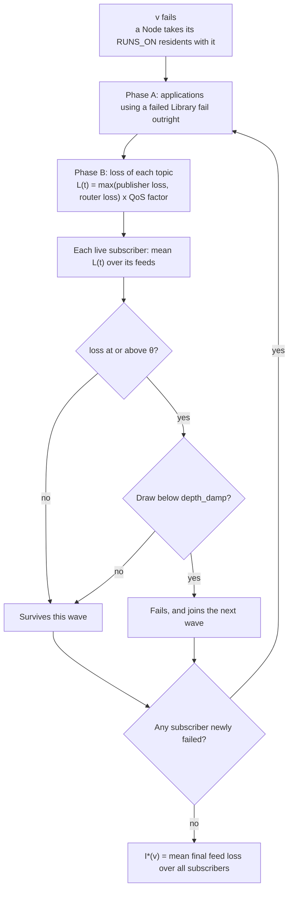

- **Topic loss.** Publisher loss is the rate-weighted share of the topic's publishers that have failed. Router loss is the share of its routing brokers that have failed (½ when one of two brokers dies). A failed topic loses everything. The QoS factor multiplies the loss, which is then clamped to 1; the default `ladder` gives ×1.2 for RELIABLE, ×1.15 for high priority and ×1.05 for medium.
- **Failure rule (`failure_model="step"`, published).** A subscriber whose loss reaches θ (`propagation_threshold`, default 0.2) fails with probability `depth_damp = max(0.25, 1 − 0.15 · wave)`.
  - Wave 0 is therefore deterministic.
  - How far past θ the loss goes never matters. The code writes the probability as `min(1, loss/θ) · depth_damp`, but that branch is only reached when loss ≥ θ, so the first factor is always 1.
  - A surviving subscriber is redrawn on every later wave.

$$I^*(v) = \frac{1}{|\mathcal{S}|}\sum_{s \in \mathcal{S}} \text{loss}(s) \qquad \text{over all subscribers } \mathcal{S}$$

I\* is 0 when nobody loses anything and 1 when every subscriber loses every feed. A subscriber counts its feed loss, not its own failure, so a pure sink, such as an application that only subscribes, always scores 0.

**Options**

| Option | Default | Effect |
|:---|:---|:---|
| `seeds` | `[42]` in code; `RECOMMENDED_SEEDS` (5 seeds) on the CLI | Labels are seed means; `impact_score_std` is the spread |
| `propagation_threshold` | 0.2 | Raise toward 1.0 for "fail only when starved" |
| `qos_factor_mode` | `ladder` | `wt`: scale by the topic weight w(t), which includes durability; `none`: topology only (the label-ablation arm) |
| `failure_model` | `step` | `threshold_cdf`: each subscriber draws a tolerance θ_s ~ U(0.1, 0.5) once per seed and is redrawn only when its loss rises. Averaged over seeds, P(fail) = F_θ(loss) · depth_damp, so the cliff at θ becomes a smooth curve. |
| `network_gating`, `replica_aware` | off | See [§9](#9-shared-deployment-options) |
| `node_types` | `Application, Broker` in code; the CLI adds `Library` | Types left out are listed in `unlabeled_node_ids`, never scored 0. `Topic` and `Node` can be labelled: a failed topic silences its subscribers, and a failed host takes its residents with it. |

**Run it**

```python
from pathlib import Path
from saag.core.graph_io import load_graph
from saag.simulation.fault_injector import FaultInjector, RECOMMENDED_SEEDS

graph = load_graph(Path("data/scenarios/atm_system.json"))
result = FaultInjector(graph, seeds=RECOMMENDED_SEEDS).run(node_types=["Application", "Broker"])
result.save(Path("output/simulation/impact_scores.json"))

top = result.top_k_by_impact[0]
print(top["node_id"], top["impact_score"], result.label_stability["test_retest_spearman"])
```

```bash
python cli/simulate_graph.py fault-inject --input data/scenarios/atm_system.json --seeds 42,123,456,789,2024 --export-json
```

**Output:** `impact_scores.json` ([§12](#16-output-files)). Its `label_stability` block (mean and maximum seed spread, worst pairwise test-retest ρ, worst top-K Jaccard) bounds any correlation computed against these labels. A type whose labels are all 0 is reported in `degenerate_node_types`; `strict_labels=True` turns that into an error.

---

## 5. `FailureSimulator`: multi-layer quality oracle I_comp

Source: [`saag/simulation/failure_simulator.py`](../saag/simulation/failure_simulator.py). This is the Validate-stage oracle; it is never a training label.

**What it answers.** *What does the system as a whole lose when v fails, across hosts, brokers, topics and libraries?*

**How it works.** Each component carries an **impact between 0 and 1** (1 = failed). A queue walks the rules below, each one raising impact on its targets, until nothing rises or the depth limit (10) is reached:

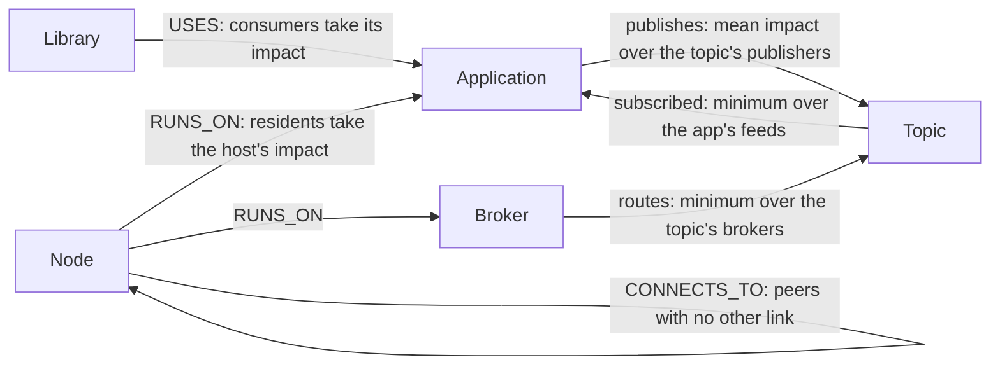

The two minimums express redundancy: a surviving peer broker keeps a topic up, and one healthy feed keeps a subscriber up. A subscriber here is starved only when all its feeds are impaired, unlike `FaultInjector`'s mean feed loss.

Topic impact is also scaled by the topic's weight w(t). Logical rules fire with probability equal to the edge's QoS weight w(e) when one is recorded, and `cascade_probability` otherwise. Physical and network rules use `cascade_probability`. Runs are seeded per component, so a sweep is reproducible.

**The scores.** Four losses are combined with AHP-derived default weights:

$$I_{\text{comp}}(v) = 0.35\,\text{RL} + 0.25\,\text{FR} + 0.25\,\text{TL} + 0.15\,\text{FD}$$

| Term | Meaning |
|:---|:---|
| RL, reachability loss | Share of publisher-to-subscriber paths severed: 1 − paths_after / paths_before |
| FR, fragmentation | 0.70 · Δ connected components + 0.30 · Δ stranded mass |
| TL, throughput loss | Share of QoS-weighted message bandwidth lost |
| FD, flow disruption | Share of healthy `(publisher, topic, subscriber)` flows broken. The baseline flows come from [`EventSimulator`](#8-supporting-engines) (`SimulationService._prime_baseline_flows`). |

The sweep also fills in the quality decomposition the validation gates are written against:

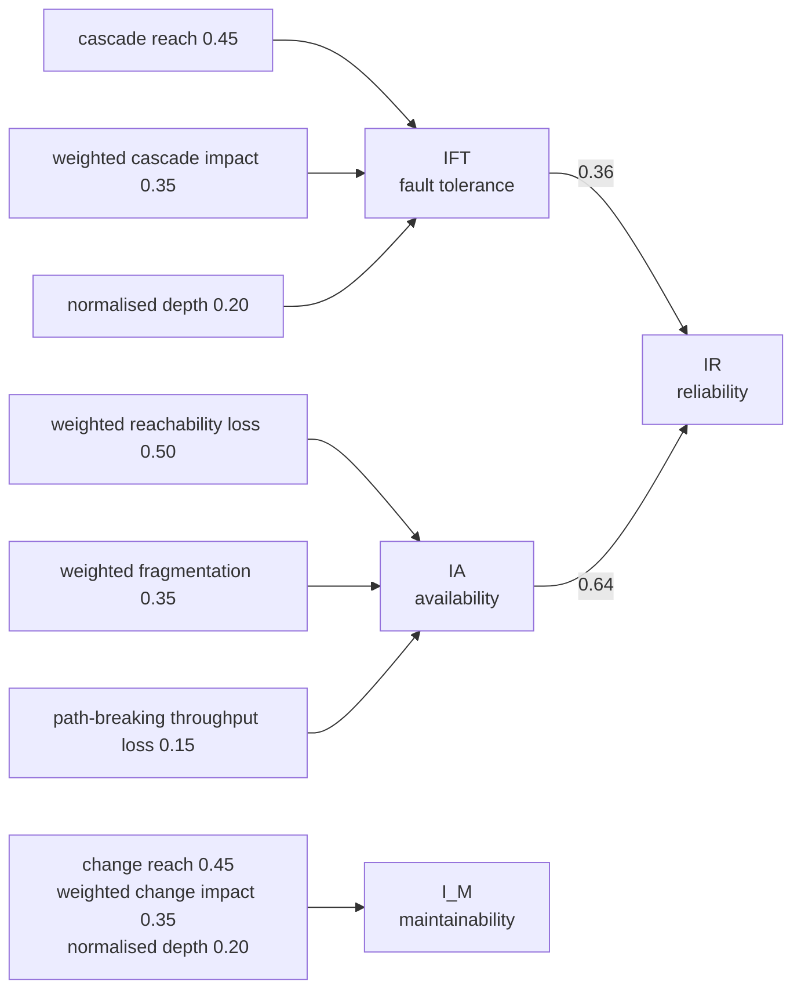

### Edge criticality

Removing one relationship while both endpoints stay up gives

$$I_{\text{edge}}(u,v) = \max\bigl(0,\; I_{\text{comp}}(G \setminus \{(u,v)\}) - I_{\text{comp}}(G)\bigr).$$

Both terms are single measurements with **no cascade**: the question is what this link carries, and cascades belong to the node labels. The sweep measures only a bounded candidate set, the bridges plus the top-q edges by betweenness. The CLI subcommand is `edge-criticality`.

### Options

| Option | Default | Effect |
|:---|:---|:---|
| `qos_weighting` | on | Off: the topology-only oracle arm |
| `failure_mode` | `CRASH` | `DEGRADED`: the target keeps half its capacity and skips the library blast. `PARTITION`: a crash without the physical cascade. `OVERLOAD` is a declared stub with no behaviour of its own; it runs as `CRASH`. |
| `cascade_rule` | `ALL` | Restrict to `PHYSICAL`, `LOGICAL`, `NETWORK` or `LIBRARY` |
| `cascade_probability` | 1.0 | See above; below 1.0 it is what makes Monte Carlo trials differ |
| `library_cascade_probability` | `None` | Falls back to `cascade_probability` |
| `network_gating`, `replica_aware` | off | See [§9](#9-shared-deployment-options) |

### Run it

`SimulationService` loads the graph and offers several ways to run the engine:

| Method | What it runs |
|:---|:---|
| `run_failure_simulation_exhaustive(layer)` | Every component of the layer, one at a time. `system` covers Application, Broker and Node. |
| `run_failure_simulation_pairwise(layer)` | Every pair of components failing together |
| `run_failure_events({name: targets})` | Named joint outages, such as a whole failure domain |
| `run_failure_simulation(target_ids)` | One seeded scenario; the targets fail together |
| `run_failure_simulation_monte_carlo(target_id, n_trials=100)` | Repeated trials; returns mean, spread and 95 % interval |

All of them prime the baseline flows first, so the FD term is live.

```python
import json
from pathlib import Path
from saag.infrastructure.memory_repo import MemoryRepository
from saag.simulation.service import SimulationService

repo = MemoryRepository()
repo.save_graph(json.loads(Path("data/scenarios/atm_system.json").read_text()), clear=True)
results = SimulationService(repo).run_failure_simulation_exhaustive(layer="system")

for r in sorted(results, key=lambda r: -r.impact.composite_impact)[:3]:
    print(r.target_id, r.target_type, round(r.impact.composite_impact, 3),
          round(r.impact.maintainability_impact, 3))
```

---

## 6. `MessageFlowSimulator`: queue-flow oracle I_dyn

Source: [`saag/simulation/message_flow_simulator.py`](../saag/simulation/message_flow_simulator.py). It requires SimPy (extra `sim`).

**What it answers.** *When v fails, how much less traffic gets through, once rates, bounded queues, contention and QoS contracts are taken into account?*

**How it works.** The engine models simulated time. Publishers emit at their topic's declared rate, split evenly among the topic's publishers. Each subscriber has a private bounded queue **per topic**, so one busy topic cannot block another, but all its topics share **one service station** (its CPU), which is where contention arises.

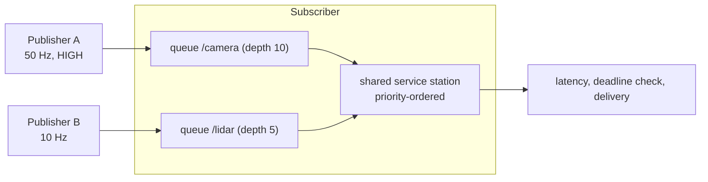

**The impact score.** The fault splits the run into two windows. Each message is assigned to a window by its **creation time**, for demand and for delivery alike. `fault_time` defaults to half the duration; the warm-up and guard band default to 0 s.

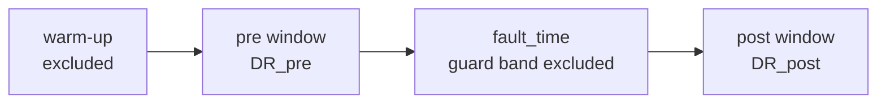

$$I_{\text{dyn}}(v) = \text{DR}_{\text{pre}} - \text{DR}_{\text{post}}, \qquad \text{DR} = \frac{\text{delivered}}{\sum_t \text{published}(t)\cdot|\text{sub}(t)|}$$

- The failed component's own receipts, and its share of the fan-out, are left out of both windows.
- A silenced publisher's demand stays in the denominator.
- I_dyn is **not clamped**. Removing a high-rate publisher relieves contention for everyone else, and a negative value is a real measurement.
- **Latency is deliberately left out.** In the same contention-relief situation, latency and deadline misses *fall* after the fault: their changes correlate negatively with I_dyn (ρ = −0.499 and −0.418; [§14](#18-research-context)). A score that added latency to delivery loss would cancel out exactly when a high-rate publisher fails.

The **golden signals** are reported alongside it for triage, for the whole run and for each window: latency (p50/p95/p99, split into queue wait and service), traffic (published and delivered rates, bytes), errors (deadline drops, overflows, unserved demand) and saturation (utilisation, queue depth and occupancy).

**QoS enforcement**, under the default `qos_mode="full"`:

| Policy | What the engine does | DDS meaning, if different |
|:---|:---|:---|
| Reliability RELIABLE | Full queue drops the **oldest** sample (head-drop) | same (KEEP_LAST) |
| Reliability BEST_EFFORT | Full queue drops the **new** sample | KEEP_LAST would replace the oldest |
| `history_depth` | Becomes the queue capacity | same |
| `transport_priority` | Orders service at the station | — |
| `deadline_ms` | A sample whose end-to-end latency exceeds it is **dropped** | DEADLINE is a *period* contract (a new sample at least this often) and drops nothing. Dropping on age is LIFESPAN. |
| durability | Retained samples are replayed to surviving readers after a publisher outage (`recovery` and `full` modes) | — |

`qos_mode` selects which policies apply: `none` neutralises them but keeps the load, `contracts`, `recovery`, `full`, and `legacy` (the pre-QoS engine, uncalibrated). The deadline rule is the engine's largest source of non-structural loss; the [DDS arm](#11-dds-qos-semantics-and-status-metrics) measures the difference.

**Load calibration.** QoS contracts only bind under contention. The engine sizes each subscriber's mean service time from its offered load Λ_s so that it *targets* utilisation ρ = 0.65 (`target_utilization`): E[S_s] = ρ / Λ_s. Below about 0.2 nothing queues; above about 0.85 queues explode into noise.

The realised utilisation is reported per subscriber in `measured_utilization`, and it lands unevenly. On `atm_system` the 60 s run in [§12](#16-output-files) averages 0.37, with A0 at 0.29. Check it before relying on the operating point.

**Timing.** The CLI default is 100 simulated seconds, and the study uses 60 (fault at 30). A sweep needs one run per candidate, which is why I_dyn is an offline probe and I\* the training label.

**Run it**

```python
from pathlib import Path
from saag.core.graph_io import load_graph
from saag.simulation.message_flow_simulator import MessageFlowSimulator

graph = load_graph(Path("data/scenarios/atm_system.json"))
result = MessageFlowSimulator(graph, duration=60.0, fault_node="A0", fault_time=30.0,
                              seed=42, qos_mode="full", target_utilization=0.65).run()
result.save(Path("output/simulation/message_flow_results.json"))

fe = result.fault_event
print(f"I_dyn(A0) = {fe.i_dyn:.4f}  (delivery {fe.delivery_rate_before:.3f} -> {fe.delivery_rate_after:.3f})")
```

```bash
python cli/simulate_graph.py message-flow --input data/scenarios/atm_system.json --duration 60 --fault-node A0 --fault-time 30 --qos-mode full --target-utilization 0.65 --export-json
```

The convergent-validity study across all scenarios is `PYTHONPATH=. python reproduce/convergent_validity.py`.

---

## 7. `ChangePropagationSimulator`: maintainability reference I_M

Source: [`saag/simulation/change_propagation.py`](../saag/simulation/change_propagation.py).

**What it answers.** *If v's interface changes at development time, which components have to adapt?*

**How it works.** If *u* depends on *v*, a change to *v* may force *u* to change, so the change travels **against** the dependency direction, on the transposed graph Gᵀ. Breadth-first search from *v* counts every direct dependent as reached, because it may have to adapt. The search does not continue *through* a dependent when either of these holds:

- **loose coupling:** the dependency weight is below `theta_loose`, default 0.20;
- **stable interface:** the dependent's instability, out-degree / (in-degree + out-degree), is below `theta_stable`, default 0.20.

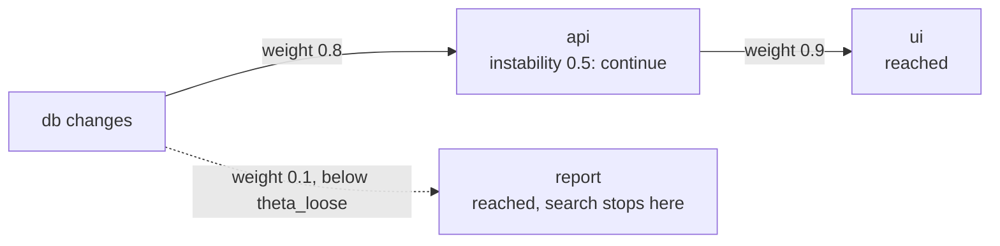

The simulator returns three sub-metrics, which `ImpactMetrics.maintainability_impact` combines:

$$I_M(v) = 0.45\cdot\text{change reach} + 0.35\cdot\text{weighted change impact} + 0.20\cdot\text{normalised depth}$$

**Where it runs.** `FailureSimulator`'s maintainability post-pass calls it with the dependency edges that `SimulationGraph` re-derives from raw edges, and with their degrees. The result appears as `impact.maintainability_impact` on every sweep result (see the [§5 example](#run-it)).

**Directly**, this reproduces the diagram:

<!-- doc-test: assert -->
```python
from saag.simulation.change_propagation import ChangePropagationSimulator

# (u, v, w): u depends on v with weight w
edges = [("ui", "api", 0.9), ("api", "db", 0.8), ("report", "db", 0.1)]
in_deg, out_deg = {"api": 1, "db": 2}, {"ui": 1, "api": 1, "report": 1}
res = ChangePropagationSimulator().simulate_all(
    ["ui", "api", "db", "report"], edges,
    component_in_degrees=in_deg, component_out_degrees=out_deg)
assert sorted(res["db"].reached_components) == ["api", "report", "ui"]
assert res["api"].reached_components == ["ui"]
```

Pass the degrees. Without them every instability is 0, so every dependent counts as stable and the search stops after one hop.

---

## 8. Supporting engines

**`EventSimulator`** ([`event_simulator.py`](../saag/simulation/event_simulator.py)) is a dependency-free discrete-event loop (`heapq`). It models PUBLISH → ROUTE → DELIVER (→ ACK for RELIABLE) and DROP, with optional Poisson component failures, recoveries and message arrivals. Its job in the pipeline is to record the healthy flows that `FailureSimulator`'s FD term compares against. It can also be run on its own:

```python
import json
from pathlib import Path
from saag.infrastructure.memory_repo import MemoryRepository
from saag.simulation.service import SimulationService

repo = MemoryRepository()
repo.save_graph(json.loads(Path("data/scenarios/atm_system.json").read_text()), clear=True)
ev = SimulationService(repo).run_event_simulation("A0", num_messages=50)
print(ev.metrics.messages_published, ev.metrics.delivery_rate)
```

**`TrafficSimulator`** ([`traffic_simulator.py`](../saag/simulation/traffic_simulator.py)) is a closed-form estimate of message rates and bandwidth per topic and per broker for a chosen topic set. A topic's publish rate is its publisher count × frequency; the delivery rate multiplies that by the subscriber count, and bandwidth by the message size. It produces no impact score. It accepts an `IGraphRepository` (supporting both `MemoryRepository` and `Neo4jRepository`, with a `from_neo4j(...)` convenience constructor), and backs the REST traffic endpoint (`api/routers/traffic.py`).

---

## 9. Shared deployment options

Two flags change how hosts, replicas and the network are treated. Both are off by default, and the published labels were produced without them. Both are accepted by `SimulationService(...)` and `GraphEvaluator(...)` too, and on the CLI as `--network-gating` and `--replica-aware`.

| Flag | `FaultInjector` | `FailureSimulator` | `MessageFlowSimulator` |
|:---|:---|:---|:---|
| `network_gating` | A feed the live CONNECTS_TO network no longer delivers counts as lost; hosts and `NetworkDevice`s get labels | Flows are routed over the live network (ECMP). Unreachable subscribers starve; congested links scale RL, TL and FD (they measure, they never fail anything) | With `deployment_model="stations"` only: reachability gates delivery |
| `replica_aware` | A host failure kills a resident only if **all** its hosts are down | A hosted component takes its least-impacted host's impact; a joint outage `FailureScenario(target_ids=[…])` kills replicas | When the [runtime engine](#10-runtime-engine) is active: same rule as `FaultInjector` |

- **`network_gating`** needs a modelled network: `NetworkDevice` switches and routers, and `CONNECTS_TO` links with optional `capacity_mbps` ([graph-model.md §5.2](graph-model.md#52-phase-2-structural-topology--degree-augmentation); routing in [`saag/core/network.py`](../saag/core/network.py)). The corpus's sparse host mesh is not a complete network, which is why gating is opt-in. Without gating, a device failure only scores fragmentation, and a warning is logged.
- **`replica_aware`** addresses the default, under which a multi-hosted component dies when *any* of its hosts fails, making a replica a liability. With the flag on, only `Node` labels move. On a corpus without replicas the flag is a no-op (`tests/test_replica_aware.py`). Example, I\* with seeds 42/123/456: atm N0 0.396 → 0.000, av N1 0.947 → 0.032.

---

## 10. Runtime engine

Code: [`saag/simulation/runtime/`](../saag/simulation/runtime/). These options switch `MessageFlowSimulator` from the published engine to a runtime model.

### Reactive behaviour (`behavior_model="reactive"`)

Every application publishes only while its inputs are **fresh**. An input stays fresh for max(deadline, 3 periods of its topic) after its last *delivered* sample. This is what lets a failure travel through a relay:

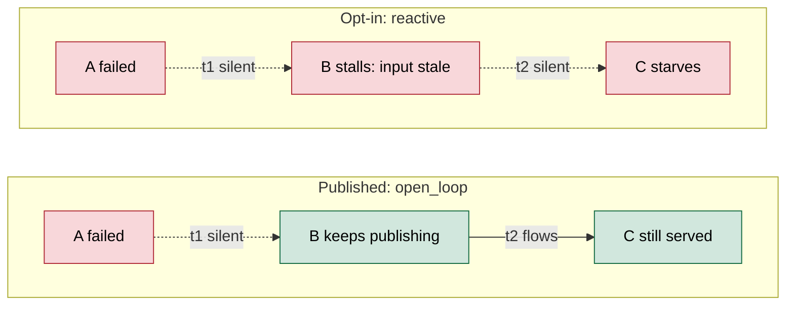

On this chain, the published engine gives I_dyn(A) = 0.50 < I_dyn(B) = 1.00, because B keeps publishing. A failure record under the reactive model also lists `stalled_apps`, `time_to_stall_s` and `cascade_hops`.

Each application has a trigger policy. It comes from the `trigger` attribute, or by default from `app_type`:

| `app_type` | Policy |
|:---|:---|
| sensor | `periodic` (ignores inputs) |
| processor, controller | `all_of` (every input fresh) |
| gateway, service, monitor, actuator | `any_of` (at least one input fresh) |
| any, via the `trigger` attribute | `k_of_n:K` (degrades in proportion below K fresh inputs) |

Topics nobody publishes, and topics the application itself publishes, are never required inputs.

Queueing jitter can briefly starve a relay even without a fault. Fault-free publication is 0–5.5 % below the published engine's on five scenarios. Only stalls lasting at least one staleness window (and at least 1 s) count.

### Deployment on the data path (`deployment_model="stations"`)

- **Brokers** become service stations on their routes. When a broker fails, its topics move to the lowest-id live broker after a lease of max(1 s, 3 periods).
- **Co-located applications** share their host's CPU (`cpu_cores`, default one core per resident). A failure that adds work, such as a slowdown or babbling, therefore delays neighbours.
- **Host failures** kill residents, respecting `replica_aware`.
- `hot_standby=True` brings `hotstandby` components back after `failover_delay_s`.

### Fault library

Faults are given as `faults=[FaultSpec(target, mode, start_s, duration_s, params)]`. The first fault is the one the record reports.

| Mode | Effect | Parameters |
|:---|:---|:---|
| `crash` | Permanent crash; a host takes its residents | — |
| `transient_crash` | Crash, restart after `duration_s` | `storm_copies` on restart |
| `freeze` | Stops serving and publishing (a broker stops forwarding); queues keep filling | `duration_s` |
| `slowdown` | Service time × k (a host's residents, or a broker's station). An app with no inputs has no station, so it emits one tick in k instead; its demand stays counted. An app with a station keeps emitting on schedule, even when saturated, unless its inputs go stale. Testbed `AppRuntime` also stretches emission periods for station-less apps when `k >= 1.0`. | `k`, or `k_mu` / `k_sigma` (log-normal) |
| `omission` | Drops each emission with probability p | `p` |
| `babbling` | Publishes at k × its rate | `k` |
| `buffer_leak` | Reader queues shrink by β slots per second | `beta` |
| `redelivery_storm` | Re-sends retained history `copies` times | `copies` |
| `link_flap` | Gilbert-Elliott on link `a\|b` (bad state = cut); needs `deployment_model="stations"` and `network_gating` | `mean_good_s`, `mean_bad_s` |

For a bounded fault the record reports `time_to_recover_s`: the time until delivery regains 95 % of its pre-fault rate. `RuntimeFaultMode` is separate from `FailureSimulator`'s `FailureMode`, so the Validate oracle is unaffected.

```python
from pathlib import Path
from saag.core.graph_io import load_graph
from saag.simulation.message_flow_simulator import MessageFlowSimulator
from saag.simulation.runtime.faults import FaultSpec

graph = load_graph(Path("data/scenarios/atm_system.json"))
result = MessageFlowSimulator(
    graph, duration=40.0, seed=42, behavior_model="reactive", deployment_model="stations",
    rng_streams="per_process", estimator="paired",
    faults=[FaultSpec("N1", "transient_crash", start_s=20.0, duration_s=5.0)],
).run()
fe = result.fault_event
print(fe.i_dyn_paired, fe.time_to_recover_s, len(fe.stalled_apps))
```

### Other runtime options

| Option | Effect |
|:---|:---|
| `rng_streams="per_process"`, `estimator="paired"` | Same-stream no-fault baseline; a fault that touches nothing scores exactly 0 |
| `workload_model="mmpp"` | Bursts with the declared mean rate |
| `calibration_load="published"` | Sizes stations without topics nobody publishes. The default counts them, which leaves `atm_system` at 0.41 against a 0.65 target, because 26 of its 85 subscriptions read silent topics |

### Overload failure (`overload_model="saturation"`)

Without this, load never fails anything: a broker inheriting traffic on failover just queues. With it, and `deployment_model="stations"`, a broker, app or host crashes when its offered load reaches capacity over a window, which can start a chain the fault alone would not cause.

- **The signal** is arrivals × mean service time ÷ capacity over `overload_window_s` (default 5 s). The threshold is `overload_utilization` (default 1.0). A busy fraction or a standing backlog would not do: at 1 Hz and ρ = 0.65 a queue stays backlogged for about 17 s by chance, so they would crash healthy components.
- **Capacity** comes from a broker's `capacity_msgs_s` and a host's `cpu_cores`. A host with no declared `cpu_cores` is never overloaded as a host. An undeclared broker is sized from the load it routes at the start of the run, so a backup that routes nothing gets the default service time and is hard to overload. Declare capacities for failover to mean anything.
- **Restart.** `overload_restart_s` brings the component back after that long; by default it stays down.
- **The record.** `fault_event.overload_failures` lists what overload brought down, and `runtime_events` says when.

Not modelled: publisher backpressure under RELIABLE, and retries. The testbed does not implement overload yet.

**Declaring capacities.** The corpus declares none, so a crash almost never triggers overload. `runtime-sweep --declare-capacities RHO` (`runtime.workload.declare_capacities`) sizes what a scenario leaves undeclared: a broker for the larger of its starting load and the fleet's mean, divided by ρ, and a host for its stationed residents. This is an assumption about the system, not a measurement.

> [!WARNING]
> **Overload is not a new label source for applications** (exploratory: 4 scenarios, 2 seeds, 30 s runs, crash faults, ρ of 0.65, 0.8 and 0.95):
> - No application crash caused overload anywhere (0 of 206 at each ρ), because losing an application only removes load. Only brokers and hosts pass load on, through failover.
> - Chains are rare and short, at most 2 components. `atm_system` had none, and `healthcare_system` and `microservices_system` had one only at ρ = 0.95. `integration_hub_migration_system` was the exception, with 1–2 of its 4 brokers and 1–2 of its 6 hosts.
> - Rankings mostly hold. `i_flow` stays close to its no-overload value (ρ 0.80–0.99). `i_delivery` moves more as capacity tightens, most on `integration_hub_migration_system` (ρ 0.31–0.62, retest 0.68–0.76).
> - No fault-free run overloaded at any ρ.
>
> Getting load to move on an application failure would take retries or rerouting, which are not modelled.

### Runtime labels (`runtime-sweep`)

The sweep fails every candidate under the runtime settings: reactive, stations, per-process streams and the paired estimator. Candidates are Applications, plus Brokers and Nodes under stations. It writes `runtime_labels.json`; each label is a mean and spread over seeds:

| Label | Meaning |
|:---|:---|
| `i_delivery` | Paired, volume-weighted delivery loss |
| `i_delivery_consumer` | The same, averaged per subscriber, so a 700 Hz feed does not outweigh a 1 Hz one |
| `i_flow` | Criticality-weighted loss at the sinks. A failed sink loses everything, so terminal consumers are not harmless as they are under I\*. |
| `i_timeliness` | Signed change in the deadline-miss share. Under `qos_semantics="dds"` it is the paired increase in the DDS deadline-miss rate instead. |
| `i_recovery` | Recovery time, for bounded faults only |

**Parameter uncertainty.** Before deployment, the operating point, service distribution, staleness window and burstiness are guesses. `runtime-sweep --parameter-draws N` repeats the sweep under N draws from `PARAMETER_RANGES`, at the first seed, and adds `parameter_stability` to the file: the worst pairwise Spearman of each label across draws. A label can reproduce across seeds and still depend on the guess, so read both blocks. The retest gate in training looks only at seeds. The block's `inert` list names drawn keys that the run never reads. Under the default label settings, that list is `burst_ratio`, because bursts apply only under `workload_model="mmpp"`. So the spread measures three guesses, not four.

The sweep is also available as `SimulationService.run_runtime_sweep(...)`, and as `SimulationMode.RUNTIME` through `SimulateGraphUseCase`. Pass `--profile PROFILE.json` (or `telemetry_profile=...` to `runtime_labels`) to calibrate the sweep with a `RuntimeTelemetryProfile` produced by `testbed calibrate`; the output records `"calibrated": true` and `"calibration_source"` while keeping `settings` JSON-serialisable.

Each label ships with its **order-k reference**: the training-free truncation of the simulator's own computation that a learned ranker must beat ([research context](#18-research-context)).

| Reference | Truncation |
|:---|:---|
| `ref_delivery_first_order` | Eq. 7, generalised to brokers and hosts |
| `ref_flow_reach` | Full propagation of reach; saturates on dense systems |
| `ref_flow_policy` | Deterministic stall fixpoint under the same trigger policies |

```python
from pathlib import Path
from saag.core.graph_io import load_graph
from saag.simulation.runtime.labels import runtime_labels

out = runtime_labels(load_graph(Path("data/scenarios/tiny_system.json")), seeds=[42],
                     settings={"duration": 20.0})
rec = out["records"]["A9"]
print(rec["i_flow"]["mean"], rec["ref_flow_policy"])
```

```bash
python cli/simulate_graph.py runtime-sweep --input data/scenarios/tiny_system.json --seeds 42
```

<!-- schema: runtime_labels -->
```json
{
  "labeler": "MessageFlowSimulator/runtime",
  "seeds": [42],
  "labeled_dimensions": ["i_delivery", "i_delivery_consumer", "i_flow", "i_timeliness"],
  "references": ["ref_delivery_first_order", "ref_flow_reach", "ref_flow_policy"],
  "records": {
    "A9": {"node_type": "Application",
           "i_flow": {"mean": 0.1732, "std": 0.0, "per_seed": {"42": 0.1732}},
           "ref_flow_policy": 0.1167}
  }
}
```

**Training on a runtime label.** Name the label, because the file holds several: `train_graph.py --simulated runtime_labels.json --label i_flow`. Each label's `label_stability` block gives its worst pairwise Spearman across seeds, and training refuses a label below 0.70 or one measured with a single seed. `--allow-unstable-labels` overrides that.

Check the block before planning a study. In a 30 s, 2-seed sweep of 3 scenarios, crash `i_flow` reproduced at 0.73–0.97, but crash `i_delivery` reached −0.011 on `integration_hub_migration`.

> [!WARNING]
> **Exploratory measurements, not results** (2 scenarios, 2 seeds, 30 s runs):
> - ρ(`i_flow`, `ref_flow_policy`) is 0.86 on atm and 0.80 on microservices.
> - ρ(`i_flow`, I\*) is 0.22 and −0.28.
> - ρ(`i_delivery`, first-order reference) is 0.87 and 0.85.
> - No application has `i_flow` = 0, against 5 and 13 with I\* = 0.
>
> A sanity check: with `behavior_model="open_loop"`, paired `i_delivery` matches `ref_delivery_first_order` at ρ = 0.998 on atm.

---

## 11. DDS QoS semantics and status metrics

Code: [`saag/simulation/runtime/dds_status.py`](../saag/simulation/runtime/dds_status.py). These are opt-in arguments to `MessageFlowSimulator`.

### The DDS arm (`qos_semantics="dds"`)

The published engine departs from DDS in three places ([QoS table](#6-messageflowsimulator-queue-flow-oracle-i_dyn)). `qos_semantics="dds"` follows DDS instead:

| Policy | `engine` (default) | `dds` |
|:---|:---|:---|
| DEADLINE | Drops a sample whose latency exceeds `deadline_ms` | Counts a miss when no new sample arrives within the period; drops nothing |
| KEEP_LAST, BEST_EFFORT | Full queue drops the new sample | Full queue replaces the oldest sample |
| Request-vs-offered matching | Not checked | Incompatible (writer, reader) pairs never communicate: reliability, durability order, deadline period |

The engine's deadline rule is what most of its fault-free loss comes from. These are fault-free 30 s runs, seed 1:

| Scenario | Delivery, `engine` | Delivery, `dds` | DDS reader deadline misses |
|:---|:---|:---|:---|
| atm_system | 0.9811 | 0.9979 | 0 |
| av_system | 0.9403 | 0.9993 | 0 |
| microservices_system | 0.9501 | 0.9914 | 0 |
| financial_trading_system | 0.9909 | 0.9996 | 0 |
| iot_smart_city_system | 0.9840 | 0.9910 | 0 |

The corpus meets every declared deadline period in steady state. The published engine's deadline drops come entirely from treating the deadline as a latency limit, so a QoS "deadline enforcement" effect in I_dyn rests on that interpretation.

### Status metrics (`dds_status=True`; implied by `dds`)

The engine counts the DDS standard communication statuses. Counting is observation only and changes no behaviour. Counts are kept per reader (`reader|<topic>|<component>`) and per writer, in pre- and post-fault windows, in `result.dds_status`. Names follow the DCPS statuses, with the RTI Connext 7.7 metric as an alias:

| Status | RTI alias | Simulator source | Testbed source (Cyclone) |
|:---|:---|:---|:---|
| `requested_deadline_missed` | `dds_data_reader_deadline_missed_total` | Period monitor on reception; pauses once the reader's writers are all gone | `get_requested_deadline_missed_status` |
| `offered_deadline_missed` | `dds_data_writer_deadline_missed_total` | Period monitor on emission while alive | `get_offered_deadline_missed_status` |
| `sample_lost` | `dds_data_reader_sample_lost_total` | Copies dropped on a cut network path | `get_sample_lost_status` |
| `sample_rejected` | `dds_data_reader_sample_rejected_total` | `engine` arm: BEST_EFFORT new sample rejected | `get_sample_rejected_status` |
| `liveliness_alive_count` | — | Matched writers alive (the relays, for a brokered topic) | `…liveliness_changed….alive_count` |
| `liveliness_not_alive_count` | `dds_data_reader_liveliness_not_alive_count` | not simulated (see below) | `…liveliness_changed….not_alive_count` |
| `requested_incompatible_qos` | `dds_data_reader_incompatible_qos_total` | Static request-vs-offered check | `get_requested_incompatible_qos_status` |
| `cache_replaced_dropped_samples`, `cache_samples_peak` | `dds_data_reader_cache_*` | Queue accounting | Agent queue count |

Running against Cyclone corrected the simulator's model twice:
- With AUTOMATIC liveliness, a crashed host's writers are *removed*: `alive_count` drops and `not_alive_count` stays 0. The simulator therefore reports `alive_count`.
- An instance with no live writers stops deadline counting.

```python
from pathlib import Path
from saag.core.graph_io import load_graph
from saag.simulation.message_flow_simulator import MessageFlowSimulator

graph = load_graph(Path("data/scenarios/atm_system.json"))
result = MessageFlowSimulator(graph, duration=30.0, fault_node="A0", seed=1,
                              qos_semantics="dds").run()
print(sum(t.total_dropped_deadline for t in result.topic_stats.values()),
      sorted(result.dds_status["statuses"]))
```

Not modelled: the RTI Prometheus import and export, participant UDP bandwidth, the reliability protocol (heartbeats, NACKs, repairs), and RTI's alert categories.

---

## 12. Emulated testbed, calibration and fidelity

Code: [`saag/testbed/`](../saag/testbed/), [`saag/simulation/calibration.py`](../saag/simulation/calibration.py), [`saag/validation/fidelity.py`](../saag/validation/fidelity.py), [`saag/validation/health.py`](../saag/validation/health.py).

Every oracle in Step 5 is scored against something the framework computes. The testbed produces *observed* behaviour instead. It runs the scenario as a real pub-sub system, injects the same `FaultSpec`s, and records OpenTelemetry-shaped traces (8 event kinds: `saag.publish`, `saag.deliver`, `saag.deadline_miss`, `saag.drop`, `saag.forward`, `saag.state`, `saag.health`, `saag.status`):

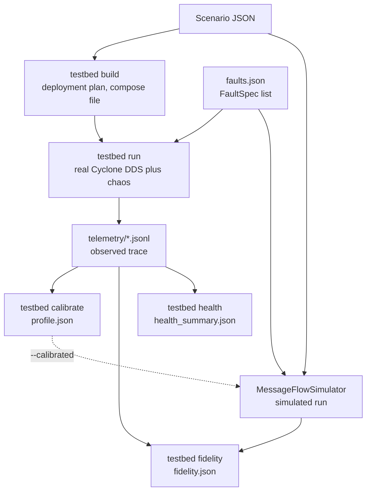

| Part | What it does |
|:---|:---|
| Deployment plan | Hosts and residents, scenario `domain`, declared entity `criticality` (`topics`, `apps`, `brokers`, `host_criticality`, `network_devices`), each topic's DDS QoS, and each app's trigger policy, staleness windows and service time. The same functions as the reactive model are used, so a gap in fidelity is a gap in timing and transport, not in the behavioural model. |
| Runtime | Stub applications: one publisher thread per output, one worker per app (the shared station), bounded queues with peak-depth tracking (`cache_samples_peak`), deadline checks, and live `saag.health` state-transition telemetry (`healthy`/`degraded`/`stalled`/`crashed`/`frozen`, annotated with resolved operational criticality). A **broker** is a relay: writers publish to `ingress`, the routing broker republishes to `egress`, and the lowest-id relay with a live heartbeat routes (emitting `saag.forward` and `saag.health`). A **multi-hosted app** runs one instance per host; the lowest-id live instance is active and the others are warm standbys. |
| Transport | Cyclone DDS (extra `testbed`, `cyclonedds==11.0.1`) through a WaitSet poller, never listeners, with AUTOMATIC liveliness. `--mode local` runs everything in-process without Docker. |
| Chaos | Host crashes and freezes become `docker kill`, `start` or `pause`. Docker runs sample per-container `docker_cpu_p95` into `run.json`. A host slowdown, like any app fault, becomes control files the agents poll, one per resident (brokers included). A slowed app with no inputs stretches its emission period, as in the simulator. `link_flap` becomes a *partition*: each blocked container drops ingress traffic from its peers' addresses with `tc`, multicast included, so DDS discovery and liveliness see the cut. Without `--network-gating` the flapping link's two hosts are blocked from each other. With it, any two hosts that CONNECTS_TO no longer connects are blocked, as in `network_gating`. That also makes a NetworkDevice crash real, and a topology that already separates hosts is partitioned before traffic starts. `buffer_leak`, `redelivery_storm` and faults on a network vertex with no container are reported as unsupported. |
| Emulation options | All opt-in at `build`, so the defaults behave as before. `--service-work cpu` burns each service time on the CPU (hashing, which releases the GIL) instead of sleeping. It also caps each host container at the simulator's host capacity: `cpu_cores`, or else one core per resident station. Co-located apps then really compete for a host, while broker relays keep sleeping, as broker stations do in the simulator. The build refuses if utilisation × stations exceeds this machine's cores. `--carry-payload` puts each topic's `size` bytes on the wire. Serializing costs about 12 ns per byte, so 32 KiB takes about 0.4 ms. |
| Calibration | `TelemetryCalibrator` fits topic rates (outage-robust), application and broker service-time distributions (`saag.deliver`, `saag.deadline_miss`, `saag.forward`), and per-topic MMPP workload burstiness on steady state. It infers trigger policies (including `k_of_n:K`) from input outages, abstaining when ambiguous, and supports incremental EMA re-calibration (`update_profile`). It never writes `edge_failure_correlation`, which is a cascade probability, not a drop rate. See *What calibration can recover*, below. |
| Fidelity & Health | `testbed fidelity` compares the simulated run with the observed one across steady state, fault response (stall-set Jaccard), DDS statuses, end-of-simulation health summaries (`compare_health_summaries`), and operational criticality. `testbed health` computes and prints the standalone Tier-2 operational health summary (`health_summary.json`) and observed operational criticality table directly from `telemetry/*.jsonl`. Both are advisory reports, never gates. |

```bash
python cli/simulate_graph.py testbed build --input data/scenarios/tiny_system.json --output output/testbed/tiny --duration 50 --qos-semantics dds
python cli/simulate_graph.py testbed run --output output/testbed/tiny --duration 50 --faults faults.json --mode docker
python cli/simulate_graph.py testbed calibrate --output output/testbed/tiny
python cli/simulate_graph.py testbed fidelity --output output/testbed/tiny --calibrated
python cli/simulate_graph.py testbed health --output output/testbed/tiny --only-unhealthy
```

`--mode docker` builds an image that downloads `python:3.11-slim` and `cyclonedds`. The testbed directory is its own build context, with a copy of `saag/`.

**What calibration can recover.** To test this, `atm` was simulated under the runtime-label settings with known parameters. The trace was then calibrated, and the fitted parameters compared with the known ones (`tests/test_calibration_identifiability.py`):

| Parameter | Recovered? |
|:---|:---|
| Topic rates | Yes. Median error 3% over a 60 s trace (outage-robust on fault traces). |
| App & broker service mean and CV | Yes. Median error 1% for apps (every app within sampling noise, at most 3.6 SE over 30 apps), including `saag.deadline_miss` service times so late samples do not bias the mean low; broker service times recovered from `saag.forward`. |
| Workload burstiness (MMPP) | Yes, when bursty. Outage-filtered CV + Fano gate with 2-means segmentation recovers `burst_ratio`, `burst_fraction`, and `mean_burst_s` with zero false positives on periodic/Poisson traces. |
| Trigger policy | Never wrong. On `atm`, 16 or 17 of the 17 apps with inputs and outputs get an answer, and every answer is right (including `k_of_n:K` when partial-outage ramps are observed). Pure sinks and apps that never saw a partial input outage get no answer. |
| `staleness_periods` | No. The calibrator has no estimator, so post-deployment data cannot narrow this range. |

A testbed directory contains:
- `deployment.json`, `Dockerfile`, `docker-compose.yml` and `saag/`;
- `telemetry/<host>.jsonl`, OpenTelemetry-shaped `saag.*` events (including `saag.health` and `cache_samples_peak`);
- `run.json` (including `docker_cpu_p95` on Docker runs), `profile.json` (calibration), `fidelity.json` (`fidelity_calibrated.json` with `--calibrated`), and `health_summary.json` (from `testbed health`).

**Validation on `tiny_system`.** This setup has 4 containers, 12 apps and 2 broker relays at 1 Hz, run with declared parameters; each row is a single run, so treat this as a smoke test.

| Run | Topic rate error | Per-reader delivery error | Latency error p50 / p95 | Stall-set Jaccard |
|:---|:---|:---|:---|:---|
| Fault-free, 40 s | 0.000 | 0.000 | 0.14 / 0.11 | — |
| Host N1 `docker kill` at 20 s | 0.000 | 0.059 | 0.40 / 0.14 | 1.0 |
| Broker B0 crash at 20 s (failover to B1) | 0.000 | 0.059 | 0.34 / 0.18 | 1.0 |

Errors are median relative errors. With `qos_semantics="dds"` and a host crash, the DDS statuses of the application entities agree as follows:

| Status | Agreement |
|:---|:---|
| `liveliness_alive_count` | Same 15 readers on both sides; values exact |
| `requested_deadline_missed` | Same 1 reader; 9 vs 7 misses |
| `offered_deadline_missed` | Same 3 writers; ~7 % count error |
| `sample_lost`, `sample_rejected`, `liveliness_not_alive_count` | 0 on both sides |

The relays' own DDS endpoints exist only on the testbed and are excluded, with their count reported.

**Partition recovery is not instant.** This smoke test ran the two-host chain behind one switch with `--network-gating --service-work cpu --carry-payload`, and crashed the switch from 10 s to 20 s. Deliveries stopped within 0.2 s of the cut. They resumed about 6 s *after* the rules were removed, because Cyclone had expired the peer participants during the 10 s outage and had to rediscover them. The simulator reconnects at once, so expect this to show up in the fault response of any partition longer than a participant lease. In the same run, the burned service time matched the plan: the median served time was 21.3 ms against an exponential median of 22.5 ms.

---

## 13. Hybrid two-tiered runtime verification

Code: [`saag/testbed/hybrid.py`](../saag/testbed/hybrid.py). Combines fast discrete-event screening in `MessageFlowSimulator` (**Tier 1**) with targeted verification and gray-failure probing on the emulated/container Cyclone DDS testbed (**Tier 2**). This keeps wall-clock cost bounded (sweeping every candidate on Tier 1 while running only a Top-*K* shortlist on Tier 2) and outputs a non-blocking Tier-2 advisory report (`hybrid_report.json`) — never a CI pass/fail gate or a replacement for `FailureSimulator` release gates.

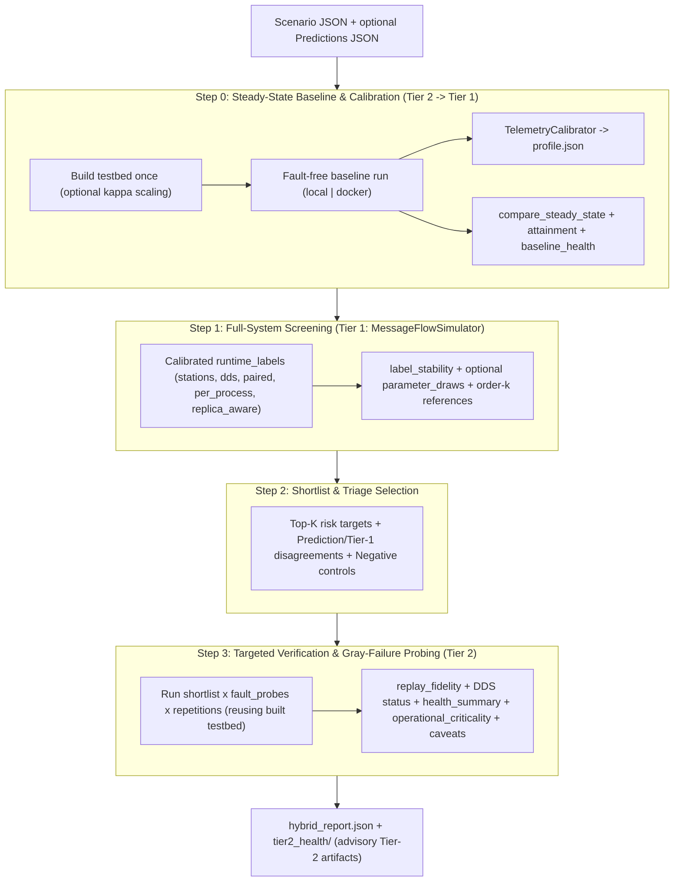

### The four steps

1. **Step 0 — Steady-state baseline & calibration:** Builds the testbed once under `<output>/testbed/` (optionally scaling topic rates by $\kappa \le 1$ via `--max-host-load` and writing `scaled_scenario.json` without mutating the input), runs a fault-free baseline (logging per-container CPU p95 in `docker` mode), fits `profile.json` via `TelemetryCalibrator`, checks steady-state fidelity (`compare_steady_state` and `study.attainment`), and records `baseline_health` (also written to `tier2_health/baseline.json`).
2. **Step 1 — Full-system Tier 1 screening:** Loads `profile.json` (unless `--skip-calibration`) and runs `runtime_labels` under the runtime/DDS engine (`deployment_model="stations"`, `qos_semantics="dds"`, `dds_status=True`, `estimator="paired"`, `rng_streams="per_process"`, `replica_aware=True`) with multi-seed stability, optional `--parameter-draws`, and order-$k$ references (`ref_flow_policy`, `ref_delivery_first_order`), writing `tier1_runtime_labels.json`.
3. **Step 2 — Shortlist & triage selection:** Combines **Top-*K*** targets (ranked by `--predictions` if supplied—accepting flat `{id: score}`, `saag-predict` GNN/RM JSON, `impact_scores.json`, or `runtime_labels.json`—or by Tier 1 `--tier1-label` otherwise), up to `--disagreements` targets with the largest normalized rank gap between predictions and Tier 1, and up to `--controls` lowest-Tier-1-impact negative controls (kept separate from primary rank correlations so tied zeros do not inflate Spearman $\rho$; declared sinks rank last among equal scores, because a sink's crash removes only its own receipts, which `observed_impact` excludes, so a sink control cannot fail), writing `shortlist.json`.
4. **Step 3 — Targeted Tier 2 verification & gray-failure probing:** Reuses the built testbed across every `(probe, target, repetition)`, replaying each testbed run in `MessageFlowSimulator` (`simulate_like`) and comparing the replay with the observed run: impact scored by `observed_impact` on both sides (`replay_fidelity`, via `compare_fault_response`), stall-set Jaccard, DDS communication statuses per repetition (`compare_dds_status`), schema-validated end-of-simulation health summaries (`health_summary`, `health_agreement` via `compare_health_summaries`), and Tier-2 observed operational criticality (`operational_criticality` per target and probe-level `ranking`, `tier1_vs_tier2`, and `replay_vs_tier2` comparisons via `compare_operational_criticality`). Standalone Tier-2 JSONs are written under `<output>/tier2_health/`. A probe that the testbed cannot emulate on a particular target (e.g. `omission` on a host in `docker` mode) is skipped for that target and listed under `skipped_targets` with an `unsupported_probe_targets` caveat. Apps whose stall disagrees get their trigger policy re-inferred from the faulted run (`policy_updates`; conflicting inferences go to `conflicting_policy_inferences`). Unsupported probes and structured caveats are recorded in `hybrid_report.json`.

### Gray-failure parity & caveats

| Fault probe | Tier 1 (`MessageFlowSimulator`) | Tier 2 (`docker` / `local`) | Recorded behaviour / caveat |
|:---|:---|:---|:---|
| `crash`, `transient_crash`, `freeze` | Supported | Supported (`docker kill`/`start`/`pause` or control file) | Full parity |
| `omission`, `babbling` | Supported | Supported (agent control file) | Full parity |
| `slowdown` | Scales service time (or period if station-less) | Control file; station-less apps not throttled identically | Emits `slowdown_stationless_divergence` caveat when probing station-less apps; use `--service-work cpu` for real host contention |
| `link_flap` | Instant reconnect on heal | `tc` ingress drop in `docker` mode (unsupported in `local`) | Emits `link_flap_rediscovery_lag` caveat (~6 s Cyclone DDS rediscovery lag) in `docker`, or skips as unsupported in `local` |
| `buffer_leak`, `redelivery_storm` | Supported | Unsupported | Skipped cleanly and recorded in `step3_tier2_verification.unsupported_probes` + `caveats` |

**Methodological boundaries recorded automatically in `hybrid_report.json["caveats"]`:**
- **`circular_reactive_policies`:** Under the default `reactive` mode, `policy_for` is shared between `MessageFlowSimulator` and testbed stubs, so cascade agreement checks timing/transport fidelity rather than independent app logic. Pass `--open-loop` for confirmatory non-circular transport checks.
- **`rate_scaled_latency_caveat`:** Triggered whenever `--max-host-load` forces $\kappa < 1.0$; utilization is preserved, but transport-to-service latency ratios are distorted.
- **`local_mode_no_dds_transport`:** Triggered under `--mode local`, which runs in-process over `LocalTransport` without containers or Cyclone DDS.
- **Construct alignment:** When validating an $I^*$-trained predictor (`FaultInjector`) against Tier 1/Tier 2 runtime impact, treat the comparison as an external construct/transferability check rather than a substitute for `FailureSimulator` release gates.

### Output directory & CLI examples

An invocation writes `<output>/{testbed/, tier1_runtime_labels.json, shortlist.json, hybrid_report.json, tier2_health/}` (plus `scaled_scenario.json` when $\kappa < 1$), where `tier2_health/` holds `baseline.json`, per-target `<probe>_<target>.json`, and `operational_criticality_ranking.json`.

```bash
# Quick local smoke check with crash + gray-failure omission probe (printing full Tier-2 health tables)
python cli/simulate_graph.py hybrid-verify --input data/scenarios/tiny_system.json --output output/hybrid/tiny --mode local --duration 20 --warmup 2 --seeds 42,123 --repetitions 1 --top-k 2 --controls 1 --fault-probe crash --fault-probe omission:duration=5,p=0.5 --show-health

# Container + Cyclone DDS verification (non-circular open-loop transport check with CPU contention)
python cli/simulate_graph.py hybrid-verify --input data/scenarios/atm_system.json --output output/hybrid/atm --mode docker --open-loop --service-work cpu --carry-payload --duration 60 --warmup 5 --seeds 42,123,456 --repetitions 3 --top-k 5 --disagreements 3 --controls 3 --fault-probe crash --fault-probe slowdown:duration=10,k=3
```

---

## 14. Operational health status and Tier-2 operational criticality

Code: [`saag/validation/health.py`](../saag/validation/health.py), schema: [`saag/validation/schemas/health_summary.schema.json`](../saag/validation/schemas/health_summary.schema.json) (Draft 2020-12).

To evaluate end-of-simulation system health and operational criticality in terms of **product-in-use (ISO/IEC 25019:2023)** identically on Tier 1 (`MessageFlowSimulator`) and Tier 2 (`saag/testbed`), `summarize_system_health(trace, plan, ...)` classifies every modelled component across all five types (`Node`, `Application`, `Topic`, `Broker`, `NetworkDevice`) into `healthy`, `degraded`, or `lost`:

- **Derived operational criticality (`derive_operational_criticality`):** Uses declared `criticality` (`CRITICAL`/`HIGH`/`MEDIUM`/`LOW`) on `Topic` and `Application` entities and derives operational criticality (with explicit `provenance` and `derived_from` source IDs) for infrastructure entities:
  - `Broker` ← max criticality of routed topics;
  - `Node` ← max criticality of resident applications, resident brokers, and resident application topics;
  - `NetworkDevice` ← max criticality of pub-sub flows traversing the device along shortest/ECMP paths (`saag.core.network.Fabric.ecmp_shares`), falling back to adjacent nodes when isolated.
- **System & component health:** Reports counts and shares overall, by type, by criticality level, and for `operational_critical` (`CRITICAL` + `HIGH`), together with per-component `health_score`, `reasons`, `redundancy_remaining`, `n_minus_0_critical_ids`, time-integrated availability, and `docker_cpu_p95` saturation.
- **ISO/IEC 25019 Product-in-Use health indices:** Computes `beneficialness` (critical sink mission continuity, criticality-weighted health index, critical topic timeliness), `freedom_from_risk` (zero-tolerance critical loss flag, safety-contract exposure seconds, critical redundancy depletion rate), and `acceptability` (critical SLA compliance and DDS status breaches), combined via domain stakeholder priorities $\vec{\omega}$ from `saag.core.quality_model.DOMAIN_PRIORITIES` into `overall_qiu_health_index`.
- **Tier-2 operational criticality (`observed_operational_criticality`):** Extracts trace-based counterparts of Tier 1's runtime labels (`i_flow`, `i_delivery`, `i_delivery_consumer`, `i_timeliness`, `i_recovery`) plus `qiu_impact` and `static_criticality`, enabling side-by-side Tier-1 vs. Tier-2 health agreement (`compare_health_summaries`) and criticality rank correlation (`compare_operational_criticality`).

---

## 15. Command line and REST API

**Command line.** The entry point is `cli/simulate_graph.py`, installed as `saag-simulate`. The full flag tables, with defaults, are in [cli-pipeline-guide.md, Step 5](cli-pipeline-guide.md#step-5-simulate).

| Subcommand | Engine | Writes |
|:---|:---|:---|
| `fault-inject` (the default) | `FaultInjector` | `impact_scores.json` |
| `edge-criticality` | `FailureSimulator` edge sweep | `edge_criticality.json` |
| `message-flow` | `MessageFlowSimulator` (one failure), including all runtime and DDS flags | `message_flow_results.json` |
| `runtime-sweep` | [Runtime engine](#runtime-labels-runtime-sweep) over all candidates | `runtime_labels.json` |
| `hybrid-verify` | [Hybrid two-tiered protocol](#13-hybrid-two-tiered-runtime-verification) (Tier 1 + Tier 2) | `hybrid_report.json`, `tier1_runtime_labels.json`, `shortlist.json`, `tier2_health/` |
| `testbed {build,run,calibrate,fidelity,health}` | [Emulated testbed](#12-emulated-testbed-calibration-and-fidelity) | the testbed directory (`deployment.json`, `telemetry/`, `run.json`, `profile.json`, `fidelity.json`, `health_summary.json`) |
| `combined` | `fault-inject`, then `message-flow` | both |

```bash
python cli/simulate_graph.py edge-criticality --input data/scenarios/atm_system.json --top-q 20 --export-json
python cli/simulate_graph.py combined --input data/scenarios/atm_system.json --seeds 42,123,456 --duration 60 --fault-node A0 --export-json
```

The whole-pipeline CLI `saag` (`cli/run.py`) runs `SimulateGraphUseCase` instead, choosing the service method with `--sim-mode` (default `exhaustive`).

**REST API.** All endpoints are `POST` under `/api/v1/simulation` ([`api/routers/simulation.py`](../api/routers/simulation.py)), run on Neo4j, and take `credentials` in the body. `FaultInjector` and `MessageFlowSimulator` are not exposed.

| Endpoint | Body fields | Runs |
|:---|:---|:---|
| `/event` | `source_app`, `num_messages` (100), `duration` (10.0) | `EventSimulator` |
| `/failure` | `target_ids`, `layer` (`system`), `cascade_probability` (1.0) | `run_failure_simulation` |
| `/exhaustive` | `layer` (`system`), `cascade_probability` (1.0) | `run_failure_simulation_exhaustive` |
| `/report` | `layers` (`app`, `infra`, `system`) | `generate_report` |

`/failure` is seeded, and the API has no seed field. With `cascade_probability` below 1.0 it therefore returns the same single draw on every call, not a sample or an average. For a spread, use the Monte Carlo method, which no endpoint exposes yet.

---

## 16. Output files

### `impact_scores.json` (`fault-inject`)

<!-- schema: impact_scores -->
```json
{
  "schema_version": "2.2",
  "graph_id": "atm_system",
  "topology_fingerprint": "92670795fd37e398",
  "labeler": "FaultInjector",
  "labeler_config": {"failure_model": "step", "propagation_threshold": 0.2, "qos_factor_mode": "ladder",
                     "network_gating": false, "replica_aware": false},
  "seeds_used": [42, 123, 456, 789, 2024],
  "labeled_node_types": ["Application", "Broker"],
  "labeled_dimensions": ["composite", "reliability"],
  "unlabeled_node_ids": ["L0", "L1", "L2"],
  "degenerate_node_types": [],
  "label_stability": {"n_seeds": 5, "mean_std": 0.02014, "max_std": 0.129898,
                      "test_retest_spearman": 0.968807, "topk_jaccard": 0.666667},
  "top_k_by_impact": [{"rank": 1, "node_id": "B4", "node_type": "Broker", "impact_score": 0.7662}],
  "records": {
    "B4": {"node_type": "Broker", "impact_score": 0.7662, "impact_score_std": 0.0014,
           "cascade_depth": 2, "total_orphaned_topics": 21, "total_impacted_subscribers": 22,
           "seed_impact_scores": {"42": 0.7669, "2024": 0.7637}}
  }
}
```

Read labels from `records[*].impact_score`. `unlabeled_node_ids` lists nodes that were never injected; they are unmeasured, not zero.

`labeler_config` states every setting that changes a label, and `topology_fingerprint` hashes the topology the labels were measured on. `cli/train_graph.py` uses them to refuse the wrong file: labels from another topology, or labels that do not reproduce across seeds ([flags](cli-pipeline-guide.md#step-3b-train-gnn)).

### `message_flow_results.json` (`message-flow`)

<!-- schema: message_flow_results -->
```json
{
  "schema_version": "2.0",
  "graph_id": "atm_system",
  "simulation_duration": 60.0,
  "system_delivery_rate": 0.984,
  "qos_mode": "full",
  "target_utilization": 0.65,
  "utilization_mode": "per_subscriber",
  "measured_utilization": {"A0": 0.2917},
  "golden_signals": {
    "latency": {"p50_ms": 3.553, "p95_ms": 26.067, "mean_queue_wait_ms": 0.89},
    "errors": {"deadline_violations": 1559, "queue_overflows": 239},
    "saturation": {"cpu_utilization": 0.3682, "peak_queue_occupancy": 1.0}
  },
  "fault_event": {
    "fault_time": 30.0,
    "faulted_node_id": "A0",
    "delivery_rate_before": 0.9825,
    "delivery_rate_after": 0.7098,
    "i_dyn": 0.272716,
    "latency_p95_before": 19.11,
    "latency_p95_after": 23.62,
    "per_topic_i_dyn": {"T1": 1.0}
  }
}
```

`runtime_config` and `dds_status` appear only when a non-default option is set.

### Other files

| File | Written by | Contents |
|:---|:---|:---|
| `edge_criticality.json` | `edge-criticality` | Run metadata (`top_q`, `n_evaluated`, `n_nonzero`) and `edge_criticality`, one entry per candidate: `source`, `target`, `relationship`, `flow_impact`, `connectivity_impact`, `combined_impact` (= I_edge), `level`, `evaluated` |
| `runtime_labels.json` | `runtime-sweep` | [Runtime labels](#runtime-labels-runtime-sweep) |
| `hybrid_report.json` & `tier2_health/` | `hybrid-verify` | [Two-tiered hybrid report](#13-hybrid-two-tiered-runtime-verification) (`step0_calibration` incl. `baseline_health`, `step1_tier1_screening`, `step2_shortlist`, `step3_tier2_verification` incl. `health_summary`, `health_agreement`, `operational_criticality`, `caveats`) plus standalone `tier2_health/{baseline.json, <probe>_<target>.json, operational_criticality_ranking.json}` |
| Testbed directory | `testbed` | [Plan, telemetry, profile, fidelity and health summary](#12-emulated-testbed-calibration-and-fidelity) (`health_summary.json` conforms to `saag/validation/schemas/health_summary.schema.json`) |

---

## 17. Worked examples

### Air traffic management, by hand

<!-- doc-test: assert -->
```python
import networkx as nx
from saag.simulation.fault_injector import FaultInjector

g = nx.DiGraph()
for app in ("RadarTracker", "ConflictDetector", "FlightDataProcessor", "ATCWorkstation"):
    g.add_node(app, type="Application")
g.add_node("ASTERIX_Broker", type="Broker")
for t in ("T_radar", "T_tracks", "T_fpa", "T_conflicts"):
    g.add_node(t, type="Topic")
    g.add_edge("ASTERIX_Broker", t, type="ROUTES")
for u, v, kind in [
    ("RadarTracker", "T_radar", "PUBLISHES_TO"), ("RadarTracker", "T_tracks", "PUBLISHES_TO"),
    ("ConflictDetector", "T_radar", "SUBSCRIBES_TO"), ("ConflictDetector", "T_tracks", "SUBSCRIBES_TO"),
    ("FlightDataProcessor", "T_tracks", "SUBSCRIBES_TO"), ("ATCWorkstation", "T_tracks", "SUBSCRIBES_TO"),
    ("FlightDataProcessor", "T_fpa", "PUBLISHES_TO"), ("ATCWorkstation", "T_fpa", "SUBSCRIBES_TO"),
    ("ConflictDetector", "T_conflicts", "PUBLISHES_TO"), ("ATCWorkstation", "T_conflicts", "SUBSCRIBES_TO"),
]:
    g.add_edge(u, v, type=kind)

records = FaultInjector(g, seeds=[42, 123, 456, 789, 2024]).run().records
scores = {n: round(r.impact_score, 4) for n, r in records.items()}
assert scores == {"RadarTracker": 1.0, "ASTERIX_Broker": 1.0, "ConflictDetector": 0.1111,
                  "FlightDataProcessor": 0.1111, "ATCWorkstation": 0.0}
assert records["RadarTracker"].cascade_waves[0].newly_failed_publishers == [
    "ATCWorkstation", "ConflictDetector", "FlightDataProcessor"]
```

Failing `RadarTracker` takes two waves. All three subscribers fail in the first one, including `ATCWorkstation`, whose loss of 1/3 is already above θ = 0.2. The topics they publish go silent in the second:

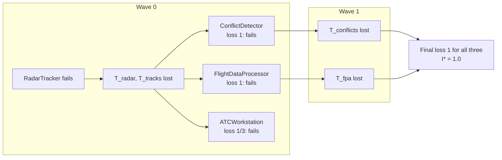

| Component | I\* | Cascade depth | Why |
|:---|:---|:---|:---|
| `RadarTracker` | 1.000 | 2 | Sole source of radar and tracks, as drawn above |
| `ASTERIX_Broker` | 1.000 | 1 | Sole router of every topic, so all feeds are lost in wave 0 |
| `ConflictDetector` | 0.111 | 1 | `ATCWorkstation` loses 1 of its 3 feeds: loss 1/3, averaged over the 3 subscribers |
| `FlightDataProcessor` | 0.111 | 1 | Same |
| `ATCWorkstation` | 0.000 | 0 | A pure sink: its failure harms no other subscriber |

### One system, three oracles: `av_system`

These values are computed on the current corpus (152 nodes, 730 edges): I\* with 5 seeds, I_comp exhaustive, and I_dyn from single-seed 60 s runs. Values are means per type.

| Type | Count | I\* | I_comp | I_dyn |
|:---|:---|:---|:---|:---|
| Node (host) | 8 | 0.953 | 0.287 | — (not observable) |
| Library | 20 | 0.947 | — (not swept) | — (not observable) |
| Broker | 4 | 0.960 | 0.104 | — (not observable) |
| Application | 80 | 0.193 | 0.013 | 0.010 |

The oracles rank different strata. I\* puts libraries, brokers and hosts near the top, because each one's failure removes many feeds at once. I_comp emphasises hosts, through fragmentation and stranded capacity. I_dyn only sees components that carry traffic in the published engine; `deployment_model="stations"` makes brokers and hosts observable.

---

## 18. Research context

**Oracle names in the JSS manuscript (§4.3):**

| Engine | Name in the paper | Role in the paper |
|:---|:---|:---|
| `FaultInjector` | Cascade reachability oracle, I\* | Primary target |
| `FailureSimulator` | Multi-metric composite oracle, I_comp; relationship removal oracle, I_edge | Validate and Prescribe |
| `MessageFlowSimulator` | Dynamic queue-flow oracle, I_dyn | Second oracle; research probe |
| `ChangePropagationSimulator` | Change-propagation oracle, I_M | Maintainability reference |

**The order-k reference criterion (§4.4).** Let oracle O propagate a failure in waves, and let T_k(O) be the same computation stopped after wave k. A ranking that equals T_k(O) after a fixed set of simplifications is a **reference** for O, not a predictor: agreeing with O shows it recovers O's rule, not predictive skill. The simplifications are expectation instead of stochastic draws (S1), no QoS severity multipliers (S2), no queueing (S3), uniform rates and normalisers (S4), and counting affected components instead of summing their losses (S5).

The references in the study are:
- for I\*: Analytic I\* (first order), InDeg (the support of the first wave) and Reach (unbounded);
- for I_dyn: the rate-weighted first-order expansion, Eq. 7, where r_t is the declared rate of topic t:

$$\hat I^{\text{rate}}_{\text{dyn},1}(v) = \sum_{t \in \text{pub}(v)} \frac{r_t}{|\text{pub}(t)|}\,|\text{sub}(t)|$$

The simulator's own accounting also leaves v's readership out of the denominator. Because both oracles do most of their damage in the first wave, these low-order truncations capture most of their signal.

**Headline numbers, each with its setup and source:**

| Quantity | Value | Setup | Source |
|:---|:---|:---|:---|
| ρ(I_dyn, I\*) | 0.711 | Five seeds, full Application population, 12 folds | Manuscript §7 (§4.3) |
| ρ(I_dyn, I\*) | 0.627 (Kendall τ 0.493, top-K Jaccard 0.370 vs 0.111 chance) | Single seed, at most 30 candidates per fold | Supplementary, convergent validity; `results/convergent_validity.json` |
| I_dyn labelling cost | 12.7 CPU-hours, 355.6 Wh | Five seeds, whole corpus | Manuscript §7 |
| I\* test-retest | 0.811–1.000 (median 0.982) | Five seeds, 12 folds | Supplementary |
| I\* without QoS scaling vs with | ρ = 0.965 | Application ordering, 12 folds | Manuscript §4 |
| References vs I\* | Analytic I\* 0.808, InDeg 0.764, Reach 0.732; best learner ≤ 0.748; Topo-QoS 0.553 | LOSO, 12 folds | Manuscript §7 |
| Eq. 7 vs I_dyn | 0.830; learned approximation 0.799; rate-fed graph networks ≤ 0.665 | LOSO | Manuscript §7 |
| Latency and deadline change vs I_dyn | ρ = −0.499 and −0.418 | Contention relief | Supplementary |
| RM attribution vs I_comp | 0.566 (Applications), 0.119 (Brokers), 0.244 (Nodes); 0.098 pooled | The reason the study stratifies by type | Supplementary |

**Learners and I_M.** I\* observes runtime reachability, not maintainability. Learners therefore mask the maintainability column of their targets with `dimension_mask` (`[True, True, False]` under `FaultInjector`; the paper writes the two-head form m = [1, 0]). See [prediction.md](prediction.md).

**Quality-model alignment** ([quality-model.md](quality-model.md)):

| ISO/IEC 25010 | Observed as | Engine |
|:---|:---|:---|
| Reliability | Feed-loss cascade (I\*); path reachability loss (RL) | `FaultInjector`, `FailureSimulator` |
| Availability, fault tolerance | Fragmentation and stranded volume (FR), the IA and IFT decompositions | `FailureSimulator` |
| Capacity | QoS-weighted throughput loss (TL) | `FailureSimulator` |
| Time behaviour | Delivery loss under contention (I_dyn) | `MessageFlowSimulator` |
| Maintainability | Upstream change ripple (I_M) | `ChangePropagationSimulator` |

All labels in the framework are simulator-derived. No oracle has been validated against production outages; the [emulated testbed](#12-emulated-testbed-calibration-and-fidelity) is the first comparison with observed behaviour, on emulation.

---

## 19. Known limitations

| | Limitation | Consequence |
|:---|:---|:---|
| **L1** | I\* and the published I_dyn are first-order by construction. `FaultInjector`'s wave 0 is deterministic, and published `MessageFlowSimulator` publishers ignore their inputs. | Low-order references recover most of their signal ([§14](#18-research-context)). The [runtime engine](#10-runtime-engine) is the opt-in alternative. |
| **L2** | I_dyn is one-dimensional: delivery loss only. | Contention relief would cancel a latency term ([§6](#6-messageflowsimulator-queue-flow-oracle-i_dyn)). |
| **L3** | The published engine's deadline is a latency drop, not DDS DEADLINE. | QoS "deadline" effects in I_dyn rest on that rule ([DDS arm](#11-dds-qos-semantics-and-status-metrics)). |
| **L4** | Sweeps inject one failure at a time. | Joint outages need `run_failure_events`, `FailureScenario(target_ids=[…])` or a `faults` list. |
| **L5** | Under the default `--node-types`, `Topic` and `Node` are not injected. Without `deployment_model="stations"`, the published `MessageFlowSimulator` cannot observe brokers or hosts. | Those strata are unmeasured, and must be reported as undefined, never as 0. |
| **L6** | Sinks score I\* = 0. | Terminal consumers look harmless under I\*; `i_flow` charges them their own loss. |
| **L7** | All labels are simulator-derived. | The testbed comparison is on emulation, not production. |

---

## What comes next

- **[Step 3: Predict](prediction.md).** Train rankers on the I\* labels.
- **[Step 6: Validate](validation.md).** Compare predictions with the oracles.
- **[Step 7: Prescribe](prescription.md).** Verify candidate refactorings with `FailureSimulator`.

← [Step 4: Diagnose](diagnosis.md) | → [Step 6: Validate](validation.md)
